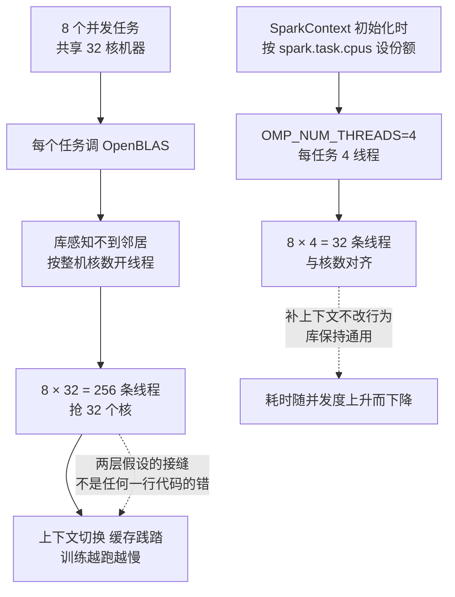

# 案例二十五：库自带了一支军队——OpenBLAS 的隐式线程

**缺陷不在任何一行业务代码里，可 CPU 就是超配了——因为库自己拉起了一支线程军队**。**读完这篇你能查出这类隐式线程，也知道并发度和线程数该怎么一起设**。

> **要点**：执行器 JVM（Java 虚拟机，Java 程序的运行时）**没设 OMP_NUM_THREADS 时，Spark ML（分布式计算引擎 Spark 的机器学习库）每个并发任务调 OpenBLAS 都按整机核数拉起线程**——**8 个并发任务 × 32 核 = 256 条线程抢 32 个核，CPU 超配、互相拖累，训练越跑越慢**。缺陷不在任何一行业务代码里。

## 要解决的问题：案例背景

**项目**：Apache Spark——**Spark ML 的矩阵运算底层交给 OpenBLAS 这个本地数学库**，BLAS 库为了榨干硬件，会**自动按机器核数开多线程**做矩阵乘法。

问题出在 Spark 的执行模型和 BLAS（Basic Linear Algebra Subprograms，基础线性代数库：矩阵乘法等运算的标准接口） 的自动并行**叠在一起**：**一台 32 核的机器跑 8 个并发任务，每个任务调 OpenBLAS 时都以为自己独占整机，各自拉起 32 条线程**——**8 × 32 = 256 条线程抢 32 个核**。**上下文切换（CPU 从一个任务换到另一个任务、保存并恢复现场的过程）、缓存互相践踏、锁竞争（多个执行流争抢同一把锁造成的等待开销），训练不升反降**

把账算出来，超配一目了然：

```text
32 核机器 × 8 个并发任务
每个任务调 OpenBLAS：自动按整机核数开 32 线程
合计：8 × 32 = 256 线程 抢 32 个核
修复后：OMP_NUM_THREADS 按任务份额限制 → 8 × 4 = 32 线程
```

两层并行假设叠加后的线程账，修复前后的对照：



图：超配的完整链条——左边是缺陷路径——**两个各自成立的假设（任务级并行就够、库独占机器）在接缝处叠加成 256 抢 32**；右边是修复路径——**调用方在进程启动前把任务份额写进环境变量，库的自动多线程保留、只把基数从"整机核数"换成"应得份额"**。虚线标注修复的分寸——**补的是库感知不到的上下文，库行为不变**。
（[上游 commit 3b9cca7a](https://github.com/apache/spark/commit/3b9cca7aa32f659ea7413abeb373fe7ed069e6f7)，P2，已真实复现）。

这一簇缺陷的本质是**资源的归属与账目分离**：**线程是本地库开的，记在调用方进程的账上，而调用方（执行器）对自己的资源预算一无所知——两层各自合理，合起来超配**。**认清这一点之后，防线就不在业务代码里，而在两层之间的边界上：谁引入本地库，谁负责把它拉起的并发纳入自己的配额**。

## 初看这段代码会冒出哪两个疑问

1. **OpenBLAS 自动多线程本身没有错，错在按"整机核数"开**——**它不知道自己活在进程里、还有别的任务在跑。单任务场景这个默认值确实快**。

2. **为什么缺陷"不在任何一行业务代码里"？** 用户的代码、Spark 的调度代码都没写错——写错的是**两层并行设计的叠加假设**：**Spark 假设"任务级并行就够了"，OpenBLAS 假设"我独占机器"**。

**两个假设各自成立，叠起来就是 CPU 超配**。


来源：[小林coding《进程、线程基础知识》](https://www.xiaolincoding.com/os/4_process/process_base.html)

## 隐式并发的结构原因是什么：库看不见调用方

BLAS 库自动开线程是**对单进程科学计算的正确设计**——**Fortran 时代延续至今的传统，单独跑一个线性代数程序就该这么做**。它坏在嵌入环境：库通过环境变量感知机器，**感知不到调用方的并发模型**。**Spark 的任务调度、PythonRunner、Mesos 资源管理各自处理自己的并发，没有任何一层告诉 OpenBLAS"你只分到一个任务的份额"**。

**这和案例五的安全依赖、案例七的打包依赖是同族**：**第三方库是黑盒（不接触代码内部、只看输入输出的测试或分析方式），它的隐式行为（自动线程、自动缓存、自动降级）全部依赖"它对运行环境的假设"**——降级（服务受限时主动放弃部分功能保住核心）即主动牺牲部分功能或精度，保住核心链路。**假设不成立时，故障不在库的代码里，也不在你的代码里，在两层假设的接缝上**。

「每个灶都按满灶眼开火」的实物原型是中餐后厨的猛火灶：**单灶设计按"这口灶独占整条燃气管"给火力，一排八口灶同时开工、个个开到最大，总管气压立刻不足，每口灶的火都反而小了**——**火力的"账"要有人按灶眼分，锅才烧得旺**：


*图源：Wikimedia Commons，作者 KellyB.，CC BY 2.0，https://commons.wikimedia.org/wiki/File:Flaming_wok_by_KellyB_in_Bountiful,_Utah.jpg。*

**OpenBLAS 就是那口按独占管路设计的灶：单任务场景火力十足（Fortran 时代的正确设计），八口灶（八个并发任务）同开时没人分账**——`OMP_NUM_THREADS` 就是燃气公司按灶眼分的那笔账：每灶四分之一的气压，八口灶同时旺。

## 这类问题还在哪儿出现过

和 [[工程知识/缺陷分析：从个案到体系/兼容与升级/案例七：兼容与性能——滞后的依赖与放大的日志]] 的日志刷屏病例最近亲：**那次是"同一份资源画像反复登记"，日志与对象开销双涨；这次是"每个任务都按整机核数开线程"，CPU 与切换开销双涨**。共同的不变量：**重复的、未被约束的资源索取，在共享环境里必然互相践踏。** 和案例十二（写锁不释放）对照也有意思：**那是"资源少释放了一份"，这是"资源多索取了 N 倍"——资源记账的两个方向**。

## 上游怎么修

修复（[上游 commit 3b9cca7a](https://github.com/apache/spark/commit/3b9cca7aa32f659ea7413abeb373fe7ed069e6f7)）在 SparkContext 的初始化路径：**未显式配置时，按 spark.task.cpus 自动设置 OMP_NUM_THREADS**，**把 OpenBLAS 的线程数限制在一个任务应得的份额。用户显式配置了就尊重用户**。**这个修法只补上下文：不给库打补丁，不改变库的行为，只是替库补上它感知不到的调用方上下文，库保持通用，调用方负责把环境告诉它**。

**线程总数要与并发任务数对账**——**预写在已知核数的机器上跑多个并发任务时线程总数应受核数约束，实测为任务数与核数之积，与预期对不上**。

## 这套说法在哪儿会失效，代价换来了什么教训

- **每个会自动开线程的本地库（OpenBLAS、MKL、libgomp）都要问一句**：它知道自己的并发邻居有多少吗？环境变量是不是在进程启动前就设好了？
- **两层并行叠加时，乘法要自己算**：任务数 × 每任务线程数 ≤ 核数。任何一层"自动用满"都会在叠加时超配。
- **性能缺陷的定位要看线程数，不只看 CPU 利用率**。**利用率 100% 可能是 32 条线程在干活，也可能是 256 条线程在打架**——`top -H` **看线程级分布，一眼区分**。**量到线程级之后，还要看清这些线程把时间花在哪：火焰图（按调用层级堆叠的耗时分析图、越宽的块越耗时）按占用时间把调用栈摊开，宽度就是时间占比，超配带来的争用会直接显形**。


*图示：CPU 火焰图的形态：宽度是占比、纵向是调用栈深度。图源：[Brendan Gregg · CPU Flame Graphs](https://www.brendangregg.com/FlameGraphs/cpuflamegraphs.html)。*
- **修复动作只有"补上下文"**，是嵌入第三方库时最干净的一种修法：库保持通用，调用方负责把环境告诉它。


## 怎么自己动手验证

1. 上游对照：**到 Spark 的提交 3b9cca7a 里核对修复方式，确认执行器的数学库线程数被限制到任务份额对应的数量**。
2. 线程数核算：**在一台已知核数的机器上跑 N 个并发训练任务，用线程列表核对实际线程总数，修复前为任务数与整机核数之积、远超核数，修复后与核数相匹配**。

3. 训练耗时对照：**固定数据与并发度，测量修复前后的训练耗时与上下文切换次数，修复前 CPU 超配导致耗时上升，修复后随并发度上升而下降**。
4. 来源定位：**确认线程由本地数学库依据环境变量自动发起，业务代码与调度代码中没有任何一处显式创建这些线程**。
5. 断言锚点：**环境变量在部署时被显式设置，任务数、核数与线程数三者关系有实测记录，两层并行假设的叠加点被写明**。

## 用了能拿到什么，要付什么代价

**把自动开线程的本地库与调用方并发模型放在一起核算，换来的是任务数与每任务线程数的乘积在上线前就有上界，超配导致的互相拖累可以在线程级分布里被识别**。**代价是个案的根因位于两层假设的接缝上，需要追到上游提交的修复位置，环境变量还要在进程启动前设置才能生效**。

## 接着读哪几篇：同在缺陷分析里的相邻问题
[[工程知识/缺陷分析：从个案到体系/性能/案例二十四：并行度被自己折叠——repartition 的 2 的幂倾斜.md]]

- 进程线程的执行边界——[[工程知识/性能工程：从用户等待到资源瓶颈/操作系统与运行时/进程线程与系统调用构成执行边界]]。
- CPU 超配为什么拖慢一切——[[工程知识/性能工程：从用户等待到资源瓶颈/处理器与内存/CPU性能来自有效执行与数据供给]]。
- 任务并发与资源份额——[[工程知识/后端系统：在并发、失败与变化中维持服务/任务与并发/调度必须同时处理优先级、公平与背压]]。
- [[工程知识/缺陷分析：从个案到体系/兼容与升级/案例七：兼容与性能——滞后的依赖与放大的日志]] · [[工程知识/缺陷分析：从个案到体系/稳定性/案例十二：调度线程的永久等待——广播写锁不释放]] · [[工程知识/缺陷分析：从个案到体系/缺陷分析：从个案到体系——导读与开源地图]]
