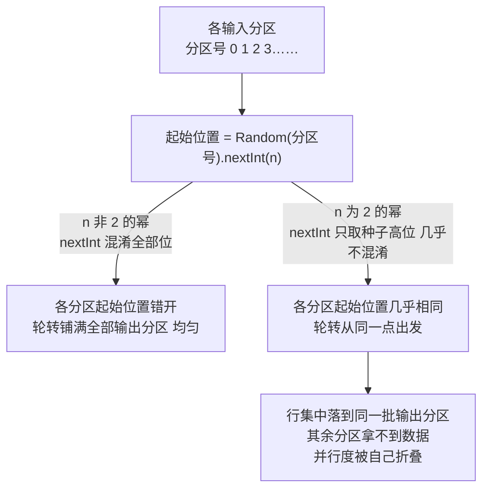
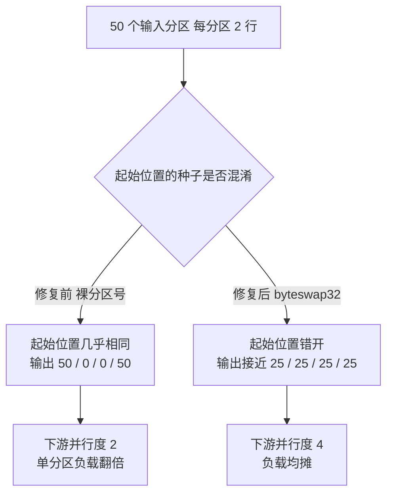

# 案例二十四：并行度被自己折叠——repartition 的 2 的幂倾斜

**拖慢作业的正是用户自己指定的那个"健康"分区数**。读完这篇你能看出 2 的幂在重分区时为什么会造成倾斜（数据或负载集中到少数节点），以及怎么绕开。

> **要点**：df.repartition(n)（不带 key 参数）的分区数恰好是 2 的幂时，各输入分区的起始写入位置几乎相同，数据只进入少数输出分区——下游并行度减半、单分区负载成倍：**拖慢作业的是用户自己指定的那个"健康"数字**。

## 要解决的问题是什么：repartition 后并行度为什么被折叠

**项目**：Apache Spark——`repartition(n)` 是最常用的数据重分布手段：把数据均匀散到 n 个分区，下游按分区并行。

**用户对它的预期是均匀，Spark 的实现却有一个只对 2 的幂触发的隐患**。Spark 是分布式计算引擎，在内存中执行 DAG（Directed Acyclic Graph，有向无环图：任务依赖关系的常用表达）任务。

内部用来决定"从哪个位置开始轮转写入"的随机数，在模数为 2 的幂时退化：**各输入分区算出的起始位置几乎相同，轮转从同一个点出发，数据成片地涌进少数输出分区**（[上游 commit 18e83f9a](https://github.com/apache/spark/commit/18e83f9ab234e2e475842c70f191d90e4dd6e00d)，SPARK-40407，已真实复现）。

## 初看这段代码会冒出哪两个疑问

1. **repartition 不就是为了让数据均匀吗？** 怎么反而自己制造了倾斜？
2. **2 的幂不是性能调优的经典数字吗？** 缓存、缓冲区全用 2 的幂，怎么到分区数就成了坑？

**两个疑问的答案在"轮转的起点怎么定"这个常被忽略的实现细节里**。

来源：[稀土掘金《深度解析 Raft 分布式一致性协议》](https://juejin.cn/post/6907151199141625870)（CC 4.0 BY-SA）

## 它是怎么做到的：轮转的起点被随机数折叠

*图示：Spark 的集群结构——Driver 拆分作业，任务落到各 Executor 上执行。图源：Apache Spark 官方文档《Cluster Mode Overview》，Apache-2.0，https://spark.apache.org/docs/latest/cluster-overview.html。看得见的是节点数，决定并行度的是分区数：图上每个 Executor 能同时跑的任务由核数定，而任务总数由分区数定——下面这次坍缩就发生在"分区数看着没变、实际被折到少数几个"上。*

`repartition(n)` 不带 key 参数时走 RoundRobinPartitioning：每个输入分区给自己负责的行连续编号，编号交给 HashPartitioner 对 n 取模，落到 n 个输出分区。**只要各输入分区的**起始编号**错开，所有行就均匀铺满 n 个分区**。

起始编号由 `new Random(分区号).nextInt(n)` 给出：种子是分区号，nextInt 对同一个种子返回同样的值——确定性本身没问题，**问题在 Java Random 的 nextInt 实现对 **n 为 2 的幂**有一条特殊路径：直接取种子的高几位、几乎不做混淆**。分区号是 0、1、2……这样的连续整数，高几位的相关性极强，于是**每个输入分区算出的起始位置几乎一样**。

图：倾斜的成因链——**问题在随机数的实现细节**——n 为 2 的幂时起始位置不再随机，确定性种子加无混淆，各分区的"随机"起点坍缩成了同一个点。

上游 commit 给的实测最直白：50 个输入分区、每分区 2 行、repartition(4)，输出是 `50,0,0,50`——**分区 1 和分区 2 完全没有数据**；而 `(1 to 200).foreach(i => print(new Random(i).nextInt(4)))` 打印出来的全是同一个数。**n=2、4、8、16、32 逐个试，全部如此**；n 为非 2 的幂时起始位置正常错开。

这解释了缺陷的隐蔽性：**同一份代码，n=250 均匀，n=256 倾斜**——相邻的两个配置，一个正常一个灾难。用户怎么也想不通，自己只是把 250 调成了"更整"的 256。

隐蔽性还来自另一个方向：配置惯例里 2 的幂占主流——缓冲区大小、哈希表容量、按 2 的幂取整的地址布局都推荐它，于是"调到 256"看起来像是把配置调得更规范。**同一个数字在一种场景里是优化，在另一种场景里触发退化**——"边界与教训"一节单独列了这一条。

## 这类问题还在哪儿出现过

和 [[工程知识/缺陷分析：从个案到体系/兼容与升级/案例七：兼容与性能——滞后的依赖与放大的日志]] 的三个病例同族但机制不同：那三条是"该做的没做"（依赖没升级、重复登记、下推失效），这一条是"**一个只在特殊参数下坍缩的随机性**"。**随机性看似均匀，确定性种子加特殊路径能让它整体失效**。[[工程知识/缺陷分析：从个案到体系/正确性/案例二：静默错算——Spark SQL Union 的别名陷阱]] 的别名删除也是同一形状：一次自以为安全的改写，前提在特定输入下不成立，代价在前提塌掉的那天出现。**性能缺陷和安全缺陷一样，要审"优化的隐藏前提"，不是审"代码写没写错"。**

## 上游怎么修

修复位于 ShuffleExchangeExec.scala：把起始位置的种子从裸分区号换成 `hashing.byteswap32(分区号)`——**先用位交换打散种子，再交给 Random**。nextInt 的 2 的幂特殊路径还在，但它拿到的高位已经被混淆，各分区的起始位置恢复错开。修复同时更新了 Dataset 与 AQE（Adaptive Query Execution，Spark 的自适应查询执行） 的测试套件——**把"2 的幂分区数"固化为倾斜回归用例**。

同一个 repartition(4) 在修复前后给出两种分布：种子未混淆时输出是 50、0、0、50，混淆后四个分区各自接近 25，差别直接换算成下游并行度。

分布从两格变四格，下游并行度翻一倍、单分区负载减半，这就是相邻两个分区数一个正常一个灾难的实测形态。

分区均匀性要与相邻配置对照对账——**预写相邻两个分区数下各分区记录数应接近，实测其中一个的记录只进入少数分区，与预期对不上**。

## 这套说法在哪儿会失效，代价换来了什么教训

- **随机性的均匀要审"种子的均匀"**。`new Random(连续整数)` 的种子空间与 n 为 2 的幂的取位路径叠加，**均匀性会整体坍缩**——用确定性随机时，**先检查它对特殊参数的行为**。
- **"2 的幂"对缓冲区是对的，对随机数边界不一定对**——同为经典数字，适用场景不同，**别互相类推**。
- **倾斜的监控要看"分区内行数的最大/中位数之比"**。倾斜时总吞吐可能完全正常，比值才暴露真相：**总吞吐是全体分区的合计，少数分区超载会被多数分区的空闲抵消；决定作业完成时间的是最慢的那个分区，最大/中位数之比直接反映这个差距**。
- **按 key 重分布是应用层的自救手段**：`repartition(n, "col")` 走哈希（把任意长度数据压成固定长度指纹、不可逆）分区路径，**不经轮转起始位置这条链路——修复到来之前就能止血**。

## 怎么自己动手验证

1. 上游对照：到 Spark 的提交 18e83f9a 里核对修复方式，**确认种子混淆（byteswap32）让各输入分区的起始位置不再坍缩**。
2. 相邻配置对照：用同一份数据分别按 n=250 与 n=256 做 repartition，**修复前后者只进入少数分区、下游并行度减半且单分区负载成倍，修复后两者分布接近**。

3. 起点复现：在同一环境打印 `new Random(i).nextInt(256)`（i 取连续整数），**修复前的实现下各 i 的返回值几乎相同——起点坍缩的直接证据**。
4. 分布核对：统计每个分区的记录数与字节数，**确认倾斜分区与均匀分区的差距**。
5. 断言锚点：**分区数与每分区记录数的对应关系有实测数据，同一份数据在不同分区数下的分布差异可对照**。

## 接着读哪几篇：同在缺陷分析里的相邻问题

- 随机数与确定性的边界——[[工程知识/软件构建：让变化可以理解、验证与交付/算法与数据结构/算法复杂度连接规模与资源成本]]。
- 倾斜如何破坏并行假设——[[工程知识/性能工程：从用户等待到资源瓶颈/处理器与内存/CPU性能来自有效执行与数据供给]]。
- 调度对负载均衡（把请求分摊到多台服务器、避免单点过载）的要求——[[工程知识/后端系统：在并发、失败与变化中维持服务/任务与并发/调度必须同时处理优先级、公平与背压]]。
- [[工程知识/缺陷分析：从个案到体系/兼容与升级/案例七：兼容与性能——滞后的依赖与放大的日志]] · [[工程知识/缺陷分析：从个案到体系/正确性/案例二：静默错算——Spark SQL Union 的别名陷阱]] · [[工程知识/缺陷分析：从个案到体系/缺陷分析：从个案到体系——导读与开源地图]]
