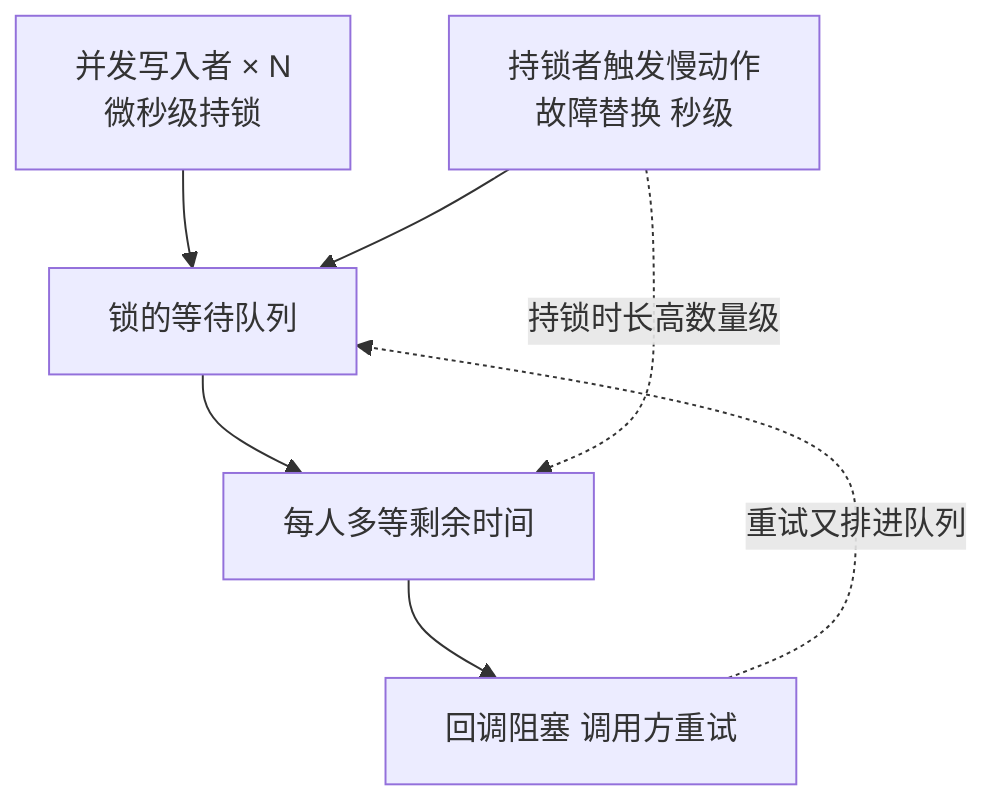
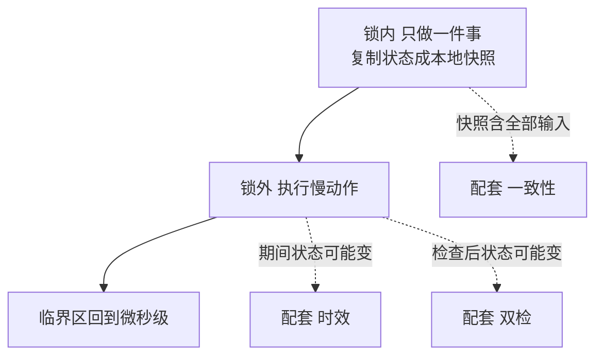

# 锁内的长动作：临界区里藏着的延迟放大器

> **要点**：**持锁线程在临界区里做了一个可能很慢的动作（故障切换、网络调用、重试），同一把锁的全部等待者被拖着一起慢**——**锁保护了数据一致性，代价是把这个慢动作放大成所有排队者的延迟**。

## 要解决的问题

锁的正确用法有一条隐含约定：**临界区要短**。**这条约定的执行靠自觉，而"短"的判断经常失准**——**代码评审时看一眼，"就是更新几个字段，很短"，实际运行中某个分支里藏着一次网络调用、一次磁盘同步、一次可能重试的远程操作**。**日常负载下藏着的慢路径从不触发，缺陷潜伏；故障注入（主动向系统注入故障来验证容错能力的测试方法）或真实故障来临的那个瞬间，慢路径被踩中，锁的等待队列全体陪葬**。

Apache BookKeeper 的一个真实病例（上游修复 commit 84ca507b，可查）是标准样本：**客户端写入遇到 bookie 故障需要替换时，处理故障的代码在持有账本元数据锁的状态下直接执行整个替换流程（下线旧副本、发起 ensemble 变更、等待新写集合就绪）**。**同一账本的所有并发写入都在等这把锁——替换要多久，写入的完成回调就阻塞多久，append 长时间不返回**。上游修复只有一个动作：**在锁内只取出失败 bookie 的副本信息，释放锁之后再执行替换与变更**。

**本文讲清楚三件事：慢动作为什么必须移出临界区、什么算"慢动作"、移出之后要补什么**。

## 一次慢动作为什么拖住所有人：锁的等待队列是延迟的乘法器

先把形状说成一件事：**锁像银行网点里唯一对外的综合柜台——所有人排一条队，柜员办谁的时，后面的人一步都动不了**。平时柜员每单几秒钟（微秒级的字段更新），队伍流动很快；**某天轮到一位要现场补办全套证件的客户，这一单办了半小时，后面排队的每个人都被多等了半小时**。**柜台的规矩（保护数据一致性）没有变，变的是某一单的时长，队伍的每个成员各自承担一遍**。这个比喻到"各自承担一遍"为止——**现实里银行客户可以走人改天再来，被锁住的写入线程走不了，还会触发调用方的超时重试、把更多请求压进队列，延迟与负载互相推高**，这是比喻之外要单独讲的恶化链条。

**等待的传递关系是理解放大器的关键**：**一个线程等另一个线程持有的锁，后者又在等第三个，等待沿链传递，每次持锁时长都被后面所有人各承担一遍**。


*图示：等待的传递结构（来源：perfmatrix 线程转储分析页）。持锁时长被等待链上的每个人各承担一次，这就是放大的来源。*

把账本元数据锁的供需两边摆出来，放大器的结构一目了然。

**需求侧**：**同一账本上的每次写入都要短暂持锁——更新写集合、登记在途项**。**单次持锁的本来耗时是微秒级，并发写入者排队等待，每人多等一个"当前持锁者的剩余时间"**。

**供给侧**：**故障处理分支持锁的时间是"整个替换流程"——跨网络的副本协商、可能的重试、可能秒级的等待**。**这个数字比正常持锁高三到六个数量级**。

**乘法发生在排队上：锁是串行点，持锁者慢 100 毫秒，排在这个慢动作之后的每个等待者都要等满这 100 毫秒再排队，越往后等待时间越长**。**写入完成回调也被拖着：超时配置紧的调用方开始重试，重试的写入又排进队列，延迟与负载互相推高**。**队尾的等待时间由持锁者的慢动作决定，队列越长等得越久**。

锁的等待队列把一次慢动作扩散给每个等待者，乘法器的形状见下图——慢动作放大的倍数等于排队人数：



图：放大器的结构——**供给与需求在锁上相遇——正常持锁是微秒级（需求侧），故障路径持锁是秒级（供给侧），两者在串行点上相遇后，慢的那一方决定所有人的下限**；下限只是起点——反馈回路会把代价继续推高：回调阻塞导致调用方重试，重试又回到队列，延迟与负载互相推高。**评审看代码行数看不出这个问题，要看的是持有时间上界**。

**为什么这类代码能通过评审？因为慢路径的触发条件（bookie 故障）在日常测试里不出现，代码看起来"就是更新了集合"**；因为替换逻辑写在故障处理函数里，读代码的人注意力在"替换对不对"，不在"谁在等这把锁"。锁的评审要看**持有时间上界**，不是持有期间做了几行代码。


来源：[美团技术团队《Java线程池实现原理及其在美团业务中的实践》](https://tech.meituan.com/2020/04/02/java-pooling-pratice-in-meituan.html)（CC 4.0 BY-SA）


## 什么算"锁内的长动作"

**循环等待是放大器最坏的一种形态：两个或两个以上线程互相持有对方需要的锁，谁也推进不了**。这与前面的链式等待是同一机制，只是等待关系闭合成了环。


*图示：循环等待的闭合环（来源：perfmatrix 线程转储分析页）。**等待链成环即无法自行恢复**。*

**把"短"变成可审查的判据，临界区里允许出现的操作收敛成三类，评审时按这三类对号入座**：

- **内存读写**：更新集合、复制引用、读取字段——纳秒到微秒级；
- **本地信号量（带计数的同步原语、控制同时访问的数量）操作**：countDown、offer 到无界队列、设置 future——微秒级且不阻塞；
- **条件判断与状态标记**：设置标志位、记录时间戳。

允许清单之外就是禁区。临界区里不允许出现的操作，按危险度从高到低排：

- **任何可能跨网络的调用**：**RPC（远程过程调用：像调用本地函数一样调用另一台机器上的功能）、远程配置读取、分布式协调——毫秒到秒级，还可能重试**；
- **任何可能等待的操作**：**future.get、锁的嵌套获取、条件变量 await——死锁（多个执行流互相等待对方释放资源）与级联阻塞的入口**；
- **任何可能做 IO 的操作**：**日志同步刷盘（把内存中暂存的数据写入磁盘持久化）、磁盘文件操作——毫秒级且抖动（性能指标不稳定的起伏）大**；
- **计算量不确定的操作**：按数据量伸缩的解析、序列化（把内存对象转成可存储或传输的字节格式的过程）、排序。

判据的使用姿势：**对每个临界区问一句"这里面最坏的一步要多久"，答案超过毫秒级就需要重新设计——要么把慢动作移出去，要么换更细的锁**。

## 怎么把慢动作挪出去又不出新问题：修复模式

上游修复的模式有一个可复用的名字：**快照后处理**。**持锁阶段只做一件事——把后续动作需要的状态复制成本地快照（这里指失败 bookie 的副本列表）；释放锁之后，基于快照执行所有慢动作**。**锁的临界区回到微秒级，慢动作在锁外串行执行（故障处理本身通常也要串行，但那是业务串行，不占锁）**。

**采用这个模式要补三件配套，否则会引入新缺陷**。

**快照的一致性**：**快照必须在锁内完成，且包含动作所需的全部状态——锁外再回头读共享状态，等于没锁**。**判断"全不全"的办法是写出动作的完整输入清单，逐项核对来源**。

**状态的时效**：**锁外执行期间，共享状态可能已被别人修改（另一个故障、并发替换）**。**动作要么基于快照做（接受可能的过期，失败重试），要么在提交结果时做二次校验**。**故障替换这类动作天然幂等（同一动作执行多次与执行一次效果相同，重试不会叠加副作用）且可重试，基于快照执行是安全的**。

**双检的纪律**：**"锁内检查、锁外执行"的模式有个经典漏洞——检查与执行之间状态变了**：TOCTOU（Time-Of-Check to Time-Of-Use，检查与使用之间对象被调包的竞态）。对本病例，取出的副本列表在替换期间被并发修改的影响有限（替换以 ledger 元数据版本为准），但不是所有场景都这么宽容：**凡是"检查后执行"且执行依赖检查结果仍然成立的结构，要么把执行放回锁内（如果它足够快），要么用版本号/代数校验桥接**。

修复模式的完整形态：锁内取快照，锁外做慢动作，配套三件各守一段：



图：修复后的结构分工——锁内与锁外按动作速度分界——快照在锁内完成（包含动作的全部输入），慢动作全部移到锁外（替换、协商、重试），临界区回到微秒级。三条虚线是采用该模式必须补的配套——快照不全是新缺陷的入口（锁外回头读共享状态等于没锁）、快照会过期（幂等动作基于快照执行是安全的）、检查与执行之间状态可能变（版本号校验桥接）。**三件配套缺一件，修复本身就成为下一个缺陷**。

## 这套说法在哪儿会失效

三条边界说清楚这套模式的适用范围。

**不是所有慢动作都能移出去**：有的操作必须与锁保护的状态强一致且不可重试（比如"检查余额不足则拒绝"）。**移不出去的慢动作，出路是把锁变细（按 key 分片，缩小受影响的等待者范围）或异步化（把动作转成事件，由单独的执行器处理，结果再经锁写回）**。**移出、变细、异步化，三个方向选一个，"先放着"不是选项**。

**锁外动作的顺序性**：**多个故障同时发生时，锁外的替换动作由谁串行化？本病例里上游依赖故障处理的单线程入口**；**如果动作在多线程并发执行，要自己提供按 key 的串行域——参考属主线程模式，锁外不等于无序**。

**监控盲区要主动补**：**锁等待时间不在常规指标里，这类缺陷上线后靠"写入延迟尖峰与故障时间相关性"才能发现**。**主动暴露"锁最大持有时间"与"锁等待队列长度"两个指标，把放大器的输入输出都变成可观测的**。

## 怎么自己动手验证

**验证要拿的账是：注入窗口内并发写入的回调延迟与注入的故障处理时长对不对得上**。

1. 压测构造：**对同一账本（或同一把锁保护的资源）持续并发写入，同时注入一次慢的故障处理（测试里把替换动作人为延迟数秒）**；
2. 未修复基线（正常状态下的指标水平、用来对比异常）：**观察注入窗口内全部并发写入的完成回调延迟与注入时长同量级，捕获一次即可作为缺陷证据**；
3. **修复后重跑：同一注入下，写入回调延迟与注入解耦（不受替换时长拖累），替换本身仍正确完成**；
4. 断言锚点：**锁持有时间的 P99（把所有请求响应时间从小到大排，第 99 百分位的值，99% 的请求比它快）在注入前后不变（微秒级），写入延迟的 P99 与注入时长无关**。

```text
注入 = 并发写入 + 慢故障处理（数秒级）
延迟断言 = 写入回调延迟 ⊥ 替换时长
锁断言   = 临界区耗时保持微秒级
```

"延迟 ⊥ 慢动作时长"**是这类缺陷修复后的核心性质，把它写成压测断言，任何把慢动作塞回临界区的重构都会当场红**。验证时预期与实际的对照要对应到两组数字上：**注入窗口内的写入回调延迟预期与平时持平，对不上（与替换时长同涨）即说明慢动作仍在临界区里**；**锁持有时间的 P99 预期保持微秒级，对不上即说明快照后处理有遗漏路径**。

## 接着读哪几篇：同一写入路径的串行域纪律

- [[工程知识/缺陷分析：从个案到体系/性能/案例三十七：锁自己变成了瓶颈——争用背后的临界区错配]] —— 锁争用的性能面，本文的并发阻塞面
- [[工程知识/缺陷分析：从个案到体系/并发/写入路径的串行化边界：回调换了线程，不变量就换了主人]] —— 同一写入路径的串行域纪律
- [[工程知识/性能工程：从用户等待到资源瓶颈/处理器与内存/无锁数据结构的证据门槛：CAS与内存序]] —— 缩小临界区的另一条路：无锁化的证据要求
- [[工程知识/后端系统：在并发、失败与变化中维持服务/任务与并发/并发控制先定义共享状态和完成条件]] —— 锁的边界与完成条件的设计入口
