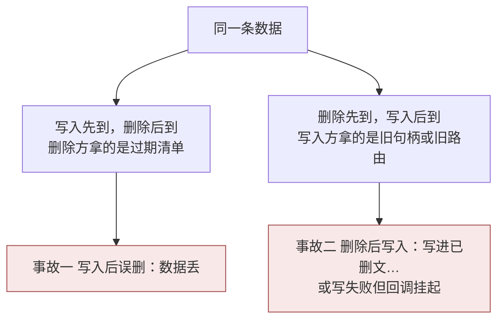
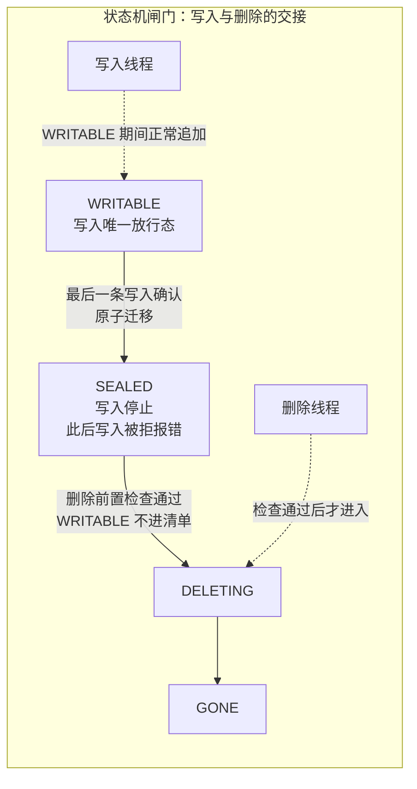

# 删除与写入的竞赛：清理线程与写入路径的时序要有闸门

**删除线程和写入路径并发时，时序错位会造成"删除后写入"和"写入后误删"两类数据事故**。**读完这篇你能用状态机互斥点设计闸门，挡住这两面**。

闸门的设计原则是**状态机迁移点互斥**（删除只清"已完成写入"的对象，写入只接受"未进入删除流程"的对象），**交接用原子状态位或租约**；**历史包袱下退而用墓碑宽限期，那是带代价的宽容窗口，与状态位的即时互斥是两档方案**。

**两类事故由「谁先到」决定，但要命处在双方对同一对象的状态认知有时间差而无人仲裁（冲突发生时裁决谁胜出的机制），顺序只是表象**：



## 删除和写入撞上了谁该让谁：要解决的问题

删除与写入竞赛出两类事故：**写入后误删**——写入线程刚完成对某文件/分段的追加，删除线程按"过期清单"把它清掉（清单是旧的，写入发生在清单生成之后）——数据丢；**删除后写入**——删除线程正在清理（文件已 unlink），写入线程拿着旧句柄（程序持有的资源引用标识）或按旧路由继续追加——**要么写进已删文件（数据进了黑洞），要么写失败但回调挂起（写入永久挂起，上游 pending add callback 的形态）**。**根因同源**：两个线程对"对象处于什么状态"的认知不同步——写入方认为"存活"，删除方认为"应删除"，认知的仲裁缺失。本库"删除与写入的并发窗口"（复活句柄）讲过同族机制；本篇只讲**清理流程的闸门设计**。

**两类事故的分界在于"谁先到"**。**写入先完成、删除后到，且删除方拿的是过期清单——写入的成果被清掉**；**删除先到、写入后到，且写入方拿的是旧句柄或旧路由——写入落进了已经不存在的对象**。**双方都没有做错各自的动作，问题出在双方对同一对象的状态认知存在时间差，而没有任何机制来仲裁这个差**。

**闸门的作用就是在两条路径之间放一个仲裁者**。**它不需要让双方实时同步：状态机保证在迁移点上一致，租约与墓碑则用一段容忍窗口覆盖点与点之间的感知延迟**——**窗口内双方认知可以暂时不同，窗口外必须收敛**。

## 闸门有哪三档、各挡什么：机制与选择

先把形状说成一件事：**删除与写入的竞赛像旧楼拆除与住户搬家撞在同一周——拆迁队（删除线程）按一张上周拍板的名单拆房（过期清单），搬家车（写入线程）按上月的门牌号送货（旧句柄）**。**两边都没干错事，坏事出在名单与门牌都没人更新、也没人拦着对一下**。**闸门三档就是三种拦法：拆迁前跟物业核对当天房态（状态位互斥，立即生效）；给住户留一周搬完的宽限（墓碑宽限期，窗口内允许旧认知）；把钥匙交给唯一有权开门的人一段固定时间（租约）**。**这个比喻到"租约"为止——现实里三档各有实现方式与失效场景，下面逐档展开**。

**闸门一：状态机互斥（首选）**。对象的生命周期显式状态化，迁移点就是闸门：


**写入路径只接受 WRITABLE（SEALED（部分收集完成的分区状态）后写入被拒并显式报错），删除流程只从 SEALED 进入 DELETING（WRITABLE 的对象不许进删除清单）**。**这条规则有一个必须处理的例外：写入方崩溃遗留的 WRITABLE 对象永远等不到最后一条写入确认，若没有兜底就再也无法清理**。**做法是给 WRITABLE 设一个超时上限，超时后由清理方强制迁移到 SEALED——代价是可能截断一次仍在进行的写入，因此超时值要按最大写入时长设定，且强制封印要在日志里留痕**。**状态迁移点是天然的互斥闸门**：**SEALED 迁移（最后一条写入确认时）原子完成，之后写入自然停止，删除安全开始**。

**开合桥的状态机与这条规则同构：通行（WRITABLE）与抬升（DELETING）之间有 SEALED 式的中间态——栏杆落下、警示灯亮，这个状态一旦进入，车辆与新船各自按规则等待，两个方向的请求不会同时获得授权**：


*图源：Wikimedia Commons，Juliancolton，公有领域，https://commons.wikimedia.org/wiki/File:Mystic_River_Bascule_Bridge_3.JPG。*

**上游"data lost after writing and deleting"的修复方向**就是补齐这个中间态：原实现删除不检查写入是否完成，修复后删除前置检查 sealed 状态。



**闸门二：租约与引用计数（跨进程/跨组件）**。**写入方与删除方分属不同进程（写入在 broker、清理在 GC 线程甚至独立服务）时，内存状态位不可用**——**租约**：**写入方持有对象的租约（有 TTL 的锁，TTL 即存活时间，到期自动释放），删除前必须等到租约过期或显式释放**；**引用计数**：**每次写入路径的句柄获取计数 +1，结束 -1，删除在计数归零后进行**。**租约的取舍**：**两种配置方式二选一，混用会两头落空**。方式一：TTL（Time To Live，生存时间：缓存键的过期时限） 大于最大写入时长，无需续租，代价是写入方崩溃后要等满 TTL 才能删。**方式二：写入方定期续租，TTL 只需大于续租间隔，长写入也能覆盖，代价是多了续租的心跳（节点定期互发的存活信号，超时收不到就判定故障）开销**。**误删发生在"TTL 小于实际写入时长且写入方未续租"时**。**TTL 过长则删除延迟堆积，两种方式的共同取舍是按实测的写入时长分布确定数值**。

**闸门三：墓碑与两阶段删除（有历史包袱时）**。**无法给对象加状态位时（格式固化、老版本共存），用墓碑记录：删除分两步——先写墓碑（"此对象将于 T 时刻删除"，写入路径见到墓碑即拒新写入），T 到后物理清理**——**墓碑的宽限期**就是闸门（写入方有时间收尾），代价是删除延迟与墓碑存储。**两阶段的时间参数**：**宽限期 > 写入方感知墓碑的传播时间（通知延迟 + 最大重试间隔）+ 在途写入的最大剩余时长**。**前者保证写入方"知道"要停，后者保证它来得及收尾——只算前者时，T 时刻仍可能有写入正在进行，闸门形同虚设**。

**日志结构的存储把删除表示成一条特殊的写入记录，物理清理留给后台合并**：Kafka（分布式消息队列，靠日志追加支撑高吞吐订阅）的日志压缩（log compaction）就是这套做法，**key 为 K1 的旧值在合并后被只保留最后一条，标着 null 的记录是墓碑，写入路径见到它就知道这个键已经删除**。


*图源：Apache Kafka 官方设计文档（Log Compaction），Apache License 2.0，https://kafka.apache.org/41/design/design/*

**压缩的物理清理（图上从 Before Compaction 到 After Compaction 的归并）由后台线程在宽限期内完成，前台写入在合并期间照常追加**——**这正是墓碑方案"用一段容忍窗口覆盖感知延迟"的形态**。同一份官方文档还给出了物理清理线程自身的时序：尾部保留（Log Tail）、头部回收（Log Head）、可删除位置（Delete Retention Point）与清理进度（Cleaner Point）四个标记点分工推进，**删除的推进由专门的清理进度负责**。


*图源：同上（Apache Kafka 官方设计文档），（Log Cleaner），Apache License 2.0。*

**pending add callback 的卡死面**：**add 操作（追加一条记录的写入动作）失败后回调挂起（未成功也未失败），上层等回调等到天荒地老**。**这类卡死在线程层面的样子是可观测的：被阻塞的线程停在同一个调用位置，等待的却是永远不会到达的事件，取一份线程栈就能把它和"真的在忙"区分开**。

下面"症状"一节里列的三处检查点（定期保存进度、故障后从最近一次保存处恢复）按"能否立刻止血"排序：**回调超时补上之后写入不再挂起，是分钟级见效的动作；删除前置检查补上之后不再误删，需要一次发布；状态机或租约则要动数据模型，周期最长**。**现场先做见效快的，是因为竞赛还在进行时，每多跑一轮就多一批受损数据**。
## 现场怎么判定是哪类竞赛：判定方法

**症状"写入卡死"**：**查三处——回调三路是否齐（超时路缺失是高嫌疑）、闸门资源是否泄漏（引用计数不减、租约不释放）、删除风暴是否在拖（清理线程大批量删除时 IO 饱和，写入的 fsync 排队——本库"清理限速"的同类核算）**。**症状"数据丢但无报错"**：**查删除清单的生成时点与写入完成时点（清单旧于写入即"写入后误删"），以及状态检查是否存在于删除路径（无检查 = 闸门缺失实锤）**。**判定后的修复次序**：**先补回调超时（止血活性）、再补删除前置检查（止血正确性）、最后上状态机或租约（根治）——三步对应三层数据事故的收敛**。

**三种闸门的选型顺序由"能不能改对象的状态表示"决定：能改状态机就上闸门一（迁移点互斥，最强），不能改表示就上闸门二或三（租约、墓碑，不动对象状态，用时间换取安全）**。**三种闸门只解决"该不该删"，回调完备性解决"写入卡不卡死"，限速解决"删多快"。三条配套缺一条，竞赛就在另一个方向上输**。

## 这套闸门在哪儿会失效：边界

三条边界防止防线走形。

**闸门有成本，粒度要对**：**对象级闸门（每 ledger 一个状态位）开销可忽略，操作级闸门（每次写入检查全局锁）会把写入吞吐拖垮**——**闸门挂在生命周期节点上**（seal、delete 的迁移点），不挂在高频路径（每条写入）上。

**清理限速与闸门互补**：**闸门解决"该不该删"，限速解决"删多快"——大批清理（GC 高峰）即使闸门齐备也会挤占前台 IO，限速让删除风暴不发生**（本库"SST（Sorted String Table，按 key 排好序后落盘的只读文件）文件回收的对账"的限速同源）。

**恢复流程是第三个竞赛方**：**崩溃恢复时重建状态，重建过程中写入与删除都可能到来——恢复期的闸门策略（恢复完成前写入拒绝、删除挂起）要显式设计**，**恢复期是竞赛规则最脆弱的时段**（状态未定，谁都不能信），本库"恢复与重平衡（成员增减时把分区重新分配给消费者的过程）的可用性边界"的开关语义同源。

## 想自己复现一遍怎么动手：验证

可复现的验证路径：

1. 竞态（多个执行流争抢资源、结果取决于时序）复现：**并发写入与删除的压力测试（对象生命周期交错），无闸门版本预期复现丢失或卡死，闸门版本干净**；2. 回调超时验证：**注入写入目标不可用，预期超时路触发失败回调、闸门资源释放、无悬挂**；
3. 租约验证：**长写入持租约期间强制删除请求，预期删除等待或拒绝、写入完成后删除放行**；4. 断言锚点：**删除路径有状态前置检查、回调三路完备带超时、清理有限速**——三件齐备，删除与写入的竞赛有裁判，数据事故的两个方向都有闸门。

```text
状态断言 = 删除只清SEALED后的对象
完备断言 = 回调三路带超时兜底
限速断言 = 清理风暴不挤前台
```

**删除与写入的并发正确性不靠运气靠闸门：状态机把"存活与已删除"的边界画清楚，租约让跨进程的认知同步，墓碑给历史包袱留过渡**——**三条实现按组件关系选，回调完备性与清理限速做配套，写入与删除的竞赛就有了不再输的规则**。

## 接着读哪几篇：同族机制的个案层

- [[工程知识/缺陷分析：从个案到体系/并发/删除与写入的并发窗口：复活句柄是静默丢数据的机器.md]] —— 同族机制的个案层
- [[工程知识/缺陷分析：从个案到体系/稳定性/案例三十六：写被自己的回调堵住——挂起的 add 回调.md]] —— 回调挂起的个案
- [[工程知识/缺陷分析：从个案到体系/稳定性/案例二十一：异常路径上没有完成——永不兑现的 future.md]] —— 回调完备性的纪律
- [[工程知识/缺陷分析：从个案到体系/硬件故障/空间回收要有对账表：引用登记让删除不漏不冤.md]] —— 清理侧的对账与登记
