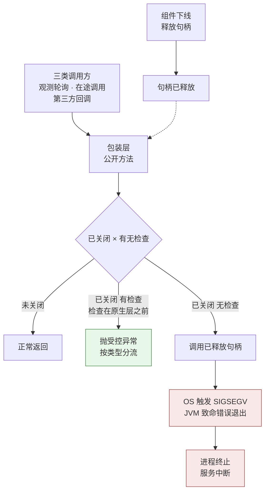
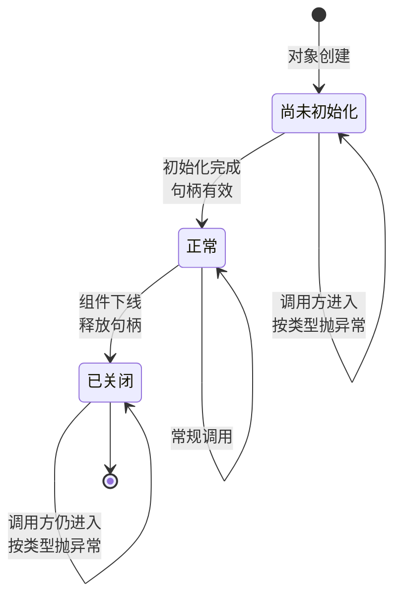
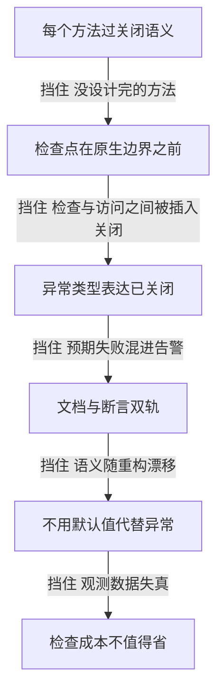

# 原生资源的关闭语义：count 应该抛异常而不是崩溃

> **要点**：**包装原生资源的对象，每个公开方法在关闭后的行为都是接口语义的一部分**；**没有定义关闭语义的方法，默认行为由底层库决定——而底层库的选择通常是崩溃**。

## 关了门电话还在响怎么办：要解决的问题

**Java（以及一切带 GC 的运行时）包装原生资源时，有一条清晰的权责线：包装对象的生命周期归 GC 管，底层资源的生命周期归显式关闭管**。**对象还在、底层资源已释放的状态完全合法——这正是"关闭后继续持有引用"的正常形态**。于是每个公开方法都要回答一个问题：**底层资源已释放时，我该怎么办？**

**这个问题不在答案里出事，在"没问过"里出事**。**没有显式定义关闭语义的方法，把这个问题交给了底层库**：RocksDB、原生 buffer、FFI（外部函数接口，Java 调用非 Java 代码的通道）句柄（程序持有的资源引用标识）**在已释放状态上被调用，性质是 use-after-free 的未定义行为**：库方并不承诺「报错」，SIGSEGV（段错误信号：进程访问了非法内存地址） 由操作系统在访问到无效地址时触发，不是库主动打出的信号。

Apache BookKeeper 的一个真实缺陷（上游修复 commit 3795f559，可查）就是这样：**RocksDB 包装类的 `count()` 方法在数据库关闭后被指标轮询调用，原生属性读取触发 SIGSEGV**，JVM（Java 虚拟机，Java 程序的运行时）**接管后输出 hs_err 致命错误日志并退出（取决于 ulimit 与 JVM 参数配置），bookie（BookKeeper 的存储节点进程）终止、节点服务中断**。**上游修复把行为改成：关闭后调用 `count()` 抛出 `IOException`**。

**这里选受控异常（编译器强制调用方处理的异常类型）而非专用的非受控异常，代价是接口要声明 `throws`、调用方必须写处理分支**；换来的收益是**「关闭后调用」这件事不可能被悄悄忽略**。

**一行修复，一句接口语义**。本文把这句语义为什么必须显式写下来讲清楚。

## 崩溃与异常隔在哪一步：两层语义错位

先把形状说成一件事：**包装原生资源的对象像酒店前台——客人（调用方）找前台要服务，前台身后是仓库（原生库）**。**酒店歇业（关闭）后仓库已清空，但前台的电话还可能响：礼貌的前台会说"我们已歇业"（抛异常），没装这个规则的前台会带客人直闯已清空的仓库（调用已释放句柄），结果是被保安按倒（SIGSEGV，操作系统对非法内存访问的强制中断）**。**修复的机制就是在前台装一句应答规则**。这个比喻到"应答规则"为止——**前台的应答是一句话，包装层的检查却要与真正的原生访问放在同一把锁里防止插队，时序要求是比喻给不了的**，修复与防线一节展开。

包装层的每个方法调用在底层走的是同一类路径：**把 Java 调用翻译成对原生句柄的操作。句柄有效时，翻译是透明的；句柄失效时，翻译结果取决于底层库的设计者，与你的接口设计无关**。

同一个方法调用有几种结局，**判据只有两个维度：句柄释放了没有、包装层查了没有**。**四条路径（关闭方 + 三类调用方）全部汇到同一个入口，然后按这两个维度分流**。



**矩阵里只有「已释放 × 无检查」这一格通向 SIGSEGV 和进程退出，其余格都有确定行为——把这一格填上检查，就是把崩溃翻译成异常的全部工作量**。

上半部是「关闭后为什么还会有人调用」的三条路径，下半部是「调用发生后走哪条分支」。**分支判据统一为两个维度的组合：句柄是否已释放，包装层有没有做检查——只有「已释放且无检查」这一格通向崩溃，其余都有确定行为**。


**底层库选择崩溃有其合理性：在它自己的语义里，"对已关闭句柄的操作"是调用方的 bug，fail-fast 到进程级是 C/C++ 世界里诚实的处理**。问题在于**它的调用方是你的包装层，包装层的调用方是你的用户**——两层语义的错位在这里兑现：

- **底层库的"这是你的 bug"针对的是包装层**；
- **包装层把这个裁决原样转嫁给最终用户**；
- **最终用户看到的是整个进程消失，而触发点可能只是一个与业务无关的指标采集**。

修复的实质是**在包装层截住语义**：**把"底层已释放"翻译成包装层接口自己的语义——受控异常**。**翻译点必须在进入原生代码之前：查关闭标志，已关闭就抛，不把调用送进底层**。**这就是"崩溃与异常之间隔着一个检查"的全部内容**。

## 为什么"关闭后没人调用"指望不上


**理想主义的答案是"关闭后没人调用就行"，工程现实是调用方清单关不住**：

- **观测路径**：**指标框架的轮询独立于组件生命周期，它不关心组件是否下线**；
- **在途调用**：**关闭动作开始时，另一个线程的方法调用已经过了参数检查，正在进入原生层**；
- **第三方回调**：**注册出去的监听器、定时任务持有对象引用，触发时机不受关闭方控制**。

三条路径共同说明：**"关闭后不再有调用"是靠不住的假设，接口必须为"被违背"的状态定义行为。**定义方式就是补全状态机——每个公开方法有三种状态下的行为要定义：

RocksDB 官方架构图给出了这类原生库的生命周期全景：写入先进内存的 Memtable，刷盘（把内存中暂存的数据写入磁盘持久化）成 SST（Sorted String Table，按 key 排好序后落盘的只读文件）文件，跨层的物理回收由后台 compact 完成，而全部文件系统变更——WAL（Write-Ahead Log，先把改动写进日志再改数据本身）、崩溃后靠日志恢复；这里的账包括其切换与 SST 变动记录在 Manifest Log 里，它的作用写明是" unclean restarts 时回退到最近一个一致点"。关键在图的左侧——**Close 动作释放的是藏在 Memtable、SST 文件句柄、Manifest 背后的那一整组原生资源；包装对象本身还留在 JVM 堆上，引用它的指标轮询线程毫无察觉**。库自己的语义里，对已关闭句柄的操作是调用方的 bug，而"调用方"在包装场景里正是包装层，包装层不做检查就把裁决转嫁给了最终用户。


*图源：RocksDB 官方 GitHub Wiki（RocksDB Overview），Apache License 2.0，https://github.com/facebook/RocksDB（嵌入式键值存储引擎，LSM（Log-Structured Merge，先把写入攒在内存里、再按批顺序落盘的存储结构） 树实现）/wiki/RocksDB-Overview。*



**三种状态里，`已关闭` 最常被漏掉，因为它看起来是异常情形而非设计对象；`尚未初始化` 次之**。补全状态机的收益是**：三条调用路径不再依赖"我没想到有人会调"这个假设**，而是每种进入都有定义好的出口。

关闭语义显式化的实物是开合桥的关闭协议：**抬升（关闭）之前，落栏杆、亮警示灯、确认桥面无人——每一个"已关闭后仍有来者"的情形都被协议预定义了处置方式（拦在栏杆外），不存在"来者撞上一座已经消失的桥"这种未定义行为**。BookKeeper 的 `count()` 在数据库关闭后触发 SIGSEGV，**等于桥面已经抬走而拦车的栏杆从未安装**：


*图源：Wikimedia Commons，Juliancolton，公有领域，https://commons.wikimedia.org/wiki/File:Mystic_River_Bascule_Bridge_3.JPG。*

## 修复怎么装应答规则：修复与防线

**上游修复的两层结构是关闭标志加读写锁（允许多读并发、写时独占的锁）——标志提供判断依据，读写锁保护「检查加访问」的整段临界区（同一时刻只允许一个线程执行的那段代码）**。修复实物见上游 commit 页：标题就是「修复 RocksDB（嵌入式键值存储引擎，LSM 树实现） 关闭后调用 KeyValueStorageRocksDB.count 产生的 core dump（进程崩溃时内存状态的完整快照文件）」，正文列出两个缺陷编号——#4581 与 #4243，后者注明触发方可能为 Prometheus（主动拉取并存储指标的开源监控系统） 指标轮询，正是正文说的观测路径，改动两个文件加 40 行减 2 行，新增的 import 是 `java.util.concurrent.locks.ReentrantReadWriteLock`——读写锁就是修复的实际形态：


*图源：[Apache BookKeeper commit 3795f559](https://github.com/apache/bookkeeper/commit/3795f559e006726cc0d500e5f98386693b47bdb5) 页面截图（playwright 实拍，2026-09-28）。coredump（核心转储：进程崩溃时的内存现场文件）=核心转储（进程崩溃时操作系统保存的现场快照），race condition=竞态（多个执行流争抢资源、结果取决于时序）条件，cherry picked from=从另一分支拣选的提交（branch-4.16 维护分支）。本篇从接口语义角度补齐防线清单。

**逐个方法过一遍关闭语义**：**包装类写完，逐方法回答"closed 后调用会怎样"——抛受控异常、返回空值（仅限无状态查询且语义明确时）、或断言拒绝。没有答案的方法就是没设计完**。

**检查点（定期保存进度、故障后从最近一次保存处恢复）在原生边界之前**：**关闭检查必须发生在最后一次原生访问之前，且检查与访问之间不释放锁（否则检查失效）。读写锁方案里，读锁保护"检查加访问"的整个临界区**。

**异常类型表达"已关闭"**：**用专门的异常类型（或带状态码的异常）区分"组件已关闭"与"组件出错"**。**指标框架、连接池（预先建好连接反复取用、省去反复握手建连的开销）这些调用方要按类型分流：已关闭是预期（组件下线），出错是告警。一个笼统的异常类型会把预期失败推给告警系统**。

**文档与断言双轨**：**接口文档写明关闭后行为；测试里对每个公开方法断言关闭后抛出指定类型。双轨防止语义随重构漂移**。


**不要用返回默认值代替异常**：`count()` 返回 0 或 -1 **看似温和，实际把"组件已关闭"伪装成"组件为空"——观测数据失真，下游按真实数据做决策**。受控异常是其中一种诚实的做法：这个请求没有答案，原因是**组件已下线**。**专用非受控异常同样能表达这个状态，取舍在于是否强制调用方写处理分支——观测类调用方（指标框架）通常不希望为一个预期状态写 try-catch，这正是两种选择的分界线**。

**检查的成本不值得省**：**无锁实现下关闭标志检查是一次 volatile 读，纳秒级；带读写锁的实现成本高一档，换来的是「检查与访问之间不会被插入关闭」的保证**。**为省它而把检查做成"调试开关"，生产环境的崩溃会替你把开关打开**。**热路径上的关闭检查同理保留——关闭是低频事件，但检查必须高频在线**。

6. **GC finalize 不是防线**：**依赖终结器兜底释放原生资源是另一个话题，与关闭语义无关；终结器的时机不可控，绝不能当作"忘了关闭"的保险。显式关闭加关闭语义，是原生资源包装的完整答案**。

**六条防线各自挡住一种失败，合起来才把"关闭"从单个标志变成完整语义**：



第五条最容易被"温和"这个理由说服：`count()` 返回 0 或 -1 **看似不打断调用方，实际把"组件已关闭"伪装成"组件为空"，下游会拿这个数当真实数据做决策，观测先失真、判断后出错**。第三条说的是同一件事的另一面——**用一个笼统的异常类型表达已关闭，等于把预期失败推给告警系统**，指标框架、连接池这些调用方要能按类型分流：已关闭是预期（组件下线），出错是告警。第二条是唯一有时序要求的一条：**关闭检查必须发生在最后一次原生访问之前，且检查与访问之间不释放锁，否则检查就失效了；读写锁方案里，读锁保护的正是"检查加访问"这整个临界区**。

## 想自己复现一遍怎么动手：验证

**验证要拿的账是：各公开方法在关闭后被调用时的实际行为，与断言表规定的异常类型对不对得上**。

1. 接口测试：**对包装类逐个公开方法，先关闭再调用，断言抛出指定异常类型——一张"方法 × 关闭状态"的断言表**；
2. 并发测试：**读方法循环与关闭循环并发，断言进程存活、无原生崩溃**；
3. 崩溃回归哨兵：CI（Continuous Integration，持续集成：代码合并后自动构建与测试）**里保留一条"关闭后调用"的用例，任何绕过检查的新路径会让它当场产生崩溃信号，测试框架把崩溃报告为失败**。

```text
断言表 = 每个公开方法 × {closed} → 指定异常类型
并发断言 = 读循环 + 关闭循环 → 进程存活
```

**接口语义测试把"关闭后行为"从口头约定变成可执行规格：重构换实现时，规格测试是唯一不变的约束**。关闭检查换来的分界在这里有具体形状——**崩溃是全进程服务中断加小时级定位，异常是调用方按类型分流的一行处理，这笔交换没有任何犹豫的余地**。

## 接着读哪几篇：异常类型设计的通用框架

- [[工程知识/缺陷分析：从个案到体系/并发/案例二十：关闭之后还有人在用——生命周期的时序竞态]] —— 同一上游缺陷的案例侧写
- [[工程知识/软件构建：让变化可以理解、验证与交付/架构与代码/错误处理的分类学：错误类型与恢复策略的映射]] —— 异常类型设计的通用框架
- [[工程知识/后端系统：在并发、失败与变化中维持服务/任务与并发/任务生命周期必须覆盖进程、日志、超时与清理]] —— 关闭语义在生命周期框架里的位置
- [[工程知识/软件构建：让变化可以理解、验证与交付/架构与代码/错误处理是策略问题，异常只是运输手段]] —— 失败行为作为接口语义的一部分
