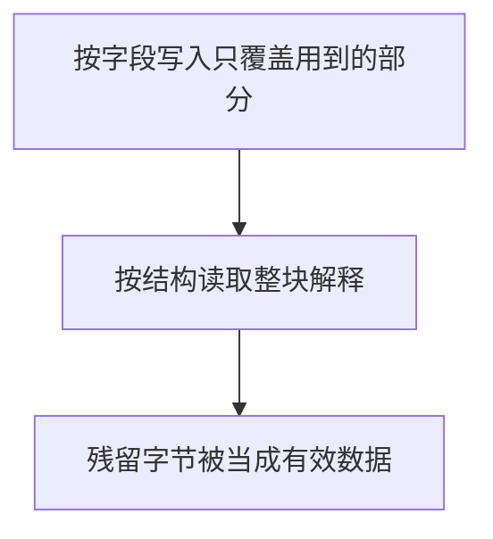
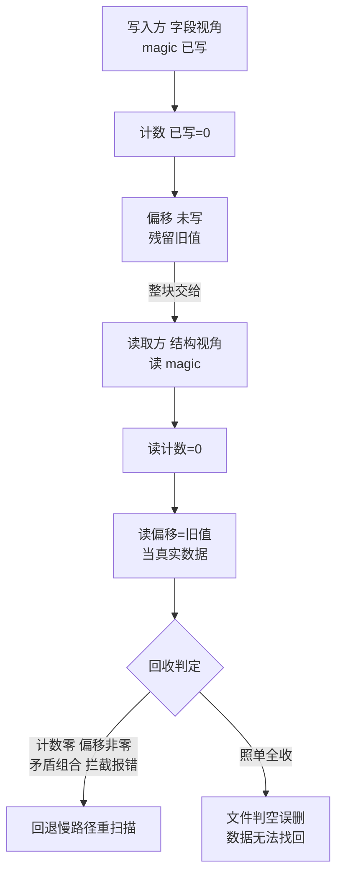
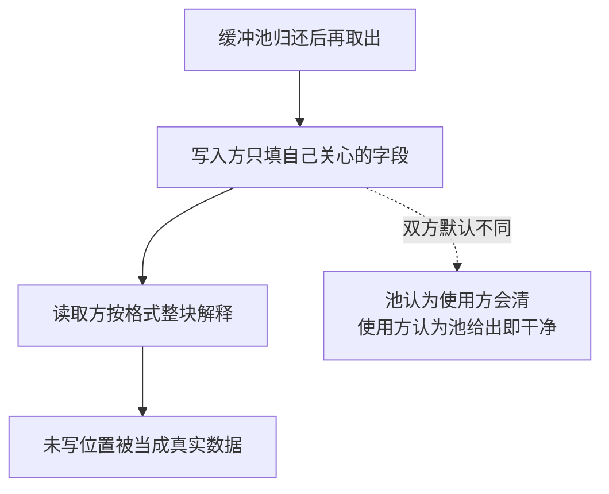

# 复用缓冲区的残留字节：清零是复用的入场费

**复用的缓冲区带着上一任租客的字节，新记录没写的位置全是旧值**。读完这篇你能说清为什么清零是复用的入场费，以及漏掉它下游会读到什么。

> **要点**：复用的缓冲区带着上一任租客的字节；新记录只写了自己认识的字段，没写的位置全是旧值——下游按"整个结构"解读这份记录时，旧值就成了新数据的一部分。

## 要解决的问题



**错位发生在写与读的粒度不一致处**——写按记录整块填，读却可能只信其中一段，下面这条通用路径把两边的假设摆出来：


带缓冲的写入路径有一个通用结构：新建一条记录时，从池里拿一块写缓冲区，填入头部字段，再填入数据，写入磁盘。缓冲区是复用的——上一条记录用过它，字节还留在里面。**写入代码通常只填自己关心的字段，剩下的位置"应该"是零**。

"应该"靠什么保证？靠拿缓冲区的那一方先清零。**清零这一步没有独立的所有者：分配方认为使用方会清，使用方认为分配方给出来的就是干净的**。两边都这么想的时候，残留字节就活着穿过了写入路径。

这不是假设。Apache BookKeeper 的一个真实缺陷（上游修复 commit 52d779ae，可查）走完了整条路：新建日志文件时复用了带残留字节的写缓冲区，头部里"条目数量与位置映射"的字段没有清零，**偏移残留非零旧值而计数是零**；后台垃圾回收读这份头部做引用统计，**把仍有数据的文件判成空文件删掉，之后读取方报错，数据无法找回**。**一条"写前没清零"的遗漏，终点是数据被自己的回收机制删除**。

## 它是怎么做到的：字段式写入与结构式读取的错位

缓冲区复用的全景位置先看清楚：InnoDB 官方架构图里，Buffer Pool 位于内存结构一侧，读入的页与写脏的页都在池中流转，复用正是这个池的日常——每一块页缓冲都经历「取出、写入、归还、再取出」的循环，残留字节的风险藏在这个循环的交接处：


*图源：MySQL（最常用的开源关系型数据库之一） 官方文档《InnoDB Architecture》架构图，https://dev.mysql.com/doc/refman/8.0/en/innodb-architecture.html。*

池内页的流转由三条链表管理——Free 链表挂空闲页、LRU（最近最少使用，内存不足时优先淘汰最久未访问的项）链表按访问新旧排列、Flush 链表挂脏页。小林coding 的这张图画的正是这个结构：页从 Free 链表被分配，经访问进入 LRU 链表的新旧分区，改写后进 Flush 链表等待刷盘（把内存中暂存的数据写入磁盘持久化）。本篇的病例发生在更靠前的写路径上，机制是同构的——复用的缓冲块交出时，没人保证上面一任的字节已被清掉：


*图源：小林coding《图解 MySQL｜Buffer Pool》，https://www.xiaolincoding.com/mysql/8_other/buffer_pool.html。*

把这类缺陷的几何讲清楚，只需要区分两种视角。

**写入方是字段视角**：我写 magic、我写版本号、我写我的字段，其余位置与我无关。它没有义务知道整个缓冲区多长，也没有义务关心别人会读哪些位置。

**读取方是结构视角**：我按格式定义读整个结构——每个字段都有位置，每个位置都有含义。格式定义里没有"未定义字节"这回事，读到的任何值都会被当成真实数据。

错位就在这里：**字段视角留下的空洞，被结构视角当成了内容。**残留字节占住的位置，恰好是读取方认真解读的位置。垃圾回收拿"头部写的计数"与"索引扫描的实际条数"做比较，**两个都错了却错得一致，判断就通过了**。



图：两类视角的错位与两条结局——写入方按字段清单填，未写位置是上一任租客的残留；读取方按结构定义读，每个位置都当真实数据——「计数为零、偏移非零」的自相矛盾组合由此诞生。两条结局取决于读取侧防线——有交叉验证的读取方对矛盾组合报错回退慢路径；没有的照单全收，垃圾回收把仍有数据的文件判成空文件删掉。

C 与 C++ 的教科书教训（`malloc` 后必须 `memset`，或直接用 `calloc`）在这里换了一层皮：高级运行时里的对象池（预先建好对象、用完归还下次复用的容器）、堆外内存、`ByteBuffer.rewind()` 后的复用、序列化框架的对象复用，**全都重新引入了"上一任的字节"**。**语言变新了，问题没变**。

## 为什么静默：每个环节单看都合理

工业级实现里这套复用机制有完整的样子：Netty 的内存池（预先分配大块内存、由程序自己切分管理）把缓冲区复用做成三级结构——PoolArena 统一管理，PoolChunk 以 16MB 为单位用完全二叉树记录页的分配与归还（每层节点记录剩余可用高度，分配时从根向下找能容纳的节点，归还时向上更新），PoolThreadCache 给每个线程缓存刚释放的同规格内存块，下次分配直接复用免加锁。池化做得越彻底，缓冲区流转得越频繁，「取出时清零」越要成为分配动作的内置语义，越不能指望使用方记得补：


*图源：edgar615《Netty 内存分配之 PoolArena、PoolChunk、PoolSubpage 与 PoolThreadCache》，https://edgar615.github.io/netty-alloc.html。*

这类缺陷静默的根源是它**没有出错点**。逐环节复盘：

- 分配方给出来的缓冲区"能用"——写进去、写入磁盘、读回来都不报错；
- 写入方填完了自己所有字段——按它的字段清单看，没有遗漏；
- 读取方按格式解读——每个字段都读到了值，值看起来"像那么回事"；
- 下游决策逻辑——用读到的值做判断，判断逻辑本身正确。

每个环节的局部正确性都成立，**错误只存在于环节之间的约定空白里**：谁来保证未写字节是零。**约定空白里的错误没有报错信号，直到某个下游用这份脏值做出不可逆动作（删除、覆盖、放行），才有第一个症状——而症状离病根隔了整个下游**。

## 上游怎么修、防线怎么布

上游的修复是两层的，两层都有通用价值。

**写入侧清零**：写头之前先把整段缓冲区置零，再填字段。**这是治本——缓冲区的每一任使用者都先付"清零"这笔入场费，残留字节活不过一次复用**。

把一次复用按参与者拆开，"约定空白"落在哪一步就清楚了，下面这张图按时间顺序标出每一步谁负责清、谁默认已清：



修好之后这条时序多一步：**从池里取出的那一刻缓冲区已置零，"拿"这个动作自带干净语义**，下游不再依赖任何一方记得补这一步。

**读取侧拒绝**：读取方对"计数为零但索引偏移非零"这类自相矛盾的组合显式报错并回退扫描，不带着可疑数据继续决策。**这是兜底——就算写入侧再漏一次，脏数据在进入决策前被拦住**。

这套机制在别的系统里换名字不换结构，推广成防线清单，四条各自挡一种残留：

- **复用必清零**：从池里拿到缓冲区的第一件事是置零或按格式初始化，写成分配函数的一部分，让"拿"这个动作自带干净语义；
- **关键结构留验证字段**：校验和（对数据算出的指纹，用来发现传输或存储中的损坏）、magic、版本号之外，给"结构性自洽"（计数与实际条数、长度与实际范围）留交叉验证位；
- **读取侧对矛盾组合 fail-fast**：宁可回退慢路径（重新扫描），不带着自相矛盾的元数据走快路径；
- **新记录类型上线时审一遍复用路径**：新增字段最容易撞上没清零的位置，重点查"旧格式缓冲区装新格式记录"的过渡场景。

这一族缺陷还有个共同的名字：初始化遗漏。它与缓冲区复用是两回事，可以独立发生——新分配的堆外内存、新 `malloc` 的块、反序列化时未覆盖的字段，全都不需要"复用"这个前提，**只要写入方是字段视角、读取方是结构视角，空洞就会被当成内容**。**复用只是让残留字节有了一个来源**。

## 这套说法在哪儿会失效

三条边界防止防线被用歪。

**清零有成本，但成本要花在正确的一方**：大缓冲区全量清零在高吞吐路径上有可测开销，于是出现"只清将要写的部分"的优化——**这等于没有清零，因为"将要写的部分"正是字段视角的清单，空洞位置原样保留**。要省就改成"读取方验证 + 回退"，省不得就老实全量清零，两者选一个，**"部分清零"是自欺**。

**零值本身也可能是合法值**：清零解决"残留"，顺带让"没填"与"填了零"不可区分。**语义上需要区分"字段缺失"与"字段为零"的格式，要用显式的存在标志，靠零值兼任两义迟早出歧义**。

**网络对端不可信**：本机写入可以靠清零纪律，网络来的数据永远按"字段可能缺失、组合可能矛盾"设计读取侧——**清零纪律管得住自己人，管不住线上的报文**。

## 怎么自己动手验证

改完要证明真的修好了，这类缺陷的可复现验证路径相当直接，三步就能让残留自己现形：

1. 构造复用场景：**写入一条含非零字节的记录，释放缓冲区，再用同一缓冲区写新记录**（或直接在单测里 new 一块缓冲区填脏字节再走正常写入路径）；
2. 断言写入磁盘内容的**未写字节全为零**（整个结构逐字节比对，留位置清单）；
3. 对读取侧防线：喂一条计数与实际条数矛盾的记录，**断言读取方报错或回退，而不是返回可疑元数据**；
4. 跑一轮"写入-回收-读取"的完整流程：**脏头部制造的文件必须在回收阶段被拒绝删除**。

```text
写入 → 写入磁盘内容逐字节断言（未写位置 == 0）
喂矛盾元数据 → 读取方必须拒绝，不得静默返回
回收判定 → 存在活跃引用的文件永不被删
```

三条断言构成这个结构的回归防线，任何一条红了都指向复用或验证纪律的破口。跑防线时预期与实际的对账规则写在断言旁边：**对不上的每一个字节都要能指出写入路径上的漏清零位置**。防线的代价与收益摆在一起看：全量清零在高吞吐路径上有可测的写放大（实际写入量是逻辑写入量的多倍）代价，换来的是"未写字节全为零"这条可以机械断言的性质；读取侧验证的代价是慢路径回退的延迟，换来的是脏数据进不了决策。**两笔交易都划算，因为对立面分别是静默数据损坏与不可逆删除**。

## 接着读哪几篇：对账与不变量作为静默失真的通用检测面

- [[工程知识/缺陷分析：从个案到体系/正确性/案例十六：数据被自己人删掉——entry log 头里的假账]] —— 同一上游缺陷的案例侧写，本文抽出的方法面
- [[工程知识/缺陷分析：从个案到体系/正确性/静默失真的检测靠对账与不变量而不是报错]] —— 对账与不变量作为静默失真的通用检测面
- [[工程知识/性能工程：从用户等待到资源瓶颈/处理器与内存/缓存行与伪共享：64字节里的并发性能]] —— 缓冲区复用的性能动机从哪来
- [[工程知识/缺陷分析：从个案到体系/配置/案例三十八：没有写下来的版本——默认值里的迁移债]] —— 同类"没写下来的位置被当成了默认语义"
- [[工程知识/性能工程：从用户等待到资源瓶颈/存储与网络/TCP不提供消息边界：成帧是应用层协议自己的责任.md]] —— 接收缓冲区里残留的尾巴也是同一类错位，成帧与装配缓冲区是网络侧的对应纪律
