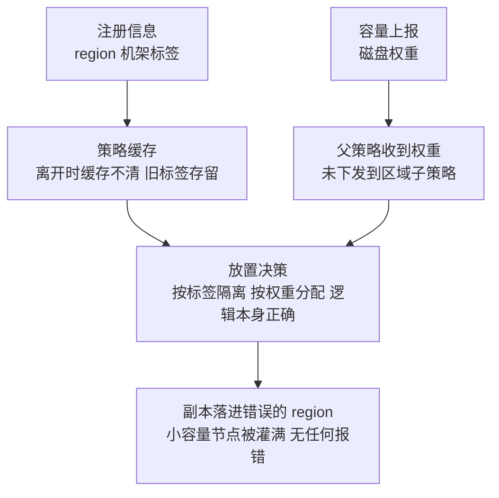
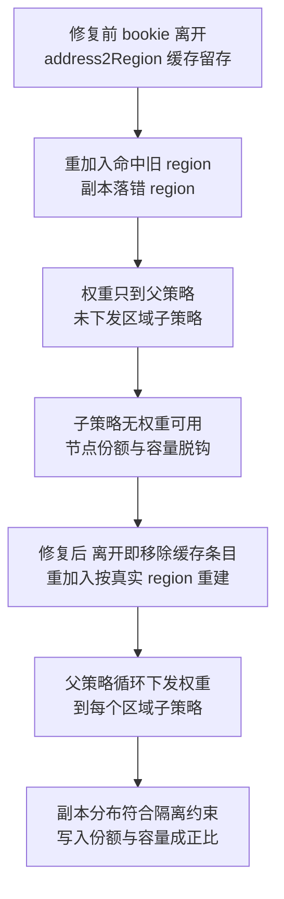

# 放置策略的状态残留：下线成员的旧标签与失效的权重

> **要点**：**放置策略按"成员标签"（region、机架）与"成员权重"（容量、磁盘）决定副本去哪，标签与权重的维护路径有延迟与遗漏时，放置按过期的世界观做决策**——**副本分布错位、均衡失效，而集群报告看起来一切正常**。

## 要解决的问题

**副本放置是分布式存储的基础决策：新写入的副本放哪些节点，按什么规则放**。规则有两类输入——**拓扑标签**（节点属于哪个 region、哪个机架，用于容灾隔离）与**容量权重**（节点多大多能装，用于负载均衡）。**决策的质量完全取决于这两类输入的时效**：**放置策略按它记忆里的世界观分配副本，世界观过期，决策就错。**

Apache BookKeeper 的两个真实病例（上游修复 commit 857959eb 与 f507b1c5，均可查）分别演示了两类输入的失效：

第一个病例，客户端启用按 region 的放置策略，某台 bookie 因 DNS（Domain Name System，域名系统：把域名解析成 IP 地址） 解析失败以默认 region 标签加入集群，离开期间机架信息已更新为真实 region，重新加入时**沿用内存里的旧标签**。**此后它的副本分布按错误 region 计算，跨 region 容灾约束被悄悄破坏**。

第二个病例，多区域集群开启按磁盘权重的放置，父策略收到了各节点的磁盘权重，**从未把它下发到各区域的子策略**，子策略手里没有权重可用。**容量相差数倍的 bookie 承担同样的写入份额，小容量节点被等量写入灌满，大容量节点闲置，均衡完全失效**。

两个病例的共性：**放置决策的输入（标签、权重）由独立的维护路径更新，更新路径的遗漏与延迟直接变成放置错误**，**且没有任何报错——放置策略忠实执行了它收到的（过期的）信息**。

## 它是怎么做到的：决策输入的维护路径与决策路径脱节


来源：[CSDN @bjmayor《图解分布式事务模式》](https://bjmayor.blog.csdn.net/article/details/154004146)（CC 4.0 BY-SA）

**这类问题可以用状态机看：对象在一组状态之间迁移，每次迁移都有前置条件与副作用（操作对外部状态产生的额外影响）**。**缺陷在于"离开"这条迁移只更新了部分状态——主状态机走完了，缓存那份还停在上一个状态，于是重新加入时读到的是过期值**。

*图示：状态迁移模型。**残留的本质是某条迁移路径没有更新全部状态副本**。*

这类残留的共同结构：**决策依赖一份输入，但这份输入的维护与决策本身是两条独立的路径，任何一侧改动都不会通知另一侧**。

把两类输入的生命周期摆出来，脱节的结构就现形了。

**标签的生命周期**：节点的 region/机架标签来自配置或注册信息，放置策略在节点加入时读一次，此后**缓存在自己的 address2Region 映射表里**。**标签变更的传播没有协议保障**——离开是一个变更时机，857959eb 的缺陷就在这里：**bookie 离开集群时，策略从 knownBookies 移除了它，address2Region 里的缓存却留着**；`onBookieRackChange` 只更新 knownBookies 里存在的地址，离开的那台永远等不到刷新，重新加入时 `getRegion` 直接命中旧缓存。

**权重的生命周期**：磁盘权重来自周期上报的容量数据，先到达父策略（RegionAwareEnsemblePlacementPolicy），再由父策略分发给各区域的子策略（TopologyAwareEnsemblePlacementPolicy），子策略用权重做加权随机。**分发的覆盖面是代码里的隐式假设**——**f507b1c5 的缺陷就是父策略的 `updateBookieInfo` 只更新了自己，没有循环调用各区域子策略的 `updateBookieInfo`，权重停在父策略手里，子策略按无权重的方式选择节点**。

**决策路径**：每次写集合组装时，策略按当前成员表做选择。选择逻辑本身正确（按标签隔离、按权重分配），**错误全在输入端**。**这是放置类缺陷的共同形态：算法正确，世界观过期**。



与一般缓存失效（缓存里的数据过期或不一致、需要回源加载）不同，放置输入的过期**没有读时校验的机会**——**写集合组装完副本就写下去了，"这个标签还准吗"的问题在决策时刻无法回答。防线必须建在输入维护侧，不能指望决策时自救**。


来源：[博客园《解密 Raft 算法》](https://www.cnblogs.com/traditional/p/12588733.html)（CC 4.0 BY-SA）


来源：[小林coding《MySQL 日志：undo log、redo log、binlog 有什么用？》](https://www.xiaolincoding.com/mysql/log/how_update.html)


## 为什么没有报错

**两类失效都静默，原因各有代表性**。

**标签过期静默**：**错误的 region 标签不触发任何约束违反——策略按"这 4 个副本在 4 个不同 region"执行，标签错的时候它照样能找到"4 个不同 region"（只是其中一个是假 region）**。约束满足的**判定与约束的事实**用的是同一份过期数据，自己骗自己，无异常可抛。

**权重失效静默**：**加权随机的结果永远是"合法的分布"——每个节点都收到写入，只是份额错**。没有硬约束被违反（不像副本数不足会报错），错的是**分布质量**，这类错误天然没有异常信号。

静默的共性给排查定了调：发现线索的地方是**结果侧的分布统计**（每 region 的副本数、每节点的写入份额），缺陷定位在**输入侧的成员表与权重表**。**两头对不上，中间的放置算法反而是最不用怀疑的**。

## 修完之后靠什么防住复发

**上游两个修复各针对一类失效，合成一套输入保鲜防线**。

**离开即清缓存**：**bookie 离开集群时，把它在 address2Region 里的条目一并移除**——857959eb 的修复动作（`leftBookies.forEach(address2Region::remove)`）。原则化表述：**成员表的任何状态不允许跨"离开-加入"存活**，离开即失效，加入即重建。

**权重聚合覆盖全分组**：**父策略收到权重上报后，循环调用各区域子策略的 `updateBookieInfo`，把权重下发到每一个分组**——f507b1c5 的修复动作。原则化表述：**分发的覆盖面必须与拓扑分组一致**，隐式假设（"只有单区域"）要显式化为代码分支与测试用例。

放置域的防线不止这两个修复，从成员表到监控再往下排还有四条：

- **放置决策的输入表要有版本感**：**成员表记录每个条目的来源与更新时间，能回答"这个标签是几时、从哪来的"——排查时这是第一手证据**；
- **分布统计作为放置质量的常驻监控**：**每 region 副本数、每节点写入份额的均衡度，偏离预期即告警——这是唯一能发现静默放置错误的信号**；
- **放置策略的测试要覆盖输入变更序列**：**加入-离开-改标签-重新加入、多区域权重差异扩大，这些序列是缺陷的出生地，单次快照（某一时刻的完整只读副本）测试测不出来**；
- **新放置策略上线先影子跑**：**新旧策略对同一集群各算一份决策，diff 出来的分布差异人工审过再切流**。



## 效果从哪儿来，要付什么代价

**输入保鲜防线的收益是放置错误从「以月为尺度在生产暴露」变成「在测试序列与监控告警里当场现形」**。**代价要摆在明处：成员表多记来源与时间戳是额外的存储与维护，分布统计多两个指标是额外的采集与告警噪音，影子跑要同时维护新旧两套决策路径**。**放置决策的正确性全押在输入保鲜上，这笔投入属于决策质量的地基**。

## 这套说法在哪儿会失效

三条边界防止防线变形。

**标签刷新有时效窗口**：**重新加入即刷新覆盖了"离开-加入"路径，但"不离开而标签被改"的路径（运维在线调整机架）依赖注册信息的推送机制**——**推送缺失的部署形态下，刷新窗口是下一次重加入。防线的完备度按部署形态评估，不假设理想路径**。

**均衡不是唯一目标**：**权重放置要与其他约束（机架隔离、容量上限、隔离策略）联立求解，"份额均匀"单独看可能违反隔离约束**。**放置质量的多目标评价（隔离达标下的均衡）比单指标更有意义**。

**客户端放置与服务端自治的分界**：**副本放置决策在客户端（本病例）还是服务端（部分系统由主节点放置），防线位置不同——客户端放置意味着每个客户端的世界观都要保鲜，升级客户端的协调成本要计入架构评估**。

## 怎么自己动手验证

**验证要拿的账是：成员表里的标签、副本分布的计算结果与注册时写入的值对不对得上**。

1. 标签过期路径：**启动策略，让节点以默认标签加入、修改注册标签、重加入，断言重加入后成员表标签为新值，副本分布按新标签计算**；
2. 权重路径：**构造多区域集群，各区域节点容量差数倍，断言各节点写入份额与权重成正比（统计窗口内偏差小于阈值）**；
3. 分布监控断言：**注入一次标签过期（不修复版），分布统计的均衡度指标出现偏离，确认告警链路通**；
4. 序列测试固化：**把"加入-离开-改标签-重加入"写成放置策略的标准测试序列**。

```text
标签断言 = 重加入后成员表标签 == 注册信息当前值
权重断言 = 写入份额 ∝ 上报权重（偏差 < 阈值）
监控断言 = 均衡度偏离 → 告警触发
```

**两条分布断言（标签分布、权重份额）合起来构成放置质量的持续验收，输入侧的任何腐化最终都会在分布上现形**。

## 接着读哪几篇：放置决策的算法面

- [[工程知识/缺陷分析：从个案到体系/正确性/案例二十九：离开的人还占着座位——机架信息的陈旧映射]] —— 同一上游缺陷的案例侧写，本文抽出的方法面
- [[工程知识/数据系统：在并发与故障中保存事实/可靠性与运维/分区再平衡的三种策略：固定取模与一致性哈希]] —— 放置决策的算法面
- [[工程知识/后端系统：在并发、失败与变化中维持服务/分布式可靠性/健康检查只能提供有时效的失败证据]] —— 成员状态时效性的通用机制
- [[工程知识/缺陷分析：从个案到体系/正确性/静默失真的检测靠对账与不变量而不是报错]] —— 分布对账作为静默放置错误的检测面
