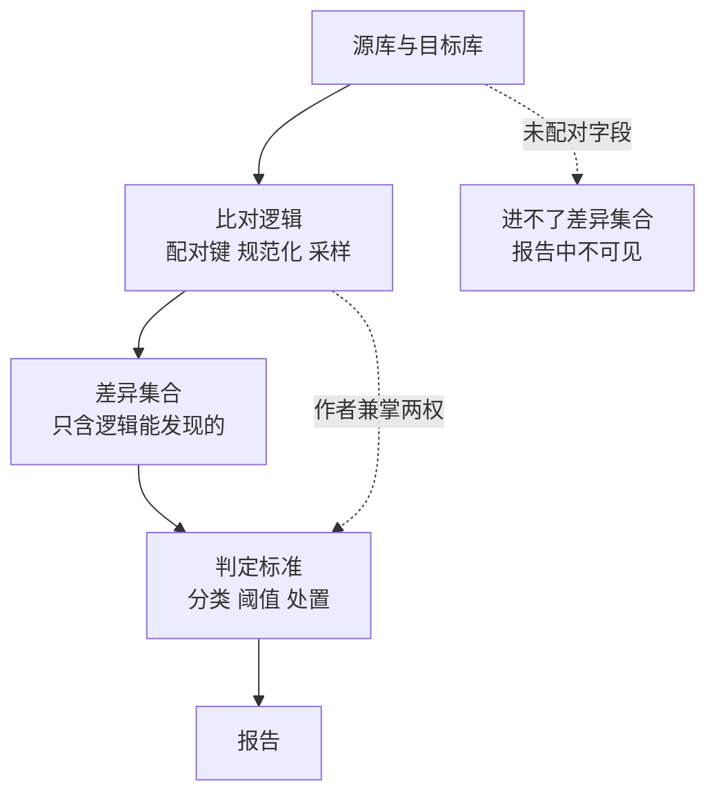
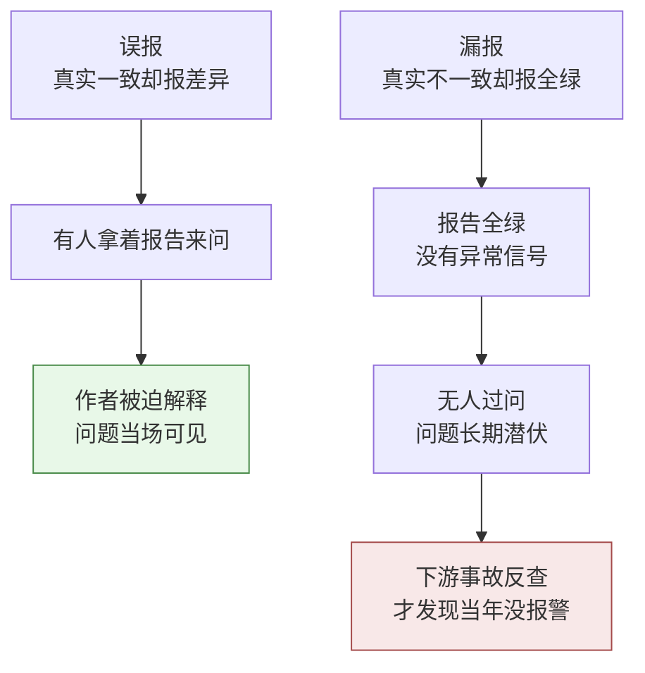
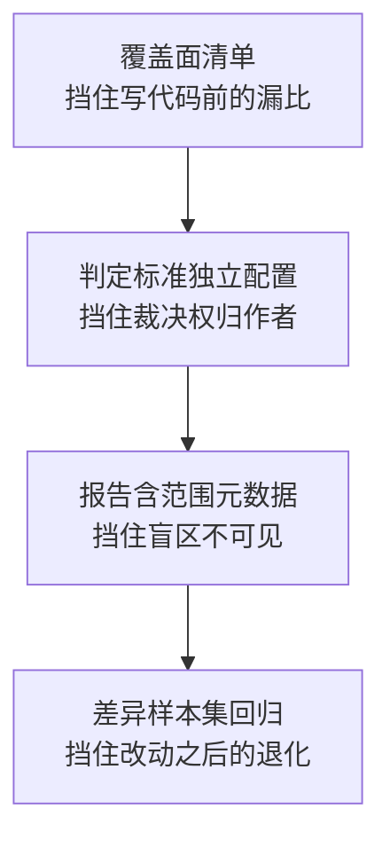

# 数据对比工具的双人裁决：比对逻辑与判定标准要分开看

> **要点**：数据对账工具同时握着"怎么比"和"什么算不一致"两个权力，**两者耦在一起时**，**工具作者的比对习惯会变成数据判定标准**——**把比对逻辑与判定标准分离评审**，让"差异是否有害"由数据 owner 裁决，"差异是否被正确发现"由工具评审裁决。

## 要解决的问题


来源：[CSDN @bjmayor《图解分布式事务模式》](https://bjmayor.blog.csdn.net/article/details/154004146)（CC 4.0 BY-SA）

**对账这件事落到实现上，是一次按配对键的遍历**：**取一侧数据，按比对键在另一侧数据里查找，找到再判是否一致，找不到就置为单边**，**一侧剩余数据全部置为单边**——整张流程图把"怎么比"的每个判定分叉都摊开来看：


*图源：稀土掘金技术社区《数据对账系统设计》，CC BY 4.0，https://juejin.cn/post/7102036546819194911。*

**数据迁移、双跑验证（新旧系统同时跑一段时间比对结果）、主备对账都依赖一个角色**：**数据对比工具**。它做两件事：**把两边的数据按某种逻辑逐行配对比较（怎么比）**，把比较结果按某种标准分类为"一致/可接受差异/不一致"（什么算不对）。

**两件事由同一拨人（通常是写工具的工程师）决定时，判定标准继承了比对逻辑的盲区**。漏报有两类来源：**覆盖面缺失（某些字段根本没比）与判定过松（比出了差异却归为可接受）**，**本篇讨论的两权耦合主要恶化后者，前者靠覆盖面清单治理**。本库正确性域"静默失真的检测靠对账与不变量"确立了"**对账是静默失真的主检出手段**"；本篇讨论对账工具自身的治理——**对账工具漏报，静默失真的防线就从根上失效**，而**漏报最常见的来源是比对逻辑与判定标准的耦合**。

真实形态：**迁移验证工具按行数 + 抽样字段比对，判定标准固定写在工具里**——"**行数一致且抽样一致 = 迁移成功**"。**抽样字段是工具作者按自己的理解选的**（挑了几个有代表性的列），**没进抽样的列的差异永远不被发现**；**浮点字段的比对精度是作者随手定的**，精度差异被归类为"可接受"，**可接受的边界没有数据 owner 参与**。**工具报告全绿，数据的真实差异从未进入视野**——这类事故的排查起点是"工具怎么写的"，与数据本身无关。


## 「怎么比」和「什么算错」为何要分家：机制

先把形状说成一件事：**数据对账像医院里检验科与主治医生的分工**——**检验科（比对逻辑）负责把血样测准**：**用什么仪器、什么试剂、测哪几项，测错了全盘皆错**；但"这项指标高 0.3 算不算病"（判定标准）**检验科说了不算，要主治医生结合病人的病情裁决**。**检验科顺手定诊断标准**，就会把自己测不准的项目悄悄划进"正常范围"——**工具作者的比对盲区变成数据判定标准，就是这个病**。这个比喻到"主治医生裁决"为止——**现实里数据 owner 是医生，工具作者是检验科**，**两边必须能独立评审、互相制衡**，下面展开各自的失效形态。

**比对逻辑与判定标准要分开，是因为它们回答的问题不同**：**一个回答「哪里不一样」，另一个回答「这个不一样算不算错」**。**两件事由同一处决定，裁决就失去了独立性**。


**把对账工具分成两个可独立评审的部件**，各自的职责与失效形态见下图：

**比对逻辑（怎么比）**：**配对键的选择（主键、业务键、时间窗匹配）**、**字段的规范化（类型转换、时区归一、字符串 trim）**、**采样（只采集一部分数据以控制记录开销）与全量的选择**。失效形态是**漏比与错比**——**配对键选错导致两边行错配（大量假差异）**、**规范化缺失导致格式差异被报成数据差异（噪音淹没信号）**。评审对象：**逻辑的完备性（每列都有比对方法）与正确性（规范化不改变语义）**。

**判定标准（什么算不对）**：**差异的分类（结构性差异指行的有无或字段缺失，数值差异指同键不同值，可接受偏差指精度与抽样造成的合法差异）**、**容忍阈值的设定（浮点精度、统计字段的抽样误差）**、**差异的处置（阻断/告警/记录）**。失效形态是**标准失真**——**阈值定得过松把有害差异归为可接受，过紧把合法差异归为不一致**。评审对象：**每个差异类别的业务含义**，由数据 owner 判定"**这个差异影响下游什么决策**"。

**耦合的失效机制在两者交界处**：比对逻辑决定了**能发现什么差异**，判定标准决定了**发现的差异算什么**——**前者是技术问题（工程可评审），后者是业务问题（owner 可裁决）**。耦在一起时，owner 看到的是工具的最终报告，看不到"**哪些差异类型根本没被比对**"。



**实线是目标态：比对逻辑与判定标准各自独立评审**。两条虚线标的是现状——一张图上同时画了两者，因为差别只在这一条边的归属上：**作者兼掌两权时，从 A 到 S 是同一个人做的决定**。

**漏报与误报的不对称是这里的关键**：**误报会自己找上门**——**有人看到报告里的假差异来问，工具作者被迫解释，问题因此可见**。**漏报没有任何入口，报告全绿本身就是它唯一的输出**，而且**全绿恰恰是它该有的样子**。于是**漏报可以存在数年而不被发现**，直到某次下游事故反过来追查"这个字段当时为什么没报警"。

**两类错误的反馈路径长度完全不同，这决定了它们被发现的概率**，见下图：



**上一条路径每转一圈就把问题推进到可见位置**，**下一条路径没有任何一环会主动产生信号**。所以评审比对逻辑时要专门问"**哪些差异根本进不了差异集合**"，**而不是只看报告里已有的分类是否合理**。

## 为什么偏偏对账工具最需要分家

**对账工具与一般工具有个关键差别**：**它的输出是"无异常"这种否定性结论**，而**否定性结论的信任度取决于工具的覆盖面**。**覆盖面盲区（漏比）不会以任何形式出现在报告里**——**其他工具的 bug 造成误报（可见、可排查），对账工具的盲区造成漏报（不可见、无从排查）**。**对"输出安全信号"的工具，治理重点是"覆盖面是否完备"，这要求把"怎么比"作为独立评审对象**；**判定标准的业务裁决（阈值、分类）则必须回到 owner**——**两边都不能由工具作者单方决定**。

## 分家之后防线怎么配：修复与防线

**四条防线挡的是不同环节**：**覆盖面清单管住写代码前的漏比，独立配置管住裁决权归属，范围元数据管住报告读者能不能看出盲区，差异样本集管住改动之后有没有退化**。



**四条防线分属四个环节，缺哪一条，那一环的漏报就重新变得不可见**——覆盖面清单挡住写代码前的漏比，判定标准独立配置挡住裁决权归作者，报告含范围元数据挡住盲区不可见，差异样本集回归挡住改动之后的退化。

**覆盖面清单先于比对代码**：**比对逻辑开发前先出覆盖面清单**——**源与目标的每个字段列一行（类型、配对方式、规范化规则、比对方法）**，**清单由数据 owner 确认完整性**。**工具代码对照清单逐项实现**，评审时核对"清单项 vs 代码项"的差集——**差集就是漏比盲区，必须显式标注理由**。

**判定标准独立成配置**：**差异分类与阈值写成工具外的配置文件（按表/字段粒度）**，**owner 持有评审权**——**工具升级改比对逻辑不动标准，owner 调整标准不动工具，两条线独立演进**。

**报告呈现"比对范围"而不只是"比对结果"**：**对账报告头部列本次比对的字段数/总字段数、全量/采样比例、配对成功率**——**范围元数据让"没比的部分"可见**，**报告的可信度可以被读出来而不是被假设**。

**对账工具自测**：用一对"已知差异"的样本数据（**构造好的差异集：结构差异、数值差异、格式差异各若干**）**验证工具能全部发现并正确分类**——**对账工具自身的回归测试（改动后重跑旧用例、确认没有破坏既有功能）**，**比对逻辑的每次改动都要跑**。

## 这种分离管不到什么：边界

**三条边界防止防线走形**。

**分离不等于两套人马各写各的**：**比对逻辑的规范化规则直接影响判定**（**时区归一做不做，决定时间字段差异是否存在**）——**两条线要联合评审交接面**，分离的是**裁决权与评审视角**，协作流程照常。

**全量对账的成本边界**：**覆盖面完备与全量对账是两回事**——**大表按分区/增量对账，采样对账要报告置信度**；覆盖面管"比什么"，成本策略管"比多少"，**混在一起谈会顾此失彼**。

**工具不能替代 owner 的抽查**：**双跑验证期间 owner 对关键表做人工抽查**（随机取行人工比对）——**人工抽查的量小但独立于工具**，它是"工具本身有盲区"的最后保险。

## 分离做得对不对怎么验证：验证

**分离做得好不好，用两轮实验检验**：

1. 差异样本集验证：**构造已知差异集（结构/数值/格式/时区四类各若干）**，**预期工具全部发现且分类正确，实测有遗漏即比对逻辑有盲区**，与预期对不上；2. 阈值敏感性验证：**对同一份有浮点差异的数据调整判定阈值**，**预期分类随阈值变化且标准独立于比对代码生效**，**实测分类不变即标准仍耦合在代码里**；
3. 范围可见性验证：**故意屏蔽一个字段的比对**，预期报告的范围元数据暴露"少比一列"，**实测报告无变化即范围元数据缺失**；4. 断言锚点：**覆盖面清单经 owner 签字、判定标准独立配置、报告含范围元数据、差异样本集回归常驻**。

```text
样本断言 = 四类已知差异全部检出且分类正确
范围断言 = 漏比一列在报告元数据中可见
治理断言 = 清单 + 配置 + 回归四件套齐备
```

**对账工具的治理与它检测的对象同构**：**数据靠对账检错，对账工具靠差异样本集与覆盖面清单自证**——**裁决权分离 + 自测常驻，"全绿"两个字才配得上"可信"**。

## 接着读哪几篇：对账方法论的上游

- [[工程知识/缺陷分析：从个案到体系/正确性/静默失真的检测靠对账与不变量而不是报错]] —— 对账方法论的上游，本篇补对账工具自身的治理
- [[工程知识/数据系统：在并发与故障中保存事实/数据治理/数据质量的三重校验：完整性时效与一致性]] —— 校验体系的组织框架，对账是其中一致性维度的工具化
- [[工程知识/数据系统：在并发与故障中保存事实/数据治理/数据质量与血缘让指标可以被解释]] —— 数据 owner 与血缘（数据血缘：一条数据从哪个上游来、被哪些下游消费的沿路记录）的治理背景
- [[工程知识/软件构建：让变化可以理解、验证与交付/测试与交付/接口约定测试的适用边界：消费者驱动与提供者验证]] —— "判定标准由消费方持有"的同构思想
