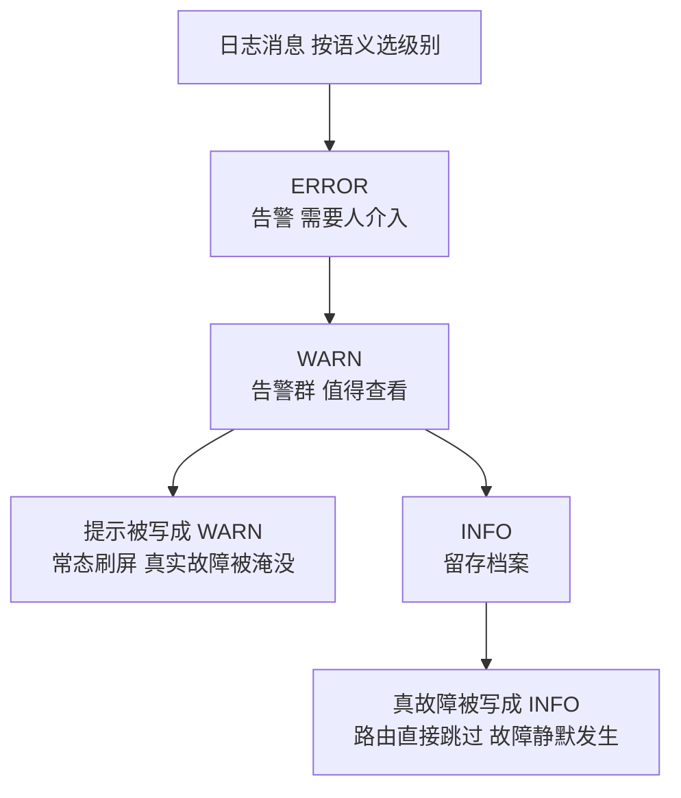
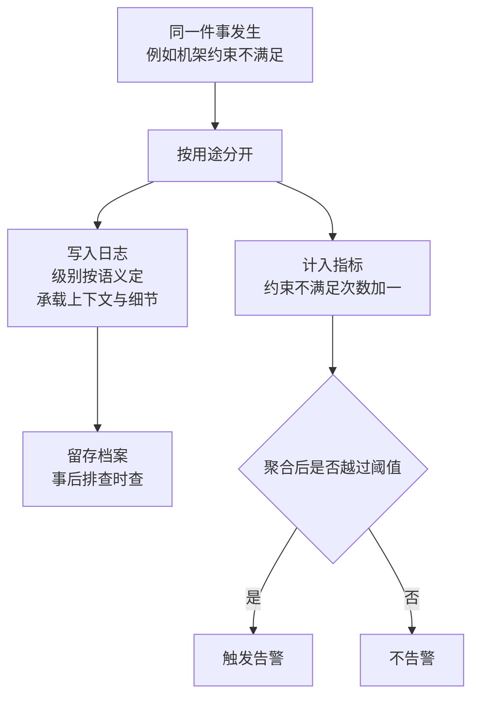

# 日志级别的语义：把提示当告警，告警就成了背景噪音

> **要点**：**放置策略的机架约束提示按 WARN 级别写进客户端日志**，**基于 WARN 的告警链路因此常态误报**——**日志级别是给人与监控系统读的语义承诺**，**级别错配让"提示"挤占"告警"的信道**，**真实故障淹没在重复噪音里**。

## 要解决的问题

日志级别除了控制显示，还承担一套**给自动化系统读的语义协议**的职责：**ERROR（日志级别：错误）表示需要人介入的故障**，**WARN（日志级别：警告） 表示异常但可自愈的状态**，**INFO（日志级别：信息）表示正常流程的记录**。**监控链路按级别路由告警**——**WARN 进告警群、INFO 进留存档案**。这套协议成立的前提是**写日志的人按语义选级别**。**某个"正常情况下的提示"被写成 WARN 后，告警链路在每个触发点上响一次**，**噪音大到一定程度，人开始忽略 WARN**——**协议从那一刻起对真实故障失效**。

Apache BookKeeper 的一个真实病例（上游修复 commit 0ce47aa9，可查）：**客户端创建账本时申请跨机架多副本的放置，而集群可用 bookie 的机架数不满足约束，放置策略返回失败**——这是一个**有明确业务含义、可自动处理**的状态（**放置策略会重试、可调整拓扑**）。旧实现把这条提示按 WARN 写进日志：**每次创建账本都刷一条"机架约束不满足"**。**运维基于 WARN 配置的告警被常态触发，误报淹没真实故障信息**。**上游修复把该提示降为 INFO**——**数据正确性与可用性不受影响，受影响的是告警信道的信噪比**。

**这个病例小到只有一行级别改动**，它背后的规则值得单独成篇：**日志级别的选择是在替监控系统做承诺**。**级别写错，承诺失真，失真的代价由整条告警链路承担**。

## 它是怎么做到的：级别的语义约定与两条失效路径

**每个级别是一份对"谁会在意这条消息"的承诺**，**按消息内容的三个维度判定归属**：

**是否需要人行动**：**需要人现在就处理的故障 → ERROR**；**异常但系统可自愈或可延后处理 → WARN**；**正常流程的事实记录 → INFO**。

**是否是预期内的状态**：**机架约束不满足属于"策略按设计工作"的输出**——**策略告诉你"当前拓扑满足不了请求"**，这是**反馈**，按设计会有、按设计会被处理。**预期内的反馈用 WARN，就是把"系统在正常解释世界"误报成"系统遇到了问题"**。

**触发频率**：**高频路径上的消息，级别定错伤害按频率放大**。**账本创建是客户端的常态操作，约束不满足在拓扑受限的集群里是常态状态**——**两个常态相乘，一条 INFO 级的提示成了告警群里的刷屏者**。

**告警信号与触发条件的绑定，实物原型是灯塔的雾角**：**它只在有雾时鸣响，晴天一声不吭**——**正因为每次响起都意味着「此刻真的看不清」，沿海居民听到雾角必然警觉**：


*图源：Wikimedia Commons，作者 Ronnie Robertson，CC BY-SA 2.0，https://commons.wikimedia.org/wiki/File:Sumburgh_Foghorn_%26_Lighhouse_IMG_4374_(13518803255).jpg。*

反过来想：**如果雾角不管有没有雾都每小时响一次，一周之后没有居民会再抬头**。**把常态提示写成 WARN 的服务就是那座乱响的灯塔**——**告警链路从此学会忽略 WARN，真正起雾的那一天，信号在噪音里归零**。

**级别错配有两条失效路径**。**误报路径**（本病例）：**提示占用了 WARN 信道，告警疲劳后真实 WARN 无人理会**——**告警的查全率没变，查准率崩了，等效于告警失效**。**漏报路径**（反向错配）：**把真故障写成 INFO，监控按级别路由直接跳过它**——**这类错配更危险，因为它不产生任何噪音，故障静默发生**。本库稳定性域"周期任务静默终止"的病例里，**Error 逃逸连日志都没有，就是漏报路径的极端形态**。




来源：[博客园《解密 Raft 算法》](https://www.cnblogs.com/traditional/p/12588733.html)（CC 4.0 BY-SA）


## 判定：一条消息该用什么级别

**把判定变成可执行的检查单，写日志时过一遍**：

- 这条消息出现时，**运维应该做什么**？答"立即处理" → ERROR；答"看看就行" → WARN；答"什么都不用做" → INFO；
- 这条消息在**正常业务的常态流**里会出现吗？会 → 至多 INFO；
- 这条消息**触发频率**是多少？高频路径上的消息定高级别前，先按频率乘一遍告警量；
- 这条消息有没有**结构化的对应物**？**能变成指标或事件的状态（重试次数、约束不满足次数），优先做成指标**——**指标有聚合、有阈值、有抑制策略，比日志行的告警更可控**。**本病例的"约束不满足次数"做成指标，比任何日志级别都更准确**。

第四条是现代实践的关键：**日志与指标分工**——**日志承载上下文与细节，指标承载可告警的状态**。**把"要不要告警"的问题从日志级别里拿出来交给指标，级别错配的伤害面就小了一个量级**。

**分工之后，同一件事走两条不同的路：一条进日志留上下文，一条进指标管告警**：



**本病例的"约束不满足次数"走右边这条路最合适**：**它有聚合、有阈值、有抑制策略，不会因为在高频路径上出现就把告警群刷满**。**左边那条路仍然要写日志，但级别只需回答"这条消息本身有多严重"**，**不再兼任告警开关**。

**按用途分流是现代观测体系的标配形态**：OpenTelemetry Collector（可观测性数据采集开放标准 OpenTelemetry 的采集器组件）的官方管线图里，**多个 Receiver 的数据汇入同一条处理链，链尾按用途 fan-out 到不同的 Exporter**——**留档的进文件后端、要告警的进指标后端，各走各的信道**。日志与指标的分工在管线层面就是这么落的：


*图源：[OpenTelemetry 官方文档 Collector Architecture](https://opentelemetry.io/docs/collector/architecture/)，CNCF，Apache 2.0。*

日志与指标的分工参考中文资料：[日志级别全解析：从 DEBUG（日志级别：调试） 到 FATAL（致命级别日志） 的工程实践与性能优化](http://www.hqwc.cn/a/985202.html)、[日志级别详解（CSDN）](https://blog.csdn.net/m0_60252632/article/details/148280916)。

## 修完之后靠什么防住复发

**上游修复的动作是把提示降为 INFO；防线体系要延伸到存量与流程**：

**级别审计**：**对高频路径上的 WARN/ERROR 做例行审计**，**判定标准用上面的检查单**——"**最近 24 小时出现超过 N 次的 WARN**"是天然的审计入口，**常态高频的 WARN 几乎都是错配**。

**告警链路的抑制与聚合**：**同一消息的告警按窗口聚合、按来源抑制**，**重复噪音合并成一条带计数的告警**——**这治不了级别错配的根，但能防单点错配刷屏，给审计争取时间**。

**级别规范进评审**：**代码评审对日志级别的敏感度要与对异常处理的敏感度同等**——**新日志按检查单过一遍，改级别像改错误码一样留变更说明**。

**监控与日志级别解耦**：**长期方向是把告警输入从"日志级别"迁到"指标与事件"**，**日志级别退回给人读的上下文层**——**级别错配还在发生，但它不再能攻破告警链路**（此处击穿指闯入防线，与缓存击穿无关）。

## 这套说法在哪儿会失效

三条边界防止防线走形。

**降级（主动牺牲部分功能或精度，保住核心链路）不消除信息**：**把提示从 WARN 降为 INFO 的前提是"系统按设计处理了这个状态"**；如果状态实际上没人处理（放置失败后账本就建在单机架上），该修的是处理逻辑，级别只是表象——**先确认"这确实是预期内反馈"，再动级别**。

**级别语义按团队共识固定**：**ERROR/WARN/INFO 的语义承诺要在团队内成文并一致执行**，**不同服务对 WARN 的理解漂移，跨服务的监控就失去统一判据**。

**迁移期要双轨**：**从日志告警迁到指标告警的过渡期，两条链路并行验证覆盖面**，**直接切会让依赖旧链路的告警失去兜底**。

## 怎么自己动手验证

**验证要拿的账是：常态触发下的 WARN 日志量与账本创建数的增长对不对得上**。

1. 构造常态触发：**搭建机架数受限的测试集群，客户端持续创建账本触发约束不满足**；
2. 未修复基线（正常状态下的指标水平、用来对比异常）：**统计 WARN 日志量随账本创建数的增长，确认告警链路常态触发，捕获一次即为缺陷证据**；
3. 修复后重跑：**同一负载下该提示为 INFO，WARN 信道安静**；另造一个真实异常（如 bookie 宕机），确认它的 WARN 在告警群里**不再被噪音淹没**；
4. 断言锚点：**常态业务流不产生 WARN 级日志**；**告警链路的信噪比可度量（真实故障告警数 / 总告警数）**。

```text
常态流断言 = 常态业务负载 → WARN 计数 == 0
信噪断言 = 注入真实故障 → 告警群可见且未被常态噪音稀释
```

**信噪比是告警链路的终局指标**——**级别错配的一切防线，最终都收敛到"真故障的告警能不能被看见"这一问上**。

## 接着读哪几篇：日志级别的另一端：该记的没记

- [[工程知识/缺陷分析：从个案到体系/稳定性/异常处理器的覆盖面：Error 逃逸终止周期任务]] —— 日志级别的另一端：该记的没记，静默终止
- [[工程知识/缺陷分析：从个案到体系/并发/关闭与观测的并发错位：生命周期边界要算上读它的人]] —— 观测通道的相邻病例
- [[工程知识/数据系统：在并发与故障中保存事实/数据治理/数据质量与血缘让指标可以被解释]] —— 指标语义与可解释性的治理框架
- [[工程知识/后端系统：在并发、失败与变化中维持服务/分布式可靠性/健康检查只能提供有时效的失败证据]] —— 观测语义的机制面：证据的时效与信噪
