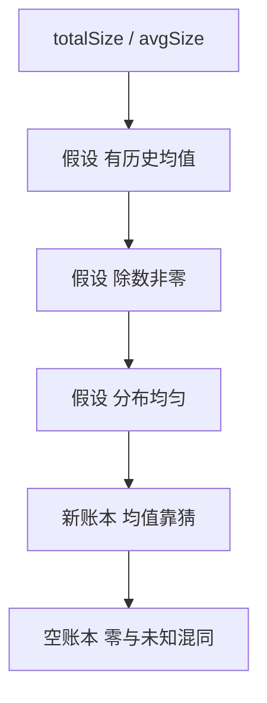
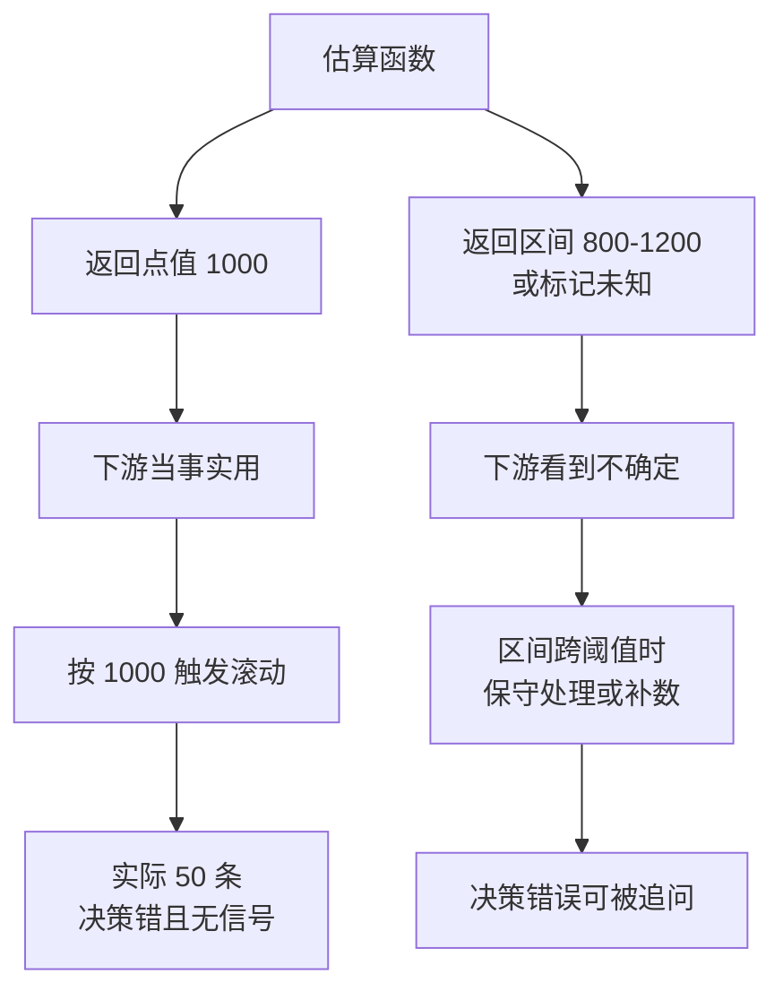
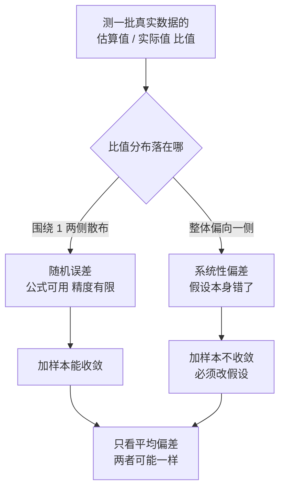

# 案例三十三：估算不等于算术——按大小推条目的错算

> **要点**：**用总字节数除以平均条目大小来估算条目数，是一条在边界上必然失真的公式**——**它假设了平均值的稳定性，而边界情形恰恰是平均值不成立的地方**。

估算器上有两类性质不同的缺陷，本篇要解决的问题是其中关于计算本身的那一类：**估算公式在边界上失真**。它常常与读取竞态长在同一个组件上——**估算器这种"不要求精确、被多处依赖"的组件，往往同时缺少严格的正确性审查和并发审查**。

**同一类「估算值驱动决策」的结构，在消息系统里有标准形态可对照**：**优先级队列模式把消息按高、中、低三条队列分流，消费者池按队列优先级取任务**——**每条队列的长度是估算值，驱动的决策是「哪个消费者先服务哪条队列」**。微软 Azure 架构模式文档画的正是这个结构，**队列长度估算错一分，消费者调度就偏一分**：


*图源：Microsoft Azure 架构模式，Priority Queue pattern，CC BY 4.0，https://learn.microsoft.com/zh-cn/azure/architecture/patterns/priority-queue。*

## 案例出在哪个环节：场景

**项目**：Apache Pulsar——分布式的消息与流处理平台。**它的条目数估算器用总字节数推算条目数，推算过程里藏着哪些分布假设，就是本篇追问的事**。

`EntryCountEstimator` **负责估算一段区间内的条目数量**。**精确计数需要遍历所有条目，代价太高**；**估算则是用已有的元数据（总字节数、已知条目数）推算**。

`estimateEntryCountBySize` 是这类估算的典型实现：**已知某段数据的总字节数，已知平均条目大小，两者相除得到条目数**。

这条公式在**平均值稳定**时是准的。**问题在于，它被调用的场景恰恰是平均值不稳定的场景**。

**估算的对象是 topic 日志的 segment（分段）：一个 topic 的日志由一串 segment 组成，只有最后一段可写，之前的都已封闭不可变**。Apache Pulsar 官方文档的这张图画出了这条 segment 链——**估算器被调用的时机往往正是"这段 segment 覆盖多少条目"还没有精确答案的时候**：**刚建的新 segment 没有历史均值，空 segment 总字节数为零，大小悬殊的条目让平均值失去代表性**：


*图源：[Apache Pulsar 官方文档《Tiered Storage》](https://Pulsar.apache.org/docs/3.0.x/cookbooks-tiered-storage/)。*

## 公式在什么边界上失真：问题

上游报告的问题集中在 `estimateEntryCountBySize`（后重构为 `EntryCountEstimator`）的边界行为上，上游有三个关联修复（[PR（Pull Request，拉取请求：请求把我的分支改动合入主干） #24055](https://github.com/apache/pulsar/pull/24055) 防止估算值为负；[PR #24089](https://github.com/apache/pulsar/pull/24089) 把估算逻辑抽成独立类并处理 NPE 与上限；[PR #24125](https://github.com/apache/pulsar/pull/24125) 空账本返回 1 而不是按默认大小估算）。

按大小估算条目数，失真的来源有下面几种，见下图：

**平均值不可用。** **没有任何历史条目时，平均大小无从计算**。**此时代码需要一个兜底值（比如取 0、取 1、取某个常量）**。**这个兜底值没有任何数据支撑，只是猜测，它会在空账本或新账本上产生严重失真的结果**。

**边界除法。** **除数为零（总字节为 0、条目数为 0）时结果是除零异常或无穷**。**被除数为零时结果为零，而"零条目"与"不知道有多少条目"是两回事，返回值却相同**。

**分布假设不成立。** **条目大小的实际分布可能高度不均——少量大条目与大量小条目混合**。**用平均值推算，对大条目段会高估、对小条目段会低估**。**这种误差朝一个方向堆积，随机误差那种互相抵消的好运在这里不会出现**。

**整数溢出与截断。** **总字节数可能很大，与平均大小相乘或相除时可能越界**。这与 [[工程知识/缺陷分析：从个案到体系/正确性/案例九：数字越过了边界——Redis 里三次截断导致的崩溃|案例九]] 是同一族问题——数字在类型边界上失去意义。
## 错的估算为什么会带偏决策

**估算值会驱动决策。** **如果只用于显示"大约有多少条"，错一点无妨**。**但它会被用于判断是否触发账本滚动、是否值得执行压缩、积压是否过大**。错误的估算会导致：**该滚动时不滚动、不该压缩时压缩**。**这些决策的代价远高于一个显示数字不准**。

**它是静默的。** **估算返回 1000，实际是 50，没有任何一方会察觉**。**没有异常，没有校验——因为"估算"这个性质本身就豁免了精确性要求**。**名字里的"估算"二字，让所有不合理的值都变得可被接受**。

**误差在边界上最大，而边界恰恰是需要正确决策的地方。** **新账本（无历史平均值）、空账本（零字节）、超大账本（溢出）——每一个都是系统状态转换的关键点**，**没有一个可以当成角落忽略**。

**难以设定正确的期望。** 测试这类函数时，"正确值是多少"本身就不清楚。写测试的人只能断言"大概在这个范围"，这样的断言几乎捕捉不到系统性偏差。

**它与其他缺陷叠加。** 本组件同时存在读取竞态（见 [[工程知识/缺陷分析：从个案到体系/并发/案例三十二：取到了已经不存在的那个——估算器的读取竞态|案例三十二]]）。估算值可能因为竞态返回缺失，也可能因为公式错误返回偏差——两者表现相似，排查时容易混淆。

**估算值驱动的下游决策里最重的一条就是分层卸载**：**segment 估算出的条目数参与「这段冷数据值不值得搬走」的判定**，官方文档的卸载机制图给出这条链路的完整形状——已封闭的 segment 从 Topic Log 搬到 S3（Simple Storage Service，AWS 的对象存储服务）/GCS（Google Cloud Storage，谷歌云对象存储）/文件系统，热数据留在 BookKeeper：


*图源：同上（[Apache Pulsar 官方文档《Tiered Storage》]）。*

## 根子在哪：公式把假设藏在实现里

把这条推算公式的隐含前提抽象出来，骨架如下面这张图：

> **估算用一条公式替代真实的枚举，公式的每一步都引入了关于数据分布的假设；这些假设在典型场景下成立，在边界场景下失效——而失效时的输出与正常输出无法区分。**

这条骨架的关键在于**假设的隐藏性**。

**精确计数不需要假设：数一遍就知道了**。**估算需要假设：用一部分信息推全体，推导规则就是假设**。**"条目大小差不多"是一个假设，"历史平均能代表当前"是另一个假设**，"总量与均值相除有意义"是第三个。

这些假设**不写在任何地方**。**它们隐含在** `totalSize / avgSize` **这一行代码里**。**写这行代码时，作者脑中的场景是"大量条目、大小相近"**——**在那个场景下公式是对的**。**后来这个函数被用在空账本上、被用在大小悬殊的混合负载上，假设不再成立，而代码没有任何变化**，**也没有任何地方表达了"我依赖这个假设"**。

第二个要点是**估算豁免了正确性审查**。**代码评审时，精确计算的函数会被仔细验算边界**；**估算函数往往被放过——"反正是估算"**。**结果是估算函数的边界处理通常比精确计算粗糙得多，而它却被用在同样重要的决策上**。

第三个要点是**误差的方向性**。**随机误差会互相抵消，系统性偏差不会**。按平均值估算对不均匀分布的偏差是**朝一个方向的**，**它"在这类输入上一直错"，与"偶尔错"完全两样**。

## 打个什么比方：按平均身高估算一队人的总体重

要估算一队人的总体重，已知队里有 20 个人。用"平均体重 60 公斤 × 20 = 1200 公斤"。

**这个方法的问题不在算术，在假设**。**如果这是一支篮球队，平均体重可能接近 90 公斤，估算值严重低于实际**；**如果是体操队，严重高于实际**。**"平均 60 公斤"这个数字来自哪里，决定了对不对**——**如果它来自全体人群的统计，那么用在这支特定队伍上就是错的**。

还有两个情形会让公式彻底失效。**如果队伍刚组建，还没称过任何人，"平均体重"只能靠猜**——**这时公式给出的 1200 公斤与猜测的东西一样不可靠，但它看起来是一个计算出来的数字，比猜测更有说服力**。

如果队伍只有一个人，或者零个人，公式会给出奇怪的结果：**零人时算出 0 公斤（看起来对，但"零人"与"不知道有多少人"被混为一谈）**；**一人时用一个平均值代表他（而这一人的实际体重可能差得很远）**。

关键教训：**一个算出来的数字，比一个承认不知道的答复更危险**——**因为它会被当作事实使用，而它的不确定性没有随它一起传递**。

## 假设怎么在边界上失效：机制

估算把假设藏进了公式里，边界一变就失真。**具体化视图是同一个问题的另一种解法：视图由源数据按规则生成并单独存放，规则变了就重新生成，而不是拿旧的推导结果继续用**。


估算逻辑集中在 `EntryCountEstimator` 这个类里：

```
managed-ledger/src/main/java/org/apache/bookkeeper/mledger/impl/EntryCountEstimator.java
```

按大小估算的典型实现路径上，以下几个环节各自引入了假设，见下图：

**获取平均大小**：来自历史统计。**历史为空时无值——这一步要么返回默认值（引入猜测），要么需要特殊处理（容易漏）**。

**除法运算**：`totalSize / avgSize`。**除数为零需要保护**；**结果为零时的语义（真的是零条目，还是算不出来）需要区分**。

**结果的上下界**：**估算值可能超出合理范围（比如超过账本理论最大条目数）**。**缺少 clamp 会让下游拿到荒谬的值**。

**类型边界**：**总量与均值的乘积可能溢出**。**这在长时间运行、大账本上才会触发，与案例九的数字越界同族**。

四个环节各自的假设在哪种输入上断掉，下面对着公式逐个摆一遍，对照见下表：



图："哪种输入打断哪条假设"——一行公式背后并排站着四条假设，每条对应一类边界输入。**评审估算函数时按这四列逐个问，比盯着那一行除法更容易找到缺口**。

**上游修复的方向是处理这些边界：为平均值不可用的情形提供明确语义，取代静默套用默认值**；**对除法与溢出做保护；对结果做合理性约束**。

这里有一个设计选择的机会：**估算函数可以返回一个区间**。**"大约 800 到 1200 条"比"1000 条"更诚实，也更能让下游做出合理决策**。代价是接口变复杂。多数实现选择返回点值，然后把这个点值当作事实使用——**这个选择才是问题的真正来源**。两种返回形态在下游各走到哪里：



图："不确定性去了哪里"——左路把不确定性在函数边界上丢掉，下游拿到的是一个看起来确定的数字；右路把不确定性随结果一起传出去，下游至少知道自己在冒险。


## 怎么发现：把估算当有前提的计算审查

**把估算函数的每个假设写下来。** **评审时先列"这个函数依赖哪些关于数据的假设"，再逐个问"什么输入会让它不成立"**。**这个清单比读代码本身更能发现问题——因为假设不在代码里**。

**专门测试边界输入。** **空输入、单元素输入、极端大小、极大总量**。**估算函数的边界测试比正常值测试更有价值，因为正常值上它通常是对的**。

**验证估算值与真实值的偏差分布。** **只看平均偏差会漏掉方向性**。**跑一批真实数据，计算估算值与实际值的比值分布**：**围绕 1 波动说明误差随机，集中在某一侧说明存在系统性偏差**。

两种分布的平均偏差可以完全相同，含义却相反，看下面的例子，对比见下图：



最后一行是这条检查容易被跳过的原因：**随机误差与系统性偏差在平均值上区分不出来，只有看分布才看得出**。而二者的处置完全不同——**前者可以多取样本改善，后者取再多样本也只会稳定在错的位置上**。

**给估算结果设合理性上下界并断言。** **结果超出理论可能范围时记录告警**。**这是发现公式错误最廉价的手段**。

**区分"算出来是零"与"算不出来"。** 返回值里保留这个区分（比如用 `Optional` 或额外的标志位）。**混在一起会让下游无法判断**。

## 上游把前提怎么摆上台面：修复

上游的三个修复对应三类边界：[PR #24055](https://github.com/apache/pulsar/pull/24055) **在 long 转 int 后加负值检查**——**总字节数极大时估算结果可能溢出为负，负值会让读取操作拿到空结果**；[PR #24089](https://github.com/apache/pulsar/pull/24089) 把估算逻辑从 `ManagedCursorImpl` 抽成独立的 `EntryCountEstimator` 类，**补 NPE 防护（只读账本的 currentLedger 为空）**、**加入 maxEntries 上限提前停止计算、返回类型从 long 收窄为 int，并补了成套单元测试**；[PR #24125](https://github.com/apache/pulsar/pull/24125) 处理空账本——**所有账本都为空时不按默认条目大小估算，直接返回 1**。

PR #24055 的 diff 就是「类型边界」这条假设的修复实物：改动前 `Long.valueOf(estimateEntryCountBySize(...)).intValue()` 直接把 long 估算结果砍成 int，溢出为负无人察觉；**改动后估算值先以 long 保存、超界时返回 maxEntries 兜底，再收窄类型**——


*图源：[Apache Pulsar PR #24055](https://github.com/apache/pulsar/pull/24055/files) 的代码评审页 diff 截图。*

**修复保持了"估算"这个性质——没有改成精确计数**。这是对的：**精确计数的代价在热路径上不可接受，估算本身是合理的设计**。**该修的是"估算在边界上的行为未被定义"，"用估算"这个决定本身没有错**。

**预期空账本、新账本与超大账本三类输入各有明确约束的返回值**；**修复前实测返回零或常数猜测，与预期对不上**。

## 这套防法在哪儿会失效：边界与教训

- **估算的假设不写在代码里。** 评审时先列假设，再验算边界。
- **"反正是估算"让它逃过了边界审查。** 而它被用在同样重要的决策上。
- **系统性偏差不会互相抵消。** 偏差朝一个方向意味着在这类输入上一直错。
- **算出来的数字比"不知道"更危险。** 不确定性没有随结果一起传递。
- **区分"算出零"与"算不出来"。** 混在一起会让下游误判。
- **边界测试比正常值测试更有价值。** 估算在正常值上通常是对的。
- **考虑返回区间。** 点值会被当作事实使用，这是问题来源。


## 想自己复现一遍怎么动手：验证

1. 上游对照：到 Pulsar 的 PR #24055、#24089 与 #24125 里核对 `estimateEntryCountBySize`（EntryCountEstimator）的修复方式，确认负值防护、NPE 防护与空账本兜底都有对应改动与测试。
2. 边界复现：**分别构造空账本（总字节为零）、新账本（无历史平均值可算）、超大账本（总字节接近类型上界）三种输入**，**记录返回值是异常、是零还是常数猜测，修复前后逐项对照**。

3. 分布核验：**用少量大条目与大量小条目混合的数据复测，确认按平均大小推算的偏差方向与幅度**，并确认偏差是系统性偏向。
4. 决策影响：**把估算值接到滚动与压缩的判定逻辑上，确认修复前后触发时机的差异**。
5. 断言锚点：**边界输入的返回值逐项记录，偏差方向有实测数据，决策链路的触发条件与估算值对应**。

## 接着读哪几篇：同在缺陷分析里的相邻问题

- 算法复杂度连接规模与资源成本——[[工程知识/软件构建：让变化可以理解、验证与交付/算法与数据结构/算法复杂度连接规模与资源成本]]。
- 测试策略按风险选择证据——[[工程知识/软件构建：让变化可以理解、验证与交付/测试与交付/测试策略从风险选择证据]]。
- [[工程知识/缺陷分析：从个案到体系/并发/案例三十二：取到了已经不存在的那个——估算器的读取竞态]] 讲同一估算器上的另一类缺陷，读取竞态。
- [[工程知识/缺陷分析：从个案到体系/正确性/案例九：数字越过了边界——Redis 里三次截断导致的崩溃]] 讲数字在类型边界上失去意义的同族问题。
- 导读见 [[工程知识/缺陷分析：从个案到体系/缺陷分析：从个案到体系——导读与开源地图]]。
