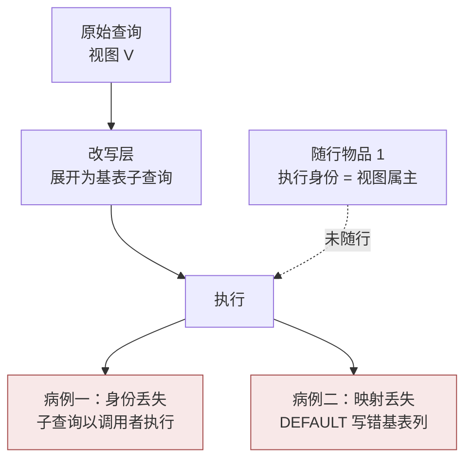
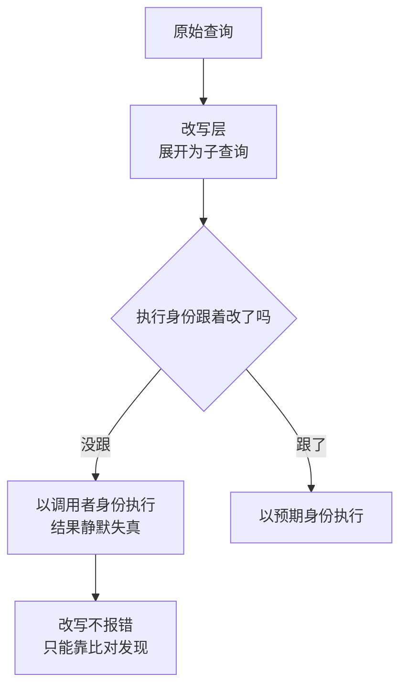
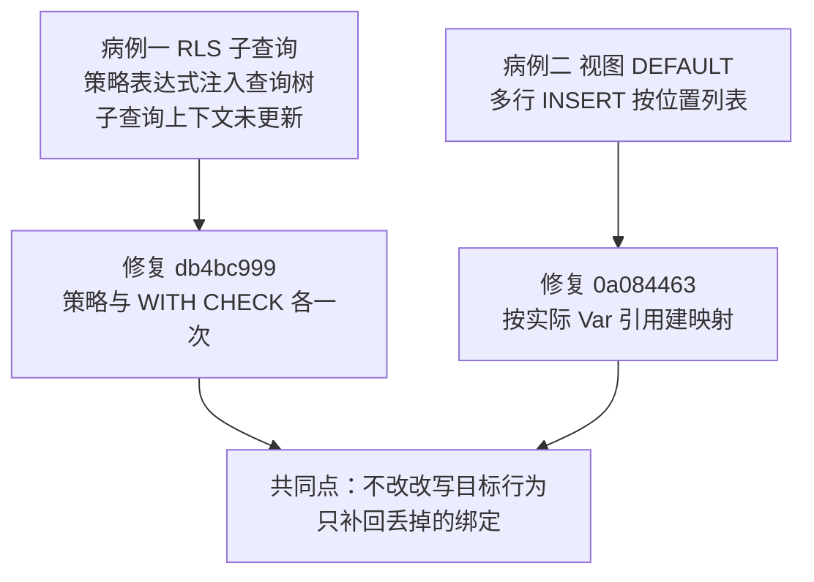

# 案例三十九：身份在改写中丢失——RLS 子查询与视图 DEFAULT 的静默失真

**查询被引擎改写时，附着在原始写法上的身份和列映射没有跟着传下去**。**读完这篇你能识别改写导致的身份丢失，不再让权限策略静默失效**。

> **要点**：PostgreSQL（开源关系型数据库）的两条病例——**RLS 策略里的子查询被以错误的身份执行、可更新视图的 DEFAULT 写入错误的基表列**——共享同一个不变量：**查询在被引擎改写时，附着在原始写法上的身份和列映射没有跟着传下去。**

## 案例背景（要解决的问题：身份在改写中静默丢失，机制是什么）

**项目**：PostgreSQL——开源关系型数据库。**这一簇的修复全部来自它的上游，部分发行分支滞后未带上**（[上游 commit db4bc999](https://github.com/postgres/postgres/commit/db4bc99948bf746c7035b49cc581eb1c44a30788) 与 [上游 commit 0a084463](https://github.com/postgres/postgres/commit/0a08446308c8387144e69a99bf738e204f11fc70)，P1，正确性类，已真实复现）。

SQL 引擎执行一条查询前要对它做大量**改写**：视图展开成子查询、规则重写、权限策略注入、DEFAULT 值映射到基表列。改写是引擎的日常——每一条改写都要携带两样易碎品：**身份**（这段表达式以谁的身份执行）和**映射**（这个列对应基表的哪一列）。**两个病例各碎了一样**。



**图要表达的是改写层的职责边界：它负责把查询树从一种形态变成另一种形态**，而**身份与映射这类信息附着在"原始写法"上，不属于查询树本身的结构**。**改写规则照着树走，走到没有这些附件的那一层，附件就留在了原处**。

## 病例一：RLS 子查询以调用者身份执行

**行级安全（RLS）策略本身是一条表达式，可能内嵌子查询**。通过视图访问基表时，策略表达式里的子查询应该以**视图属主**的身份执行（这是"视图代理权限"的语义），实际却以**调用者**的身份执行——**安全边界从属主收紧到调用者，策略可能失效**。

**为什么引擎会拿错身份**：策略表达式在改写阶段被注入查询树，注入时**没有人去更新表达式内部子查询的用户上下文**——**改写只处理了"把策略挂上去"，没处理"策略内部的世界"**。修复（[上游 commit db4bc999](https://github.com/postgres/postgres/commit/db4bc99948bf746c7035b49cc581eb1c44a30788)）**在关闭基表前对策略条件与 WITH CHECK 选项各调用一次身份传播，把属主身份灌进子查询与 CTE（Common Table Expression，SQL 的临时命名结果集）**。

**身份问题之外，改写层还守着另一道与谓词求值顺序有关的屏障：视图的过滤条件是安全条件，外层查询的谓词必须证明「无害」（leakproof）才允许下推到屏障之下先于它执行**——**下推的谓词会在屏障过滤完成前读到行，函数在报错信息里把不可见行的值带出去**：


*图源：[Database Execution Plans《Security Barrier Views and Leakproof Functions》](https://www.database-execution-plan.com/reading-interpreting-query-plans/filter-pushdown-mechanics/security-barrier-views-and-leakproof-functions)。**安全条件先行的代价是索引用不上（右栈），引擎在安全与速度之间默认选了安全**。*

**这里"收紧"二字的方向值得留意：属主身份通常比调用者宽，以调用者身份执行意味着子查询看到的数据更少、策略条件的判定结果可能不同**。**安全边界收紧听起来比放宽安全，实际同样危险——它让策略按设计者未预期的方式求值，而这个差值在权限审计里是看不见的**。

## 病例二：可更新视图的 DEFAULT 写错列

**多行 INSERT（插入语句）走可更新视图时，VALUES（INSERT 里给出具体数值的子句）里某一行的 DEFAULT 应该映射到基表对应的列**。旧实现按**位置列表**索引列映射——多行 VALUES 的位置索引对不上单行的假设时，DEFAULT 写入错误的基表列，**静默写错数据**。

**为什么是静默的**：**写进去的值类型兼容、格式合法，任何约束都不拦**。**只有业务知道"这一列的默认值不对"**——和 [[工程知识/缺陷分析：从个案到体系/正确性/案例二：静默错算——Spark SQL Union 的别名陷阱]] 的 Union 别名同构：**位置是一种隐含约定，改写层的假设与实际行数或顺序不符时，映射错位**。修复（[上游 commit 0a084463](https://github.com/postgres/postgres/commit/0a08446308c8387144e69a99bf738e204f11fc70)）**改为扫描目标列表中引用该关系层的实际列来构建映射，删除有假设的位置索引**。

## 这类问题还在哪儿出现过

两个病例并排放着看，不变量是一句话：**改写一条查询时，跟着原始写法走的隐式约定（执行身份、列位置）必须被显式地重新绑定——改写者只改了它关心的部分，易碎品留在原地。**

**改写时该随行的两件行李**：

```text
改写：视图 V → 基表 T 的子查询
随行物品 1：执行身份 = 视图属主    ← RLS 子查询丢失的就是它
随行物品 2：列映射 = V.col → T.col ← DEFAULT 错位丢的就是它
改写只搬了查询树，两件行李留在原地址
```

**特洛伊木马讲的是同一类事故的反面教材：希腊人把士兵藏进木马，特洛伊人按"祭品"的语义把马拖进城——载荷被搬运了，藏在载荷里面的东西没有跟着原来的意图走**。查询改写同样如此：**改写规则搬动了查询树的结构，附着在原始写法上的身份与列映射不在结构里，搬运完成的那一刻它们已经留在原地**：


*图源：Wikimedia Commons，Jorge Royan，CC BY-SA 3.0，https://commons.wikimedia.org/wiki/File:Munich_-_Trojan_wooden_horse_at_K%C3%B6nigsplatz_-_5440.jpg。*

与 [[工程知识/缺陷分析：从个案到体系/正确性/案例二：静默错算——Spark SQL Union 的别名陷阱]] 的 Spark（分布式计算引擎，靠内存计算加速大规模数据处理） SQL 别名删除完全同构：**两个引擎、两种改写、同一个"改写时丢上下文"的模型**。**任何做查询改写的系统都适用这条：SQL 优化器、ORM（Object-Relational Mapping，对象关系映射：负责把数据库表映射成程序里的对象）、规则引擎的查询翻译无一例外。**

**三个病例分布在不同引擎上，说明这不是某家的实现疏忽**。**改写的过程是把一种写法翻译成另一种，翻译规则只覆盖"被翻译的那部分结构"**——**附着在写法上的上下文不在结构里，也就不在规则的处理范围内**。**这是改写这类机制自带的属性，不是某一处代码没写对**。

| 病例 | 随行的物品 | 丢失之后的表现 | 静默原因 |
| --- | --- | --- | --- |
| RLS 子查询 | 执行身份（视图属主） | **子查询以调用者身份求值，策略失效** | **返回的仍是合法数据，权限系统无报错** |
| 视图 DEFAULT | 列映射（V.col → T.col） | DEFAULT 写入错误的基表列 | **值类型兼容，约束不拦** |

**两个病例的第三列指向同一个结局：系统交付了结构合法的结果，只是结果与设计意图不一致**。**这正是改写类缺陷难以被测试拦住的原因——测试断言的是"返回了什么"，而身份与映射属于"以什么方式得到的"**，**后者不在常规断言的覆盖范围内**。

## 上游怎么修



**查询改写会替换执行主体，身份不随改写传递时结果会静默变化**；**上面这张判定图把「没跟」与「跟了」两条路径的结局摆在一起，静默失真那一路不报错，只能靠比对发现**。


**两处修复都在改写层补"传递"：身份传播函数覆盖策略表达式内的子查询与 CTE；列映射改为按实际 Var（查询树里表示列引用的节点）引用构建**。共同点是**不改变改写的目标行为，只把改写过程中丢掉的绑定补回来**——**这也是改写类缺陷修复的标准姿势**。



**"不改变目标行为"这个限定让这类修复的风险可控：改写的目的（展开视图、注入策略）保持原样，只是把漏掉的附件补上**。**反过来说，如果修复要顺带改掉改写的目的，回归面就从"绑定是否完整"扩大到"改写是否仍然正确"，验证成本完全不同**。

## 这套说法在哪儿会失效，代价换来了什么教训

- **改写类的代码要维护一张"随行物品清单"**：身份、权限、列映射、排序语义、NULL 语义——每做一次转换，逐一核对是否跟着走了。
- **安全边界类缺陷优先看身份传播**。**策略、视图、存储过程——每层封装都是一次身份可能失真的机会，测试要覆盖"通过封装访问"的路径，不能只测直连**。**直连测试下身份只呈现一种取值，身份传播的错误在第二种取值出现时才现形**。
- **静默写错数据要评估存量**：DEFAULT 写错列写入的数据不会自己恢复，修复之后要对受影响窗口内的数据做清洗评估。

**三张检查单合起来是一次改写的验收动作：动手之前先问一句「这次改写搬走了什么、又漏下了什么」**。**它的价值不在列举齐全——不同系统的附件各不相同——而在于把"检查附件是否随行"变成一个在动手之前必做的动作**，**而不是等缺陷出现之后再回头找**。

## 怎么自己动手验证

1. 身份复现：**以受限用户执行含安全条量子查询的语句，EXPLAIN 预期显示按调用者身份评估**；**切换 SECURITY DEFINER（以函数属主身份而非调用者身份执行的属性）后对比评估身份差异**。
2. DEFAULT 列位复现：**对改列序后的视图做 INSERT，核对写入行的列对位，预期修复后与业务预期一致**。
3. 断言锚点：**视图变更后必跑行为对比、RLS（Row-Level Security，行级安全：按用户身份限制可读的行） 视图的身份语义进评审清单**。

## 接着读哪几篇：同在缺陷分析里的相邻问题

- 认证与授权的分工——[[工程知识/后端系统：在并发、失败与变化中维持服务/服务设计/认证授权决定请求能看什么和做什么]]。
- 一条查询在执行前经历什么——[[工程知识/数据系统：在并发与故障中保存事实/查询与索引/一条SQL如何穿过优化器与存储引擎]]。
- 事务边界与业务用例的关系——[[工程知识/数据系统：在并发与故障中保存事实/事务与存储/事务边界应覆盖完整业务用例]]。
- [[工程知识/缺陷分析：从个案到体系/正确性/案例二：静默错算——Spark SQL Union 的别名陷阱]] · [[工程知识/缺陷分析：从个案到体系/正确性/案例十三：键序与列名——Spark SQL 又两种静默错算]] · [[工程知识/缺陷分析：从个案到体系/缺陷分析：从个案到体系——导读与开源地图]]
