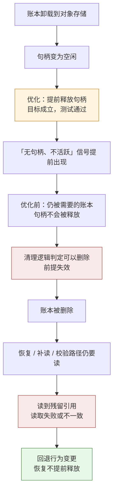
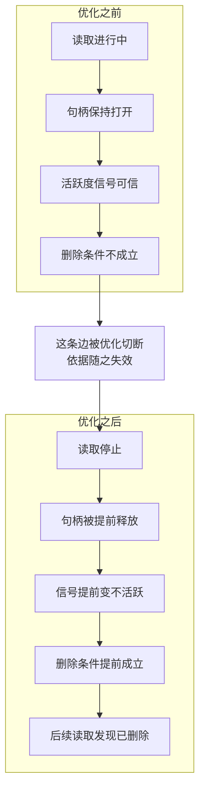
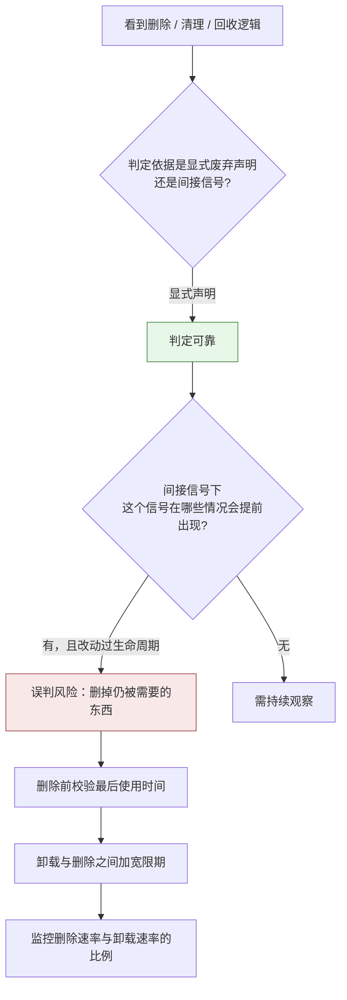

# 案例三十四：省下的句柄与多出的删除——一次优化引入的回归

> **要点**：**为了省资源而提前释放账本句柄，却让另一条路径误判"账本不再需要"而把它删掉**——**优化省下了一个句柄，代价是删掉了可能还在用的数据**。

有一类缺陷出在**改对了**的事情上：改动确实达成了它的目标，只是它顺带改变了另一段代码所依赖的前提。**这类回归最难防，因为改动本身通过了它自己的所有测试**。Apache Pulsar（分布式消息队列）的这个病例（上游修复 commit e0462126 与 1294a56b，均可查）是这条规律的完整展示。

## 省句柄的优化为什么删了数据：要解决的问题

打个比方：**邻居多年习惯把花盆放在你家墙沿上，从没写在任何协议里；你家装修把墙沿拆了（一次合理的优化），邻居的花全摔了**——**没人做错事，被破坏的是一段从未写下来的依赖**。本篇要解决的问题是：**一项本身正确的优化改变了实现细节，而另一段代码依赖的正是这个细节所维持的隐含前提**——**"我不用了"与"此后不再有人用"被混为一谈，导致可能仍在使用的账本被删除**。这个比喻到「没写下来的依赖会碎」为止，具体哪段代码依赖了什么，看下文案例。

## 案例出在哪个环节：场景

**项目**：Apache Pulsar——分布式的消息与流处理平台，**其分层存储把冷数据从存储层卸载到对象存储，卸载之后本地账本的句柄与空间如何处置构成本篇的问题**。

Pulsar 支持分层存储：**冷数据从 BookKeeper 卸载（offload）到对象存储（如 S3，AWS 的对象存储服务），以降低成本**。**卸载后，BookKeeper 上对应的账本理论上不再需要读取——数据可以从对象存储读回**。

Pulsar 官方集群架构图把这次改动涉及的几个组件摆在了同一张图上：客户端经 Service discovery 找到 Broker，Broker 内部的 Managed Ledger 通过 BookKeeper Client 与右侧的 Bookie 交互（BookKeeper：Apache 的分布式日志存储，Pulsar 的底层存储），读取与写入的账本（ledger）就落在 Bookie 上。**句柄（handle）是 Managed Ledger 这一侧持有的、指向 Bookie 上某个账本的入口**——**它属于 Broker 的内存状态，而账本实体在 Bookie 的磁盘上，两者分处图的两端**。

**释放句柄只让 Broker 这一侧的入口消失，Bookie 上的账本还在**；**清理逻辑如果只看句柄是否还在，就等于用一端的临时状态裁决另一端的永久归属**。


*图源：Apache Pulsar 官方文档（Architecture Overview），Apache License 2.0，https://pulsar.apache.org/docs/concepts-architecture-overview/*

**账本句柄（ledger handle）是读取 BookKeeper 账本的入口，持有它要占资源**。既然卸载后账本不再需要，那么**及时释放它的句柄**就是一项合理的优化。

于是有了这样一次改动：**让空闲的、已卸载账本的句柄被更早释放**。


## 释放句柄怎么被当成"账本可以删了"：问题

上游报告的现象（[上游 commit 1294a56b](https://github.com/apache/pulsar/commit/1294a56b95ed)，P1）是一次行为变更的回退（revert）：`only release idle offloaded ledger handle`。

另一条相关的（[commit e0462126](https://github.com/apache/pulsar/commit/e046212643e4)，P1）描述了具体后果：`still got BK（BookKeeper 的缩写，Apache 的分布式日志存储，Pulsar 的底层存储） ledger, even though it has been deleted after offloaded`——账本已卸载并被删除后，仍然拿到了它的 BK 账本。

**这里有两个方向的问题，都源于同一个混淆——把「暂时不用」当成了「永远不要」**：

**方向一：句柄释放被误读为"账本不再需要"。** **某些清理逻辑以"句柄是否已释放"或"账本是否空闲"作为判断依据，进而触发删除**。而**句柄释放的真实语义只是"当前没人读"，不含"以后也没人读"**。

**方向二：账本被删除后，仍有路径尝试获取它。** **删除与获取之间缺少同步——一边在删，一边在取**。**取到的可能是已删除账本的残留引用，随后的读取会失败或读到不一致状态**。

**两个方向合起来构成一个完整的事故：优化让句柄提前释放，释放触发了删除，而删除之后还有人要用**。



## 为什么说改动本身没错

**这是本例最值得说的地方**。

**整改的人没错：优化目标成立、测试通过**；**错在另一段代码的供电前提从来没写在任何图纸或约定里，只在原来的实现里成立**。**优化的目标是成立的。** **已卸载的账本确实不再需要从 BookKeeper 读；释放空闲句柄确实省资源**。**改动达成了它的目标，测试也通过了**。**从改动自身的视角看，它完全正确**。比喻到「搭线的人没记录」为止，隐含前提为什么防不住看下文。

**它破坏的是别人依赖的隐含前提。** **删除逻辑此前依赖一个事实：只要还有人可能需要这个账本，句柄就在**。**这个事实从未被写成约定——它是实现细节的自然结果**。**优化改变实现后，这个事实不再成立，而依赖它的代码没有收到任何通知**。

**隐含前提之所以危险，正因为它们不写在任何地方**。**变更影响分析的常规动作是查"谁调用了我"**，而**这类前提的持有者往往并不调用被改动的函数，只是观察它留下的状态**。**于是它们既不在调用图里，也不在评审清单上**。

**回退（revert）说明了问题的性质。** **上游的修复方式是回退这次行为变更，而不是修补删除逻辑**。**这通常意味着：改动带来的收益小于它破坏的东西，且正确修复需要重新设计"谁决定账本可以删除"这个约定**。**回退是诚实的做法**。

**影响是数据丢失级别的。** **账本被删除意味着 BookKeeper 上的数据在副本之外还有一份——但如果对象存储上的副本尚未完整写入或已不可用，删除就是不可逆的丢失**。

**它只在特定时序下发生。** **卸载、释放、删除、读取四条路径需要以特定顺序交错**。**低负载下卸载后很少触发读取，问题不出现；负载上升或某些恢复流程触发时才会暴露**。

## 根子在哪：释放资源不等于宣布废弃

把释放与删除这两步的语义差别抽象出来，骨架如下：

> **"我不用了"与"此后不再有人用"是两个不同的声明；当系统把前者的信号（释放资源）当作后者的证据（可以删除），就会删掉仍被需要的东西。**

**这条骨架里有三层意思**。

**第一层：资源释放是本地的、关于现在的。** **释放一个句柄只说明"我这个使用方此刻不需要它"**。**它不涉及其他使用方，也不涉及未来**。

**第二层：删除是全局的、关于未来的。** **删除一个账本意味着"此后任何人都不需要它"**。**这是一个无法从任何单个使用方的行为推出的结论**。

**第三层：两者之间必须有显式的约定。** **从"我不用了"到"可以删了"，需要一条明确的规则来说明如何聚合所有使用方的状态（引用计数、租约、显式标记）**。**缺失这条规则时，代码会就近找一个可用的信号——比如句柄是否空闲——而这个信号承载不了它所需要的语义**。

这与 [[工程知识/缺陷分析：从个案到体系/正确性/案例十八：空集合被当成了"全部已确认"——游标跳过的位置]] 是同一族的问题：**一个值的语义被过度解释**。**空集合被解释为"全部完成"，空闲句柄被解释为"可以删除"**。两者的修复方向也一致——**不要让信号承载它承载不了的含义**，信号本身的准确性反而是次要的。

还有一个更普遍的教训：**隐含前提不会出现在变更的影响范围里**。**改代码时会检查"谁调用了我"，不会检查"谁依赖我的副作用（操作对外部状态产生的额外影响）"**。而**下一次的回归，往往就藏在那些依赖副作用的角落里**。挂着锁链的大门是这种前提的实物写照：门看起来没人走，锁链取下来也无妨——真正的依赖（这扇门为什么锁着）没写在任何地方，拆锁的人看不见：


*图源：Wikimedia Commons，cogdogblog，CC0 1.0，https://commons.wikimedia.org/wiki/File:2013-365-146_The_Door_May_Be_Open_But_the_Gate_is_Locked_(8849273077).jpg。*

## 打个什么比方：还了钥匙不等于退房

**酒店客人出门时把钥匙交回前台（释放句柄）**。前台的规则之一是：**钥匙交回后，房间可以安排给下一位客人**。这个比喻到「钥匙回前台」为止，为什么双方都没错但数据没了，见下文。

**但这位客人只是出门吃饭——他还住三天，行李还在房间，他一会儿要回来**。**他交回钥匙是因为出门不需要带，不是因为退房**。**前台看到钥匙回来了，安排了新客人入住**。

**问题不在交钥匙这个动作（出门确实不需要带钥匙），也不完全在前台（他的规则在正常退房流程里是对的）**。问题在于：**交钥匙这件事同时被用作了两种信号**——"暂时不用"和"永久离开"——而它的实际含义只是前者。**正确的做法是区分两个动作：出门交钥匙（临时），退房交钥匙并明确说"我退了"（永久）**。

## 优化怎么改掉了别人的前提：机制

「句柄是否空闲」这个信号长什么样，可以用一句命令看见：进程持有的每个句柄都作为一行列在系统里，`FD` 列是句柄编号，`TYPE` 列区分它是目录、文件还是映射内存——判断"这个进程还占着什么"，看的就是这张表：


*图：`lsof -p 1` 的输出示例。每一行是一个打开的文件句柄，`FD` 列的 `cwd`、`rtd`、`txt`、`mem` 是标准编号，其余为数字编号；`TYPE` 列的 `DIR`/`REG`/`mem` 说明句柄指向的对象类别。**释放句柄就是这张表上少一行——只是少一行，它不说明被指向的对象此后还有没有人用**。*

*图源：lsof 官方手册，[lsof(8)](https://man7.org/linux/man-pages/man8/lsof.8.html)；各列语义以手册为准，任一 Linux 环境执行同一命令可得同结构输出。*

句柄释放与分层卸载两侧的代码，对照如下：

```
managed-ledger/src/main/java/org/apache/bookkeeper/mledger/impl/ManagedLedgerImpl.java
tiered-storage/... (offload 相关)
```

**卸载后的账本句柄在此前会保留一段时间（或直到明确不再需要）**。优化让空闲句柄被更早释放。

**删除逻辑对账本状态的判断依赖于账本的"活跃度"信号——比如是否有打开的句柄、是否在活跃的账本列表里**。**句柄提前释放让这些信号提前变为"不活跃"，删除条件提前成立**。

时序上的关键交错，见下图：

1. 账本被卸载到对象存储。
2. 读取停止，句柄变为空闲。
3. 优化释放了这个句柄。
4. **清理逻辑观察到"账本无句柄、不活跃"，判定可以删除**。
5. 删除执行。
6. **某条路径（如恢复、补读、校验）需要读这个账本，发现它已被删除**。

**这里第 4 步是错误发生的地方**。它的判断依据在第 3 步之前是可靠的——**一个仍被需要的账本，其句柄不会被释放**。**第 3 步之后这个依据失效了，而第 4 步的代码毫无变化**。

**两侧代码都没改错，变的是它们之间那条隐含的前提**，变化过程见下图：



**上图下半部分每一步都是优化想要的效果——释放空闲句柄本身是对的**。**问题出在中间那条虚线：清理逻辑把「有句柄」当作「还被需要」的证据，而这条证据链从来没被写下来过，所以优化改动它时没有任何人会注意到**。

这类缺陷的定位方式也由此确定：不要去找哪一行写错了，去找**哪个信号被别的模块当成了前提**。**优化只改了自己这一侧的行为，失效发生在信任这个信号的那一侧**。

## 看到提前释放怎么起疑：改前问一句谁依赖

**改之前先查谁在依赖这个行为：这个信号一旦撤掉，信任它的那一侧会直接被掐断**。上游的处理是回退这次行为变更（`only release idle offloaded ledger handle` 的 revert），恢复"不提前释放"的旧行为。**这让被破坏的隐含前提重新成立**。比喻到「先查表再销户」为止，判定流程看下图。



**三个兜底动作的共同点是廉价：它们不改变删除的语义，只在判定成立与执行之间插入一次确认**。**删错的代价远高于晚删，这个不对称是全部兜底的依据**。

## 怎么找出依赖副作用的判断

**审查"可以删除"这类判断的依据。** **每次看到删除、清理、回收逻辑，问：它凭什么认为这个东西不再需要**？**依据是显式的废弃声明，还是某个间接信号（空闲、无引用、超时）**？**后者需要追问这个信号在什么情况下会提前出现**。

**改动资源生命周期时，搜索所有读取"活跃度"的地方。** **释放时机变了，所有依赖活跃度判断的逻辑都受影响**。**这个搜索范围比"谁调用了我"大得多**。

**为删除动作加"最后使用时间"校验。** **删除一个账本前，检查它最后一次被访问的时间**。**刚被访问过就被删除，几乎一定是误判**。**这是一个廉价的兜底**。

**在卸载与删除之间加宽限期。** **卸载后不立即允许删除，保留一个时间窗。这让时序错乱有一个缓冲，代价是空间晚点释放**——与 [[工程知识/缺陷分析：从个案到体系/正确性/案例十六：数据被自己人删掉——entry log 头里的假账]] 的取舍方向一致：**删错的代价远高于晚删的代价**。

**监控删除速率与卸载速率的比例。** **两者应当大致匹配且有延迟**。**删除速率突然追平或超过卸载速率，说明有东西在提前触发删除**。

## 上游把前提怎么补上：修复

**上游选择了回退这次行为变更**。

**这个选择值得讨论**。**另一种可能是修补删除逻辑——让它不依赖句柄状态，而依赖显式的"已卸载且确认不再需要"标记**。**这更正确，但影响面更大、需要重新设计约定**。**回退的代价是放弃这项优化，收益是立即恢复安全**。

**在"删除数据"这类不可逆操作面前，回退优于修补**——因为修补需要时间验证，而在验证完成前，删除仍在发生。这与 [[工程知识/缺陷分析：从个案到体系/正确性/案例十六：数据被自己人删掉——entry log 头里的假账]] 的结论一致：**涉及销毁的操作，默认值必须偏向保守**。

**句柄生命周期要与前提核验对账**——**预写清理逻辑依赖的「句柄存在」前提在句柄提前释放后应不成立，实测仍读到已删除账本的残留引用，与预期对不上**。

## 这套防法在哪儿会失效：边界与教训

- **优化改变实现，也就改变了别人依赖的隐含前提。** 影响范围比"谁调用了我"大，要顺着"活跃度"这类状态信号去搜读取方。
- **删除判断的依据要显式。** 用间接信号（空闲、无引用）做删除判断，等于赌信号不会提前出现。
- **回退是处理不可逆操作风险的正当手段。** 修补需要验证时间，而删除不会等。
- **删错的代价远高于晚删。** 宽限期是廉价的保险。
- **隐含前提不写在任何地方，因此不会被变更影响分析覆盖。** 这是回归的主要来源之一。


## 想自己复现一遍怎么动手：验证

1. 上游对照：到 Pulsar 的提交 1294a56b 与 e0462126 里核对处理方式，**确认上游以回退这次行为变更收场，以及正文描述的「已卸载且已删除后仍拿到 BK 账本」这一现象**。
2. 机制复现：**让一个已卸载的账本句柄被提前释放，随后触发依赖「句柄存在」这一前提的清理逻辑，修复前账本被删除，之后仍有路径尝试获取它并读取到已删除账本的残留引用**。

3. 前提核验：**逐处检查哪些代码把「句柄存在」当作「账本仍会有人读」的依据，确认这些位置依赖的是实现细节而非显式约定**。
4. 断言锚点：**句柄释放与账本删除之间的因果关系有复现记录，依赖该前提的调用点清单留档，回退前后的行为差异可对照**。

## 接着读哪几篇：同在缺陷分析里的相邻问题

- API 与 Schema 演进必须兼容新旧消费者——[[工程知识/软件构建：让变化可以理解、验证与交付/架构与代码/API与Schema演进必须兼容新旧消费者]]。
- 发布门禁必须绑定真实证据——[[工程知识/软件构建：让变化可以理解、验证与交付/测试与交付/发布门禁必须绑定真实证据]]。
- [[工程知识/缺陷分析：从个案到体系/正确性/案例十六：数据被自己人删掉——entry log 头里的假账]] · [[工程知识/缺陷分析：从个案到体系/正确性/案例十八：空集合被当成了"全部已确认"——游标跳过的位置]] · [[工程知识/缺陷分析：从个案到体系/缺陷分析：从个案到体系——导读与开源地图]]
