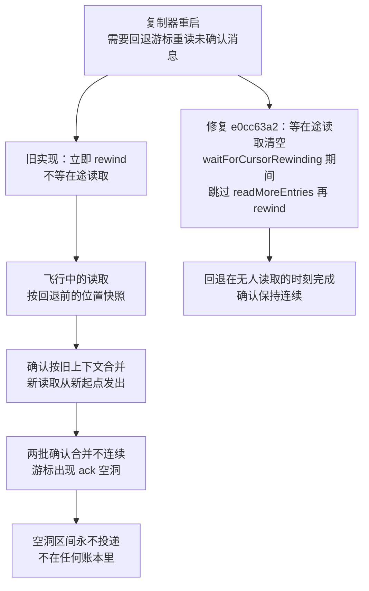
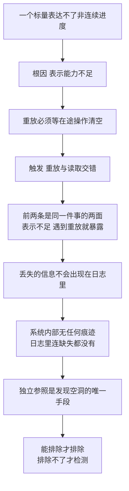
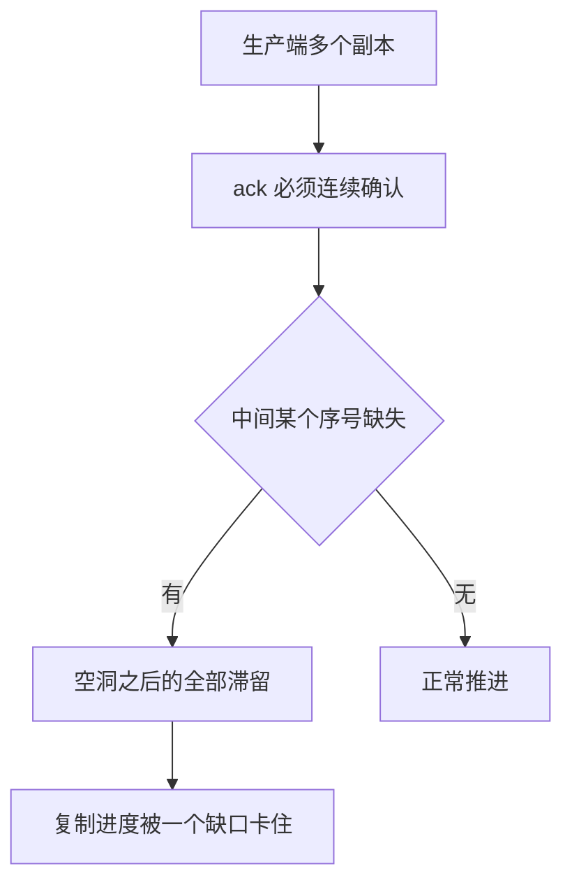

# 案例三十：中间缺了一块——跨地域复制的 ack 空洞

复制器重启时回退游标（cursor：复制进度的记账指针，记录"处理到哪了"）与仍在飞行中的读取竞态（结果取决于执行时序、因而不可重现的并发缺陷），会让一段位置的确认状态错乱。读完这篇你能定位 ack 空洞，也知道回退和飞行中的操作该怎么排序。

> **要点**：**复制器重启时回退游标（rewind）与仍在飞行中的读取操作竞态**，**导致一段位置的确认状态错乱，游标上出现 ack 空洞**——**空洞区间的消息前后都已确认，自己却永远不会再被投递**。

**用一个位置表示进度，隐含地假设了进度是连续的**。**这个假设在顺序消费上成立**；**当"重读未确认消息"的重放动作与"正在读取"的异步操作叠加时，它就不成立了**。本篇要解决的问题是：**假设破裂后进度表示会出什么形态的错，以及为什么它比"丢一条消息"更麻烦**。Apache Pulsar（一款分布式消息与流处理系统）的这个病例给出了具体形态。

## 这个案例发生在什么场景

**项目**：Apache Pulsar——分布式的消息与流处理平台。**它的订阅游标用单一位置表达消费进度**，**跨地域复制的复制器（replicator）在重启时要回退游标重读未确认消息，回退与读取的并发打乱了确认的连续性**。

订阅游标（cursor）记录消费进度。**常规场景下，消费者顺序确认消息，游标单调向前推进，用一个"最后确认的位置"（mark-delete position）足以表达进度**。

**跨地域复制（geo-replication）改变了这个前提**。**启用复制后，消息可能来自本地生产，也可能来自远端集群的复制**。Pulsar 官方文档里异步复制的结构是这样：


来源：Apache Pulsar 文档「Geo Replication」的 Asynchronous geo-replication 一节（Apache License 2.0），地址 https://pulsar.apache.org/docs/next/concepts-replication/ 。**图里每个集群既接收本地生产的消息，也接收远端复制来的消息，同一个订阅游标要同时消化这两股来源**；**承载复制的复制器自身还要在重启时回退游标、重读未确认的消息，重放动作与在途读取的叠加是本病例的舞台**。

## 要解决的到底是什么：进度越过了未确认的一段

上游报告的现象（[上游 commit e0cc63a2](https://github.com/apache/pulsar/commit/e0cc63a22223)）是：跨地域复制场景下游标上出现 **ack 空洞**——一段位置被跳过，而它前后的位置都已确认。

空洞的后果是这一段消息**永远不会被投递**。**游标记录的进度已经越过了它们，消费方不会再收到**；而**它们也没有被确认过，不属于"已处理"**。**它们处在两边都不算的状态：不在待投递集合里，也不在已确认集合里**。

**与丢一条消息不同，空洞是一片区间**。**区间里可能包含成百上千条消息，而系统对它们的存在没有任何记录**。


来源：[博客园《解密 Raft 算法》](https://www.cnblogs.com/traditional/p/12588733.html)（CC 4.0 BY-SA）


来源：[腾讯云开发者社区《Redis系列：Redis主从、哨兵、集群介绍》](https://cloud.tencent.com/developer/article/2183910)（CC 4.0 BY-SA）


## 为什么是问题：进度这个抽象本身失效了

**单一位置无法表达非连续状态。** **这是根本困难**。**游标用"最远确认位置"表示进度，其语义是"这个位置之前的都处理完了"**。**出现空洞时，这个语义不再成立——位置之前有未处理的，但游标没有地方记录"哪里没处理"**。**游标的值没有算错，错在这个表示能力不够**。

**系统无法自证。** **游标看不到自己的空洞，因为它不保存"应该有哪些位置"这份信息**。**要发现空洞，需要一份独立的清单（比如实际写入的位置范围）与之比对**。**没有这个比对，空洞就不可见**。

**它只在复制器的重放与读取竞态下出现，测试覆盖往往不足。** **单集群顺序消费不产生空洞；跨地域复制的测试通常只关注"消息是否到达"，没人去查"确认状态是否连续"**。**这让它能长期存在而不被发现**。

**后果是静默的批量丢失。** **空洞区间内的消息不会报错、不会重试、不会进死信队列（多次消费失败的消息转入的兜底队列）——它们只是不在了**。**发现往往来自业务侧的对账**："**这个时间段的数据好像少了一批**"。

**与 [[工程知识/缺陷分析：从个案到体系/正确性/案例十八：空集合被当成了"全部已确认"——游标跳过的位置|案例十八]] 同源而形态不同。** **两者都导致游标越过本不该越过的位置**：**案例十八源于空集合被解释为"全部完成"，本例源于重放动作与在途读取的竞态**。两条病根合起来是一句话：**游标的位置推进逻辑默认了连续性，连续性却要有人专门保证**。

## 本质是什么：用一个标量表达集合状态时的信息损失

把这份游标位置的表示方式抽象出来，骨架如下：

> **进度用"最远位置"这个标量表示时，隐含假设是"已处理的部分为从起点到该位置的连续区间"。已处理部分不连续时，这个表示无法表达真实状态，也无法自愈——表示本身没有记录缺失。**

**这条骨架值得分三层来看**。

**第一层：表示能力决定可表达的状态。** **一个标量位置能表达的状态是"前 N 个都完成了"**。**真实状态可能是"前 N 个里除了第 30 到 50 个都完成了"**。**后者无法用前者表达，只能退化为前者——而退化过程丢掉了"30 到 50 未完成"这个信息**。

**第二层：丢失的信息不会出现在任何日志里。** **因为系统从不知道自己丢过它**。**表示能力之外的东西，连"没记录到"这个事实都没有记录**。

**第三层：重放与在途操作并发时，连续性假设最易破。** **单条路径顺序推进，连续性是自然结果**。**游标回退重放（rewind）这类"从头再读未确认部分"的动作，与仍在飞行中的异步读取叠加时**，**读取请求拿着回退前的快照（某一时刻的完整只读副本）继续确认，回退后的读取又从新起点发出**——**两批确认合起来可以不连续**。**重放动作与异步操作的竞态**是这类缺陷集中的地方。

## 打个什么比方：点名只记最后一个到的人

**老师点名，规则是"记住最后一个答到的人，他之前的都算到了"**。**这个规则在全员按序答到时完全正确**。

**现在课堂中途换了一次点名册**。**换册的时候老师宣布"大家重新报一遍没答到的"，可有一部分学生用的是旧册子上的顺序继续答题**。**旧册的确认与新册的确认合在一起，老师的记录跳过了一段人**。

**实际缺课的那段学生没有被记为缺席（没人记缺席），也没有被记为到场（他们没答到）——他们在花名册上消失了**。

**老师的记录方式决定了他发现不了这件事：他只记一个数字**，而"26 到 40 号里缺了几个"这件事需要一个名单才能表达。数字本身没记错，**记数字这个方式本身表达不了这个情况**。

**要修，要么改成记名单，要么在换册时等在途的作答全部收完再重放（消除竞态）**。

## 它是怎么做到的：回退与在途读取的竞态

ack（acknowledgement，确认：下游告诉上游"这段我收好了"）空洞发生在复制器重启路径上：

```
pulsar-broker/src/main/java/org/apache/pulsar/broker/service/persistent/PersistentReplicator.java
```

复制器（PersistentReplicator）**负责把本地集群的消息复制到远端集群**。它重启（或重建 producer）时要执行一条规则：**回退游标（cursor.rewind），保证重启期间已发出但未确认的消息能被重新读取**。**旧实现的问题在于这条回退没有等待时机：回退执行时，可能还有一批读取操作在飞行中（pending read）**，**这些请求是按回退前的位置快照发出的**。

产生空洞的结构按下面的四步展开：

1. 复制器正在运行，一批读取操作已发出、尚未返回（位置覆盖 1 到 100）。
2. producer 重建触发 `setProducerAndTriggerReadEntries`，复制器立即执行 `cursor.rewind()`，游标回退到未确认的最远位置。
3. **飞行中的读取请求返回，其确认状态按回退前的上下文合并到游标上**。
4. **回退后的读取从新起点重新发出，新一批确认与第 3 步的确认合并不连续**。
5. **中间一段位置的确认状态错乱，游标上留下 ack 空洞**。

关键在第 2 步：**回退动作必须等"没有在途读取"的时机执行**。**旧实现直接回退，把"在途读取的确认按旧快照合并"这个窗口敞开了**。**这是一个"隐含前提在并发下失效"的典型：顺序执行时回退是安全的，与异步读取并发时它需要一个等待条件**。这与案例十八的结构一致——**代码没有错，错在它所依赖的假设不再成立**。



图：空洞的诞生与修复。左侧是缺陷路径：立即回退把在途读取留在了旧快照上，两批确认合并出空洞；右侧是修复路径：`waitForCursorRewinding` 标志让回退等到在途读取清空（等不到就取消重试），重放发生在无人读取的时刻，确认恢复连续。

## 怎么发现：用独立清单做比对

**维护一份独立的"应有位置"清单并定期比对。** **游标只记进度，不记"应该有哪些"**。**比对需要外部参照——比如账本（BookKeeper 里一段有序的条目序列）实际写入的位置范围**。**两者做差集，差集非空就是空洞**。**这是唯一能主动发现的手段**。

**在推进时断言连续性。** **每次 mark-delete 前进，检查被跨过的区间是否都处于已确认状态**。**跨越未确认区间时记录告警**。**这个检查有成本，但可以在非热点（访问集中在少数键或节点上的现象）路径或采样（只采集一部分数据以控制记录开销）模式下启用**。

**复制器重启路径必须有专门的确认连续性测试。** **构造"重放期间仍有在途读取"的交错场景，验证合并后不存在空洞**。**顺序消费的测试完全覆盖不到这里**。

**业务侧做端到端对账。** **生产端记录发出的消息 ID 集合，消费端记录收到的，定期比对**。**系统内部的空洞检测可能不完善，业务侧对账是最后一道网**。

**监控订阅积压的非单调变化。** **积压突然下降一大截而无对应消费增长，可能是游标跳跃而非消费加速**。**这是一个廉价的异常信号**。

## 上游怎么修

修复（[上游 commit e0cc63a2](https://github.com/apache/pulsar/commit/e0cc63a22223)）在 PersistentReplicator 引入 `waitForCursorRewinding` 标志，**把"回退"从立即执行改成等待时机的动作**：**producer 重建时先置位标志，若有在途读取且取消不掉，就每 10 毫秒重试一次整个流程**；标志置位期间 `readMoreEntries` 直接跳过新读取请求；等到在途读取清空，才执行 `cursor.rewind()` 并清除标志。修复只改了复制器一个文件——**不改游标的表示，不改确认协议，只给重放动作补上它缺少的等待条件**。

**这里有一个设计取舍**。**彻底的解法是把游标从"单个位置"改成"区间集合"（能表达空洞），代价是存储与计算复杂度大幅上升，且影响所有订阅**。上游选了另一条路：**保持简单表示，让会产生空洞的时序在结构上无法发生**。

**这个取舍的合理性在于：空洞是异常状态**。**为一个异常状态付出常态化的复杂度代价不划算**；**更好的选择是让它在结构上不可能发生，并为已发生的情况提供检测与修复工具**。

同一批 sources 里的 [commit 9883d92e](https://github.com/apache/pulsar/commit/9883d92ed0ed) 是另一条相关线索：修复"游标位置为空时 ackSet 被忽略"的问题（改动在 `asyncDelete` 路径），与本篇的重放竞态分属两个缺陷，列在 sources 供对照。

**预期复制器重启重放后游标无空洞**；**修复前实测在"重放与在途读取交错"时序下出现空洞，与预期对不上**。

## 这套说法在哪儿会失效，代价换来了什么教训

- **一个标量位置表达不了非连续的进度。** 重放与在途操作并发时，连续性假设会破。
- **重放（rewind）类动作必须等在途操作清空。** **"从头再读"与"正在读"叠加是确认错乱的高发区**。
- **丢失的信息不会出现在日志里。** 表示能力之外的东西，连"没记录"都没有记录。
- **顺序消费的测试覆盖不到重放竞态。** 重放与读取交错必须有专门测试。
- **独立参照是发现空洞的唯一手段。** 系统内部无法自证。
- **取舍：为异常状态付常态化代价不划算。** 优先让它在结构上不可能发生。

六条教训分属三类，前两类是同一件事的两面，归组如下：



**右边两栏点出这类缺陷的排查困境：因为丢失的信息在日志里连"没记录"都没有，系统内部无法自证，唯一手段是独立参照**。而最后一条取舍排在最末是有顺序的——**能让它结构上不可能发生就先排除，排除不掉的部分才靠检测兜住**。


## 怎么自己动手验证



连续确认的语义下，单个缺失会卡住后面所有数据，见下图：


1. 上游对照：到 Pulsar 的提交 e0cc63a2 里核对修复方式，确认修复引入 `waitForCursorRewinding` 标志、重试取消在途读取、标志置位期间跳过 `readMoreEntries`、读取清空后才执行 rewind。
2. 机制复现：**构造复制器重放与在途读取交错的时序，修复前游标出现 ack 空洞、区间内的消息既不被投递也不被重新读取，修复后重放等到读取清空才执行，无空洞**。

3. 空洞检测：**准备一份独立于游标的已写入位置清单，与游标推进结果逐段比对，确认缺失区间能被这份对照发现**；**没有对照时空洞不可见**。
4. 边界核验：**在单集群顺序消费场景下重复同一流程，预期不产生空洞，确认症状只在重放竞态下出现**。
5. 断言锚点：**空洞区间的起止位置与消息数量留档，独立清单与游标推进结果的比对进入复现脚本**。

## 接着读哪几篇：同在缺陷分析里的相邻问题

- 消息投递与业务提交的一致性边界——[[工程知识/后端系统：在并发、失败与变化中维持服务/分布式可靠性/消息投递与业务提交需要显式的一致性边界]]。
- 复制与分片（把数据按规则切开存到不同节点）改变数据归属——[[工程知识/后端系统：在并发、失败与变化中维持服务/分布式可靠性/复制分片与再平衡改变数据归属]]。
- [[工程知识/缺陷分析：从个案到体系/正确性/案例十八：空集合被当成了"全部已确认"——游标跳过的位置]] 讲游标越过本不该越过的位置的另一种成因，空集合被解释为全部完成。
- [[工程知识/缺陷分析：从个案到体系/正确性/案例二十九：离开的人还占着座位——机架信息的陈旧映射]] 讲另一种"系统无法自证、要靠独立参照对账"的缺陷。
- 导读见 [[工程知识/缺陷分析：从个案到体系/缺陷分析：从个案到体系——导读与开源地图]]。
