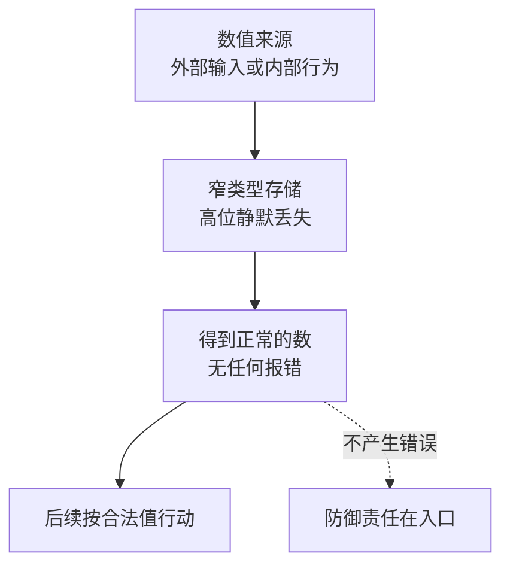
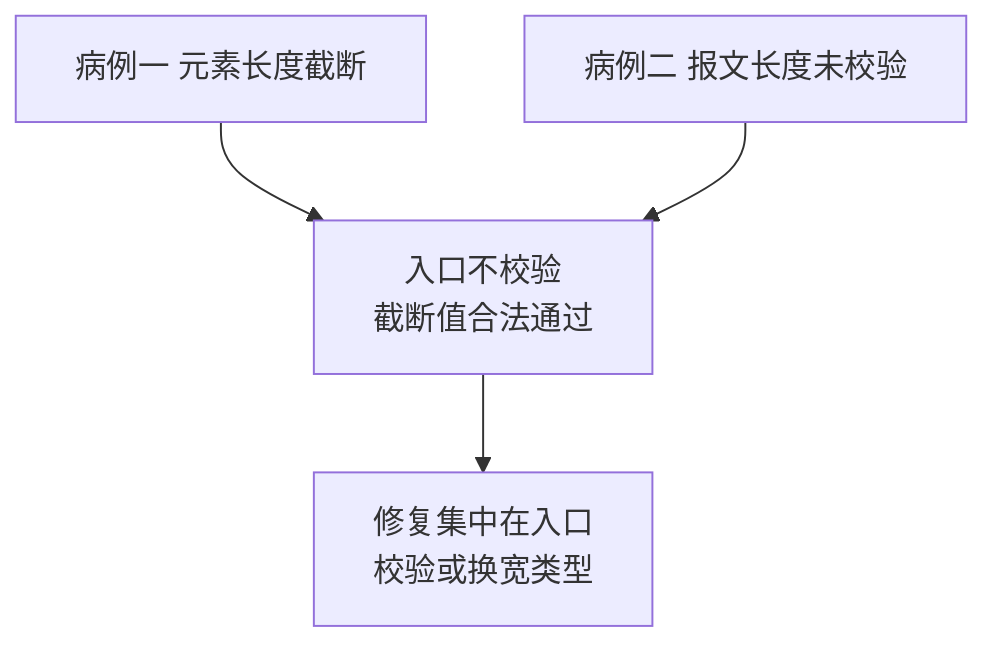
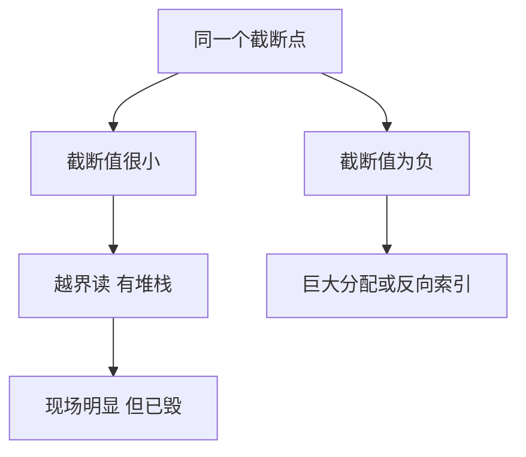

# 案例九：数字越过了边界——Redis 里三次截断导致的崩溃

**长度、周期、容量这类数值在类型边界被静默截断，会从大得荒唐的正数变成小得正常的数**。读完这篇你能识别三个 Redis 病例背后共同的根因。

> **要点**：**长度、周期、容量这类数值，在类型边界上被静默截断后，会从一个大得荒唐的正数变成一个小得正常的数，或者变成负数**。**Redis 的三个病例分别产生了越界读、事件循环空转和 JSON 截断——触发方式毫无关联，根因是同一个**。

**有边界的数字比没有边界的数字危险**。一个 `uint32_t` 装不下的长度，不会报错，会被截断成低位留下的那部分；一个 `int` 装不下的微秒数，超过约 35.8 分钟（2^31 微秒）就装不下，计算绕回后变成"立刻触发"。**程序拿着这个被截断的数继续往下走，走得理直气壮**。Redis 的上游修复里有三个这样的病例（输入数值超出类型边界），外加一例释放后使用（罕见状态组合走到未预期路径），四个病例的症状与触发方式各不相同，修复都指向同一件事：**入口处的类型边界与状态组合，要有人显式管起来**。

## 要解决的问题

**病例一：HyperLogLog（用极小内存估算去重个数的近似算法）的 2GB 元素。**

**缺陷**（[上游 commit 32497c0a](https://github.com/Redis/Redis/commit/32497c0a5ffa0fa2618222e566c180a0b4c807ca)，P0）。**HyperLogLog 接收单个元素时，元素长度在内部被截断，随后按截断后的长度越界读取内存，整个进程崩溃**——**事故层级高于单个 key 的数据问题，实例不可用，全部客户端连接中断**。

**触发条件**：写入一个超过 2GB 的单个元素。**这个尺寸在正常使用中不会出现，但它是一个合法的输入范围，而代码没有拒绝它**。

**修复**：**在入口做长度校验，越界的写入直接拒绝；同时补上大元素的回归用例**。改动在 `src/hyperloglog.c`。

## 病例二：集群总线的报文长度溢出

**缺陷**（[上游 commit c0a83262](https://github.com/redis/redis/commit/c0a83262a34de8781dc9f076ed3f4ae4235c2d70)，P1）。**集群模式下，集群总线报文的长度字段在累加时没有溢出校验**。**攻击者构造一个超大长度的 PUBLISH（Redis 的发布命令）报文，可以让节点越界读内存或直接 OOM（Out Of Memory，内存或显存不够分配而崩溃） 崩溃**。

**为什么它是安全缺陷**：**这条路径不需要认证**。**集群总线的报文处理发生在任何身份校验之前——攻击者只要能连上集群总线端口，就能触发**。**一个"大得不合理的长度"在这里构成了未授权的远程崩溃入口，超出可用性问题的范畴**。

**修复**：**在处理前校验报文长度，畸形报文直接拒绝**。新增了 `packet-validation.tcl` 作为回归用例。

## 病例三：超过 35.8 分钟的定时器

**缺陷**（[上游 commit 24187ed8](https://github.com/redis/redis/commit/24187ed8e396625cc44a6bbeeb87e01aec55c27d)，P2）。**模块注册一个周期超过 35.8 分钟的定时器后，主事件循环（反复取出队列里的回调执行的调度机制）开始零超时空转——整实例 CPU 飙升，请求延迟上升**。

**机制**：定时器距下次触发的微秒数存在 `int`（32 位有符号整数）里，上限约 21.5 亿微秒，即约 35.8 分钟。**模块注册一个周期超过 35.8 分钟的定时器时，这个数装不下，计算绕回甚至变成负值**，`usUntilEarliestTimer` 返回 0——**事件循环认为"该触发了"，以零超时不停轮询**。**上游记录的行为是周期性波动：定时器越远，高 CPU 与正常 CPU 交替出现，各约 35.8 分钟一个周期**。这个病例值得单独记住，因为它**不是外部输入触发的**——它是一个完全合法的模块行为（注册一个长周期定时器）撞上了内部表示的边界，与"边界与教训"一节"32 位毫秒能表示的最长周期约 24 天"对照：**同为 32 位，单位是毫秒还是微秒，边界差了三个数量级，写代码时单位错一个字，边界就错一千倍**。

**修复**：**定时器触发时间改用 64 位计算**。改动只有 `src/ae.c` 里的几行。这个病例在外部的可见形态是 `top` 里 redis-server 的 %CPU 一栏长期顶格：没有报错、没有慢日志，定时器越远，高 CPU 与正常交替各约 35.8 分钟。

## 附带的一例：释放后使用

**缺陷**（[上游 commit 303667a4](https://github.com/redis/redis/commit/303667a40cdf5032b1044e94dfc6860a15414e03)，P0）。**集群模式下，模块注销某类集群消息的接收者之后，再收到该类消息，会走到一条释放后使用的路径，整个实例崩溃**。改动在 `src/module.c`，消除这条路径。

它和前三个病例不属于同一个根因，但共享同一个特征：**触发需要走到一条不常被执行的状态迁移路径**——先注销，再接收。正常流程里，注销之后就不再有该类消息了，**"注销之后又收到"是一个状态机上的意外组合**。

还有一例性质略轻（[上游 commit da9c2804](https://github.com/redis/redis/commit/da9c2804a5ce774099bc3aabc894a8fd8c7e1440)，P3）：**Lua 脚本在调试构建下用 cjson 编码超过 2GB 的字符串时输出被截断，客户端拿到不完整的 JSON**。**同样是 2GB，同样是大数撞上边界，后果从崩溃降为数据不完整**。

## 它是怎么做到的：截断为什么是静默的

**截断静默，是因为它发生在数据流转的中间环节，两端都认为自己拿到的是完整的值**。管道与过滤器配消息队列（生产者写入、消费者读取的缓冲中间层）的形态下，这个风险更明显：**过滤器之间用队列解耦，各自按自己的速度处理，中间任何一个环节丢了精度，上下游都不知道**。

**把这三例的机制摊开，结构一致**：

1. **输入数值存入窄类型，用窄类型累加，高位丢失**
2. **得到一个数值正常（甚至为负）的数**
3. **后续逻辑认为它合法，按这个数走后续链路**

**这三步是一条链，链上没有任何一步会报错，所以防御的责任不在链上任何一环，而挂在链条之外**：

**V 那个数看起来完全正常，U 才照着它去读、去调度、去分配——错误不在这条链的任何一个节点上产生，因此校验的责任只能落在链外、最先拿到数值的那一方**。

关键在第二步和第三步之间：**截断不产生错误，只产生一个错误的合法值**。**C 语言里整数截断是实现定义行为，不抛异常、不触发断言、不写日志**。**拿到结果的那一侧无从判断这个数是真实的还是截断残留下来的**。

于是防御的责任被推到了入口：**谁最先拿到这个数值，谁负责校验它的范围**。**三个病例的修复都集中在这一层——校验元素长度、校验报文长度、把时间计算换成够宽的类型**。

里程表给"量程边界"提供了一件实物：**机械里程计的数字轮只有六位，跑到 999999 公里之后不报错，直接翻回 000000——读数从"大得荒唐"变成了"小得正常"**，**司机从读数上完全看不出车已经跑了几十万公里**。窄类型截断是同一个动作：`int` 装不下的微秒数不会报错，绕回成一个"看起来合法"的值，下游拿着它走得理直气壮。**修复的方式也同构——给计数系统换更宽的量程，或者在入口把超出量程的输入显式拒收**：

*图源：Wikimedia Commons，Andy / Andrew Fogg，CC BY 2.0，https://commons.wikimedia.org/wiki/File:SEAT_Alhambra_Mk1_odometer.jpg。*

**为什么测试抓不到**：**测试写的是合理范围内的值**。**2GB 的元素、溢出的报文长度、35.8 分钟以上的定时器，都不在常规用例的数值区间里**。这类缺陷只出现在**边界测试**中，而边界测试需要有人先想到"这个字段的边界在哪"。

这类修复在 Redis 仓库里的样子：unstable 分支的提交列表每行一个提交，修复散布在 hyperloglog.c、cluster bus、ae.c 各自的提交里——从「实例崩溃了」回溯到「某个长度字段被截断」的定位工作，就是在这样的列表里逐条翻出来的：

*图源：[redis/redis unstable 分支 commits 页](https://github.com/redis/redis/commits/unstable/)（页面截图，2026-09-27）。本文引用的五个上游提交都能在这样的列表里按 hash 定位；边界修复的提交标题通常只写模块名，读 diff 才能看到「入口校验」这个共同形状。*

## 为什么这一类危险

**触发面在最外层**。**长度、大小、数量、时长，这些字段通常来自网络、来自用户输入、来自配置文件——都是攻击者能够影响的面**。**病例二不需要认证就能触发，正是因为它处在协议栈最靠外的位置**。

**后果不可控**。**截断后的值可能很小（读越界）、可能是负数（分配巨大内存或反向索引）、可能恰好指向一个有效地址（读到不该读的数据而不崩溃）**。**同一处截断在不同输入下表现出不同的故障形态，这让复现和归因变得困难**。

**修复很轻，定位很重**。**三个修复的代码量都不大——加一个校验、换一个类型**。**真正的工作量在于从"实例崩溃了"回溯到"某个长度字段在某一层被截断了"，中间隔着一个已经毁掉的现场**。

「换一个类型」在上游修复里的样子——`MurmurHash64A` 的长度参数从 `int` 换成 `size_t`，一行差分解决 2GB 以上元素导致的崩溃：

*图源：GitHub redis/redis commit 32497c0 页面截图（2026-09-27），https://github.com/redis/redis/commit/32497c0a5ffa0fa2618222e566c180a0b4c807ca。*

定位之所以重，是因为同一处截断在不同输入下会走出完全不同的故障路径：

三条路径的排查难度差别很大：崩溃那条至少留下堆栈，OOM 那条留下内存曲线，唯独读到有效地址那条什么都不留——进程正常运行，数据悄悄出错，等到对账或投诉才发现，此时已经隔了很久。这也是为什么这类缺陷不能只靠"没崩就没事"来判断。

**边界校验要与越界写入对账——预写超过长度上限的元素应在入口被拒绝，实测按截断值越界读取内存，与预期对不上，校验位置不对**。

## 这套说法在哪儿会失效，代价换来了什么教训

- **数值在入口就校验，而不是在使用点。** **等到拿它去读内存时才发现不对，已经晚了**。**校验的位置越靠外，覆盖的路径越全**。
- **类型的宽度与单位共同决定取值范围。** **32 位毫秒能表示的最长周期约 24.8 天，32 位微秒约 35.8 分钟——同一宽度换个单位差三个数量级**。**超出范围的行为要显式定义，参与累加或比较时可用范围还会远小于名义范围**。
- **不需要认证的路径上，畸形输入等于攻击面。** **在协议解析的最外层做长度和范围校验，成本最低，收益最高**。
- **状态机的意外组合值得单独枚举。** **先注销再接收、先关闭再写入、先释放再访问——这些组合在正常使用中不出现，但代码路径存在，就会被走到**。
- **边界值测试要写进回归。** **0、-1、类型上限、类型上限加一、2GB、2GB 减一**。**三个 Redis 修复都补了回归用例，因为这类缺陷一旦修掉，极易在重构窄类型时复发**。

## 怎么自己动手验证

1. 上游对照：**到 Redis 的提交 32497c0a、c0a83262、24187ed8 与 303667a4 里核对四处修复，确认分别在入口做长度校验、处理前校验报文长度、触发时间改用 64 位计算、消除注销后接收的路径**。
2. 长度截断复现：**写入一个超过 2GB 的单个元素，修复前长度被截断后按截断值越界读内存、实例崩溃，修复后入口直接拒绝该写入**。
3. 报文长度复现：**向集群总线端口发送构造的超大长度 PUBLISH 报文，修复前越界读内存或内存耗尽，修复后畸形报文被拒绝**。
4. 定时器复现：**注册一个周期超过 35.8 分钟的定时器，修复前主事件循环零超时空转、CPU 飙升且随定时器距离呈约 35.8 分钟周期波动，修复后触发时间计算不绕回**。
5. 状态迁移复现：**先注销某类集群消息的接收者再接收该类消息，修复前走到释放后使用的路径导致崩溃，修复后该组合被安全处理**。
6. 断言锚点：**四处修复各自的对照实验留档，触发输入的具体数值与崩溃位置可核对**。

## 接着读哪几篇：同在缺陷分析里的相邻问题

- 整数表示与溢出行为属于语言基础层，溢出为何静默——[[工程知识/性能工程：从用户等待到资源瓶颈/操作系统与运行时/垃圾回收与内存分配决定延迟尾部]]。
- 外部输入的校验位置——[[工程知识/软件构建：让变化可以理解、验证与交付/测试与交付/发布门禁必须绑定真实证据]]。
- [[工程知识/缺陷分析：从个案到体系/正确性/案例十：类型说谎时——静默删数据的 TTL 与算错的比较]] · [[工程知识/缺陷分析：从个案到体系/稳定性/案例十一：上游修好了，你这边没有——一个发行分支的移植缺口]] · [[工程知识/缺陷分析：从个案到体系/缺陷分析方法——三分离、判定树与五步法]] · [[工程知识/缺陷分析：从个案到体系/缺陷分析方法——三分离、判定树与五步法]]
