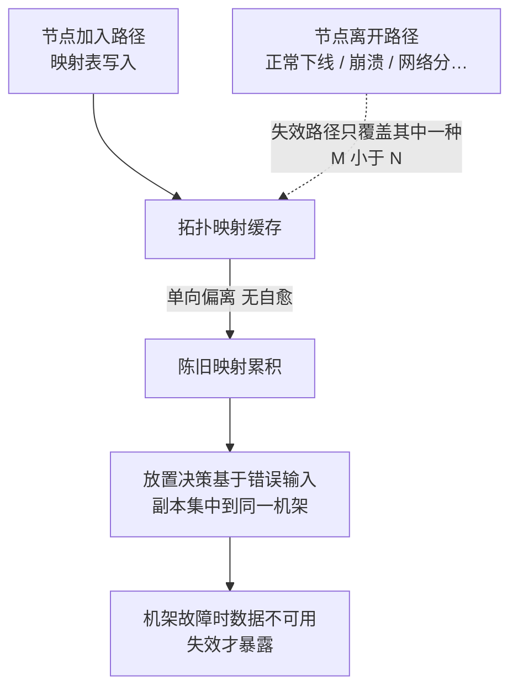
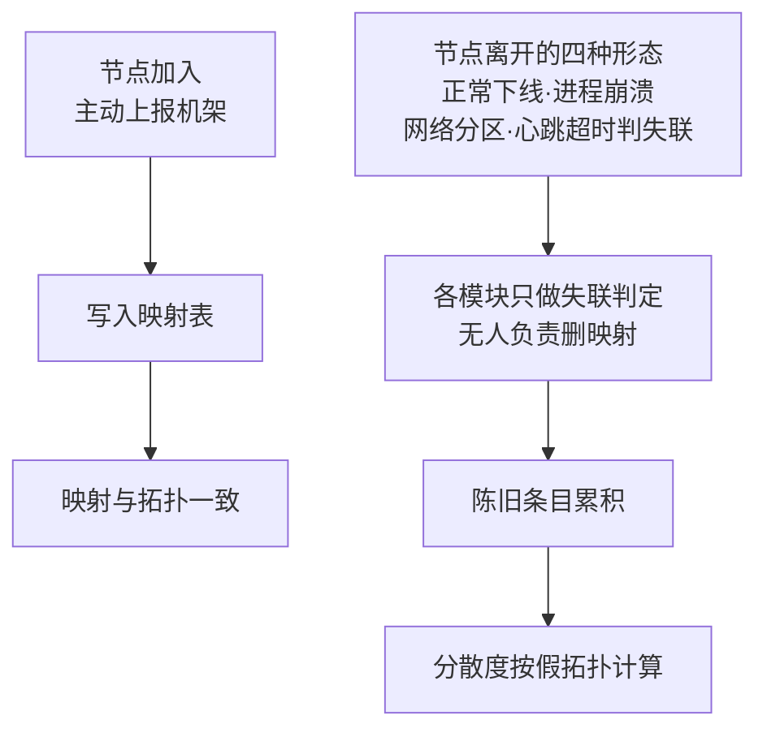

# 案例二十九：离开的人还占着座位——机架信息的陈旧映射

**节点已经离开，拓扑映射表却还留着它的条目**，**容错域（failure domain，故障隔离单位：同机架的机器算一个域，副本要分散到不同域才不会被一次故障全部波及）于是在一份过期的地图上演算**。

> **要点**：**拓扑映射表在节点离开后没有移除对应条目，放置策略于是继续按已经不存在的节点做决策——容错域的计算建立在一份过期的世界地图上**。

读完这一页你能看出陈旧映射是怎么让容错域算错的，会把离开事件和映射表更新绑成一步，也能设计核对账目的例行检查。

**分布式系统要避免把副本放在同一个机架上，否则一个机架掉电就丢全部副本**。**这个判断依赖一份"哪个节点在哪个机架"的映射，映射随节点加入与离开变化**。本篇要解决的问题是：**节点离开时，谁来把它从映射里删掉？** Apache BookKeeper（Apache 开源的分布式日志存储，消息系统常用它存账本）的这组病例说明了漏掉这一步会发生什么。

## 这个案例发生在什么场景

**项目**：Apache BookKeeper——为日志条目提供低延迟、可持久化写入的分布式日志存储服务。**它的机架感知放置策略依赖一份节点到机架的映射，这份映射能否跟上成员变化，就是本篇追问的事**。

映射表记录的对象在机房里有对应的实物：一排排插在机架上的服务器，每台的槽位与机架编号都写在标签上。下图是一排 Cisco（思科，网络设备厂商）HyperFlex（其超融合服务器产品线）节点——「哪个节点在哪个机架」问的就是这类实物与标签的对应。


> 图：机架上的 Cisco HyperFlex HXAF 240c M5 节点，来自 [Wikimedia Commons](https://commons.wikimedia.org/wiki/File:Rack_of_Cisco_Hyperflex_HXAF_240c_M5_nodes.jpg)，CC BY-SA 4.0，摄影 Btrs。

BookKeeper 支持机架感知的放置策略（`RegionAwarePlacementPolicy`）。**它在选择副本位置时，需要知道每个 bookie（BookKeeper 里存放数据的服务节点）属于哪个机架/区域，据此把副本分散到不同的容错域**（一起故障的一组机器，机架是最常见的一种：同一机架共用电源与交换机）。机架感知放置的目标形态，HDFS（Hadoop 的分布式文件系统，Datanode 是它的存储节点）设计文档里的这张图画得最直接：


来源：Apache Hadoop 文档「HDFS Architecture」的 Data Replication 一节（Apache License 2.0），地址 https://hadoop.apache.org/docs/stable/hadoop-project-dist/hadoop-hdfs/HdfsDesign.html 。**图里每个块的副本都跨了机架，这个"跨"字依赖调度方手里那份节点到机架的映射是对的**；**映射一旧，图上的分散就只存在于调度方的想象里**。

节点与机架的对应关系维护在一张映射表里（代码中是 `address2Region` 之类），由节点注册与发现流程维护。**放置策略每次决策时读这张表**。

映射表的行数对应到机房里就是一排排机架：表里每一个「节点-机架」条目，都对应这排实物里的一个槽位。**机架整体搬走、节点下线之后，表里的行还在，机房里的位置已经空了**：


*图源：Wikimedia Commons《Datacenter Server Racks》，CC BY 2.0。*

这张表是放置决策的**唯一输入**。**它错了，决策就一定错——而且不会有任何一方察觉，因为决策过程本身完全正常**。

## 要解决的到底是什么：两个不同层面的陈旧

**病例 A（[上游 commit 857959eb](https://github.com/apache/bookkeeper/commit/857959eb8cf3)，P1 即上游缺陷分级里仅次于最高档的严重级别）**：bookie 离开时没有从 `address2Region` 中移除。**一个已经不存在的节点，仍然在映射表里占着一个机架位置**。

**后果有两层**。**表层是决策失真：放置策略认为某个机架上有一个节点，实际那个节点已经不在了**——**它可能因此避开这个机架（浪费容量），也可能因此认为已经有足够分散度（实际没有）**。深层是**容错保证失效**：分散副本的目的是防止单点（没有备份、一坏全局受影响的组件）故障，而**基于陈旧拓扑算出的"已分散"，可能实际是"集中在剩下的少数机架上"**。

**病例 B（[上游 commit f507b1c5](https://github.com/apache/bookkeeper/commit/f507b1c54a3a)，P1）**：**区域感知放置策略里的磁盘权重不更新**。**节点上的磁盘使用情况变化后，权重仍是旧值，导致按权重分配的决策偏向错误的节点**。

**两个病例的层面不同——一个是成员关系，一个是容量权重——但结构完全一样**：**决策输入是缓存的，而缓存的失效没有被完整覆盖**。宿舍点名册是同一个结构：**花名册上还留着已退宿学生的名字（成员关系陈旧），饭卡余额表也没跟着销户余额走（容量权重陈旧）**——**两件事不同层，但都是「变化发生了，登记表没有对应的更新动作」**。比喻到「两张表都旧了」为止：宿舍表旧了顶多饭卡错发，**放置策略按陈旧拓扑算出的分散度是容错保证的假象，后果重一个量级**。
## 为什么是问题：容错保证是悄悄失效的

**系统不会报错。** **放置策略每次都在正常工作：读表、计算、返回一组位置**。**它没有任何依据去怀疑输入是旧的**。**返回的节点也确实存在、确实可用——只是分散度不对**。

**它破坏的是一种概率性保证。** **机架感知承诺的是"尽量分散，保证机架故障时数据不丢"，允许个别决策做不到分散**。**基于陈旧拓扑的决策，在多数时候仍能给出分散的结果（因为大部分映射还是对的），只在特定组合下才会把副本集中**。这意味着：**系统在大部分时间看起来是安全的**，失效是间歇性的。

**失效在真正发生故障时才暴露。** **平时无法验证副本是否真的分散在不同机架——机架真的掉电、交换机（在局域网内按地址转发数据帧的设备）真的故障，才能发现"三个副本原来都在同一个机架上"**。**而那时已经是数据不可用**。

**它会随集群变动累积。** **每次节点离开都留下一条陈旧记录，集群运行越久、变动越多，映射表与实际拓扑的偏差越大**。**这是个单向恶化的过程，没有自愈机制**。

**容量与正确性的影响难以分离。** **病例 B 的磁盘权重陈旧会导致某些节点被过度写入**。**运维看到的是"磁盘使用不均"，容易当成容量规划问题，而根因在决策输入**。

## 本质是什么：缓存的失效必须与源的变化同覆盖

把这份映射的刷新条件抽象出来，骨架如下：

> **任何对外部状态的缓存，其失效路径必须覆盖源状态的所有变化方式；源有 N 种变化而缓存只有 M 种失效（M < N）时，缓存会单向地偏离真实状态，而依赖它的决策会在不知情的情况下基于错误输入运行。**

**骨架里的"单向偏离"四个字决定了危害有多大**。**缓存不会自己变好——没有失效路径的那些变化，会永久累积在偏差里**。**这与临时性的不一致不同：临时不一致会自愈，覆盖不全的偏差只会扩大**。

第二个要点是**失效的触发方**。**映射表的写入发生在"节点加入"路径上，这很自然——加入是一个明确事件**。而**失效需要发生在"节点离开"路径上，这条路径往往更隐蔽**：**节点可能是正常下线，也可能是崩溃、网络分区、被判定失联**。**离开的判定方式有多少种，失效路径就要覆盖多少种**。少覆盖一种，就多一类陈旧。

第三个要点是**没有验证端**。**缓存的正确性通常依赖"写入方与失效方都正确"，缺少一个独立的校验者**。**如果系统定期用真实拓扑去校验映射表，陈旧会被主动发现；没有这个校验，陈旧就一直存在到它造成后果**。



## 打个什么比方：座位表上有已经离职的人

**公司有一张座位表，行政部门按它安排会议座位——规则是"同一个部门的人不要坐一起，免得部门临时有事全组缺席"**。

**有人离职了，但座位表没更新——离职流程由 HR（人力资源部门）管，座位表由行政管，两边没有联动**。**座位表上，那个人的位置还在，部门标记也还在**。

**行政继续按座位表排座。她看到"技术部有 5 个人"，其中一个是已经离职的。实际到场的是 4 个**。**她按 5 个人的分布来安排，结果可能是：她以为技术部的人已经分散在三张桌子上了（表里显示的），实际只有两张桌子有人，而有两个人其实挨着坐**。

**平时看不出问题——会议照常开**。**只有当某张桌子那边临时出了状况（比如那片区域空调漏水），才会发现"技术部的人怎么都在那边"**。

**离职的人越多，座位表越不准，而没有任何一个环节会去核对"座位表上的人今天还在这家公司吗"**。

修复有两条路：**让离职这个事件一定触发座位表更新**，或者**排座前先点一次名**。**排座排得再仔细，也补不上表本身的缺口**。

## 它是怎么做到的：加入有路径，离开没有

机架映射与拓扑策略两处代码，改动位置如下：

```
bookkeeper-server/src/main/java/org/apache/bookkeeper/client/RegionAwarePlacementPolicy.java
bookkeeper-server/src/main/java/org/apache/bookkeeper/client/TopologyAwareEnsemblePlacementPolicy.java
```

**拓扑映射的维护逻辑里，节点注册（加入）会写入映射；节点下线、失联、被移出集群等路径上，移除映射的动作缺失或不完整**。

这类不对称有个典型成因：**加入是一个主动动作，离开是一个被动判定**。**节点加入时，它主动上报自己的机架信息，写入路径清晰**。**节点离开时，没有节点会上报"我走了"——离开要由监控、心跳超时（节点定期互发的存活信号，超时收不到就判定故障）、或者运维操作来判定，而这些判定逻辑分散在不同模块里**。每个模块都认为自己只负责判定，**没有人认为移除映射是自己的责任**。

加入与离开两条路径在映射表上的待遇差别，见下图：



图："缺口在哪一侧"——**加入只有一条路，路上有写入动作；离开有四条路，四条路的终点都没有删除动作**。**修复要补的是四条离开路径各自的清理，或者在决策前加一次对账，缺一条路就留一类陈旧**。

**病例 B 的权重不更新是同一结构：容量信息在写入时被记录，但容量变化（磁盘写入、删除、扩容）不会触发权重重算**。同样是"变化发生了，没有对应的更新路径"。

**上游修复的方向是补齐失效路径：在 bookie 离开的各个判定点上确保映射被清理；让磁盘权重在使用前或定期重算**。

## 怎么发现：让缓存与源可以对账

仓库每月盘点是同一套发现手段：**账面库存（缓存）与货架实物（源状态）逐项核对，账上有货架上没有的直接记差异（「映射表里有但集群里没有」）**——**盘点不挑品种，所以不管缺口出在哪条入库路径（不用预先知道失效路径缺口在哪）都能查出来**。比喻到「对账不预设缺口」为止：仓库盘点差异可以追责入库员，拓扑陈旧差异一出现就要告警，因为它只在故障时才致命。

**定期用源状态校验缓存。** **用真实的节点列表去比对映射表，报告"映射表里有但集群里没有"的项**。**这是最直接、最可靠的发现手段，而且能发现所有未被覆盖的失效路径——不需要预先知道缺口在哪**。

**缓存条目加时间戳与来源标记。** **每个条目记录它最后一次被确认有效的时间。超过阈值未被确认的条目视为可疑**。**这让"陈旧"变成可度量的量**。

**对账差异要告警。** **拓扑陈旧平时无感（容量浪费与分散度失真都不会报错），只在故障时致命，差异一出现就告警，等到它造成后果就晚了**。

**在测试中模拟节点离开的各种形态。** **正常下线、进程崩溃、网络分区、被判定失联——每种形态后检查映射表是否正确**。**只测正常下线的测试会漏掉大部分失效路径**。

**把容错保证做成可验证的断言。** **副本放置后，主动验证"这些副本是否真的在不同机架"，不满足就记录**。**这让概率性保证变成可检查的**。

## 上游怎么修

**两处修复都是补齐缺失的更新：bookie 离开时从映射中移除，磁盘权重在使用时重算**。门卫交接班改成「走一个登记一个」是同一个补法：**以前只在有人入住时登记（加入路径有写入），退宿没人销名（离开路径没有清理），现在进出两头都动表**——比喻到「两头都记」为止：门卫表错了顶多访客登记错，**映射表错了容错保证跟着错，所以修复落在离开判定的每个分支上而不是给表加过期时间**。

修复的**位置**有讲究：都在使用侧或离开判定侧，没有给缓存本身加过期时间。加过期时间行不行？**TTL（Time To Live，存活时间：到期后自动失效或删除）是一种通用兜底；但对拓扑信息，TTL 带来新的问题：过期期间该用什么值**。**对于"没有值就不能安全决策"的输入，值必须准确，拿不到就拒绝决策或降级（主动牺牲部分功能或精度，保住核心链路；用旧值凑合等于把容错保证换成运气）**。

这也提示了一个设计原则：**区分"旧值可用"与"旧值不可用"的缓存**。**容量权重旧一点无妨（分配稍不均衡），拓扑成员旧一点有害（容错失效）。对后者，宁可保守**。

**预期节点离开后映射表中不再有该条目；修复前实测它仍占着机架位置并参与分散度计算，与预期对不上**。

## 这套说法在哪儿会失效，代价换来了什么教训

点名制度本身也有代价是同一个边界：**每次进出都要登记（对账与断言的持续成本），高峰期门口排长队（决策延迟），碰到忘记带卡的常住人员还会误拦（对账误报）**——比喻到「登记不是免费的」为止：**排队的代价肉眼可见，拓扑对账的代价是算力与告警带宽，所以对账频率按集群变动速度定，不是越勤越好**。

- **缓存的失效路径要覆盖源的所有变化方式。** 缺一种，偏差就多一类。
- **加入是主动的，离开是被动的。** 离开的判定分散在多个模块，容易没人认领清理责任。
- **偏差是单向累积的。** 没有自愈机制，运行越久偏差越大。
- **概率性保证的失效只在故障时才暴露。** 平时无法验证，要主动做断言。
- **定期与源对账是最可靠的发现手段。** 它不需要预先知道缺口在哪里。
- **区分"旧值可用"与"旧值不可用"。** 拓扑这类影响安全保证的输入，宁可拒绝决策也不要用陈旧值。


## 怎么自己动手验证

1. 上游对照：**到 BookKeeper 的提交 857959eb 与 f507b1c5 里核对两处修复，确认一处是在节点离开时从机架映射中移除条目、一处是让磁盘权重随使用情况更新**。
2. 成员关系复现：**让一个 bookie 离开集群后检查映射表，修复前该节点仍占着一个机架位置，放置决策据此计算分散度；修复后映射中不再有该条目**。
3. 权重陈旧复现：**改变某个节点上的磁盘占用后触发放置决策，修复前决策仍按旧的权重分配写入，表现为节点之间磁盘占用长期不均**。
4. 失效验证：**按修复前的映射构造一组副本位置，核对它们实际位于哪几个机架上；确认分散度声明与真实分布不一致这一判定成立**。
5. 断言锚点：**映射条目的增删与节点进退一致，权重随使用情况更新，分散度结论有真实的机架分布作为对照**。

## 接着读哪几篇：默认值里的迁移债

- 服务发现决定请求去向——[[工程知识/后端系统：在并发、失败与变化中维持服务/服务设计/服务发现与负载均衡决定请求发往哪里]]。
- 复制与再平衡改变数据归属——[[工程知识/后端系统：在并发、失败与变化中维持服务/分布式可靠性/复制分片与再平衡改变数据归属]]。
- [[工程知识/缺陷分析：从个案到体系/正确性/放置策略的状态残留：下线成员的旧标签与失效的权重]] 讲"标签保鲜 + 权重分组 + 分布统计"的通用防线，是本病例修复动作背后的方法面。
- [[工程知识/缺陷分析：从个案到体系/配置/案例三十八：没有写下来的版本——默认值里的迁移债]] 讲另一种"变化发生了、没有对应更新路径"的形态。
- [[工程知识/缺陷分析：从个案到体系/稳定性/案例三十六：写被自己的回调堵住——挂起的 add 回调]] 讲记账结构与真实事件脱节后的自我固化。
- 导读见 [[工程知识/缺陷分析：从个案到体系/缺陷分析：从个案到体系——导读与开源地图]]。
