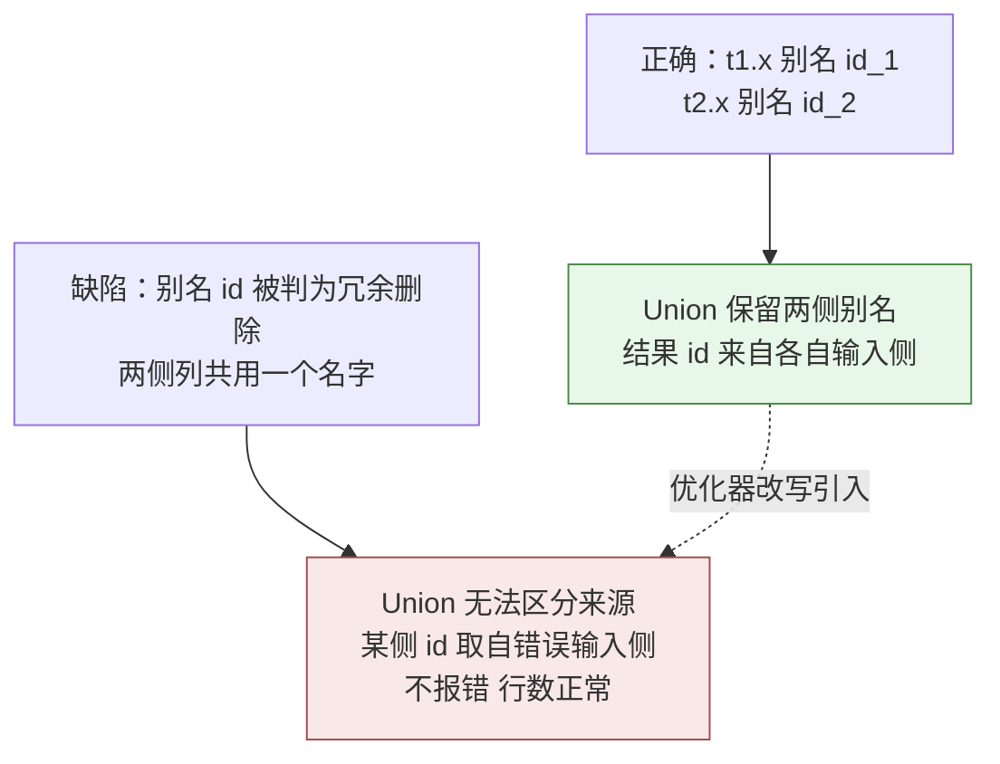
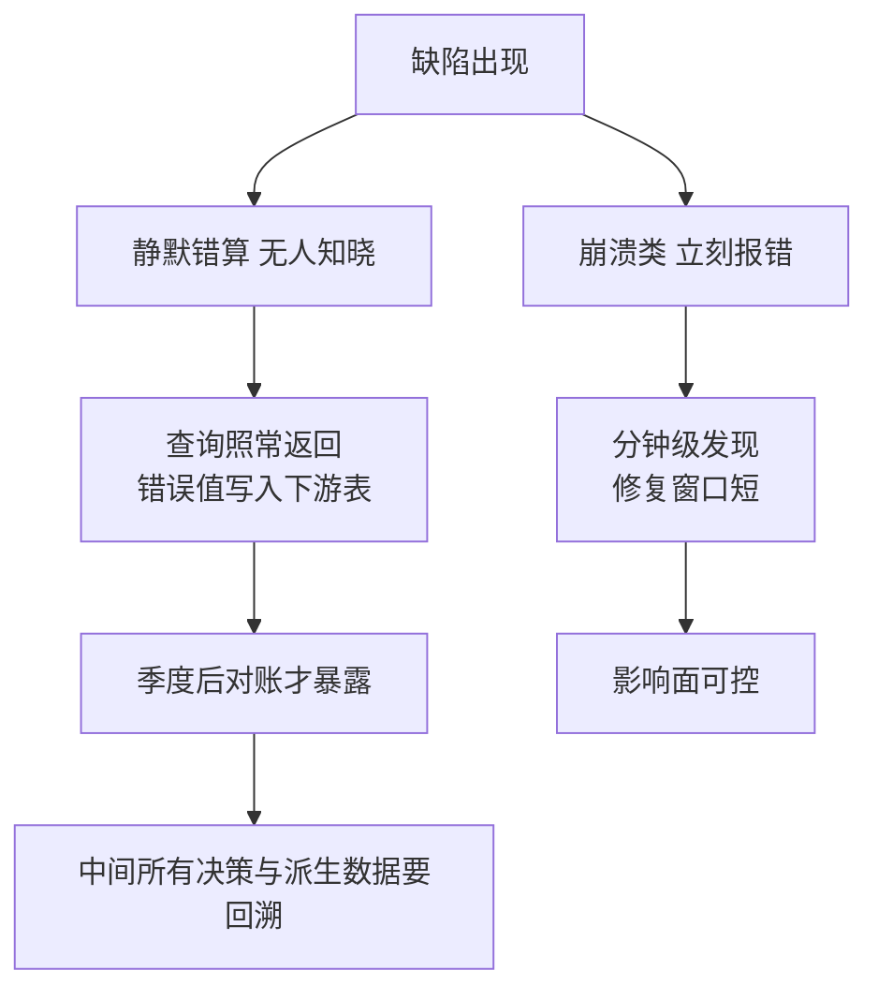

# 案例二：静默错算——Spark SQL Union 的别名陷阱

**不崩溃、行数正常，返回的却是错误的列值**。**读完这篇你能用独立参照答案抓住这类静默错算，避免它随写入扩散成持久化的脏数据**。

> **要点**：Union 两侧同名列带别名时，优化器会删错别名，**静默返回错误的列值**——不崩溃、行数正常。它必须靠独立参照答案去抓，否则会随写入扩散成持久化的脏数据。

**崩溃会喊，静默错算不会**。Spark SQL（分布式计算引擎 Spark 的 SQL 查询模块）在特定条件下**静默返回错误的列值**——**不报错、不告警、不抛异常，查询正常结束，只是答案错了**。而**错误结果可以随写入进入下游表，变成报表和决策的一部分**。**这是正确性缺陷的标准形态，也是八个家族里最难抓的一类**。

## 要解决的问题：一个跑得通的 SQL 为什么算错数

**项目**：Apache Spark——面向大规模数据的批处理（把多个请求合并成一批同时计算、提高硬件利用率）与 SQL 分析引擎，**其 SQL 优化器在改写计划时会把同名列的别名处理错，静默返回错误的列值正是本篇的问题**。

**Spark SQL 的 Union 语义要求两侧按列位置配对**。当两侧存在**同名列且一侧带别名**时，优化器在改写查询计划的过程中会把这些别名处理错——最终返回的列值取错了来源。[上游 commit d04c7884](https://github.com/apache/spark/commit/d04c7884ca5190fec81a081102276e97197807fa) 修复了这个问题；**在此之前，命中该条件的查询一直"正常"返回着错的数据**。

## 它是怎么做到的：它是怎么发生的

要理解这个缺陷，得先看 Spark SQL 的执行模型：用户写的 SQL 不直接执行，而是先被翻译成逻辑计划，再由**优化器**做多轮改写——合并冗余节点、删除无用的 Project、化简别名。每轮改写都应该保持语义不变，这叫**计划改写的等价性**。

缺陷就藏在其中一轮改写里。**Union 两侧的同名列在内部用别名区分归属，某个化简规则在删除"冗余"别名时，把不该删的那个也删了——两侧的列来源被错误地归并**。从这一刻起，计划已经错了，但它看起来完全正常：有列名、有数据、有行数，只是**某些列的值来自错误的输入侧**。

这条从 SQL 到 RDDs（弹性分布式数据集，Spark 里最底层的数据抽象，数据分片后分布在集群各节点上）的翻译链是 Databricks 官方博客画的 Catalyst（Spark 的查询优化器，负责把 SQL 改写成高效执行计划）流水线——未解析逻辑计划先经分析（Analysis，检查表名列名是否存在、类型是否匹配），再经逻辑优化与物理规划（含代价模型），最后生成代码交 RDDs 执行。**缺陷发生在中段的逻辑优化环节，改写规则在这里把仍在区分归属的别名当作冗余删除**：


*图源：Databricks 官方博客《Deep Dive into Spark SQL's Catalyst Optimizer》Figure 2，https://databricks.com/blog/2015/04/13/deep-dive-into-spark-sqls-catalyst-optimizer.html。*



图的右侧是缺陷发生的位置。**别名在这里承担的实际职责是"标记这一列来自哪一侧"，而删除规则只看它是否冗余——判断依据里没有"这个别名是否还在承担区分职责"这一项**。**两类信息在优化器内部共用一个结构，规则又只按其中一类来判定，误删就发生了**。

三个因素叠加使它隐蔽：

这个缺陷发生在优化器的逻辑优化阶段——SQL 先翻译成未解析的逻辑计划，经 Analysis 解析、Logical Optimization 规则改写、Physical Planning 物理化，最后 Code Generation 生成 RDD 代码。官方论文把这条流水线画成一张图，别名删除规则就住在中间 Logical Optimization 那一格：


*图源：[Spark Playground 教程《The Catalyst Optimizer》](https://www.sparkplayground.com/tutorials/spark-theory/catalyst-optimizer)，图为 SIGMOD 2015 论文《Spark SQL: Relational Data Processing in Spark》Figure 3 同款流程。*


用一个极简查询说明触发形态（两侧同名列各带别名）：

```sql
SELECT a.id FROM (SELECT x AS id FROM t1) a
UNION ALL
SELECT b.id FROM (SELECT x AS id FROM t2) b
-- 命中别名删除规则时，某一侧的 id 取值可能来自错误的输入侧
-- 不报错、行数正常，只有值不对
```

**别名承担的「区分归属」职责，公文系统的关防印章是实物原型**：两份同文种的公文并排盖印，印面刻着发文单位全称——**凭印文就能分辨这份文件出自哪一路，印文若被当作重复格式抹掉，两份文件立刻分不清彼此**：


*图源：Wikimedia Commons，作者 Solomon203，CC BY-SA 4.0，https://commons.wikimedia.org/wiki/File:Keelung_Customs_and_Keelung_Post_Office_sealed_jointly_20200207.jpg。*

**优化器里的别名就是计划里每个列的印文：它标记"这一列的值出自哪一侧输入"**。**删除规则只检查"是否冗余"，没检查"是否还在盖章"——把仍在承担区分职责的印文当成重复格式擦掉，Union 两侧的列归属当场混淆，结果错得悄无声息**。

- **不崩溃**。类型系统能对上的错误取值，执行器一行不问照跑。
- **不确定**。是否触发取决于查询的写法——有没有同名列、有没有别名、优化器有没有走到那条规则。同一段代码换一种写法就没事。
- **会扩散**。`INSERT INTO ... SELECT` 一执行，错误值正式进入下游表，从"一次查询的问题"升级成"一份持久化的脏数据"。

## 为什么这一类危险

**正确性缺陷的杀伤力用"出现多久"来度量，而不是"多严重"**。**崩溃类缺陷从出现到告警以分钟计；正确性缺陷从出现到被发现，可能隔一个季度**——**等下游对账发现数字不对，中间所有基于错误结果的决策都要回溯**。

抓这类缺陷只有一条路：**你手里得有一个独立于被测代码的参照答案**。**这道题的正确答案是可推导的（Union 的语义有明确的规范定义），测试可以构造两侧数据、断言精确输出**。**上游修复的提交里就带着这样的对照测试——没有参照答案，这个缺陷就算被撞见了也无法证明它是缺陷**。


**崩溃与静默错算的差别在时间轴上而不在严重程度上**——**同一个缺陷起点，两条分岔通向完全不同的代价曲线**：



所以**度量口径是「出现多久」而不是「多严重」：崩溃分钟级收敛，静默错算要到对账那天才开始结算代价**。

两张条形的差距说明了为什么"严重程度"不是好的度量口径。**崩溃类的代价集中在故障当时，但因为立刻可见，修复窗口短、影响面可控**；**静默错算的每一刻都不痛，代价却随时间累积——等到被发现时，中间所有基于错误结果的决策和已写入的派生数据都要回溯**。

**"独立"是这个方法的要点，也是它的成本所在**。**参照答案不能由被测系统自己生成：用 Spark 跑一遍、再跑一遍对比，两次都错的结果完全一致，对比也发现不了问题**。**答案要来自规范定义、手工推导或另一个独立实现——建设这个参照的成本，就是这类缺陷的预防成本**。

## 上游是怎么修的

修复在优化器（`Optimizer.scala`）里：**改写规则在删除别名前先检查列的归属，属于 Union 边界上用来区分两侧的别名不再被当作冗余删除**。**提交同时更新了优化器的对照测试套件，以及 TPC-DS（事务处理性能委员会的决策支持基准，数据分析场景常用的标准测试集）的计划稳定性文件**——**后者是 Spark 用来自证"计划改动不影响结果"的机制，修复改动计划，就要显式刷新基线（正常状态下的指标水平、用来对比异常）并解释原因**。

## 这套说法在哪儿会失效，代价换来了什么教训

- **优化器缺陷的暴露依赖写法**，所以"我这里跑是对的"不构成反证。**SQL 引擎的历史上，大量正确性缺陷的复现查询都极短——短到没人相信它会错**。
- **不要用被测系统解释自己**。用 Spark 解释 Spark 的结果对不对，是循环论证；参照答案必须来自语义规范或独立实现。
- **写入数据库的错误是最贵的错误**。在写路径上给关键结果加校验（行数、聚合值、抽样比对），让静默错误至少在写入数据库那一刻多一道网。
- **计划改写类系统的测试基线机制值得学习**：**把"计划长什么样"固化成可对照的基线，任何非预期改动都会被看见**。


相关变体：[[工程知识/缺陷分析：从个案到体系/正确性/案例十三：键序与列名——Spark SQL 又两种静默错算]]

## 接着读哪几篇：同在缺陷分析里的相邻问题

- 一条查询在执行前经历了什么——[[工程知识/数据系统：在并发与故障中保存事实/查询与索引/一条SQL如何穿过优化器与存储引擎]]。
- 列别名在改写过程中如何被解读——[[工程知识/软件构建：让变化可以理解、验证与交付/架构与代码/静态分析发现结构问题但不能证明行为正确]]。
- [[工程知识/缺陷分析：从个案到体系/缺陷分析方法——三分离、判定树与五步法]] · [[工程知识/缺陷分析：从个案到体系/并发/案例三：并发两面——写回调卡死与心跳竞态]] · [[工程知识/缺陷分析：从个案到体系/缺陷分析：从个案到体系——导读与开源地图]]
