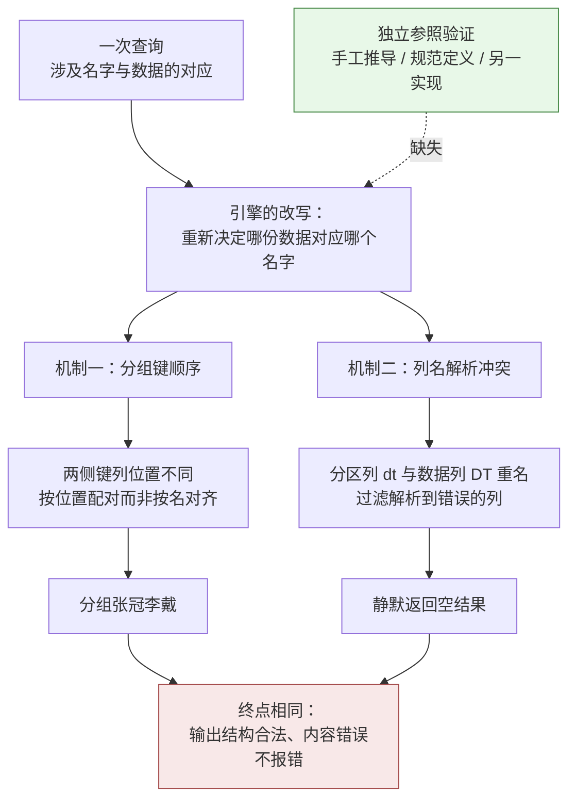
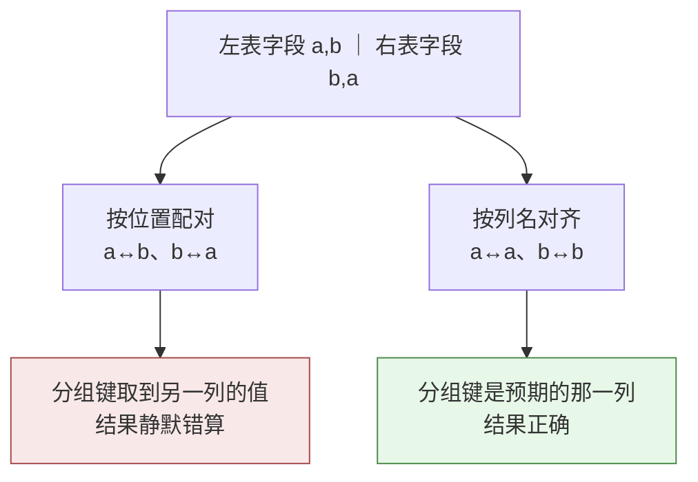
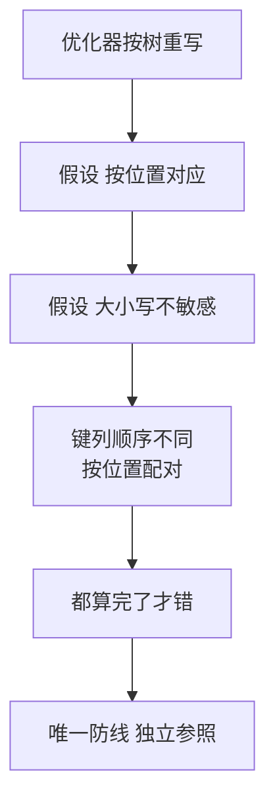

# 案例十三：键序与列名——Spark SQL 又两种静默错算

**分组顺序不一致会静默返回错误分组，重名列会静默返回空结果**。读完这篇你能看出两种机制背后同一个不变量，并用独立参照验证。

> **要点**：分组键顺序不一致时 cogroup 静默返回错误分组，分区列与数据列重名时过滤静默返回空结果——两种机制、同一个不变量：引擎对"哪份数据对应哪个名字"的改写没有经过独立参照验证。

## 要解决的问题：案例背景

**项目**：Apache Spark——面向大规模数据的批处理（把多个请求合并成一批同时计算、提高硬件利用率）与 SQL 分析引擎，其 SQL 引擎在键序与列名两类改写上都能给出不报错的错误答案。

正确性缺陷的核心困难在 [[工程知识/缺陷分析：从个案到体系/正确性/案例二：静默错算——Spark SQL Union 的别名陷阱]] 已经说过：答案错了，执行器一句话都不说。这一篇补上同批扫到的两条 P0（缺陷优先级的最高级），机制与 Union 别名不同，同样静默不报错（两例均已实际复现）。

这类错误答案的复制规模对应着执行作业的硬件：成排的计算节点同时跑同一个作业，一处键序或列名的改写错误会在所有节点上同时发生。下图是瑞士国家超算中心的 Alps 机柜。


> 图：CSCS 超算中心 Alps 机柜，来自 [Wikimedia Commons](https://commons.wikimedia.org/wiki/File:CSCS_Supercomputer_Alps_1.jpg)，CC BY-SA 3.0，摄影 Marco Abram / CSCS。

## 这两种机制差别在哪儿

按位置配对与按列名对齐，差别在于名字是不是跟着数据一起走。事件溯源把这条做到了底：所有变更以事件形式追加进存储，当前状态由事件重放得到——名字与结构都留在记录里。




右侧那条虚线是全文的不变量：改写发生时，没有人拿独立于引擎的参照去比对改写前后的结果是否等价。

名字与数据的对应关系，卡片目录是最耐久的实物：每个抽屉贴着标签（键序），每张卡片按规则插进且只插进一个位置（列名）。目录员整理时抽屉顺序 rearrange 过一次而卡片没跟着搬，或者两张卡片写了同一个名字——查阅的人拿到的是"结构合法"的结果，顺着标签找到的却是错的数据，目录自己不会报错。引擎改写查询时决定"这份数据对应哪个名字"，做的是同一种整理；缺少的那道工序是目录馆的交叉核对——另一个人按独立的规则表抽查卡片与标签是否仍然对应：


*图源：Wikimedia Commons，Carolina Prysyazhnyuk，CC BY-SA 2.0，https://commons.wikimedia.org/wiki/File:Card_catalogue_drawers.jpg。*

两个机制都始于同一个动作：引擎要决定"这份数据对应哪个名字"。机制一里它按位置决定，机制二里它按名字匹配但匹配到了错误的那个。终点相同——输出结构合法、内容错误。

**机制一：分组键顺序假设**（[上游 commit 2a37f221](https://github.com/apache/spark/commit/2a37f221631b11b40a8fa38535b6ed1f0d06e49d)，P0）。PySpark 的 cogroup 按键对两侧数据分组。两侧的分组键**顺序不一致**时，**引擎没有做重对齐，直接按位置配对——分组结果张冠李戴，且这是确定性错误——重跑得到同样的错误结果**。用户拿到的是"格式完全正确"的错误输出。

"按位置配对"是这里的关键：两侧 DataFrame 的键列一个在第一位、一个在第二位，引擎不比较列名，直接取第 i 个位置当作同一个键。**位置是隐含约定，两侧写法不同就失效**——与 [[工程知识/缺陷分析：从个案到体系/正确性/案例二：静默错算——Spark SQL Union 的别名陷阱]] 的别名删除同源。

**机制二：列名解析冲突**（[上游 commit e8a578ac](https://github.com/apache/Spark/commit/e8a578ac757b4e53072af1bec908f6a1ff8ba611)，P0）。Parquet（列式存储文件格式）表的分区列与数据列重名（忽略大小写）时，对分区列的过滤被解析到错误的列上，查询**静默返回空结果**——**带过滤的 count 与全表 count 互相矛盾，同一个表两套答案**。

机制二比机制一多一层隐蔽：分区列的值来自目录路径，数据列的值来自文件内容，两者存储在物理上不同的位置。**过滤条件写的是 `dt = '2024-01-01'`，引擎把它解析到数据列上，而数据列里恰好没有这个值——于是返回空**。表并不空，只是这一次查询走了错误的列。

同一对 DataFrame 按位置配对与按列名对齐，分组结果完全不同：


## 最小对照实验怎么设计

机制一用一对键序不同的 DataFrame 触发：

```python
left  = spark.createDataFrame([(1, "a"), (2, "b")], ["k", "lv"])
right = spark.createDataFrame([("b", 2), ("a", 1)], ["rv", "k"])  # 键列在第二位

from pyspark.sql.functions import col
import pyspark.sql.types as T

schema = T.StructType([
    T.StructField("k", T.IntegerType()),
    T.StructField("left_rows", T.StringType()),
    T.StructField("right_rows", T.StringType()),
])

def merge(k, ldf, rdf):
    return [(k, str(ldf.collect()), str(rdf.collect()))]

# 修复前：按位置配对，(1,"a") 与 ("b",2) 被分进同一组
# 修复后：按列名对齐，k=1 与 k=2 各自成组
result = left.cogroup(right).applyInPandas(merge, schema).collect()
```

`left` 的键列在第一位、`right` 的键列在第二位，这是触发条件。**修复前的输出里 k=1 会与 "b" 分到同一组——按位置看它们都是各自的第一个字段，按名字看一个是整数一个是字符串，本不该凑在一起**。

机制二的最小复现更短——建一张分区列与数据列重名的 Parquet 表，按分区列过滤：

```sql
-- 表内同时存在分区列 dt 与数据列 DT
SELECT count(*) FROM t WHERE dt = '2024-01-01';  -- 修复前返回 0
SELECT count(*) FROM t;                          -- 非空，与上一条矛盾
```

**两条 count 互相矛盾，是这个缺陷最容易识别的外部特征**——不需要读执行计划，只需把两条结果并排。当一条带过滤的查询返回空而全表非空时，先怀疑列解析，而不是**先怀疑数据**。

## 这类问题还在哪儿出现过：三个机制，一个不变量

和 Union 别名陷阱并排放着看，去掉专有名词，三个机制的骨架是同一句话：**引擎对"哪份数据对应哪个名字"的映射做了一次自以为安全的改写，而改写前后的等价性没有被独立参照验证**——这里的独立参照指不依赖引擎自身判断的正确答案来源：按语义手工推导的预期结果、规范给出的定义，或另一个独立实现算出的结果。 别名删除改的是映射，键序假设改的是映射，列名解析冲突还是映射——**Spark SQL 的优化与解析层在不停地重写这层对应关系，每一次改写都是一个潜在的静默错算点**。

改写为什么集中发生在这层？因为"名字到数据"的映射是一种附着在写法上的约定，而不是**查询结构本身**。优化器重写查询时，它的规则处理的是树的结构；**名字与数据的对应关系不在树里，只在使用这些名字的上下文中**。规则照着树走，**走到没有上下文的那一层，映射就只能靠假设**——按位置、按大小写不敏感匹配、按默认优先级。三个病例对应三种假设，三种假设都不成立。

三种假设看着不相干，失效方式却是同一条链路：



右侧那条是三个病例共用的唯一防线：引擎自己不会报告，因为它的每一步改写都自洽，只有**拿一个不依赖引擎判断的正确答案去比对**才会暴露。**这解释了为什么三处的修复都只有几行、而发现它们的成本全在构造这个参照上**。

修复的成本分布也高度一致：三处的修复都集中在"补一个本该存在的对齐或校验"，几行代码；而发现它们的成本全在"构造独立参照"上——**你要先知道正确答案长什么样，才能看出引擎答错了**。

## 上游怎么修

两处修复都回到语义本身：键序不同就插入重新分区，让两侧按同一顺序分布；列名冲突时按明确的优先级解析并让过滤作用到正确的列。**修复不难，难的是有人先意识到"结果不对"这件事需要被报告**。

键序修复的实物（上游 commit 2a37f22，SPARK-42168）：提交说明写得很直白——`FlatMapCoGroupsInPandas` 此前声明的子分布要求是 `ClusteredDistribution(id, day)`，它被 `EnsureRequirements` 规则误判为与 `HashPartitioning(day, id)` 兼容，于是不插入重新分区、两侧键序错着配对；**修复把它改成 `HashClusteredDistribution`，让规则正确识别出不兼容并插入 shuffle（重新分区的网络传输阶段）**。提交说明里还带着一段可复现的 Scala 代码，注释里明确写着「列顺序与下面 groupBy 的列顺序不同」——正是正文说的键序错配：


*图源：[Apache Spark commit 2a37f22](https://github.com/apache/spark/commit/2a37f221631b11b40a8fa38535b6ed1f0d06e49d) 页面截图（playwright 实拍，2026-09-28）。required child distribution=算子对子节点数据分布的要求，HashPartitioning=按哈希（把任意长度数据压成固定长度指纹、不可逆）分区，shuffle=重新分区的网络传输阶段，EnsureRequirements=Spark 校验分布要求并决定是否插入 shuffle 的优化规则。*

分组正确性要与键序对齐对账——**预写左右两侧键列位置不同时各组应各自成组，实测按位置配对张冠李戴，与预期对不上**。

## 这套说法在哪儿会失效，代价换来了什么教训

- **"格式正确"不等于"内容正确"**。静默错算的输出看起来完全正常，唯一可疑之处是数值本身——**对关键结果做聚合值校验，是唯一能抓住它的网**。
- **凡是有"默认对齐/自动解析"的地方，都值得问一句**：两侧顺序真的一致吗？重名真的不存在吗？**默认值就是缺陷的藏身处**。
- **重跑无法恢复的错误结果，说明脏数据已经写入磁盘**——**这类缺陷的修复必须伴随对既有产出的清理评估**。

第三条需要解释"为什么重跑无法恢复"：缺陷不在调度层而在计算层，**重跑会把同样的错误映射再执行一遍，得到同样的错误结果**。这与偶发的节点故障不同——后者重跑可能碰上正常节点。**凡是"重跑仍错"的结果错，都指向确定性的逻辑缺陷**，而不是**环境扰动**，这也正好是把它从稳定性问题里区分出来的判据。


## 怎么自己动手验证

1. 上游对照：到 Spark 的提交 2a37f221 与 e8a578ac 里核对两处修复，**确认一处对两侧分组键做重对齐、一处修正分区列与数据列重名时的列解析**。
2. 键序复现：构造左右两侧键列位置不同的两个 DataFrame 并执行 cogroup，**修复前按位置配对导致分组张冠李戴且重跑结果不变，修复后按列名对齐、各键各自成组**。
3. 列名冲突复现：建一张分区列与数据列重名（忽略大小写）的 Parquet 表，按分区列过滤，**修复前返回 0 而 count 全表非空，两条结果互相矛盾；修复后两者一致**。
4. 断言锚点：两个最小用例的修复前后结果都留档，**对照实验不依赖读执行计划即可判定对错**。

## 用了能拿到什么，要付什么代价

把引擎对名字与数据映射关系的改写逐处核对，**换来的是默认对齐与自动解析这些藏身处会被点名检查，关键结果上多一道聚合值校验**。代价是**个案的发现全靠在外部构造独立参照**，上游修复动作简单而定位过程需要先知道正确答案，已写入磁盘的错误产出还要另行评估清理。

## 接着读哪几篇：同在缺陷分析里的相邻问题

- 一条查询在执行前经历了什么——[[工程知识/数据系统：在并发与故障中保存事实/查询与索引/一条SQL如何穿过优化器与存储引擎]]。
- 键序与列名的解析为什么逃过结构检查——[[工程知识/软件构建：让变化可以理解、验证与交付/架构与代码/静态分析发现结构问题但不能证明行为正确]]。
- [[工程知识/缺陷分析：从个案到体系/正确性/案例二：静默错算——Spark SQL Union 的别名陷阱]] · [[工程知识/缺陷分析：从个案到体系/缺陷分析方法——三分离、判定树与五步法]] · [[工程知识/缺陷分析：从个案到体系/缺陷分析：从个案到体系——导读与开源地图]]
