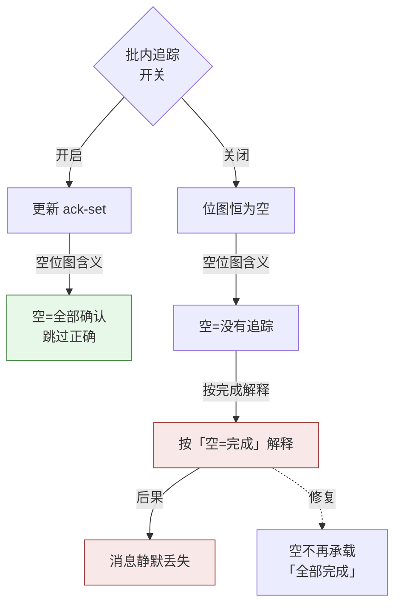
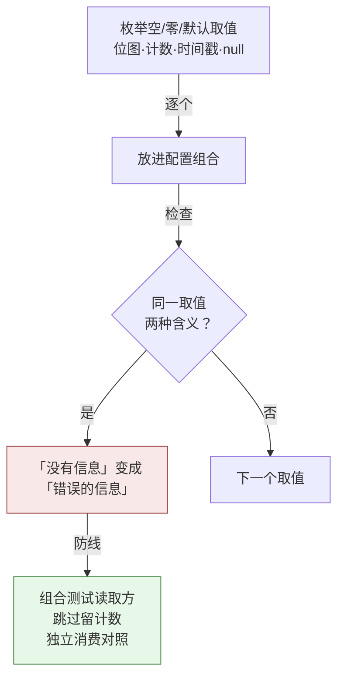
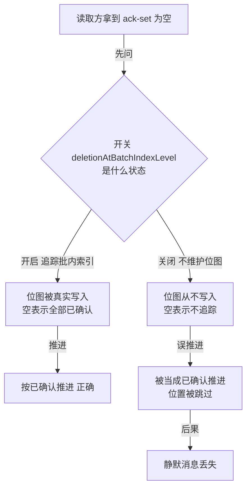

# 案例十八：空集合被当成了"全部已确认"——游标跳过的位置

**位图为空有两种含义：全部完成，或者还没开始**。**当成前者，尚未确认的位置就被推进了**。读完这篇你能区分这两种空，不再让消息永久丢失。

> **要点**：批量确认时用位图记录哪些消息已完成，位图为空有两种含义——"全部完成"和"还没开始"；当代码把空一律当成前者，尚未确认的位置就被推进，消息永久丢失。

**"空"在程序里几乎从不只表示一件事**。**空字符串可能是"没有内容"，也可能是"尚未填写"**；**零可能是"计算结果为零"，也可能是"没算过"**。这类歧义进入状态推进的逻辑后，不报错，直接**把错误的语义当成正确的继续执行**。Apache Pulsar（分布式消息队列）的这个病例（上游已确认修复）是这条规律的一个干净样本。

## 要解决的问题

本篇要解决的问题是：**一个数据结构在某种配置下不再被写入时，读取方如何区分它的默认值究竟表示"业务上已完成"还是"根本没有数据"**。**这条歧义不会报错，它把尚未确认的位置直接推进，造成静默的消息丢失**。

## 这个案例发生在什么场景


来源：[CSDN @bjmayor《图解分布式事务模式》](https://bjmayor.blog.csdn.net/article/details/154004146)（CC 4.0 BY-SA）

**项目**：Apache Pulsar——分布式的消息与流处理平台，**其订阅游标用位图记录批内每条消息的确认状态**，**位图在特定配置下的默认取值构成本篇的陷阱**。

**Pulsar 的订阅游标（cursor）记录消费者的消费进度**。消息按批（batch 批量写入，一批里的多条消息可分别确认——游标用 **ack-set** 位图记录这批里哪些已确认，每个比特对应批内一条消息）。

**确认推进的逻辑大致是：一批消息中，若所有消息都已确认，游标可以整体前进到下一批**；**若只有部分确认，则需要记录位图，等剩余部分确认后再推进**。

**关键的设计变量在于 `deletionAtBatchIndexLevelEnabled` 这个开关**。**开启时，系统按批内索引粒度追踪确认**；**关闭时**，**不维护批内位图，此时 ack-set 为空**。

**于是出现了那个致命的歧义**：**ack-set 为空，到底表示"这批全部确认完了"，还是表示"这个粒度下不追踪，位图本来就是空的"？**


来源：[CSDN @bjmayor《图解分布式事务模式》](https://bjmayor.blog.csdn.net/article/details/154004146)（CC 4.0 BY-SA）


## 要解决的到底是什么：没有确认过的位置被当成确认过了

上游报告的现象（[上游 commit 9883d92e](https://github.com/apache/pulsar/commit/9883d92ed0ed)，P0）是：**在关闭批内索引级删除的情况下，游标会忽略某些位置**——**直接把它们当作已处理而跳过**。

后果是**静默的消息丢失**。**消费者没有确认过这些消息，游标却认为它们已经完成，于是不再投递**；**而由于游标位置已经越过，这些消息也不会被重新读取**。**它们没有出错、没有日志、没有触发任何跳过的告警，只是再也不会出现**。

这里的"忽略"是字面意义上的：**代码在遍历待处理位置时，遇到 ack-set 为空的项**，**判定"这一项的确认集合为空意味着无需等待"，于是跳过它继续前进**。**在开启批内追踪时，这个判断是对的**——**空位图确实意味着全部确认**。在关闭时，这个判断是错的——空位图意味着**根本没有追踪**，**此时正确的行为应当是等待整批的确认信号，而不是跳过**。



**同一个空位图，在开关两种取值下含义相反**。**修复没有改位图的表示，也没有让读取方去感知开关取值**，而是**收紧了读取方对空数组的解释**——「长度为零的位图」从此不再承载「全部完成」的含义，**数据在某个模式下不可信时，读它的逻辑必须换一种理解**。

## 为什么是问题：丢失是不可见的

**没有错误信号。** **跳过的代码路径是一条正常的分支**，它不抛异常、不打警告。从系统视角看，游标在高效地前进。

**丢失不可逆。** **消息一旦被游标越过且被判定为可删除，后续会被回收**。等消费者发现"有消息没收到"时，数据可能已经不在了。

**复现依赖配置组合。** 这个缺陷在 `acknowledgmentAtBatchIndexLevelEnabled`（批内索引级确认，文档旧名 `deletionAtBatchIndexLevelEnabled`）**关闭**时出现——**这正是它的默认取值（官方 broker 配置默认 false），新装集群即可命中**；**开启批内追踪的环境反而安全**。这类**配置依赖的正确性缺陷**最难被发现——**代码在某个配置维度上的语义假设不成立**，且该假设没有任何报错信号。

**影响面随订阅数放大。** **一个主题上的每个订阅都有独立游标**。**配置一旦如此，所有订阅同时受影响**。

## 本质是什么：同一个值承载了两种语义

把这份位图默认取值的语义重合抽象出来，骨架是：

> **当一个数据结构在某个配置下不再被写入，它的默认值（空）就与"业务上已完成"的取值重合了；此时读取方无法区分"完成"与"未追踪"，若按前者处理，就会跳过本应等待的对象。**

这是一条关于**默认值语义**的规律，而不只是关于位图的。**它成立的条件有三个，缺一不可**：

1. **存在一个表示"进度/状态"的数据结构，它有一个自然的默认值**（空、零、`null`）。
2. **存在某个配置或模式，会让这个结构不被写入，从而长期处于默认值**。
3. **读取它的逻辑把默认值解释为某种业务含义**（这里是"全部完成"）。

**三条同时成立时，默认值就从"没有信息"变成了"错误的信息"**。

**第三条尤其值得留意，因为它是唯一可人为消除的一环**。前两条描述的是客观状态：结构有默认值，某个配置让它不被写入。这两条本身不构成缺陷。**真正把"无数据"变成"错误结论"的是读取方的解释**——它把一个表示"没有信息"的值，当作表示"某种确定状态"的值来用了。

**判断这类风险是否现实，可以顺着"谁写、谁读"这条线问**：**写入方在某个配置下停止写入，读取方并不知道这件事**——它没有收到任何通知，看到的仍是一个合法取值。**信息在写入侧被抽走，读取侧却毫无察觉**，于是把"无数据"读成了"某种确定状态"。**这类缺陷因此不会报错：从读取方的视角看，它的每一步解释都符合代码里写下的规则**。体温计没装电池是日常版：显示屏空着（默认值），粗心的人扫一眼当成了"没发烧"（把默认值读成确定状态）——显示有数字和体温正常是两回事，没数字该先换电池（检查数据源可信度），读数在此之前不成立。

**避免"默认值被读出含义"的工程形态，是让记录载体自己声明状态**。下图是一台 HP 存储阵列的机柜：每块盘的在位、离线、重建状态由阵列固件显式维护并点亮面板指示，**"没有数据"与"数据已确认完整"在固件层就是两个不同的信号**，读取方不需要靠默认值去猜。


> 图：HP P6300 存储阵列，来自 [Wikimedia Commons](https://commons.wikimedia.org/wiki/File:HP_P6300.jpg)，CC BY-SA 3.0，摄影 Redline。

## 打个什么比方：空白的签到表

会议室门口有一张签到表，每行一个参会者，签到了就打勾。管理员的规则是：**一行全是空，说明这一组人都到齐了**。

现在换了流程：**某些会议不用签到表，表发下去就是空白的，根本不填**。**管理员还是照老规则看表**——"这行是空的，说明到齐了"，于是宣布会议可以开始。**实际上那些人根本没到，也没人记录他们是否到了**。管理员看到的"空"，在他的规则里是"全部到达"，在这个流程里是"没有数据"。**他没有办法从表上区分这两者**，**因为它们在纸面上长得一模一样**。

正确的做法不是"更仔细地看表"——表上真的没有区别。而是**在发这张表的时候就说清楚它是否有效**：**这张表不填，就不应该拿它做任何判断**；或者拿一个额外的标记来区分。

这类缺陷的复现难度还有一个来源：**它只在特定的配置组合下出现**。**`acknowledgmentAtBatchIndexLevelEnabled` 默认关闭，恰好落在缺陷触发的区间里**；**开启批内追踪的环境测不到它**。**测试策略因此要覆盖开关的两种取值**，并且不能只测开关自身的功能——**依赖这个数据结构的所有读取方都要验证到**。

## 它是怎么做到的：开关改变了数据结构是否可信

批内确认位图的维护位于游标的这一处：

```java
managed-ledger/src/main/java/org/apache/pulsar/broker/service/.../ManagedCursorImpl.java
```

批内确认位图（ack-set）由游标在收到确认时维护。`deletionAtBatchIndexLevelEnabled` 控制是否启用批内索引粒度的删除追踪。

关闭该开关时的代码路径：

1. **确认到达，因为不启用批内粒度，位图不被更新，保持为空**。
2. 游标推进逻辑遍历位置，读到空位图。
3. **空位图被解释为"这一批内没有未确认项"**。
4. 位置被推进、被标记为可删除。

问题出在第 3 步的**解释没有区分上下文**。**修复让"空位图"退出"全部确认"的解释范围**——`null` 与空数组都不再被当作"无需等待"，**推进逻辑对这类位置按批级别的确认语义等待**；位图的表示本身保持不变。

这里能看到一个更普遍的修复原则：**当一份数据在某个模式下不再可信时，读取它的逻辑必须显式知道这一点**。**不能指望"反正它是空的，按空处理就行"**。



**排查的起点是枚举而不是猜测**：**把"空/零/默认"的取值列全**，逐个放进配置组合里，检查是否出现"同一取值、两种含义"。

**本例的开关把同一个取值劈成了两条语义路径，读取方走错一条就丢数据**：



**两侧都读到"空"，含义却相反**。**缺陷的根源不在读取方的判断写得不够仔细，而在于同一个字段在两种配置下承载了两种语义**——只要开关存在，这个歧义就在，读的一方无法仅凭取值把它区分开。**同一条家庭规矩换个开关含义全变是它的日常版**："冰箱里的牛奶喝完了自己买"——网购定期配送开着时，冰箱空说明马上会补上（空=已确认无虞）；配送停了之后，冰箱空就只是空（空=没有信息），还按老规矩理解，早餐就没得喝了。

## 怎么发现：找默认值与业务值重合的地方

这类缺陷有一套固定的排查姿势。

**枚举所有"空/零/默认"的取值，问它在每种配置下分别表示什么。** **位图为空、计数器为零、时间戳为零值、引用为 `null`**——把它们逐个放进不同配置组合里，检查是否出现"同一取值、两种含义"。**仓库盘点先查"零记录"是同一姿势**：**库存为零的货，要区分"卖完了"（正常空）和"从没入库"（记录缺失）**——两种"零"混在一栏里，缺货的警报就永远不响。

**对配置开关做组合测试。** **尤其是那些"关闭后就不再写某个结构"的开关**。这类开关的副作用（操作对外部状态产生的额外影响）常常超出"功能减少"的范畴——它改变**某个数据结构的语义**。测试时不能只测开关本身的功能，要测**依赖这个结构的所有读取方**。

**给"跳过"动作加计数与日志。** 本例中游标跳过一个位置，是静默的。如果这个动作有计数（跳过了多少位置、为什么跳过），异常配置下会出现明显的数量异常。

**用独立的消费验证。** **让一个独立的消费者从最早位置重新读取，与业务消费者的进度做对照**。丢失会体现为"独立消费者能读到、业务消费者从未收到"的消息集合非空。独立消费者这条防线值得单独说一句：系统内部无法自证"没有丢消息"——**游标认为消息已确认，就不会再投递，也就不会留下任何"我丢了东西"的痕迹**。**让一个不共享这套推进逻辑的读取方来读，丢失才会以非空差集的形态现形**。这类对照的成本是一次额外的消费链路，换来的却是唯一能证明"没丢"的证据。

## 上游怎么修

修复出自 [上游 commit 9883d92e](https://github.com/apache/pulsar/commit/9883d92ed0ed)，标题即 Cursor ignores the position that has an empty ack-set。**它在读取侧改了一个判断条件**：游标推进逻辑里跳过某位置的前提从"ackSet 为 `null`"扩展为"ackSet 为 `null` **或长度为零**"，同时在该条件下把批内已删索引记录一并清掉后继续正常处理该位置。

修复前，`deletionAtBatchIndexLevelEnabled` **关闭时位图恒为空数组**（不写 `null`），旧的 `null` 判断抓不住它；**修复后，空数组与 `null` 都不再被当作"无需等待"**。

**修复没有引入对 `deletionAtBatchIndexLevelEnabled` 的显式读取**，推进逻辑也未去感知模式；**它把"空数组"从合法的"全部确认"语义中摘了出来**。**这比感知模式更彻底**：**开关两种取值下，"长度为零的位图"都不再承载"全部完成"的含义**。

另一个相关修复（[上游 commit e0cc63a2](https://github.com/apache/pulsar/commit/e0cc63a22223)）处理的是跨地域复制场景下的 **ack 空洞**：游标上出现了一段位置被跳过、前后都已确认的"洞"。**两个病例共享同一个主题**——**游标的位置语义被错误地推进了**，只是一个源于空集合的解释，一个源于复制路径上的位置管理。

**两处修复的思路一致：都没有引入新的数据结构**，都只是**让已有的判断显式化**。**这类修复通常很小（几行），但发现它需要有人先意识到"空也可以表示不知道"**。同一判据也复现于另一个观察：批内只确认一部分时（预写只确认整批中的一部分），**游标本应停在未确认的位置，实测却直接越过**——**空集合再次被当成了全部确认**。

## 这套说法在哪儿会失效，代价换来了什么教训

- **开关的副作用要顺着读方追。** 关闭某个追踪能力时，检查所有读取该数据的地方，它们是否隐含假设了数据一定被写入。
- **"跳过"是危险动作，要留痕。** 任何让进度越过某个对象的分支，都应当可观测。
- **静默丢失的发现依赖独立参照。** 系统内部无法自证"没有丢消息"，必须有一个独立的读取方做对照。
- **配置依赖的缺陷在默认配置下也会出现**（本案的开关默认关闭，新装集群即可命中），组合测试是唯一的网。


## 怎么自己动手验证

1. 上游对照：到 Pulsar 的提交 9883d92e 里核对修复方式，确认空确认集合在关闭批内索引级删除时不再被当作全部完成。
2. 机制复现：**在 `deletionAtBatchIndexLevelEnabled` 关闭的配置下投递一批消息并只确认其中一部分**，**修复前游标直接越过未确认位置**、这些消息不再被投递也不被重新读取，**修复后游标等待整批的确认信号**；两种行为的预期差异在此配置下对得上，开关开启时则对不上（跳过是正确行为）。

3. 边界核验：**在开关开启时重复同一场景，此时空位图确实表示全部确认**，跳过是正确行为；**确认症状只在开关关闭时出现**。
4. 影响面核验：在同一主题上建立多个订阅重复该场景，确认受影响的范围与订阅数对应。
5. 断言锚点：配置开关的两种取值分别验证，被跳过的位置区间与消息编号留档，投递与确认两侧的记录可对照。

## 接着读哪几篇：同在缺陷分析里的相邻问题

- 消息投递语义与确认机制——[[工程知识/后端系统：在并发、失败与变化中维持服务/分布式可靠性/超时、重试与幂等共同定义调用语义]]。
- 为什么结构检查证明不了行为正确——[[工程知识/软件构建：让变化可以理解、验证与交付/架构与代码/静态分析发现结构问题但不能证明行为正确]]。
- [[工程知识/缺陷分析：从个案到体系/稳定性/案例八：承诺没有兑现——Pulsar 里六个永不返回的请求]] · [[工程知识/缺陷分析：从个案到体系/正确性/案例二：静默错算——Spark SQL Union 的别名陷阱]] · [[工程知识/缺陷分析：从个案到体系/缺陷分析：从个案到体系——导读与开源地图]]
