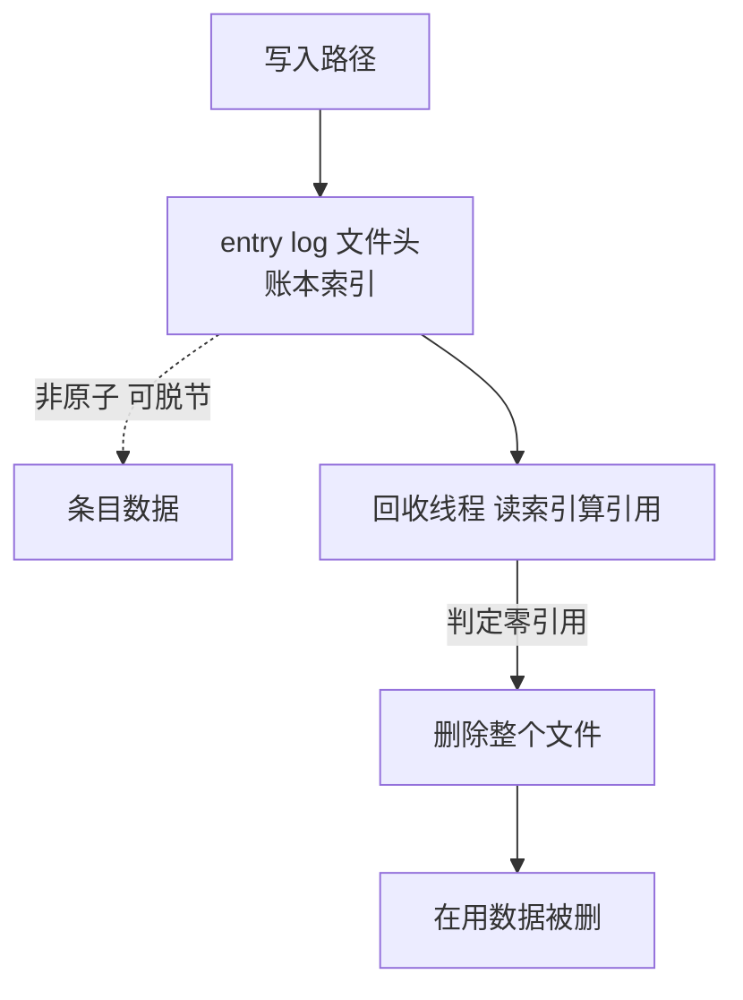
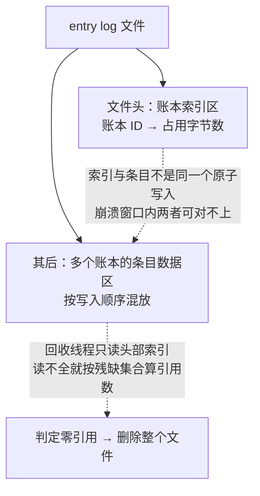
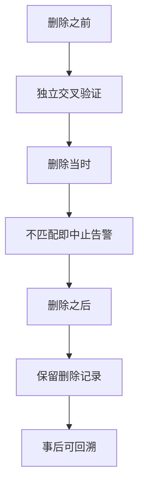

# 案例十六：数据被自己人删掉——entry log 头里的假账

**一份数据是否还活着由索引说了算，索引写错时，回收机制会忠实按假账删掉仍在用的数据**。**读完这篇你能让删除操作读到可信的那份记录**。

> **要点**：一份数据是否还活着，由它的索引说了算；当索引本身写着错误内容，回收机制就会忠实地按这份假账删掉仍在使用的真实数据——删除操作不需要出错，出错的是它读到的那份记录。

**数据丢失最容易被想象成磁盘损坏、误操作、副本全挂这类外部灾难**。**但有一类丢失完全发生在系统内部，由系统自己的正常流程完成**：**账还在，数据却被回收线程当作垃圾清走了**。Apache BookKeeper 的这个病例（已实际复现）把这条路径展示得很完整——**从头到尾没有一个组件报错，直到读取方发现数据不见了**。

## 要解决的问题是什么：账还在，文件为什么没了

打个比方：拆迁办手里有一份名单，名单是谁提供的？是每栋房子自己写在门口的「本栋已无人居住」的木牌。**木牌写错了，整栋楼就按空房拆了**。**这个病例的删除决定同样建立在被删对象自己的自述上**。

**项目**：Apache BookKeeper——**为日志条目提供低延迟、可持久化写入的分布式日志存储服务**，**其 entry log 文件混放多个账本的条目**，**文件头的账本索引能否随删除路径保持准确正是本篇的问题**。

**BookKeeper 的数据组织分两层**。写入的条目（entry）追加进 **entry log** 文件，一个文件里混放着许多账本（ledger）的条目；**每个账本的元数据独立维护，记录它属于哪个 entry log**。**当账本被删除，它占用的空间不会立刻释放**，而是**由后台垃圾回收线程周期性扫描**：**统计每个 entry log 里还有多少账本仍在使用，如果一个都没剩，整个文件就可以删掉**。

这个设计的关键在于**统计依赖于文件自己的头部**。**entry log 文件头里维护着一份账本索引**：本文件包含哪些账本、每个账本占多少字节。**回收线程扫描时读这份索引，对照元数据服务里仍存在的账本，算出"还有没有人用"**。

于是信任关系成了这样：**回收线程的删除决定，完全建立在被删文件自己写的那份索引上。**



**文件头（红色）既是写入路径的产物，又是回收决定的唯一依据——这就是自指**，图上用一条标注过的实线表示。另两条虚线标出要害：**文件头与条目数据的持久化不是原子操作**（不可分割、要么全做要么不做的操作），因而可能与实际内容脱节；而本该被保住的数据（右下）最终走进了删除结果。

## 现象：账还在，文件为什么没了

上游报告的现象（[上游 PR（Pull Request，拉取请求：请求把我的分支改动合入主干） #4607](https://github.com/apache/BookKeeper/pull/4607)，P0）是：**读取方大量报错，说某个账本读不到**。**但元数据服务里这个账本的记录清清楚楚地存在**——它没被删除，状态正常。

**排查翻到存储节点才发现**，这个账本所在的 entry log 文件**已经不在磁盘上了**。**文件是被垃圾回收线程删掉的，删除逻辑执行得完全正确**：**它读索引、算引用、得出"无人使用"的结论，然后删除**。

问题出在那份索引本身。日志里的报错原文给出了直接证据：

```
Failed to get ledgers map index from: 82.log : Not all ledgers were found in ledgers map index.
expected: -1932430239 -- found: 0 -- entryLogId: 82
```

**这条日志由回收线程在扫描阶段打出（早于删除动作）**：**它重新扫描文件头里的账本索引时，发现索引中登记的账本与实际内容对不上**。`expected` 是索引里记录的那个账本标识（-1932430239 即一个 ledgerId），`found` 是扫描时实际定位到的（此处为 0，即没找到）。两者对不上，说明**文件头里写的账本信息与实际内容不符**——索引是错的。

**这就是这个病例最反直觉的地方：写文件头和写数据是同一个写入路径上的两个动作，但它们不是原子的**。**写入过程中一旦中断或异常，文件头可能已经写入磁盘，而它声称的那部分数据还没有**；或者反过来。无论哪种，结果都是一份**与实际内容不符的自述**。

## 为什么是问题：删掉的那一刻没人知道

**好比一位员工静默离职**：门禁记录显示他刷卡出门（删除动作正常执行），没人问他去哪（无异常日志），三个月后才发现他负责的那条生产线停着（延迟暴露），而当时的监控录像早就被覆盖了（现场消失）。**这条路径的破坏力在于三件事同时成立**。

**删除是静默的。** 回收线程删文件的动作在它看来完全正常，不需要打任何异常日志。**它不会说"我删了一个可能还有人用的文件"，因为它不知道**——**它读到的信息告诉它这个文件没人用了**。

**丢失是延迟暴露的。** **从文件被删到有人读这个账本，中间可能隔很久**。**对于冷数据，可能是几周后才第一次被发现读不到**。**这时候磁盘上早已没有痕迹，写入日志也早已滚动覆盖**。

**元数据与数据就此分裂。** **元数据服务说账本存在且健康，存储层说文件没有**。**两边都自洽，矛盾只在真正去读的那一瞬间暴露**。**而读取方拿到的错误往往被当成"这个文件暂时不可用"，重试、切换副本，全都无效——因为文件是真的没了**。

**这比"写入失败"糟糕得多**。**写入失败时数据从未写入磁盘，客户端知道要重发**；**这里的删除让系统失去了"数据曾经存在"的整个证据链**。

## 本质是什么：自指的记录不能作为唯一依据

**现代存储阵列把这个教训做进了硬件**：下图是一台 HP P6300 存储阵列的机柜，几十块磁盘插在槽位里，控制器与磁盘的对应关系由阵列固件维护，任何一块盘拔出时阵列面板都会立刻报告位置与状态——**记录与实物分离，才有对账的可能**。


> 图：HP P6300 存储阵列，来自 [Wikimedia Commons](https://commons.wikimedia.org/wiki/File:HP_P6300.jpg)，CC BY-SA 3.0，摄影 Redline。

去掉 BookKeeper 的所有专有名词，这个病例的骨架是：

> **当一个组件依据"对象自己写的描述"来决定这个对象的存废，而这份描述与对象的实际内容之间没有强制一致性保证，那么描述出错时，正确执行的流程会造成错误的结果。**

**这里没有代码写错**。**回收逻辑、删除动作、元数据查询，每一步都符合设计**。**错的只是输入——而这份输入来自被操作对象自身**。

**值得强调"自身"这个词**。**如果索引写在别处（比如元数据服务里独立维护），那么它与文件内容的不一致至少还有机会被交叉发现**；写在文件自己头里，就意味着**没有任何一方持有可以反驳它的独立事实**。**回收线程无法验证，因为验证需要的信息正是它在读的这一份**。

## 打个什么比方：仓库盘点表贴在仓库门上

**账本时代的核对路径就是这条比喻的现实版**——盘点员看着账本念数，账上没写的货等于不存在：


*图源：Wikimedia Commons《Carson City ledger book》，作者 Wehwalt，CC BY-SA 3.0，https://commons.wikimedia.org/wiki/File:Carson_City_ledger_book.jpg。*

**这本账册的每个字都是它自己的证明**——**账上没登记的货，盘点的人无从知道它存在过**。**entry log 文件头里的账本索引就是这样的账册**：回收线程照它对账，**它写错或写漏时，没有任何第二本账可以推翻它**。

一个仓库门口贴着一张盘点表，写着"本仓库存放：A 类货 30 箱"。**盘点员每周来一次，看门上的表，再对照总部的在册清单**，如果表上的货在总部清单里都已被注销，就把整个仓库清空。

某天入库时出了岔子：货还在往里搬，盘点表已经先贴上了，写的内容却与实际存货对不上——比如少写了一类货。盘点员照表核对，那类"没写上去"的货在总部清单里查不到对应（因为在表上根本不存在），于是判定"此仓库无在册货物"，清空。

**货物是真的，总部账目也是真的**。唯一的错误是那张贴在仓库门上的表——**而盘点规则里，这张表是唯一依据**。

改成什么能避免？**要么盘点时不看门口的表，自己进仓库数一遍；要么表由第三方核对后再贴**。两种方案的共同点是：**不把被盘点对象的自述当作不可质疑的事实。**

## 它是怎么做到的：索引与实际内容为什么会脱节

**索引说自己还在，实际内容已经没了——自指的记录不能作为唯一依据**。**队列削峰（用队列把瞬时高峰摊平到更长的时间段）的另一面也说明同样的事**：**突发超过队列容量时，超出部分被丢弃，队列自己的计数不会告诉你丢了什么**。


从上游提交改动的文件位置可以看出案发地：

```
BookKeeper（Apache 的分布式日志存储，Pulsar 的底层存储）-server/src/main/java/org/apache/bookkeeper/bookie/DefaultEntryLogger.java
bookkeeper-server/src/main/java/org/apache/bookkeeper/bookie/GarbageCollectorThread.java
```

**`DefaultEntryLogger` 负责写 entry log 及其头部索引，`GarbageCollectorThread` 负责读索引并回收**。

**entry log 文件的物理布局是这起假账的前提**：**账本索引与条目数据同住一个文件，索引写在文件头，条目数据跟在后面**。



**头部那份账是自指的：它记录的正是本文件里有什么**。**回收线程只读这份自指的账就去断定"没人引用"**，**头部残缺时这个结论没有第二个来源可以反驳**。

写入路径上，**文件头的账本索引是在条目写入过程中逐步构建、并在特定时机刷盘（把内存中暂存的数据写入磁盘持久化）的**。这里存在一个时间窗：**索引的持久化与条目数据的持久化不是同一个原子操作**。**进程在这个窗口内崩溃、或写入路径上发生异常，就可能留下"头已更新、数据未完整"或"数据已写、头未反映"的状态**。

**上游 PR 里提到的 `expected` 与 `found` 不匹配，正是这种脱节的检测信号**——扫描时重新计算实际内容，与头部记录比对，发现对不上。

这个信号在上游修复 PR 里的原始形态（`Not all ledgers were found in ledgers map index` 的报错与判定为零引用后删除整个 entry log 的链条，页面首屏可见）：


*图源：GitHub apache/bookkeeper PR #4607 页面截图（2026-09-27），https://github.com/apache/bookkeeper/pull/4607。*

而更麻烦的是回收线程读到这种文件时的**默认行为**。**它在无法从索引里找到全部账本时，缺少一条明确的"索引可疑，跳过本文件并告警"的分支**。**于是带着一份残缺的账本集合继续算引用数，得出"零引用"的结论**。

这里能看到与 [[工程知识/缺陷分析：从个案到体系/稳定性/案例一：垃圾回收线程的终止——BookKeeper 磁盘写满]] 的深层联系：**两个病例的案发地是同一条回收线程**，**一个因异常没有兜底而终止**，一个因**错误输入没有校验**而终止。**线程的健壮性问题和输入的可信性问题是两件事，修复其中一件不会自动修复另一件**。

## 怎么发现：让删除动作留下可反驳的证据

**防线沿报废流程拆成四道关**：报废前先由第二个人盘点实物（独立交叉验证）、盘点对不上当场停手（不匹配即中止）、报废单存档（保留删除记录）、每月报废量突然翻倍要有人被惊动（速率告警）。**这类缺陷的发现难点在于，删除发生的那一刻系统认为一切正常，事后无从追查**。有效的四种手段分别作用在删除动作的前、中、后：比喻到「四道关各管一段」为止，每道的具体做法见下文。



左侧两条是拦住错误删除，右侧两条是在没拦住时保住线索。**四条里只有最后一条能在事前报警——回收速率突然升高，往往意味着索引批量出错，而此时还没造成实际丢失**。**保留删除记录那条看起来最笨，但它是数据丢失投诉到来时唯一的回溯依据**。

**删除前做独立的交叉验证。** **回收的决定不基于文件头的自述，而是重新扫描文件内容实际包含哪些账本，再与元数据服务对照**。**代价是扫描变慢，收益是删除决定有了独立依据**。**上游修复的方向正是增强这条验证路径**。

**对可疑索引显式报错。** **发现 `expected` 与 `found` 不匹配时，这必须中止本文件回收并告警的信号，而不是可以容忍的偏差**。**把"索引不完整"从隐含条件变成显式检查**。

**保留删除记录。** **每次执行删除，把"删了哪个文件、当时认为它包含哪些账本、依据是什么"写入磁盘**。**出现数据丢失投诉时，这份记录是唯一的回溯线索**。

**给回收速率设阈值告警。** **正常回收是缓慢平稳的；短时间内大量文件被判定为无引用，往往是索引批量出错的信号**。

## 上游怎么修

**处置原则与疑罪从无同理：证据有疑点就放人（跳过可疑文件不回收），代价是少办一个案子（空间晚点释放），错判的代价（错删数据不可恢复）远远更重**。**修复涉及写入侧与回收侧两处**。**写入侧加固文件头索引的构建与刷盘时机，减少脱节窗口**；**回收侧在读取索引时对不完整或校验不通过的情况显式处理**——**宁可跳过一个文件不回收（空间暂时浪费），也不能删错（数据永久丢失）**。比喻到「疑点即放」为止，两处修复的具体内容如下。

这个取舍方向很关键：**在空间与数据之间，回收逻辑的默认值必须偏向保守**。**少回收一次，代价是空间晚点释放；错删一次，代价是数据不可恢复**。**上游选择让"可疑即跳过"成为默认行为**。

## 这套说法在哪儿会失效，代价换来了什么教训

- **删之前问一句：这个判断的依据来自谁？** 来自被删对象自身的描述时，这份描述与实际内容之间需要独立的校验。自指的记录是最脆弱的依据。
- **删除操作要可追溯。** 静默删除加上延迟发现，等于让故障现场在第一时间被销毁。删除日志不是可选项。
- **不确定时不要删。** 回收、清理、压缩这类会销毁数据的流程，遇到异常输入的默认动作应当是中止并告警，而不是按残缺信息继续。
- **元数据与数据的一致性要能被主动检查。** 两边各自正常、合起来矛盾的状态，只能靠定期对账发现。

## 接着读哪几篇：BookKeeper 磁盘写满

- [[工程知识/缺陷分析：从个案到体系/稳定性/案例一：垃圾回收线程的终止——BookKeeper 磁盘写满]]
- [[工程知识/缺陷分析：从个案到体系/缺陷分析方法——三分离、判定树与五步法]]
- [[工程知识/缺陷分析：从个案到体系/缺陷分析：从个案到体系——导读与开源地图]]
- [[工程知识/缺陷分析：从个案到体系/正确性/复用缓冲区的残留字节：清零是复用的入场费]] —— 讲"写前清零 + 读取侧拒绝"的通用防线，是本病例修复动作背后的方法面
- 后台回收与空间管理的责任边界——[[工程知识/后端系统：在并发、失败与变化中维持服务/任务与并发/任务生命周期必须覆盖进程、日志、超时与清理]]。
- 为什么结构检查证明不了行为正确——[[工程知识/软件构建：让变化可以理解、验证与交付/架构与代码/静态分析发现结构问题但不能证明行为正确]]。
