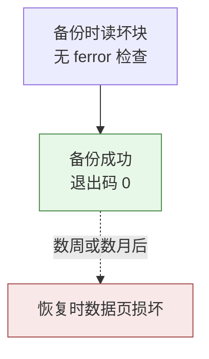
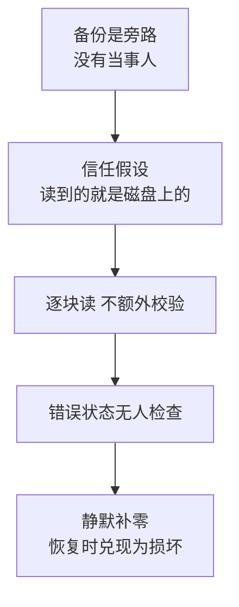
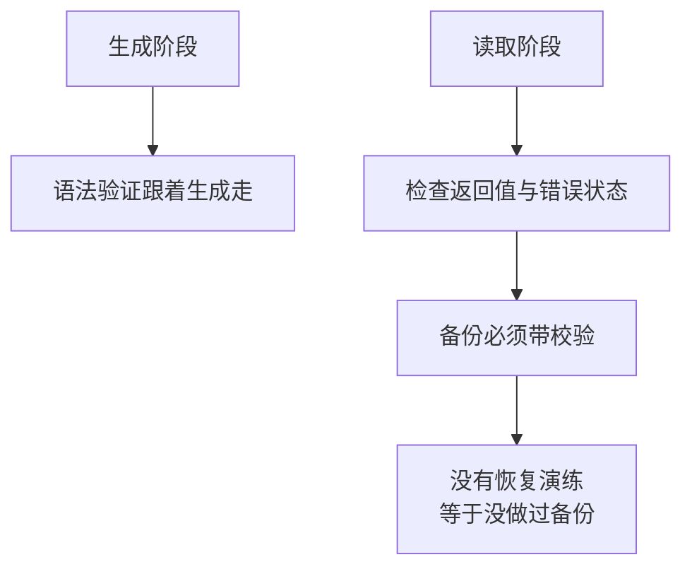

# 案例四十二：备份里的假账——恢复路径的静默损坏

做备份的时候一切正常，坏结果要到恢复时才兑现。**读完这篇你能把校验前移到备份路径上，不再等到恢复才发现损坏**。

> **要点**：物理备份在读到真实 I/O 错误时静默补零，产出一个注定损坏的备份；pg_dump（PostgreSQL 的导出工具）导出的权限语句缺一个分号，恢复时与下一条 SQL 粘连报错——备份路径的缺陷有一个共同点：**做备份的时候一切正常，坏结果要到恢复时才兑现。**

## 备份一切正常为什么还会出假账：要解决的问题与案例背景

**项目**：PostgreSQL（开源关系型数据库，以事务与扩展能力见长），**备份与恢复直接使用其 basebackup 与 pg_dump 两条路径**。

**备份是数据库的保险单**。这一簇的两个病例都发生在保险单的**开具环节**，均为 P1、正确性类、已真实复现，修复见 [上游 commit 62fb12d7](https://github.com/postgres/postgres/commit/62fb12d7e1383905c84436492e1fe841ecc69040) 与 [上游 commit b933c9c0](https://github.com/postgres/postgres/commit/b933c9c0ba8787c2e31521cc94be4acdd1f47d57)，**而兑现（恢复）发生在几周或几个月之后——缺陷的引入时刻和暴露时刻之间隔着整整一个备份周期**。

恢复时才兑现的坏账，**写出来就是两张假收据**：

- 病例一：fread 读坏块，无 ferror 检查，静默补零；备份"成功"，恢复出的库数据页损坏
- 病例二：`REVOKE GRANT OPTION FOR` 缺分号，与下一条 REVOKE 粘连；恢复中断，权限错误

**账本这门生意的核心纪律是账实相符：记下的每一笔都要能与实物对上，对不上的账是假账，而且越晚发现越难追**。备份就是数据库的账本副本——开具时看着完整的账页，恢复时对不上实物（数据页损坏、SQL 粘连），**这笔假账从开具那一刻就已经成立，只是要到兑现日才暴露**。恢复演练就是例行的对账：

*图源：Wikimedia Commons，大都会艺术博物馆（John Carlin），CC0 1.0，https://commons.wikimedia.org/wiki/File:Account_Book_Ledger_MET_DP212609.jpg。*

这类缺陷给运维出的难题是：**开具环节的每一步日志都是成功的**——**备份命令退出码为零、文件大小正常、甚至校验和（对数据算出的指纹，用来发现传输或存储中的损坏）也对（补零的数据有自己的校验和）**。**唯一能抓住它的手段，是定期拿真实备份做恢复演练**。

**图中间那条虚线是这类缺陷的全部危险所在**：开具环节的每一步日志都写着成功，包括补出来的那些零——它们有自己的校验和，文件大小也正常。**兑现要等下一次真的需要恢复时**。

## 读到坏块为什么还报成功：静默补零的机制

**备份这条旁路（绕开主流程的备用路径）天生缺校验的四个结构性原因，是各出各的错，还是合起来指向同一个缺口**。

**四个原因合起来指向同一个缺口——读循环里那次没被检查的返回值，而不是各出各的错**。

**物理备份把数据文件逐块读出来发给备份端**。读到真实 I/O 错误（磁盘坏块、存储故障）时，读循环**没有检查 fread 的错误状态**——**读不到的内容被静默补零，备份"成功"生成**。**恢复时这些补零的位置就是损坏的数据页**：要么恢复失败，要么更糟——**恢复成功但数据是错的**。

PostgreSQL 的内部架构图把这条读取路径的位置标清楚了：客户端经 TCP/IP 或 socket 连进来，postmaster 派生 backend 进程；backend 读写的是共享内存里的 shared buffers，读到页面后返回。**物理备份走的读循环与 backend 读的是同一批堆页面与索引页面**——即图上"Read heap and index pages and transfer them to shared buffers"那一块——**备份旁路不经过 backend，却要读同样的文件，所以它一旦漏掉错误检查，补出来的零就混进了本该与磁盘一致的那份副本**。

*图源：同上（Wikimedia Commons）。*

修复（[上游 commit 62fb12d7](https://github.com/postgres/postgres/commit/62fb12d7e1383905c84436492e1fe841ecc69040)）在读循环后增加显式的 ferror 检查，把真实读错误与并发截断区分开——前者必须让备份失败，后者才是可以处理的正常情况。

## 缺一个分号怎么会恢复失败：SQL 粘连

pg_dump 导出对象权限时，撤销授权选项的 REVOKE（SQL 收回权限的命令）语句**缺一个分号**，与紧随其后的下一条 SQL 粘连成一条非法语句。**备份生成的当时没有任何异常——文本文件写完了**。**恢复时这条粘连语句报错**，**恢复中断，恢复出的库权限错误**。

修复（[上游 commit b933c9c0](https://github.com/postgres/postgres/commit/b933c9c0ba8787c2e31521cc94be4acdd1f47d57)）在构建 ACL（Access Control List，访问控制列表：逐条写明谁能对什么做什么） 语句处补上正确的语法与分号。

## 为什么偏偏是备份路径出事：旁路的本质

**旁路的意思是：它平时不走，走的时候没人看着**。调度者-代理-监督者模式正好补上这块——**调度者派活给多个代理，监督者盯执行状态，失败的步骤由它决定重试还是放弃**。**备份需要这样一个盯着的人**。

按 [[工程知识/缺陷分析：从个案到体系/安全/案例二十六：公告栏没查门禁——Redis 的 ACL 键名泄露与解析崩溃]] 里主路/旁路的模型，备份是最典型的旁路：**没人点菜、没有客人、纯粹系统内部搬数据**。**主路径上的 I/O 错误会被上层感知并重试，备份路径上的 fread 错误却循环在不检查返回值的代码里**——**旁路天生缺少校验的四个结构性原因（信任假设、性能取舍、没有当事人、没人测试）在这里全部成立**。

两个病例还共享一条更深的性质：**错误发生在开具时，兑现发生在恢复时——中间隔着的每一天里，你手里攥着的是一份"假的保险单"，而你以为它是真的。** **这比没有备份更危险：没有备份的人知道自己没有保障，拿着假备份的人有虚假的安全感**。

## 这两个病例跟哪些病同源：案例关联

与 [[工程知识/缺陷分析：从个案到体系/资源与容量/案例六：容量与泄漏——连接泄漏和 SST 堆积]] 的静默主题呼应，与 [[工程知识/缺陷分析：从个案到体系/配置/案例四：配置不生效——recover 速率与重复日志]]的"错误延迟暴露"呼应，但这一簇把延迟推到了极致——**从引入到暴露，隔着一整个备份周期**。恢复路径的测试也因此特殊：**必须真的走一遍"备份 → 破坏 → 恢复 → 校验"的全流程，而不是只测"备份命令返回 0"**。

## 上游把防线加在哪：怎么修

两条修复都是**把静默变成显式**：**fread 之后检查错误状态，真错误让备份立即失败——拿着假备份去恢复，不如现在就知道备份做不成**；ACL 语句生成处补齐语法。修复的共同姿态：**宁可备份当场失败，不可恢复当天发现是假账。**

**备份完整性要与读错误对账——预写读取过程出现错误时退出码应为非零，实测静默补零且退出成功，与预期对不上，恢复时得到损坏数据页**。

## 只做恢复演练够不够：它的边界在哪儿

- **备份必须带校验**，两个层面：**备份完成时校验完整性（校验和、可恢复性抽检），恢复演练定期做**。**没有恢复演练的备份，等于没做过备份**。
- **fread/fread 类循环必须检查返回值与错误状态**——**"读到多少算多少"的代码在 I/O 错误时给出补零的假数据**。
- **生成文本类产物（SQL、配置、代码）时，语法验证跟着生成走**：**缺一个分号的检查成本是零，恢复时发现的成本是一次事故**。
- **旁路清单里，备份/恢复/导入/迁移是永久成员**——每条旁路都要过一遍主路径的那些检查。

四条教训按数据走过的顺序排，各自卡在一个阶段上：

**这四条的共同点是：缺陷在生成与读取阶段进入，在备份阶段被固化，直到恢复那一刻才被发现**。第一条说备份完成时就要校验完整性与可恢复性，没有恢复演练的备份等于没做过备份；**第二条最容易被忽略——"读到多少算多少"的循环在 I/O 错误时给出补零的假数据，于是假数据被当成真数据一路备份下去**；**第四条把范围划清楚：备份、恢复、导入、迁移是旁路清单里的永久成员，每条旁路都要过一遍主路径的那些检查**。

## 防线装上后怎么验证

1. 上游对照：**到 PostgreSQL 的提交 62fb12d7 与 b933c9c0 里核对两处修复**，确认一处是在读循环后增加 ferror 检查、一处是补上 ACL 语句缺的分号。
2. 读错误复现：**在物理备份读取过程中制造真实 I/O 错误，修复前读不到的内容被静默补零、备份退出码为零且文件大小正常，修复后备份以失败结束**；恢复演练时前者得到损坏的数据页。
3. 语句粘连复现：**用 pg_dump 导出含对象权限的数据库，修复前撤销授权语句与下一条 SQL 粘连成非法语句、恢复中断，修复后语句可独立执行**。
4. 恢复演练：**用备份实际执行一次完整恢复并校验行数与权限，确认开具环节的成功状态与兑现结果分开判定**。
5. 断言锚点：两类缺陷的备份产物都留档，恢复演练结果与备份时的日志分别记录。

## 这套防线付什么价：收益与代价

**把备份与恢复作为必查旁路，换来的是读取错误的返回值检查、生成产物的语法校验在开具环节就被要求，恢复演练成为常态而不是应急预案**。**代价是演练本身要占用真实资源并走完备份、破坏、恢复、校验整条链路，生成类产物的语法检查也要接入生成流程而非事后抽查**。

## 接着读哪几篇：同在缺陷分析里的相邻问题

- [[工程知识/缺陷分析：从个案到体系/正确性/删除与写入的竞赛：清理线程与写入路径的时序要有闸门]]
- 旁路为什么容易缺校验——[[工程知识/缺陷分析：从个案到体系/稳定性/案例一：垃圾回收线程的终止——BookKeeper 磁盘写满]]。
- 备份与恢复的持久化语义——[[工程知识/性能工程：从用户等待到资源瓶颈/操作系统与运行时/虚拟内存与文件系统把地址和持久化分层]]。
- 静默失败是另一种 bug——[[工程知识/缺陷分析：从个案到体系/正确性/案例四十一：确认了却没确认——Pulsar 消息语义的三种失真]]。
- [[工程知识/缺陷分析：从个案到体系/正确性/案例二：静默错算——Spark SQL Union 的别名陷阱]] · [[工程知识/缺陷分析：从个案到体系/安全/案例二十六：公告栏没查门禁——Redis 的 ACL 键名泄露与解析崩溃]] · [[工程知识/缺陷分析：从个案到体系/缺陷分析：从个案到体系——导读与开源地图]]
