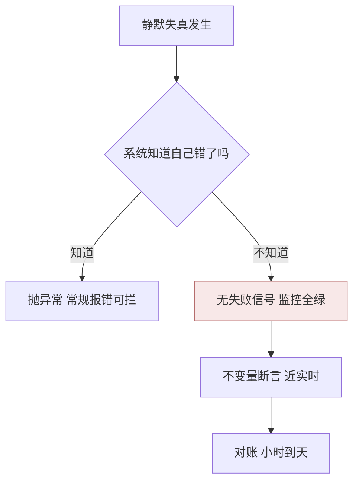
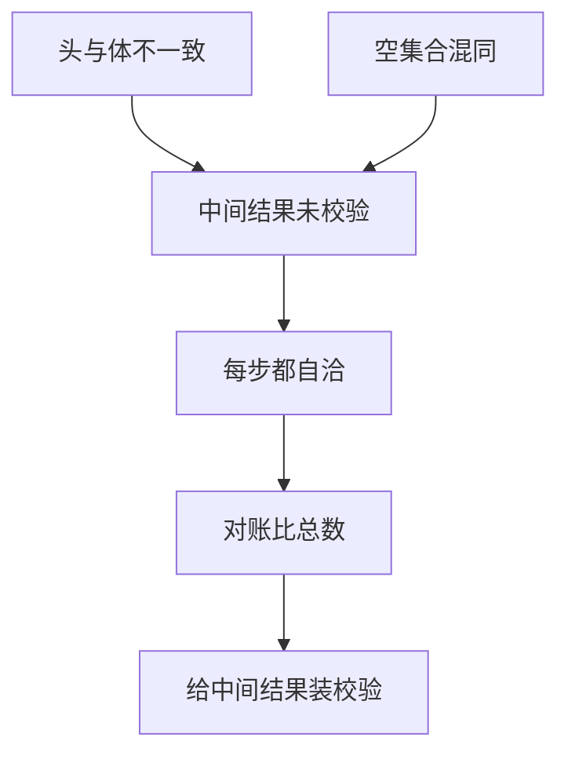
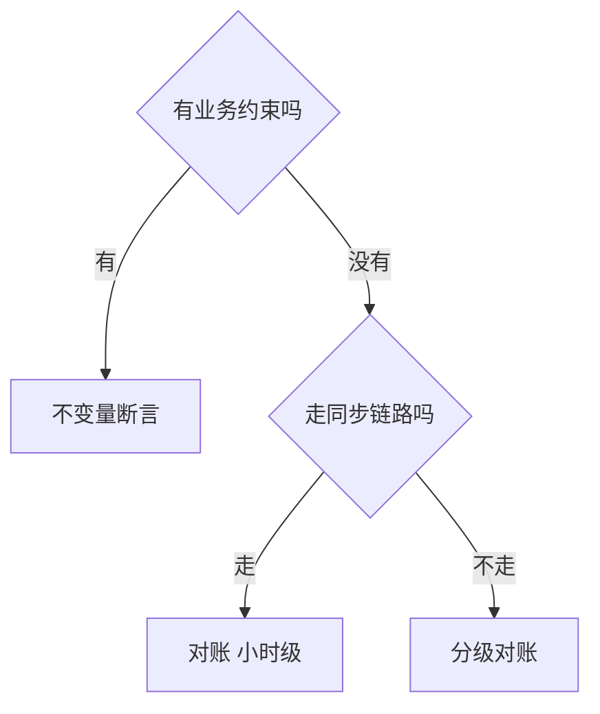

# 静默失真的检测靠对账与不变量而不是报错

**系统算了、也没报错，但结果是错的——这类静默失真没有失败信号，监控全绿，流到下游才被发现**。**读完这篇你能用对账和不变量把静默错误变成可观测事件**。

**库内 13 篇正确性案例里多数属于这一类——静默错算（案例二、案例十三）、假账（案例十六、案例四十二）、截断与删数据（案例十）、TTL（Time To Live，数据的存活时间，到期作废）删数据、空集合被当成"全部已确认"（案例十八）**。**案例九、案例三十一属于另一头——截断最终引发崩溃，崩溃会喊，不在这份名单里；但同一批截断在某些路径上静默吞数据，两个家族共享"值在类型边界被改写"这个根因**。

**为什么报错检测拦不住它们：报错的前提是"系统知道自己错了"，静默失真的前提恰恰是系统不知道。类型系统说数据是 int，运行时也确实是 int，错的是值**。所以检测手段必须换一类——**不从系统内部找信号，从外部对答案**。

## 要解决的问题是什么：报错看不见的失真靠什么检测


来源：[JavaGuide](https://javaguide.cn/high-availability/timeout-and-retry.html)（CC 4.0 BY-SA）

| 机制 | 做什么 | 代价 | 检测延迟 |
| --- | --- | --- | --- |
| 不变量断言 | 声明"必须永远成立的关系"，违反即暴露 | 常驻极低 | 近实时 |
| 对账 | 两个独立来源数同一对象，差异即暴露 | 定期批处理 | 小时到天 |
| 影子计算 | 用另一实现重算同样输入，比对结果 | 算力翻倍 | 随时可做 |

**不变量断言把"正确"从一个个值提升为一条条可检查的谓词：余额 ≥ 0、分片（把数据按规则切开存到不同节点）计数之和 = 总数、entry log 的头与实际条目一致、开始时间 ≤ 结束时间**。**谓词写进生产路径（每次写入后检查）或校验任务（定期扫全量）**。**它与单元测试断言的区别：单元测试断言"这次运行的输出对不对"，不变量断言"存量数据的状态合不合法"——静默失真恰恰只伤害后者**。

**对账解决"两个来源各自都认为自己对"的局面**。**案例三十的跨地域复制 ack 空洞、案例四十一的消息语义失真，本质都是两边账本对不上而没有对账机制**。**对账的关键设计是独立通道：对账的读路径不能复用被检测的写路径，否则写路径的 bug 会同时骗过两边**。**独立来源可以是另一个存储、另一个机房的对端、或同一库的另一视角（如按日志重放一遍）**。

**影子计算是最贵也最强的：换一条实现路径重算（比如流处理的批重算、SQL 的程序化重算），任何一边的静默错误都会在差异中暴露**。**它适合高价值数据与算法变更窗口期**。



三种检测手段的位置都在图的下半部，原因很简单：上半部那条"系统不知道"的分支上没有任何信号可抓。检测只能从外部把答案拿来比——不变量比的是"关系还成不成立"，对账比的是"另一份账怎么说"，影子计算比的是"换个算法算一遍"。

## 这些案例的机制有什么共性

把这几篇案例的失效机制摆在一起，会看到同一个骨架——**中间结果的语义没有被校验**：

四例的公共判据：**信任了中间结果，而没有对它校验**。**所以防御位置不在"写更严谨的代码"，在"给中间结果装校验"**。**具体到工程：账本类数据（任何有 count/total 头的格式）必须定期校验头与体一致；空集合语义必须显式区分"没有"与"没读到"；类型转换必须有显式截断检查**。

四例的失效位置不同，但校验点的位置是一样的——都在中间结果上：



**下半部分是这篇的落点：既然引擎的每一步都自洽，靠它自己报错这条路就走不通，能依靠的只有外部参照**。**对账是拿另一个来源的总数来比，不变量是拿数据自身应当满足的关系来比——两者都不依赖产生结果的那段代码，这正是它们能发现问题的原因**。

## 检测布置怎么选路径

**对账需要一份可比的副本。领取凭证模式给了一个现成的结构：大载荷单独存进外部存储，传输通道里只带一个引用——引用与实体天然分成两处，正好互相校验**。




| 场景 | 首选机制 | 原因 |
| --- | --- | --- |
| 有明确业务约束（余额、库存、配额） | 不变量断言 | 谓词清晰、常驻开销低 |
| 双写/复制/同步链路 | 对账 | 两边各自正确不代表一致 |
| 新算法上线、迁移窗口 | 影子计算 | 变更期是静默失真高发期 |
| 长期管道（多级 ETL，抽取转换加载） | 分级对账：每级入口出口计数 | 每级装成本太高，边界对账性价比高 |

**布置顺序按价值排：先给"错了会伤业务底线"的数据装不变量，再给同步链路装对账，影子计算只在变更窗口开**。**全都装等于什么都没装——开销会让人把检测关掉**。

**对账这套动作比计算机老。下图是 1950 年代机房里的 IBM 403 会计机：穿孔卡喂进去，机器按卡片上的数字汇总打印报表，卡片某列穿错、卡序排错，机器都照常制表不停机——发现错误的机制在流程里：制表结果与总账核对，数字对不上才回头追卡片**。**静默失真的检测布置与这套流程同构：机器（或服务）照常跑，专门的核对动作独立于生产动作存在，失真只在"两边对不上"的时刻现形**。


> 图：IBM 403 会计机房（1954 年，西雅图城市电力公司），来自 [Wikimedia Commons](https://commons.wikimedia.org/wiki/File:Seattle_City_Light_worker_with_office_machine,_1954.jpg)，CC BY-SA 2.0，摄影 born1945。

## 这套说法在哪儿会失效

**对账有自身的语义陷阱：对账脚本自己也是代码，两边用了同一个有缺陷的库函数就会一起错、一起对得上，这种"对得上"比"对不上"更危险，所以对账实现要求通道独立，且对账结果本身要有量级 sanity check——两边差异突然从 0 变 50%，先怀疑对账自己**。

**不变量断言不能覆盖"值错了但谓词仍成立"的情况（余额 100 错成 90，仍 ≥ 0）。对付这一类要靠独立来源对账或影子计算。这也说明静默失真没有银弹，三种机制覆盖三种错误形态**。

**这套方法的前置理解是"缺陷是期望与现实的偏差"（[[工程知识/缺陷分析：从个案到体系/缺陷分析方法——三分离、判定树与五步法]]）**。**静默失真最伤的正是"期望"没有显式写出来的地方——不变量的价值就在于把期望显式化成谓词**。归类入口见 [[工程知识/缺陷分析：从个案到体系/缺陷分析方法——三分离、判定树与五步法]]。

## 怎么自己动手验证

最小实验：给一张账目表同时实现三种检测并人为注入三种错误（截断、假头、漏记），看各自能拦住哪类：

```python
import sqlite3
c = sqlite3.connect(":memory:")
c.execute("CREATE TABLE ledger(id INTEGER PRIMARY KEY, amt INT, entry_count INT)")
# 正常数据：头记录 3 条
c.executemany("INSERT INTO ledger VALUES(?,?,?)", [(1,10,3),(2,20,3),(3,30,3)])
# 注入：静默删一条，头仍说 3 条（模拟假账）
c.execute("DELETE FROM ledger WHERE id=3")
# 不变量断言：头与体必须一致
bad = c.execute("SELECT DISTINCT entry_count FROM ledger").fetchone()[0] \
      != c.execute("SELECT COUNT(*) FROM ledger").fetchone()[0]
print("不变量检出假账:", bad)  # 期望 True
```

**生产布置后的检验：人为注入一次已知偏差（测试环境删一条、改一个头），确认对账任务在预期周期内报警**。**对账任务从不报警不代表系统干净，可能对账自己坏了——定期用注入验证对账本身**。

## 接着读哪几篇：数据侧同构的质量校验

- 关系：[[工程知识/缺陷分析：从个案到体系/正确性/案例二：静默错算——Spark SQL Union 的别名陷阱]] · [[工程知识/缺陷分析：从个案到体系/正确性/案例十六：数据被自己人删掉——entry log 头里的假账]] · [[工程知识/缺陷分析：从个案到体系/正确性/案例十：类型说谎时——静默删数据的 TTL 与算错的比较]]
- [[工程知识/缺陷分析：从个案到体系/缺陷分析方法——三分离、判定树与五步法]] —— 静默类在判定树上的入口
- [[工程知识/数据系统：在并发与故障中保存事实/数据治理/数据质量与血缘让指标可以被解释]] —— 数据侧同构的质量校验
- [[工程知识/AI 系统工程：从模型能力到生产能力/安全与治理/执行证据必须独立于AI结论]] —— 独立通道原则在 AI 场景的对应
- [[工程知识/后端系统：在并发、失败与变化中维持服务/任务与并发/并发控制先定义共享状态和完成条件]] —— 不变量是并发控制与检测的共同起点
- [[工程知识/数据系统：在并发与故障中保存事实/数据建模与SQL/消失的数值：浮点格式与精度陷阱.md]] —— 静默失真的检测体系，浮点是其一
- [[工程知识/数据系统：在并发与故障中保存事实/数据治理/数据质量的三重校验：完整性时效与一致性.md]] —— 静默失真检测思想在数据管道的应用
- [[工程知识/缺陷分析：从个案到体系/并发/删除与写入的并发窗口：复活句柄是静默丢数据的机器]] —— "写成功 ⇒ 可读"不变量作为静默丢失的检测面
- [[工程知识/缺陷分析：从个案到体系/配置/配置文件定位失败被静默忽略：调优在部署那一刻就丢了]] —— "文件值 == 生效值"核对作为配置域的对账防线
- [[工程知识/缺陷分析：从个案到体系/性能/判定范围的口径错位：按谁判，就在谁头上加成本]] —— 指标与语义对账：动作计数类指标失真的检测面
- [[工程知识/缺陷分析：从个案到体系/正确性/日志级别的语义：把提示当告警，告警就成了背景噪音]] —— 级别错配的信噪比度量：告警链路的对账
- [[工程知识/缺陷分析：从个案到体系/正确性/数据对比工具的双人裁决：比对逻辑与判定标准要分开看]] —— 对账工具自身的治理：覆盖面清单、判定标准独立与差异样本集自测


- [[工程知识/缺陷分析：从个案到体系/正确性/案例二：静默错算——Spark SQL Union 的别名陷阱]]：Union 两侧同名列的别名被优化器删错，列值取错输入侧，引擎不报错，因为别名替换在语义上"合法"。
- [[工程知识/缺陷分析：从个案到体系/正确性/案例十：类型说谎时——静默删数据的 TTL 与算错的比较]]：TTL 与比较操作各自正确，组合后删掉了不该删的数据——单个操作无错，组合语义有错。
- [[工程知识/缺陷分析：从个案到体系/正确性/案例十六：数据被自己人删掉——entry log 头里的假账]]：账本头记录的条数与实际不符，读路径信任了头。
- [[工程知识/缺陷分析：从个案到体系/正确性/案例十八：空集合被当成了"全部已确认"——游标跳过的位置]]：空结果被隐式当作"没有更多了"，语义上把"不知道"当成"没有"。
