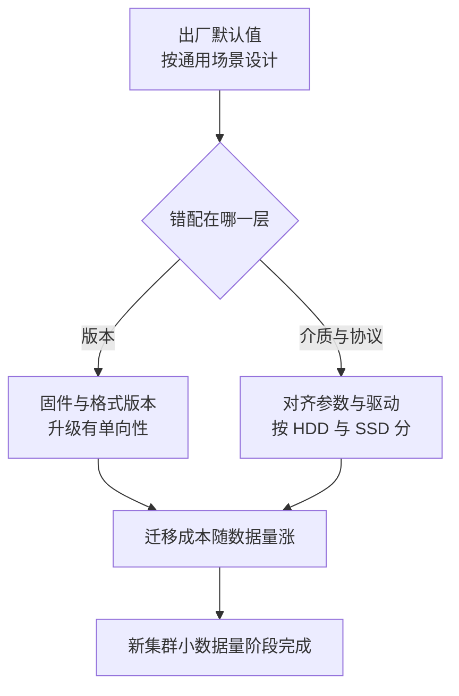
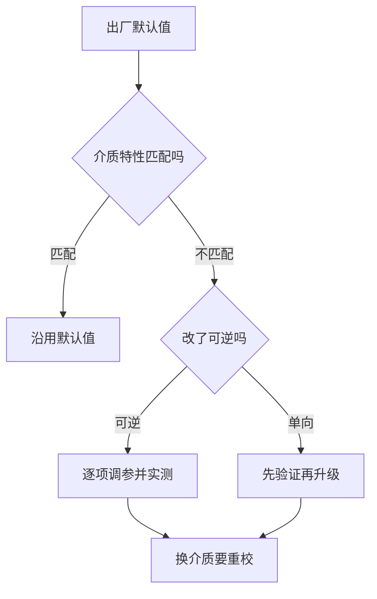
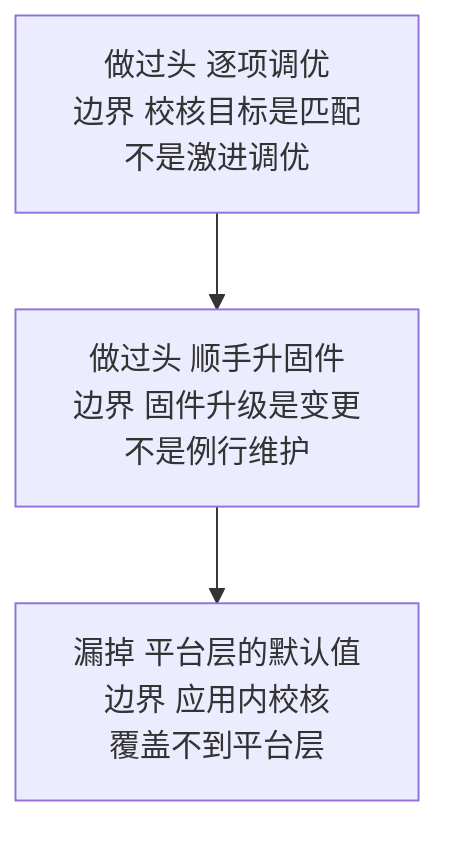

# 固件参数决定硬件的真实行为：默认值要按介质特性逐项校核

> **要点**：**存储与加速硬件的出厂默认值按通用场景设计，与实际介质和负载错配时性能与正确性双输——默认值校核是部署验收的一部分：固件/格式版本、介质对齐参数、驱动与协议版本三类逐项核对，错配的修复要在数据规模变大之前做（迁移成本随数据量线性涨）**。

## 默认值为什么不能照抄：错在哪一层

硬件"装好就能用"，但**默认参数按最通用的场景设计——通用默认与实际介质的错配是隐性性能债**：SSD（固态硬盘）固件的写缓存策略、文件系统对 HDD/SSD 的调度假设、存储引擎的文件格式版本（按旧格式设计，读放大与空间放大都差一截）。上游 BookKeeper 的一个复现改进是"RocksDB 数据库显式指定 formatVersion、默认值升到 5"（默认值按新旧介质的特性升级，旧默认值在 SSD 上浪费压缩与索引特性）——**默认值升级的收益是真金白银的性能**，**代价是迁移，拖到数据量大后迁移成本线性上涨**。本库缺陷分析域"案例三十八：没有写下来的版本——默认值里的迁移债"给过个案；本篇展开默认值校核的三类清单与迁移时机。

## 它是怎么做到的：三类默认值的校核清单

**三类错配的修复窗口都是同一个——数据规模变大之前**，见下图：




### 第一类要校什么：固件与格式版本

SSD 固件版本（厂商修复静默损坏与性能回退的更新）、存储引擎的文件格式版本（RocksDB format_version 决定是否支持新压缩与索引特性）、协议实现版本——NVMe 队列深度默认值：NVMe 是面向闪存的高速存储接口协议，队列深度直接影响小 IO 吞吐。家电出厂默认模式是同一个处境：洗衣机默认「标准程序」按最普通的衣物设计（通用默认值），洗羊毛衫前不切换到羊毛模式（按介质特性校核），缩水了才想起来——比喻到「默认按通用设计」为止：衣服缩水一件的损失有限，存储格式版本错配在数据量涨之后是迁移工程，所以版本要在部署基线（正常状态下的指标水平、用来对比异常）里登记。**校核要做的三件事：在部署基线表里登记版本，对照上游 changelog 核对新特性与已知问题，评估版本升级与数据迁移的成本**。**格式版本的特性之一：旧版本文件可以用新版本引擎读，反向不行——升级有单向性**，**回滚（把系统状态退回到改动之前的版本）要带数据格式回退，升级前核回滚路径**。

### 第二类要校什么：介质对齐参数

**文件系统的调度器与挂载参数按介质选，HDD（机械硬盘）的调度假设与 SSD 完全不同**；**块大小与介质擦除单元对齐（4K 对齐错位的写放大）**；**LSM（Log-Structured Merge，先把写入攒在内存里、再按批顺序落盘的存储结构）引擎的 compaction 参数按介质吞吐反推（SSD 能扛更高写放大，HDD 要压写放大）**。**校核动作是把介质型号写进部署清单，参数按介质分组维护（SSD 组与 HDD 组两套模板）**，错配的验证用基准测试（本库"数据库基准必须描述负载与资源边界"的负载描述法）。

参数逐项核对的「介质特性」具体指什么，机械硬盘的内部结构给了一个直观参照——调度假设、寻道与旋转延迟、顺序写偏好都由这些物理部件决定：


HDD 的调度器假设「顺序读写远优于随机访问」来自盘片旋转与磁头寻道的机械成本，SSD 没有这些部件，同一套挂载参数在两种介质上的行为由此分叉。

介质特性不止影响单盘调度，还决定了**阵列层的拓扑选择**——RAID（冗余磁盘阵列，把多块盘组合成逻辑盘提升可靠性） 10 先把磁盘两两镜像再跨镜像对条带，读性能与单盘容错各取所需，是数据库类负载的常见默认：


*图源：The Geek Stuff《RAID 10 Vs RAID 01》，https://www.thegeekstuff.com/2011/10/raid10-vs-raid01/。*

### 第三类要校什么：驱动与协议版本

网卡驱动与固件（**丢包与吞吐问题的常见根因在驱动版本**）、GPU/加速卡的驱动与运行时版本匹配——**NCCL（NVIDIA 的多卡集合通信库）负责多卡间的 AllReduce 等通信，这类集合通信库对驱动版本有硬要求**、协议协商参数（TLS 硬件加速卡的握手卸载配置）。翻译官与翻译机对不上版本是同一个坑：同声传译的接收机固件旧、发射机协议新（驱动与运行时版本不匹配），代表耳机里全是杂音（丢包与吞吐问题的根因在版本错配）——比喻到「两头版本要配套」为止：会议杂音可以现场换设备，线上丢包（数据包在网络传输途中丢失）要顺着驱动矩阵逐格排查，**所以版本矩阵要写进部署基线**。**校核动作是把驱动版本矩阵（硬件型号 × 驱动版本 × 内核版本的三维兼容表写进部署基线，升级内核前先核矩阵）**。

## 读完这一段你能判断什么：迁移时机与验收姿势

搬家前把家具重新组好，道理与格式版本迁移一致：东西越搬越多（数据量线性涨），拆装成本跟着涨——新家刚起步时（新集群小数据量）就把家具换成合脚的尺寸（默认值校核），比住满五年后（存量大数据量）再全屋改造省一个量级的工钱。比喻到「趁东西少时动」为止：家具搬错可以再搬一次，格式版本回退要带数据格式回退，代价不对称，所以迁移时机按成本曲线择时。



默认值按通用场景设计，落到具体介质上要逐项核对，核对项见下表：


### 迁移时机怎么按成本曲线定

**格式版本类参数的迁移成本随数据量线性涨——在新集群、小数据量阶段完成默认值校核与升级**（本库"依赖升级的半衰期"的同类思路：低成本窗口内做），**存量大数据量的默认值升级要按"新分区用新值、旧分区按计划迁移"分批走，避免一次性全量迁移的长窗口**。装修入住前改水电是同一个窗口：入住后（数据量大了）再砸墙改管，每件家具都要腾挪；毛坯阶段（新集群）改水电几乎随手的事——比喻到「装修要在入住前」为止：装修拖一拖只影响入住时间，**版本升级拖过窗口会与业务高峰撞车，所以窗口由数据量决定，不由日程决定**。

### 验收该怎么做：基准测试与部署基线

**新硬件/新参数部署后跑标准基准（同负载描述、同数据规模），与上一版基线对比——差异超过阈值即回查默认值（默认值错配的性能差距常在 2-5 倍量级，不是百分点级）**；**基准结果与参数版本一起进部署基线表，参数审计有据可查**。新车提车走磨合测试是同一个验收：固定路线、固定载重、固定速度跑一圈（标准基准、同负载同规模），油耗与百公里加速对得上厂商标的数（与基线对比）才算验收过——对不上先怀疑轮胎气压与驾驶模式（默认值错配），这几项差两三倍很常见。比喻到「按同一把尺子验」为止：车不对可以退换，集群验收过了才发现错配，退的成本是重做部署基线。

### 默认值变了要怎么跟住

**上游版本升级会带默认值变更（上游把默认值升到新值）——changelog 审读时把默认值变更单列（对既有集群无感、对新部署生效，两类集群行为分叉）**，**同一软件的不同实例参数不一致是排障的额外变量，参数模板集中管理消灭分叉**。

## 这套说法在哪儿会失效

三条边界防止防线走形。

### 默认值校核为什么不等于激进调优

**校核的目标是"默认值与介质匹配"，逐项调优的边际收益递减且维护成本高——与介质匹配的默认值加少数按负载定的参数是维护性最好的形态，全参数定制是反模式**。家常菜与宴席菜是同一个对比：把盐、油、火候调到与自家灶匹配（默认值与介质匹配），大部分菜就够吃；每道菜都立一本独门配方（全参数定制），换个人掌勺就做不出来（维护成本高）——比喻到「匹配即可，不炫技」为止：灶换了要重新校口味（换介质要重校），但校的是少数几项，不是全部配方。

### 固件升级为什么是变更而不是例行维护

**SSD 固件升级可能带数据迁移与停机窗口，按变更管理走（备份、窗口、回滚预案）**——**"顺手升固件"与"顺手升级依赖"是同一类事故源**。

### 模拟环境与真机默认值差在哪儿

容器与云盘的默认参数由平台层决定（宿主机配置、虚拟化层），应用内的默认值校核覆盖不到平台层。**平台层的介质与参数声明要写进部署文档，跨环境迁移时的行为差异才在预期内**。

三条边界各自挡住一种把校核做过头的方向，对照见下表：



前两条挡的是同一个方向的两种表现——把"校核"做成"调优"或"顺手升级"，两者的共同点是把本来一次性的匹配动作变成了持续投入的维护负担。第三条方向相反：平台层决定容器与云盘的默认参数，应用内的校核够不着这一层，只能靠把平台层的介质与参数声明写进部署文档来补。

## 怎么自己动手验证

错配能不能撞出来，跑一遍下面的对照就见分晓：

1. **错配复现：同一存储引擎分别用旧/新 format_version（格式版本号字段） 灌同规模数据，预期读放大（一次逻辑读触发多倍实际读取）与空间占用差异可测（基准对比），验证"默认值决定真实行为"**；
2. **校核演练：对新部署跑三类清单核对，预期每项有登记与结论（匹配/需改）、需改项在数据规模变大前完成迁移**；
3. **基线验证：参数升级前后各跑一次标准基准，预期差异可归因到具体参数项、结果进基线表**；
4. **断言锚点：三类默认值清单进部署验收、参数模板集中管理无分叉、默认值变更在 changelog 审读中单列——三件齐备，"装好就能用"从碰运气变成有基线的验收结论**。

```text
清单断言 = 三类默认值逐项有核对
基线断言 = 参数与基准结果同表登记
迁移断言 = 低成本窗口内完成升级
```

**硬件的"真实行为"由默认参数与介质的匹配度决定：三类清单在部署验收时逐项核对、参数模板集中管理、版本迁移按成本曲线择时——默认值的校核成本是一次性的，错配的性能债是持续的**。

## 接着读哪几篇：compaction 参数与介质匹配的机制层

- [[工程知识/缺陷分析：从个案到体系/配置/案例三十八：没有写下来的版本——默认值里的迁移债.md]] —— 默认值迁移债的个案视角
- [[工程知识/数据系统：在并发与故障中保存事实/事务与存储/LSM树用写放大换取顺序写和可扩展性.md]] —— compaction 参数与介质匹配的机制层
- [[工程知识/数据系统：在并发与故障中保存事实/可靠性与运维/数据库基准必须描述负载与资源边界.md]] —— 验收基准的负载描述法
- [[工程知识/软件构建：让变化可以理解、验证与交付/开发工具/依赖升级按风险分层：验证阶梯、节奏策略与 CVE 响应]] —— 版本升级节奏的同类框架
