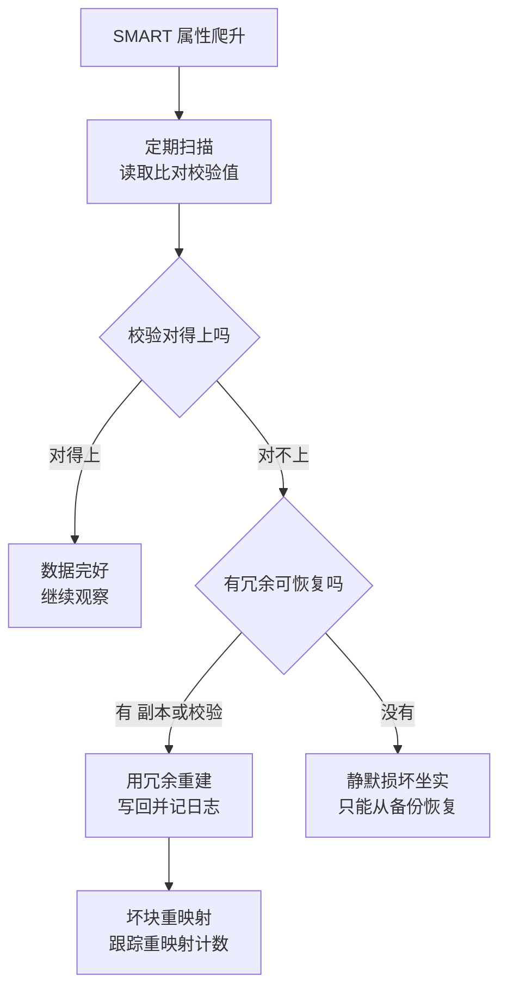
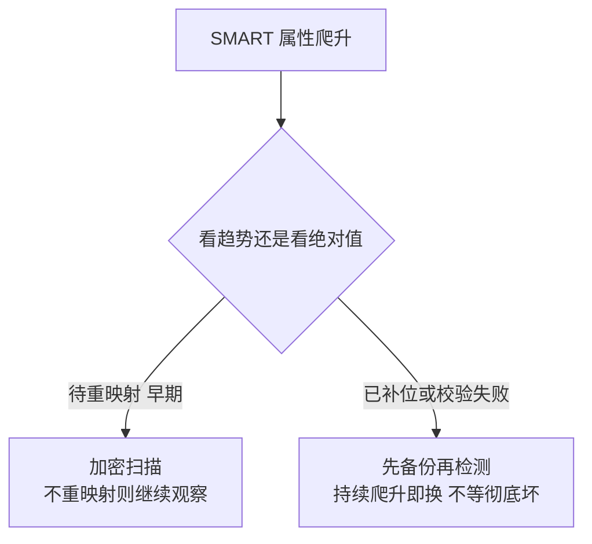

# 磁盘坏道与静默损坏的检测修复路径

硬盘在坏之前会说话：**SMART（硬盘自检数据：盘自己上报健康指标）属性的爬升、重试计数的变化、久未扫过的盘面静默损坏**。要解决的问题：硬件层"坏了怎么办、怎么防"是知识库当前真空格，本篇给出一套**从早期信号检测到更换决策的完整操作路径**，**让磁盘劣化在变成数据事故之前被拦截**。读完你能按 SMART 信号给磁盘劣化分级，并判断什么时候该换盘而不是**继续观察**。

## 磁盘劣化有哪些信号，响应该怎么分级



坏道与静默损坏的检测路径不同，**前者由介质报错暴露，后者只能靠主动扫描比对校验值发现**：


三级信号对应三种处置节奏，判据是趋势而不是**绝对值：**




| 信号级别 | SMART 属性 | 含义 | 响应动作 |
| --- | --- | --- | --- |
| 早期 | Current_Pending_Sector 爬升 | 有扇区待重映射 | 加密扫描、观察趋势 |
| 中期 | Reallocated_Sector_Ct 上升 | 已开始重映射 | 立即备份、准备更换 |
| 危急 | UDMA_CRC_Error 或离线不可恢复读 | 电缆/盘体故障 | 立即下线、换盘 |

这张表里的属性名落到工具界面上就是**一组可读的健康状态**。CrystalDiskInfo（Windows 下一款免费的磁盘健康查看工具）把每个 SMART 属性翻译成中文的属性名称、当前值、原始值与阈值，健康度直接给出「良好 100%」的结论——**SMART 的数字从此变成看得见的界面，巡检时不用再对着属性 ID 猜含义**：


*图源：CrystalDiskInfo 官方界面截图，zhtwnet.com 中文教程站转载，工具为开源软件（MIT 许可）。*

Backblaze 用近 4 万块盘的日常统计验证过这张表：**五个关键属性在故障盘上的报告率远高于存活盘**。


*图源：Backblaze Blog《What SMART Stats Tell Us About Hard Drives》，https://www.backblaze.com/blog/what-smart-stats-indicate-hard-drive-failures/。*

上表里的扇区与重映射发生在盘片表面：磁头悬浮在高速旋转的盘片上方读写数据，盘面局部介质劣化就是坏道的物理来源。下图是工作中的盘片与磁头（盘片旋转导致照片中的盘面呈动态模糊，磁头臂悬停在其上方）：


磁头悬浮高度以纳米计，盘面一旦出现物理划伤（磁头碰撞或外来震动），**划伤区域的扇区就进入待重映射队列——这正是 Pending 计数爬升最常见的物理原因**。

要点：**Pending 与 Reallocated 的区别是"将要坏"与"已坏补位"，趋势比绝对值重要——一块盘的 Reallocated=100 但三个月不变，比 Reallocated=5 但每周翻倍的更健康**。Backblaze（一家公开其数据中心硬盘存活率统计的存储服务商）年度磁盘统计报告是**大样本硬盘存活率的公开基线（正常状态下的指标水平、用来对比异常）**，判断「这块盘的型号是否劣化快于平均」时对照它。

网络侧的同构成员——链路 up 但协商到低速率、计数器静默爬升——见 [[工程知识/缺陷分析：从个案到体系/硬件故障/网卡静默降速与链路劣化：协商、光功率与吞吐基线]]。

## 这条操作路径怎么走

```bash
# 长期 SMART 巡检：smartd 配置 + 周报
smartctl -a /dev/sda | grep -E "Pending|Reallocated|CRC"
smartd.conf: DEVICESCAN -a -m root -M daily
# 全盘读取扫描：暴露静默损坏（读不出的扇区）
badblocks -sv /dev/sda
# ZFS/Btrfs 类文件系统的持续校验：scrub 检出并修复静默损坏
zpool scrub tank; zpool status -v
```
这套路径的收益是**把磁盘事故从「突发数据丢失」变成「计划内更换」**，代价是**巡检与扫描占用 IO 带宽与人力**（smartd 周报 + 季度 scrub 是可持续的最低配）。操作纪律：**发现中期信号先备份再检测**（扫描本身加重负载可能加速损坏）；**更换决策不等「彻底坏」，Reallocated 持续爬升即换**（同容量新盘价格远低于数据恢复）。ZFS（带校验与快照的文件系统） 的 scrub 是**数据层静默损坏的防线**，见 [[工程知识/数据系统：在并发与故障中保存事实/可靠性与运维/备份的价值由恢复演练来验证|备份的价值由恢复演练来验证]] 的静默损坏段——scrub 找到的损坏若无冗余副本，只能报告无法修复，**冗余是修复的前提**。

## 怎么自己动手验证

在退役盘上演练一次完整路径：smartctl 记录基线 → badblocks 全读扫描（记录坏扇区位置与数量）→ 判断标准演练（Pending 趋势预测）→ 实际下线流程（拔盘、清单、销毁）。预期：**能在 30 分钟内走完全流程并给出书面决策记录；badblocks 扫描速度约为顺序读的 80%（只读模式）**。

## 这套说法在哪儿会失效

本篇讲单盘硬件层的**检测与更换决策**。换下来的盘的数据恢复（专业机构）与物理销毁属于安全域。多盘冗余（RAID）怎么把单盘故障消化在系统层，见 [[工程知识/后端系统：在并发、失败与变化中维持服务/分布式可靠性/一致性模型与共识解决不同问题|一致性模型与共识解决不同问题]] 的复制视角。数据层冗余（三副本/EC 纠删码）与备份的关系见 [[工程知识/数据系统：在并发与故障中保存事实/可靠性与运维/备份的价值由恢复演练来验证|备份的价值由恢复演练来验证]]。ECC（Error-Correcting Code，能自动发现并纠正单比特错误的内存校验机制） 内存层的静默损坏对照见 [[工程知识/性能工程：从用户等待到资源瓶颈/处理器与内存/ECC内存把单比特错误挡在报告之前|ECC内存把单比特错误挡在报告之前]]。

## 接着读哪几篇：静默损坏的下游防线

- [[工程知识/数据系统：在并发与故障中保存事实/可靠性与运维/备份的价值由恢复演练来验证]]——**静默损坏的下游防线**
- [[工程知识/性能工程：从用户等待到资源瓶颈/处理器与内存/ECC内存把单比特错误挡在报告之前]]——**内存侧的对应机制**
- [[工程知识/缺陷分析：从个案到体系/硬件故障/静默数据损坏靠校验与副本投票检出：硬件说成功不等于数据还对]] —— **本篇讲单盘检测修复流程，体系篇讲三层布防的分工**
- [[工程知识/性能工程：从用户等待到资源瓶颈/存储与网络/硬件选型的容量留白：按峰值负载的一半规划，另一半是波动预算]] —— **选型侧把衰减计入留白，与本篇的运行侧检测互补**
- [[工程知识/缺陷分析：从个案到体系/硬件故障/磁盘更换前先看 SMART：介质劣化的预兆要比坏道早几个月.md]]
