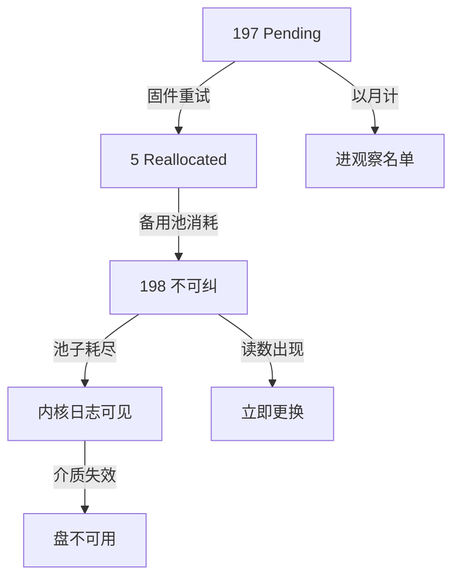
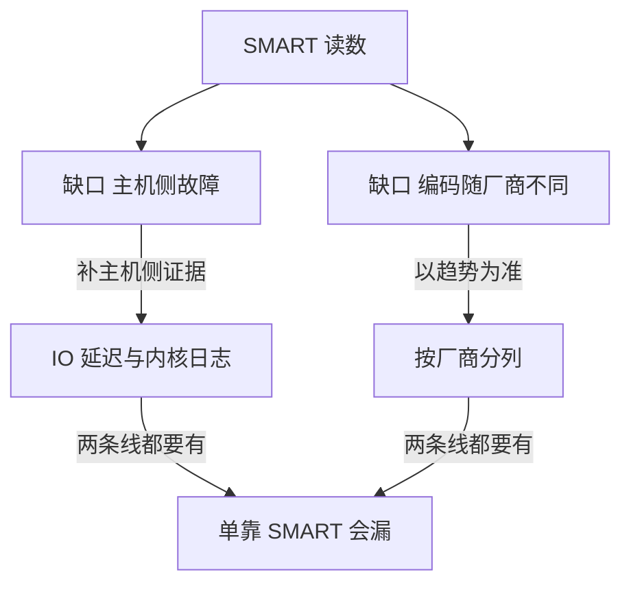

# 磁盘更换前先看 SMART：介质劣化的预兆要比可读错误早几个月

**磁盘不是突然坏的，它有一条几个月长的劣化曲线**，SMART（硬盘自检数据：盘自己上报的健康指标） 属性就是这条曲线的预告片。**读完这篇你能读懂 SMART 读数并定出比厂商更严的换盘判据**。

重映射扇区数（Reallocated）、待映射数（Current_Pending）、寻道错误率、通电时间与启停次数，**每个属性都是介质劣化的预告片**；`smartctl` 的健康状态 PASSED（测试通过状态） **只代表"还没到厂商设定的淘汰线"，运维判据要比它严**：**Pending 大于零就该观察、重映射在增长就该盯、多项同时劣化立即换**——**SMART 的价值在读数趋势，不在通过与否**。

## 要解决的问题是什么：SMART 显示 PASSED 为什么不等于没病

硬盘的出厂固件内置自监测（SMART），**`smartctl -H` 返回 PASSED 是运维最容易误读的信号**——**它只说明属性没越过厂商阈值，而厂商阈值定得极宽（零售盘按 3-5 年保修期设计，数据中心盘的工况远超）**。

**真实的劣化时序**：**介质先出现写入不稳（Pending：写入后读不回，待重试），固件重试成功后扇区进入重映射池（Reallocated 增加，盘用备用扇区替换坏区），重映射池耗尽或劣化加速后出现可读错误与 IO 超时**——**从 Pending 首次出现到盘彻底失效，常见窗口以月计**，这就是预兆的价值：**故障前有整段的更换窗口，用好了磁盘故障就从突发事件变成计划内维护**。本库"SSD（固态硬盘）的写放大（实际写入量是逻辑写入量的多倍）"讲过介质的擦写机制；本篇只讲机械盘与 SSD 共用的**预兆读数方法**。

一条劣化时序，运维的三档动作按当前处在哪一阶段分，剩余寿命只是参考——Pending 首次出现、Reallocated 在涨、198 大于零，各挂一个动作：


**上排是劣化时序，下排是对应的运维动作**。**两者之间那段时间就是 SMART 的全部价值：故障前有几个月的窗口，把突发告警换成计划内维护**。

## 它是怎么做到的：四组读数与判据

**SMART 的计数器由盘内固件维护，量的对象是介质的读写处理通道**：请求在盘内排队、由磁头与盘片兑现，写入失败待重试的扇区就悬在这条通道里——**Pending、Reallocated 这些读数全是这条通道的状态量**。


*图源：Wikimedia Commons《[Hard disk dismantled](https://commons.wikimedia.org/wiki/File:Hard_disk_dismantled.jpg)》，CC BY-SA 3.0。*

**SMART 读数要能对应到介质的物理结构才有意义**。磁头悬浮在高速旋转的盘片上方读写数据，臂端磁头与盘面的距离以纳米计，**备用扇区替换、重映射都发生在盘片与磁头臂这一侧的机构里**——**理解这个物理形态，才知道为什么"重映射计数在涨"比"当前有几个坏道"更能说明问题**。


**第一组：重映射与待映射（ID 5、197、198）**。**Reallocated_Sector_Ct（5）是已替换的坏扇区数**，**Current_Pending_Sector（197）是等待判定的可疑扇区**，**Offline_Uncorrectable（198）是重试后仍读不出的扇区**。**判据**：**197 大于零就进观察名单（每周复测，看是否收敛为重映射）**；**5 的原始值（RAW_VALUE）在涨（对比上周快照）就进更换队列**；**198 大于零是重试已失败的信号，优先级最高**。**快照（某一时刻的完整只读副本）对比是关键动作**：单次读数只说明"有伤"，**两次读数的差值说明"还在流血"**——**趋势比绝对值重要**（**用了 5 年、重映射 100 个且半年没涨的盘，比通电 8 个月重映射从 30 涨到 60 的盘健康**）。

一条真实的 smartctl 属性表节选（数值转录自公开技术文档中一块实际劣化盘的输出），正是这组判据的读数现场：5 号重映射 4 个、197 号待判定 12 个、198 号为零——按上面的判据，这块盘同时落在「197 大于零进观察名单」与「5 有读数需盯趋势」两档，属于典型的劣化中段：


*图示：smartctl -a 输出的 SMART 属性表节选（终端风格渲染，数值忠实转录自 datarecoveryfix.com《Bad Sectors》实拍盘例；VALUE（值）规一化分，RAW_VALUE 原始计数）。读数的含义：**重映射 4 说明坏扇区已被备用扇区替换过 4 次，待判定 12 说明还有 12 个写入后读不回的扇区悬着——两条同时非零且在涨，就属于「立即更换」档**。*

**一张快照只给单点读数，趋势给的是斜率**。Backblaze 把这个论点用 4 万块盘的实测数据画了出来——SMART 5（重映射扇区数）按 RAW（Read After Write，真数据依赖）值分档的年故障率：0 档与 1-4 档几乎贴地，从 16-70 档开始爬坡，1100 档以上直接站上 150%-200% 的年故障率。**同为非零，个位数与三位数是完全不同的风险等级；差值（本周比上周涨了几个）比读数本身更能预告失效**：


*图源：[Backblaze《Hard Drive SMART Stats and Failure Rates》](https://www.backblaze.com/docs/cloud-storage-hard-drive-smart-stats-and-failure-rates)（2026-09-28 实拍）。横轴是重映射扇区数的 RAW 值分档，纵轴是年故障率，误差线为置信区间。*

同一份数据的归一化值（VALUE）视角还暴露了一个陷阱：**归一化值压到 130 以下才出现故障率跳升，而厂商阈值通常设在更低的档位**——**盘按厂商阈值报 PASSED 时，RAW 档位早已进入高风险区**。这正是「PASSED 不等于没病」的数据注脚，**运维判据必须自己定而且比厂商严**：


*图源：同上，Normalized Value 视角。*

**第二组：错误率与性能（ID 1、7、187）**。**Read_Error_Rate（1）与 Seek_Error_Rate（7）的 RAW 值 interpretation 因厂商而异**（**有的盘这两个值是编码后的，恒定大数是正常**），**看趋势不看绝对值**；**Reported_Uncorrect（187）是固件报告的不可恢复错误，大于零即黄灯**。**与文件系统层的对账**：**SMART 有错但文件系统层无感（固件重试扛住了）是黄灯窗口**；**dmesg 出现 `Buffer I/O error` 与 ext4（Linux 常用文件系统）/XFS（高并发文件系统） 的 `metadata I/O error` 时，盘已经进入文件系统可感知阶段**——**红灯判定以内核日志为准，SMART 做前瞻**。

**第三组：工况与寿命（ID 9、12、SSD 的 233/249）**。**Power_On_Hours（9）与 Power_Cycle_Count（12）给盘龄背景——判据要按盘龄分档**：**3 年内的新盘出现 Pending 比服役 6 年的老盘出现 Pending 更可疑（排除批量问题后，新盘劣化常意味着个体缺陷或工况异常）**。SSD 看磨损均衡指标：Percentage_Used（寿命消耗百分比）、Available_Spare（备用空间余量，低于阈值是明确更换信号）——SSD 的"突然失效"形态（备用空间耗尽后写入即失败）让**提前换的纪律比机械盘更刚性**。

**第四组：批量信号的对照**。单盘劣化按个体处理（进更换队列），**同批多盘同时劣化**是系统性信号：**同批次固件缺陷、同机箱供电异常、同散热分区风道堵塞**——**个体视角的"换盘"在批量视角下变成"查工况"**。对照的动作：**把劣化盘的 SN（Sequence Number，序列号）前缀、通电时间、所在机箱槽位分组统计，聚集在同一机箱/同一供电模块的劣化优先查环境**。

## 读完这一段你能判断什么：巡检流程与更换决策
**巡检的最小集**：每周对全量盘跑 `smartctl -A`（带 `-d` 指定 RAID——独立磁盘冗余阵列——卡背后的盘），**采集 5/187/197/198/9 五个属性的 RAW 值入库；对比上周快照出增量表**——**巡检的产出是两张名单**：**观察名单（Pending 首现、数值低但没涨）与更换队列（重映射在涨、198 大于零、SSD 备用空间告警）**。**更换的决策链**：**更换队列的盘在下一个维护窗口摘除（RAID/副本形态直接换后重建）**；**重建前评估同组盘健康**——重建是最重的 IO 负载，同组的 Pending 盘很可能在重建压力下暴露为真坏（本库"RAID 等级与数据可靠性"的重建风险账，**先换劣化盘再触发重建**是顺序纪律）。

**告警的接法**：**smartd 的守护模式（`smartd.conf` 按属性配阈值邮件告警）做 7×24 兜底，周巡检做趋势——两者互补：smartd 抓过阈值的急症，巡检抓慢性劣化**。**RAID（把多块盘组合成逻辑盘提升可靠性）卡背后的盘**要用 `-d megaraid,N` 类透传参数，漏配透传的盘 SMART 读不到（**巡检覆盖率的核对项：盘数与读数盘数对账，读不到的盘单独列**）。

## 用了能拿到什么，要付什么代价

**SMART 巡检的收益是介质故障从半夜告警变成维护窗口计划项（更换窗口可选、重建可控）**，**代价是每周巡检的采集存储与增量对比脚本（一次建好，边际成本近零）**；**误报的代价（把健康盘换下）远低于漏报的代价（坏盘拖到彻底失效连累同组重建）**——**判据从严是刻意的成本倾斜**。

## 这套说法在哪儿会失效

**三条边界把「看 SMART」约束在证据可信的范围内**。

**SMART 预兆不覆盖所有故障形态**：**固件 bug（批量卡死）、电源与线缆问题（IO 全链路超时但 SMART 干净）、掉盘（链路重连）不在介质劣化的读数里**——**SMART 是介质维度的预兆，主机侧的 IO 延迟与内核日志是另一条独立防线，两条线都要有**。

**读数依赖厂商实现**：**属性 ID 相同、RAW 值编码不同（错误率类尤其明显），判据以 RAW 值趋势与厂商文档为准**——**跨厂商集群的判据表按厂商分列，不做统一阈值**。

**更换不是终点，重建才是风险点**：**换盘操作本身低风险，重建过程的额外负载与降级（主动牺牲部分功能或精度，保住核心链路）窗口才是事故高发段**——**重建期间的限速（本库"节流参数"的核算）与重建后的数据校验（本库"静默损坏防线"的扫描）是更换流程的收尾动作，不是可选项**。

三条边界各自守着一个 SMART 自身覆盖不到的缺口，合起来才构成完整防线：



第一条最值得强调：**SMART 读的是介质自己的状态，主机侧的 IO 延迟与内核日志看的是整条链路**。**盘健康而链路有问题的那类故障，SMART 全绿、抓不到，只能靠另一条线发现**，所以这两条线并列必需，缺一不可。

## 怎么自己动手验证

验证要拿的账是：属性增量趋势给出的预判与这块盘后续的实际更换结果对不对得上。

1. 读数巡检：**对自己的盘跑 `smartctl -a`，记录 5/197/198 与通电时间，两周后对比增量——建立"趋势视角"的实操手感**；
2. 判据演练：**拿退役盘（或 SMART 模拟工具）构造 Pending 上涨场景，走一遍"观察名单 → 复测 → 更换队列"的判定流，预期每步动作与名单一致**；
3. 覆盖率对账：**巡检脚本的读数盘数与实际盘数核对，RAID 卡透传缺失的盘会被这一步揪出**；
4. 断言锚点：**五属性周快照有增量表、smartd 兜底告警在跑、更换队列的重建顺序含同组健康评估**——**三件齐备，磁盘故障从"半夜报警"变成"维护窗口里的计划项"**。

```text
趋势断言 = 增量比绝对值优先判
红灯断言 = 内核日志定急症SMART定前瞻
顺序断言 = 先换劣化盘再触发重建
```

磁盘的劣化是缓慢的曲线，SMART 是硬盘自我监测技术，全称 Self-Monitoring Analysis and Reporting Technology，固件把内部计数器暴露成可读属性，**它把这条曲线暴露成可读的数字——巡检抓趋势、smartd 抓急症、更换队列把突发故障提前数月接住**；**PASSED 只是厂商的宽容，运维的判据要自己定，而且要比它严**。

## 接着读哪几篇：SSD 介质机制的原理层

- [[工程知识/性能工程：从用户等待到资源瓶颈/存储与网络/SSD的写放大来自介质要先擦后写.md]] —— SSD 介质机制的原理层
- [[工程知识/数据系统：在并发与故障中保存事实/可靠性与运维/RAID等级与数据可靠性：镜像与纠删的数学.md]] —— 重建风险与冗余的账
- [[工程知识/数据系统：在并发与故障中保存事实/可靠性与运维/存储的静默损坏防线：校验和、副本比对与定期扫描各拦一层.md]] —— 重建后的数据校验
- [[工程知识/性能工程：从用户等待到资源瓶颈/存储与网络/硬件退役前的容量腾挪：退役计划与扩容计划要一起做.md]] —— 更换队列与容量计划的衔接
