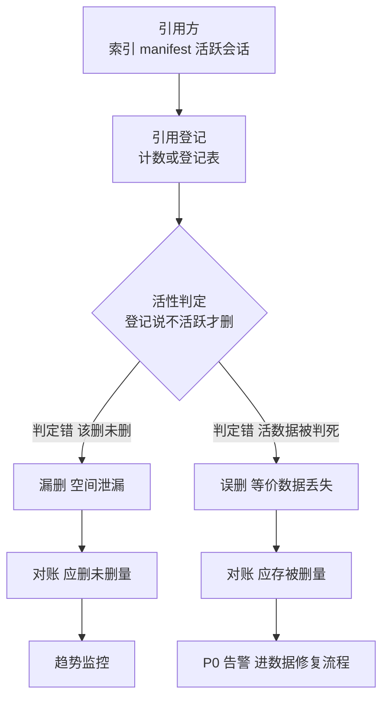

# 空间回收要有对账表：引用登记让删除不漏不冤

> **要点**：存储的空间回收（GC）依赖"引用登记 → 活性判定 → 扫描删除 → 对账"四步——引用计数或登记表回答"这块数据还有人要吗"，扫描器只删"登记说不活跃"的；**判定的错差有两个方向：漏删是空间泄漏、磁盘缓慢膨胀，误删是活数据被回收、等价于数据丢失，对账表把两个方向的错差都变成可发现的数字**。

## 删除为什么既会漏又会冤：没有引用登记时到底缺什么

空间回收的判定错误是存储系统的隐性问题：**漏删（已无引用的文件/版本没人回收，磁盘水位只涨不跌，排障时发现"很多文件不知道是谁的"）**；**误删（活性判定错差，引用还在的数据被当垃圾回收——最严重的一类数据丢失）**。上游 BookKeeper 的复现记录里有一条"pendingDeletedLedgers 不移除 ledger 导致错误"（删除的中间状态管理出错：删除进行中的条目卡在登记表里，既没删净也没法重试）——**回收的中间状态与登记表的一致性是 GC（Garbage Collection，垃圾回收：自动找出并释放不再使用的内存） 的真正难点**。本篇展开：**引用登记的形态、活性判定的窗口设计、对账的指标**。

## 它是怎么做到的：登记、判定、扫描与对账

**四步串成一条链，对账是把两端的错差变成可比数字的那一步**。食堂晚班收档是同一趟流程：窗口剩余的菜登记是引用登记，逐格判断哪些还能留是活性判定，过期倾倒是扫描删除，与备菜记录核对损耗是对账——比喻到「收档四步」为止：**食堂倒错了当天补做，存储误删是等价数据丢失，所以判定必须是「登记说不活跃才删」而不能凭现场感觉**。分层存储引擎里，"删了但空间没立刻回来"是有结构原因的——**数据大部分沉淀在最底层，只有跨层合并才真正回收**：

「销账前先对单」的实物原型是图书馆的还书箱：闭馆后管理员把还书箱里的书逐本与借阅登记单核对——书在单上（有人借出）销记录，单上有书不在（错架或丢失）另册追查，书在单上没有（来路不明）不上架；两头对得上，馆藏账才平：


*图源：Wikimedia Commons，作者 Azoma，CC BY-SA 4.0，https://commons.wikimedia.org/wiki/File:After_Hours_Return_Box_of_Glen_Eira_Library.jpg。*

空间回收的对账正是这套还书流程：**登记表是借阅单，扫描器是管理员，应删未删是"单上销了书还在"（泄漏量），应存被删是"书没了单还在借出栏"（丢失量，P0）——还书箱每天核、对账任务每天跑，两个数字进趋势，账不平就是有问题**。


*图示：RocksDB 分层合并（Leveled Compaction）的层级结构。图源：[RocksDB Wiki · Leveled Compaction](https://github.com/facebook/rocksdb/wiki/Leveled-Compaction)。*




### 引用登记有哪两种形态

**引用计数（每个数据块的引用数，增删引用时同步更新——实时性好，计数错差不可恢复）、登记表（独立维护"谁引用什么"的清单，扫描器按清单判定——判定可重算，登记与数据的偏差可对账）**。**长生命周期存储（日志段、SST（Sorted String Table，按 key 排好序后落盘的只读文件）、对象）常用登记表：引用方（索引文件、manifest、活跃会话）登记在案，扫描器以登记表为权威——计数型 GC 在崩溃恢复时计数可能错，登记表可以按"重新扫描引用方"重建**。

引用计数的机制形态，Cornell CS3410（康奈尔大学的计算机体系结构课程）课程笔记的图最直观——每个对象框上标注收到多少条入边，P 方框是持有指针的局部变量：


图源：[Cornell CS3410 Memory Safe Languages 课程笔记](https://www.cs.cornell.edu/courses/cs3410/2025fa/notes/memory_safe_langs.html)。**计数即入边数，删除即逐级递减——这正是「实时性好」的来源：判定零引用的瞬间就能释放**；而后续图（rc1-rc4）演示同一结构在引用改向后 B 计数归零被释放、C-E 因成环永远到不了零，**正对应上文「计数错差不可恢复」与长生命周期存储改用登记表的理由**。

### 活性判定的窗口该怎么设

**删除不是瞬时的——业务标记删除（逻辑删）→ 等待窗口（在途读与副本同步完成）→ 物理回收**。**窗口的作用是防删除竞态：读方刚拿到引用、写方标记删除、GC 立即回收——读失败**。酒店的退房缓冲是同一个安排：客人上午退房，房间不是立刻翻新，要等到"最晚一批在住行李搬空"之后才动——缓冲期按最慢的客人算，不按最快的算；**窗口时长按最坏在途时间定（读超时 + 副本同步时间）**，窗口内的条目状态机（pending-delete → deleted）要持久化：**上游"pendingDeletedLedgers 不移除"的缺陷正是这个状态机的实现错误——中间状态的条目被错误处理，删除流程卡住**。

### 扫描删除断了之后怎么接着跑

**扫描器按批次处理（扫一批、判一批、删一批），每批的进度持久化——中断后从断点继续，不重复不遗漏**。流水线上的记号笔是现成对照：分拣员在一箱货处理完时才在清单上划掉这一批，中途换班的人接过清单，从最后一个记号接着干——已划的不重搬，没划的不漏搬；**扫描的限速与业务 IO 共享带宽（上一批数据修复篇的限速原则同源）**。

### 用哪两个指标给删除对账

**应删未删（登记表标记已删但文件还在——泄漏量）、应存被删（业务引用存在但文件缺失——丢失量，P0 级告警）——对账任务按天跑，两个指标进趋势监控：泄漏量持续增长说明扫描器或状态机有 bug，丢失量非零直接进入数据修复分级流程**。

## 读完这一段你能判断什么：GC 的失效模式与防御

### 有哪三类失效会让删除走偏

**状态机错误（中间状态卡住或跳变，上游复现的 pendingDeletedLedgers 类）、登记与数据不同步（登记更新了数据没删/数据删了登记没更新——崩溃窗口内两个动作不原子）、扫描器误判（活性判据错：把"暂时无引用"当"永久无引用"）——防御的共同点是判定可重算：登记表可重建、扫描可重跑、删除可重试，任何一步出错都能从另一步纠正**。

### 误删的最后一道防线是什么

**物理删除前数据进"回收站"状态（保留 N 天才真正抹除）——误删在 N 天内可恢复，代价是空间回收延迟 N 天**；按存储价值分层配置（热数据长保留、临时区零保留）。废品回收站就是这个缓冲层：报纸进了回收车不等于**进了碎浆机**，在站点搁几天，家里发现夹在里面的存折还能去认领——**保留期就是认领窗口，过期碎浆，空间真正回来**。

### 回收与备份为什么必须分开看待

**GC 删除的数据在备份里还有吗——备份链与 GC 的交互要显式设计——备份周期长于 GC 窗口时，备份里存在已被业务删除的数据，恢复时多出来的数据要不要、过期的怎么处理，两个系统的保留策略对齐评审**。家里同时记两本账的情形：流水账月底结清销掉（GC），银行对账单按年封存（备份）——销掉的支出在对账单里还查得到，**恢复（对账）时两本账数字对不上，先说清以哪本为准，不然每笔差额都是一次争论**。

## 这套说法在哪儿会失效

三条边界防止防线走形。

### 引用计数为什么不用于长生命周期存储

计数型 GC 适合进程内短生命周期对象（内存管理），跨进程、跨机器的存储引用用登记表——**计数的错差不可恢复（漏计一次引用就永久泄漏或误删），登记表可重建**。小教室点名数人头管用：人数对上就开课，错了当场重数；全校点名数人头就不可行了——**请假条（登记表）才是权威，人数对不上先查请假条**，而不是**把全校重新数一遍**。**跨机器的存储里"重新数一遍"的代价同样不可接受**。

### GC 窗口和读超时是怎么互相牵制的

**删除窗口短于业务读超时，窗口保护失效（读方超时重试时数据已被回收）——窗口时长不小于读超时加副本同步，两个参数在配置里显式联动**。订金锁位是同一个约束：包间最晚到点（读超时）定一小时，留位就得留到一小时之后（窗口），留位早于最晚到点就撤台，客人到了没位只能骂店家——**两个时刻谁长谁短，规矩里要写死联动**。

### 扫描器本身为什么也要被监控

**扫描进度、批次速率、异常退出次数——扫描器静默失败时泄漏量无声增长（对账指标发现时已经堆了很久），扫描器的存活与进度本身是监控对象**。保洁外包是同一个教训：走廊堆了半个月的纸箱才被发现，因为没人查保洁的打卡记录与作业面积——垃圾堆到看得见时，欠账已经堆了很久；**查保洁，要查出勤与进度，不是等垃圾说话**。

## 怎么自己动手验证

可复现的验证路径，性质同仓库盘点：故意留一件账上有、架上无的货，看盘点流程报不报——报得出来，说明盘点机制有效；然后再故意多报一件架上有的，看会不会被误报成丢货。

1. 漏删复现：**制造登记与数据不同步（手工建孤儿文件），预期对账任务按天检出、泄漏量入趋势图**；
2. 竞态（多个执行流争抢资源、结果取决于时序）复现：**读方持有引用的同时触发删除 + GC，预期窗口保护下读不失败；缩短窗口后复现读失败——验证窗口时长公式的正确性**；
3. 断点续跑验证：**扫描中断（kill）后重启，预期从断点继续、对账无缺口不重复**；
4. 断言锚点：**登记表为判定权威且可重建、中间状态持久化、应删/应存两个对账指标有监控与告警、软删除保留期按层配置**——四件齐备，空间回收从"后台跑着的黑盒（不接触代码内部、只看输入输出的测试或分析方式）"变成"对账数字可查的工程流程"。

```text
登记断言 = 引用清单可重建可重算
窗口断言 = 删除窗口覆盖最坏在途
对账断言 = 泄漏与丢失两个指标在管
```

**空间回收的可靠性不在 GC 算法本身，在它周围的三件套：可重建的登记表、覆盖在途的删除窗口、双方向的对账指标——三件配齐，"磁盘怎么越用越满"和"数据怎么没了"两个悬案都变成有数字可查的对账问题**。

## 接着读哪几篇：对账发现丢失后的修复流程

- [[工程知识/数据系统：在并发与故障中保存事实/可靠性与运维/数据修复要按失效半径分层：行级订正、分区重建、全量重导.md]] —— 对账发现丢失后的修复流程
- [[工程知识/数据系统：在并发与故障中保存事实/事务与存储/LSM树用写放大换取顺序写和可扩展性]] —— compaction 即 LSM（Log-Structured Merge-Tree，日志结构合并树：写优化存储引擎的骨架） 的空间回收
- [[工程知识/性能工程：从用户等待到资源瓶颈/存储与网络/临时文件要先写进命名约定：可清理性是写入路径的设计要求.md]] —— 临时文件清理与 GC 同属空间治理，共享命名与登记原则
- [[工程知识/数据系统：在并发与故障中保存事实/可靠性与运维/存储的静默损坏防线：校验和、副本比对与定期扫描各拦一层.md]] —— 扫描体系的一致性与回收共用限速原则
