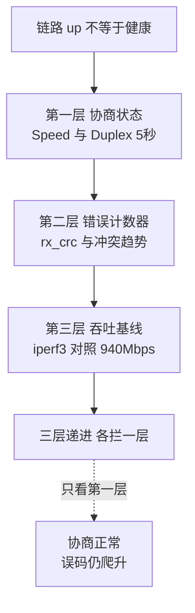

# 网卡静默降速与链路劣化：协商、光功率与吞吐基线

**链路 up 不等于链路健康。千兆降到百兆不报错、不告警、不闪断，应用层只是"变慢了"，这种静默劣化与磁盘坏道同构：还能用，但已经在坏**。本篇给出从协商状态、错误计数器到吞吐基线的三层检测路径，让网卡劣化在变成"不明原因的性能问题"之前被拦截。

## 降速为什么不打招呼：要解决的问题与静默机制

**速率协商像两位合作者见面握手——双方各自亮出能力（速率、双工模式），取双方都能接受的那一档成交。问题出在"能接受"的判定标准：千兆要全部 8 芯都通，网线断了 4 芯时，握手会"成功"地退到只用电 4 芯的百兆档——对协议来说这是完全正常的成交，没有任何层会把它当故障上报。绿灯（链路 up）继续亮着，应用只是"变慢了"**。这个比喻到"成交"为止——现实里握手双方能看见对方的证件（光功率、错误计数器），运维要主动去读这些数字，这就是三层检测路径的由来。

**速率协商发生在链路层，对上层是透明的：网卡与交换机（在局域网内按地址转发数据帧的设备）自动协商出双方都支持的速率，协商"成功"的结果可能是一个远低于物理能力的速率，链路状态依然是 up。这种静默降速不会在应用层报错，只会表现为吞吐变差**。

*图示：链路层抓包视角。协商结果错误时，冲突与重传会在这一层留下计数。*

| 劣化形态 | 触发条件 | 表现 | 静默原因 |
| --- | --- | --- | --- |
| 千兆降百兆 | 网线 8 芯中断 4 芯（千兆需全部 8 芯，百兆只用 4 芯） | 带宽降一个数量级 | 链路仍 up，协商"成功"到一个低速率 |
| 双工不匹配 | 一端强制全双工、另一端自适应（FLP 协商失败后回退监听） | 冲突、重传、吞吐骤降 | 链路 up，半双工侧只看到冲突计数上升 |
| 光模块劣化 | 光功率漂移、温度异常、污染 | 误码率上升、偶发重传 | 链路 up，错误计数器缓慢爬升 |
| link flap | 接触不良、光衰临界、协议干扰（STP/DLDP） | 周期性闪断 | 每次"恢复"掩盖了下一次劣化 |

**关键认知：自动协商（IEEE 802.3 标准的 FLP 机制）设计目标是"能通"，不是"通到最优"。协商到 100M 半双工对协议栈来说是完全正常的成功事件，没有任何层会把它当故障上报。检测责任在运维侧**。协商这件事发生在链路两端的物理端口上——网卡一侧，交换机一侧：


*图源：Wikimedia Commons，Dsimic，CC BY-SA 3.0，https://commons.wikimedia.org/wiki/File:Internals_of_a_Cisco_small_business_SG300-28_28-port_Gigabit_Ethernet_rackmount_switch.jpg。*

## 从哪里读出劣化信号：三层检测路径

**链路层的故障藏在物理层里：8 芯网线断 4 芯，千兆静默降成百兆；光功率漂移，误码悄悄爬升——链路 up 的绿灯一路亮着，直到有人在吞吐曲线上看出不对劲。检测它要从物理层读数开始，协商状态与错误计数器都发生在这块卡的物理层上**。

```bash
# 第一层：协商状态（每台机器 5 秒）
ethtool eth0 | grep -E "Speed|Duplex|Auto-neg|Link detected"
# 预期基线：Speed: 1000Mb/s, Duplex: Full, Auto-neg: on
# 异常信号：100Mb/s（降速）、Half（双工不匹配）、off（协商被关）

# 第二层：错误计数器（趋势比绝对值重要，与磁盘 SMART 同理）
ethtool -S eth0 | grep -E "rx_crc|rx_errors|tx_errors|collisions"
watch -n 60 'ethtool -S eth0 | grep -E "rx_crc|collisions"'
# 异常信号：rx_crc_errors 持续增长（物理层劣化）、collisions 非零（半双工）
# 半双工侧会累积冲突计数，全双工侧零冲突——不对称本身就是双工不匹配的证据

# 第三层：吞吐基线（iperf3 定期对照，季度或变更后）
iperf3 -c <基准服务器> -t 30   # 千兆链路预期 ~940 Mbps
# 降到 ~94 Mbps 即百兆协商；吞吐减半但计数器干净则查拥塞窗口与限速
```

**操作纪律：三层是递进关系不是替代关系。协商状态正常不代表物理层健康（错误计数器可能仍爬升），前两层都正常不代表吞吐达标（QoS 限速、policy routing 都在协商层之下动手脚）。基线对照是唯一能覆盖"配置类静默降速"的手段**。

把两层的读数摆在一起，能看到「计数器正常但协商状态读不到」的实际形态：下图为 `ethtool eth1` 与 `ip -s link show eth1` 的输出示例，双向 errors、dropped 全为 0，链路检测 yes，但 Speed 与 Duplex 一栏是 Unknown——虚拟网卡不暴露协商结果时就是这种形态，只看计数器会误判「链路健康」，协商层必须单独确认：


*图源：`ethtool eth1` 与 `ip -s link show eth1` 输出经排版渲染。**计数器干净而协商状态 Unknown，是「计数器正常不等于链路正常」的直接实例——三层各看一段，缺一层就剩一段盲区**。*



图：三层检测的递进关系——协商状态（5 秒读 Speed/Duplex，抓降速与半双工）在最外层，错误计数器（rx_crc_errors 与 collisions 的趋势爬升）往里一层，吞吐基线（iperf3 对照 940Mbps 预期）覆盖协商层之下的配置类降速——每层各拦一类静默劣化，互不替代。虚线是跳层的代价——只看协商状态，物理层的误码爬升与 QoS 限速都在读数之下，链路 up 的绿灯一路亮到用户变慢。

**四种劣化形态里，双工不匹配最容易被误判为「性能问题」而不是「配置问题」：它的症状是冲突与重传，与拥塞高度相似，而它的根因是一端被强制、另一端自适应的配置不一致。区分两者的判据是不对称性——半双工侧累积冲突计数，全双工侧计数为零。拥塞不会只在链路的一端留下计数**。

**link flap 则相反，它的难点在「自愈」的掩盖：每一次闪断之后链路自动恢复，监控系统看到的是 green 与短暂的 down，两次事件之间隔得足够久时，告警规则往往把每一次都当独立的瞬时抖动（性能指标不稳定的起伏）处理。把闪断次数放进趋势观测（逐次告警抓不住这类劣化），是这一类劣化唯一可靠的观测方式**。

三层检测的对象就是这块卡本身：PCI 网卡上的芯片、金手指与 RJ45 口，协商与错误计数器都发生在它的物理层——找到它、看它的协商结果，是排查链的第一步：


*图源：同上（Wikimedia Commons），afrank99。*

## 光模块自己会报体检数据吗：DOM 诊断

**三层检测路径解决的是「有没有降速」，但工程上还需要一个能持续回答「现在是否正常」的入口。健康检查端点就是这个入口——外部监控工具定期访问它，把检测结果变成可观测的状态，三层读数（协商状态、错误计数器、吞吐基线）由端点内部串起来暴露**：
**端点返回的内容决定了它有没有用**。**只返回固定的 200 不算健康检查，它必须真的去碰关键依赖——本例里就是协商状态与错误计数器这两层。检测路径写得再完整，没有这个入口也只是等人想起来才跑一次**。

**光模块带 DOM（Digital Optical Monitoring）遥测，`ethtool -m` 或交换机侧 `display transceiver diagnosis` 可读收发光功率、温度、电压。判读：Rx 功率比模块规格的低限高出 3dB 以内属临界（污染或弯折），持续临界的光功率等于"还没断的断纤"。收发功率不对称（Tx 正常 Rx 低于正常范围）指向对端发或链路衰减；两端 Rx 都低先查光纤本身**。


*图源：同上（Wikimedia Commons）。*

## 哪些慢不是链路的锅：边界

**降速判定要与限流（控制单位时间放进来的请求数量，超过配额就拒绝）区分：应用层限流（网关配额）与链路降速都表现为吞吐下降，netem 与限速配置是人为变量，排查先查配置变更记录再查链路读数——把人为限流当成链路故障去换光模块，是运维侧常见的误判**。

**本篇与 [[工程知识/缺陷分析：从个案到体系/硬件故障/磁盘坏道与静默损坏的检测修复路径]] 构成静默故障家族的两个成员，共用同一套纪律**：

- **信号分级：早期（趋势爬升）→ 中期（计数确认）→ 危急（功能可见损伤），对应观察、更换准备、立即下线**。
- **趋势优先：单次读数无意义，Pending Sector 周翻倍是危险、三个月不变是稳定；rx_crc_errors 同理**。
- **计划内更换：静默劣化的处置目标都是把突发事故变成计划内维护，网线/光模块的更换成本远低于"不明性能问题"的排查成本**。

**差异也要写明：磁盘的静默损坏威胁数据完整性（scrub 是数据层防线），网卡的静默降速只威胁性能不威胁正确性——TCP 的检测频率与响应等级低于磁盘，靠重传兜底，但吞吐基线漂移会直接体现为用户可见的慢，业务影响并不小**。

**误判成本也值得算一笔：把人为限流当成链路故障，换光模块、换网线都不会有任何改善，而排查一次物理链路的成本远高于查一次配置变更记录。反过来把链路降速当成限流，则会让用户在数周里持续感知到慢而无人处理。先查配置变更、再查链路读数这个顺序，是用廉价的排查排除昂贵的误判**。


## 检测路径怎么演练验证：验证

**拿一根人为损伤的网线（压掉 2 对芯中的 1 对）做全流程演练：ethtool 确认协商结果掉到 100M（预期：链路 up、Speed 100Mb/s、无任何 dmesg 报错）；iperf3 实测吞吐对照基线（预期：~94 Mbps）；换回完好 Cat6 线（预期：协商恢复 1000Mb/s）。双工不匹配演练：一端 `ethtool -s eth0 speed 1000 duplex full autoneg off`，另一端保持自适应，预期：链路 up 但自适应侧 collisions 计数持续增长，iperf3 吞吐大幅低于 100M 且不稳定**。

## 接着读哪几篇：同在缺陷分析里的相邻问题

- [[工程知识/缺陷分析：从个案到体系/硬件故障/磁盘坏道与静默损坏的检测修复路径]] · [[工程知识/后端系统：在并发、失败与变化中维持服务/基础设施/网卡与内核旁路：中断与轮询的取舍]] · [[工程知识/性能工程：从用户等待到资源瓶颈/观测与诊断/tcpdump与抓包定位网络问题的现场方法]]
