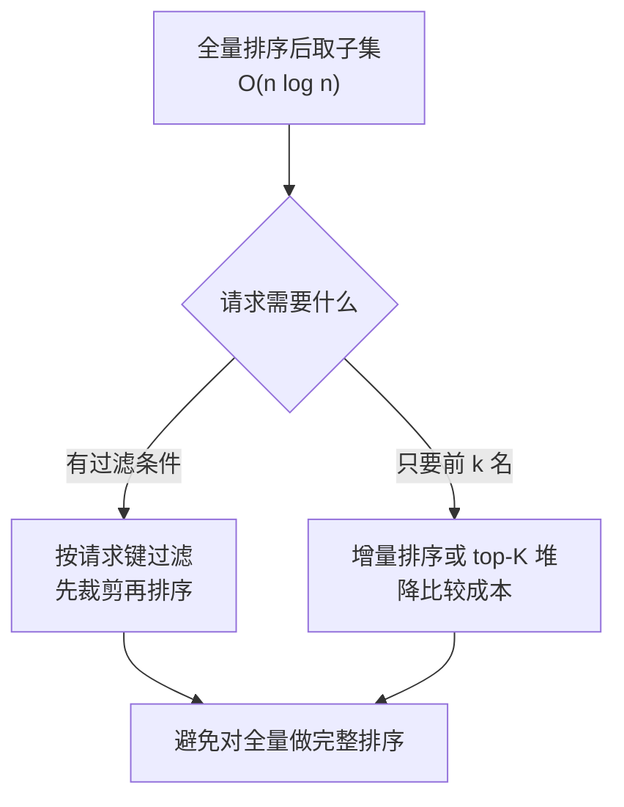
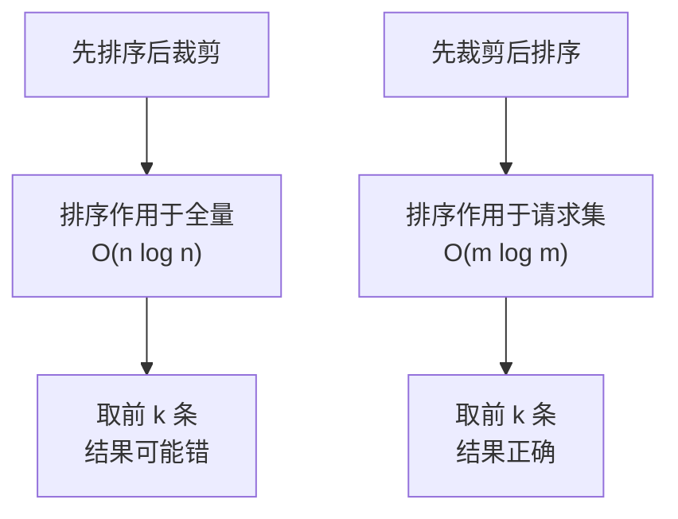

# 读路径的排序要按裁剪后的集合算：请求级的过滤先于全局的排序

> **要点**：读请求的排序成本与集合大小成正比——**把"全量排序后取子集"改成"先按请求条件裁剪、再对剩余集合排序"，排序开销从与全局规模挂钩降到与请求规模挂钩**；上游的 reorderReadSequence 按 WriteSet 而非整个 Ensemble 排序即此改进，**同一原则适用于数据库查询、缓存组装与消息按序读取**。

## 要解决的问题

读路径里"排序"是隐形的热点（访问集中在少数键或节点上的现象）：**全局排序的成本按全量集合算（日志段的全部副本、表的全部行、批次的全部消息），而单个请求只用到其中一小部分——排序的规模与请求的规模脱节**，是读放大（一次逻辑读触发多倍实际读取）的一种（本库 OLAP（联机分析处理：面向统计聚合的查询负载）篇的读放大在查询计划层，本篇在请求组装层）。上游 BookKeeper 的一个复现改进是"reorderReadSequence 按 WriteSet 而非整个 Ensemble 检查"（**读请求的副本顺序重排，原来每次遍历全 Ensemble，改为只看这次请求涉及的写集合——把请求级的计算从全局规模降到请求规模**）。本篇展开：裁剪先于排序的适用场景、实现形态与正确性边界。

## 它是怎么做到的：裁剪先于排序的三种形态

三种形态削减的都是同一个量——参与排序的集合规模。老邮件分拣房把这个道理写在流程里：来了一袋信，先按投递范围把无关的信捡出去（裁剪），再对剩下的几十封排路线（排序）——不会有人把全城信件排成一条长队再从中挑自己那几十封：




### 形态一：怎么按请求键过滤

排序前先用请求的条件缩小集合：日志读按 entryId 区间取段、消息读按 offset 区间取批——**过滤的成本是索引查找，排序的成本是全量比较，前者低一两个数量级**。快递分拨是同一先后：**按"今晚发广州"先把广州件抽出来（索引查找），再在广州市内排派送顺序——把全网件排一遍再挑广州的，排的全是白排**。实现的检查点（定期保存进度、故障后从最近一次保存处恢复）：**过滤条件是否有索引可用（无索引的过滤退化成全扫，比原来更慢）、过滤后的集合是否足够小（裁剪率低的场景收益薄）**。

### 形态二：增量排序怎么省钱

全局序号已知（数据按写入序组织）时，请求内的顺序直接按序号排，不做全量重排（布局或尺寸变化触发重新计算排版）——**有序存储上读排序是 O(k log k)（k 为请求条数）而非 O(n log n)（n 为全量）**。食堂发号是现成对照：**叫号屏上号码本来就是有序的，招呼"88 到 95 号"直接按号念就行，没有人把今天全部号码重新排一遍再念这段区间**。检查点：**序号的单调性有保证吗（乱序写入场景先补序号再读）、并发写下的序号可见性（读到的最大序号与实际数据的差距要按一致性模型处理）**。

### 形态三是什么：懒排序（top-K 堆）

只要前 K 名时用堆维护（O(n log k)）而非全排序（O(n log n)）——**n 大 k 小的场景收益显著**。检查点：**K 的边界（k 接近 n 时堆无优势）、稳定性要求（同值条目的顺序语义按业务定）**。

**三种形态的共同点**：**先看请求需要什么，再决定算多少——全局规模的计算只保留给全局性的任务（全量审计、重建索引），请求路径上的每一步计算规模都应与请求规模挂钩**。

「分拣先于排序」在存储引擎里的实物对应是索引与读路径：先按索引把这次请求命中的行筛出来（按请求条件裁剪），再在命中集合内做排序——没有哪个引擎会为一次请求先全表排序再过滤，那等于把全表扫描当索引用：


*图源：Wikimedia Commons，Tomskyhaha，CC BY-SA 4.0，https://commons.wikimedia.org/wiki/File:Server-UPS-and-EA6350v3-in-a-shelf.jpg。*

老邮局把这个次序讲得很直白：一麻袋混寄信件，先按收件局分到格口，格口内再按投递路线排顺。没有哪个邮局会把全国的信先按路线统一排一遍再分拣。


来源：[阿里云开发者社区《图文详解 RAG 技术和流程》](https://developer.aliyun.com/article/1670698)（CC 4.0 BY-SA）


来源：[阿里云开发者社区《图文详解 RAG 技术和流程》Rank 模型与精排一图](https://developer.aliyun.com/article/1670698)（CC 4.0 BY-SA）


## 读完这一段你能判断什么：正确性边界与验证



两种方式在取前 k 条时结果可能不同，差别来自排序作用的集合：


**裁剪的正确性判据**：**裁剪条件是请求语义的等价变换（裁剪后集合排序的结果与全量排序取子集一致）——等价性破坏的两种情形：排序键与过滤键分离（按时间排序、按 id 过滤，过滤后排序的时间序不等于全量的时间序——要确认业务语义接受）；跨请求的顺序承诺（同 key 的两次读顺序一致——裁剪后集合变化可能改变相对顺序，按序承诺的场景要保序号）**。

**性能验证的口径**：**裁剪优化的收益验证用"单请求耗时 × 请求速率"的总账（单请求耗时降 10 倍，但每秒查询数 QPS 决定总耗时的实际收益）也涨，总账才见真章**，基准按本库"基准必须描述负载与资源边界"的描述法——**负载描述里写明请求的选择率（每次请求命中全量的百分之几，选择率不同的两轮结果不可比）**。

**监控的信号**：**请求路径的排序耗时（P99 尾延迟）与裁剪率（过滤后/过滤前集合大小）——裁剪率低的告警提示过滤条件失效（索引丢失、参数写错，排序耗时上涨提示集合膨胀）**。

## 这套说法在哪儿会失效

三条边界防止防线走形。

### 裁剪为什么不是所有场景都赢

全量集合已在内存且很小（几十条）时，**过滤分支的判断成本反而高——小集合直接全排，裁剪的收益门槛按集合规模定（经验值：百条以上、裁剪率 50% 以下才值得）**。家里煮三颗蛋不值得先过秤分类：**量小的时候，分拣的手续比省下的锅大——流程的成本要与省下的工夫放在同一杆秤上称**。

### 请求级优化为什么不改动全局结构

读路径的裁剪优化不改变存储的全局组织（索引、分区方式），存储组织按写路径与全局查询设计，请求级的裁剪在现有组织上做——为单类请求重构存储组织是过度设计的信号。

### 验证按什么顺序排：为什么正确性先于性能

先验证等价性（裁剪前后结果一致，含边界情形：空集、单条、全量命中），再验证性能——等价性测试用差分对照（新旧实现同请求对比结果），性能测试在等价确认后跑。审计先核数、再核速度：报表算错十万的系统跑得再快也是废的——先对数（新旧结果逐条对账），对平了才值得比谁算得快。

## 怎么自己动手验证

可复现的验证路径：

1. **等价性差分**：**新旧实现对同一批请求（含边界：空集、全量命中、跨页边界）比对结果，预期完全一致**；
2. **性能基准**：**按选择率分档（1%、10%、50%）压测，预期单请求耗时随选择率下降、总吞吐提升可归因**；
3. **裁剪率监控验证**：**关闭过滤条件模拟失效，预期裁剪率告警触发、排序耗时曲线同步上涨**；
4. **断言锚点**：**请求路径的计算规模与请求规模挂钩进评审检查项，等价性差分测试进回归套，裁剪率与排序耗时进监控——三件齐备，"读请求越慢"从扩容问题变成按裁剪率定位的计算规模问题**。

```text
规模断言 = 请求路径计算随请求规模
等价断言 = 裁剪是语义等价变换
监控断言 = 裁剪率与排序耗时在管
```

读路径的性能原则是"按需计算"：排序、过滤、组装的每一步都以请求规模为预算——上游把 Ensemble 检查改成 WriteSet 检查省下的每一微秒，都来自"不碰与本次请求无关的数据"这一条纪律。

## 接着读哪几篇：查询计划层的裁剪（本篇是请求组装层）

- [[工程知识/数据系统：在并发与故障中保存事实/查询与索引/列存与向量化执行：OLAP引擎快的两个来源.md]] —— 查询计划层的裁剪，本篇在请求组装层
- [[工程知识/性能工程：从用户等待到资源瓶颈/存储与网络/存储引擎的文件一致性：元数据与数据块的对应关系要可核对.md]] —— 读路径正确性的存储侧
- [[工程知识/数据系统：在并发与故障中保存事实/可靠性与运维/数据库基准必须描述负载与资源边界.md]] —— 选择率进负载描述的验证口径
- [[工程知识/性能工程：从用户等待到资源瓶颈/存储与网络/端到端网络延迟来自排队、协议、传输与处理.md]] —— 读路径延迟的分解框架
