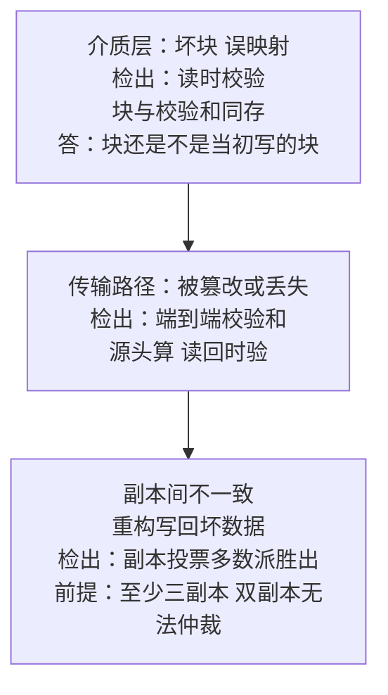
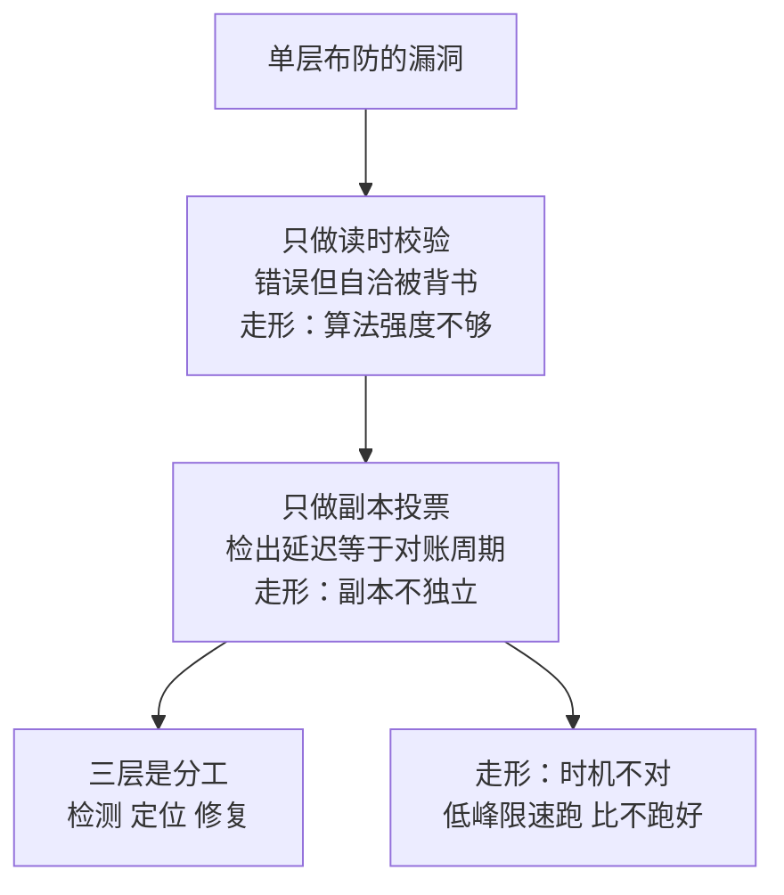
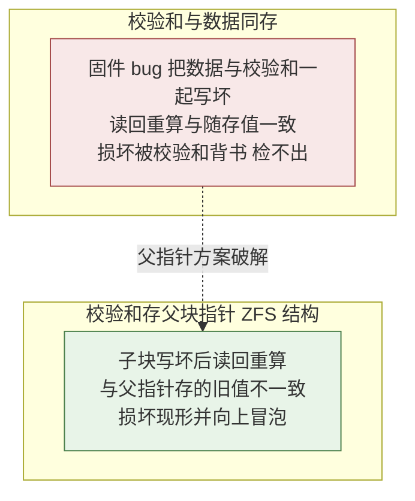
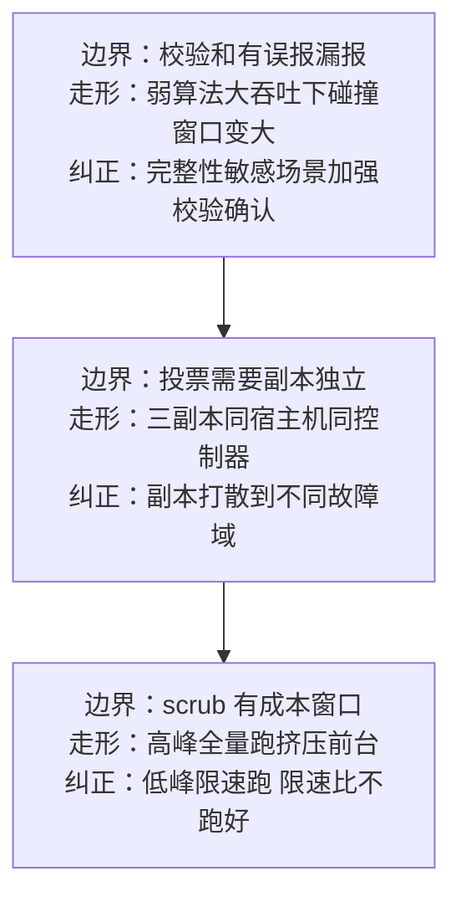
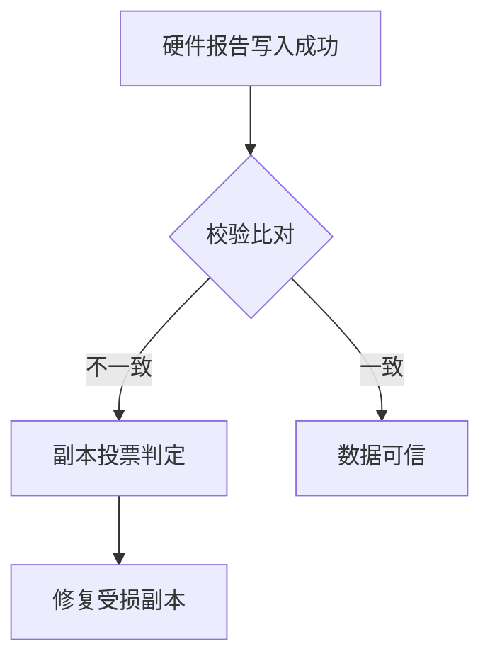

# 静默数据损坏靠校验与副本投票检出：硬件说成功不等于数据还对

> **要点**：**磁盘返回写入成功后，数据仍可能因坏块误映射、固件缺陷、掉电窗口而损坏，且读取不报错**——**静默损坏检不出来就一路传播下去**，**检出靠读时校验、端到端校验和与副本投票三层布防**，**其中只有副本层是投票机制，另两层是各自独立的验证**。

## 要解决的问题

**存储链路的每一层对"写入成功"的承诺有一个隐含前提**：**写进介质的字节就是提交的字节**。**这个前提在真实硬件上不成立**。

威斯康星大学对约 150 万块盘的田野研究（Bairavasundaram et al., FAST'08）给出量级：在为期数年的观测中发现三十余万个校验和不匹配的块（论文口径为块级校验不匹配），且**相当一部分损坏读取时不报错**——**硬盘返回了数据，数据是错的**。本库正确性域"静默失真的检测靠对账与不变量"从数据层视角讲过检出方法，本库缺陷分析域"磁盘坏道与静默损坏的检测修复路径"讲过单盘层面的检测与修复；本篇把三层检出体系（读时校验、副本投票、端到端校验和）按各自的角色与适用层摆清楚，**回答"在哪一层布防、每一层各自能抓住什么形态的损坏"**。

## 它是怎么做到的：三种损坏形态与三层布防的对应

**静默损坏按发生位置分三类，每类有不同的最佳检出层**：

**介质层损坏**（坏块、误映射、固件 bug 把写写到错误的扇区）：**特征是"读这一块，得到错误数据且无 IO 错误"**。最佳检出是**读时校验**——**数据块与校验和同存（dm-integrity、ZFS 的每块校验和），每次读取顺手验证**。开销是每次读多一次校验和计算，**换来的是"损坏在第一次被读到时暴露"，把损坏的传播窗口从"直到对账才发现"压到"下一次读"**。

**传输路径损坏**（内存位翻转、总线传输错误）：**特征是"数据在链路上被篡改"**。**控制器缓存丢失属于另一种形态——写未落盘、读回的是旧数据，它表现为丢失而非篡改**，本文不将其归入此类。最佳检出是**端到端校验和**——**校验和在数据的源头（应用或数据库）计算，跟随数据穿过整条写入与读取链路，在应用读回时验证**（应用侧计算的校验和无法在磁盘层验证，那一层只有它自己的块校验机制）。**链路上任何一环翻转的字节都会在校验点上现形，这是存储链路的每一层各自校验都抓不全的形态（各层只保护自己那一段）**。

校验和为什么抓得住这些改动，下图给出直观形态：**同一句话里一个字母换位（oer、ovr、oer 的不同换法），算出的校验值就完全不同——任何未被预期的字节变化都会在校验点上暴露**：


*输入的微小改动产生完全不同的校验值（图源：Wikimedia Commons，Helix84 原图，Jorge Stolfi 改编，公有领域）*

**副本间不一致**（RAID 即独立磁盘冗余阵列，在故障重构时把已损坏的成员数据当作有效数据写回、主从复制的主本本身已坏）：**特征是"单点校验和可能自己也坏了，或校验和跟着数据一起错"**。最佳检出是**副本投票**——**多副本读回比对，多数派胜出**。多副本系统读出多份比对、分布式存储读修复时的版本仲裁（由第三方投票打破平局、决定归属的机制）都属于这个思想：**校验和回答"这份数据自身是否自洽"（数据与校验和对得上，但可能两者一起被写坏），投票回答"哪一份是少数派"**。**多数派胜出的前提是副本数至少为三：只有两份副本时能报出"两者不一致"，却无法判断哪一份是错的**。

三层的分工边界清晰：**读时校验管"块还是不是当初写的块"，端到端校验管"数据从源头到终点有没有被动过"，副本投票管"唯一真相源本身是否已坏"**。**三层同时缺失的系统，损坏从发生到暴露的距离等于数据寿命**——**备份里的损坏副本让"备份的价值由恢复演练来验证"一文的前提（备份可恢复）直接失效**。



三类形态用深浅区分：上面两种是单点可判定的损坏，**第三种（红色）意味着连"哪一份是对的"都失去了参照，因此它的检出方式也与前两层不同**。三类形态各有一条最佳检出层，图中三条实线就是这个对应关系。

损坏来源不是理论推演。ZFS（带校验与快照的文件系统） 团队对真实损坏案例的统计把来源按占比画了出来：块损坏、路径损坏、静默写失败各占一类，其中相当一部分正是读取时不报错的形态——**「硬件说成功」与「数据还对」之间的缝隙在这些来源里都存在**：


*图源：SC09 论文《How Safe Is Your Data?》（房东等，ZFS 损坏案例实测分析，[PDF](https://www.usenix.org/legacy/events/fast08/tech/full_papers/bairavasundaram/bairavasundaram.pdf) 为同期威斯康星田野研究），第 9 页。*


来源：[腾讯云开发者社区《Redis系列：Redis主从、哨兵、集群介绍》](https://cloud.tencent.com/developer/article/2183910)（CC 4.0 BY-SA）


来源：[博客园《解密 Raft 算法》](https://www.cnblogs.com/traditional/p/12588733.html)（CC 4.0 BY-SA）


## 为什么检出必须三层都要



**单层布防各有各的漏洞**，典型形态如下：

**只做读时校验**：**校验和与数据同存，控制器固件 bug 恰好把"数据 + 校验和"一起写坏（一致性错误），读回验证通过——损坏被校验和背书**。**副本体系内，投票是能打破"错误但自洽"状态的机制；体系之外的另存校验清单、离线全量校验同样能起到这个作用**。

校验和的存放位置决定它会不会给损坏背书，下图给出两种存放方式的对照：随数据同存时两者可被一起写坏而互相自洽，ZFS 把子块校验和存在父块指针里，损坏与"事前记录"对不上而现形：



*校验和存放位置的对照：与数据同存时"错误但自洽"检不出，存父块指针时损坏与事前记录对不上而暴露（依据 OpenZFS 数据完整性机制与 Klara Systems《Understanding ZFS Scrubs and Data Integrity》文字内容绘制）*

**只做副本投票**：**没有块级校验和时，读取不触发验证，损坏数据在被对账周期扫到之前一直对外服务——检出延迟等于对账周期**。**读时校验把检出时机提前到"第一次使用"**。

**只做端到端校验**：**应用层校验和能发现"数据错了"，定位不了"错在哪一环"——修复要靠下层自检工具（scrub、smartctl）**。**三层是分工，检测发现、定位归因、修复各自的层级**。

## 修完之后靠什么防住复发

**文件系统层开校验和**：**数据完整性敏感的系统选 ZFS/Btrfs（块级校验和 + scrub）或 dm-integrity 层**；**数据库场景靠存储引擎的页校验（InnoDB 的 page checksum 校验和：算出短指纹比对即可发现损坏）**——**选型时把"有无块级校验"列为存储组件的硬性评估项**。

**应用层端到端校验**：**关键数据（备份流、传输中的归档）在应用层带校验和，写入磁盘与读回各验一次**——**应用层校验和与链路内各层校验并存，两者保护的范围不同**。

**定期 scrub 与副本对账**：**RAID/文件系统 scrub 按周或月跑，读全部数据验证校验和与 parity；多副本系统按周期全量对账**——scrub 的意义在**把静默损坏的检出从"恢复时"提前到"定期"**，避免坏块随着 parity 重构扩散。

**写入路径的掉电防护**：**静默损坏的高发窗口是掉电瞬间的缓存丢失**——**写缓存开透写（writethrough）或配掉电保护的缓存条，电源侧配 UPS（Uninterruptible Power Supply，不间断电源：断电时撑住供电的电池组）**；**fsync（强制把操作系统缓存里的数据写到磁盘的调用）语义正确（本库正确性域"持久化承诺"讨论）是软件侧的前提**。

## 这套说法在哪儿会失效

三条边界把「校验与投票」约束在证据可信的范围内。

**校验和有误报与漏报的边界**：**校验和算法碰撞概率极低但非零，weak 算法（CRC32 级别）在超大吞吐下碰撞窗口变大**——**完整性敏感场景用强哈希（把任意长度数据压成固定长度指纹、不可逆）或分层校验（快校验 + 强校验确认）**。**误报的代价是一次重读或副本替换，漏报的代价是坏数据入库，权衡明显偏向强校验**。

**投票需要副本独立性**：**三个副本跑在同一台宿主机、同一个 RAID（冗余磁盘阵列，把多块盘组合成逻辑盘提升可靠性）控制器上，投票形同虚设**——**副本独立性（物理隔离、电源隔离、控制器隔离）是投票有效的前提，坏一块盘不能同时坏三个副本**。

**scrub 有成本窗口**：**全量 scrub 是重 IO 负载，业务高峰跑会挤压前台——安排在低峰并限速；不 scrub 的阵列是在攒一次性大修，scrub 限速比不 scrub 好**。

三条边界各自守住一层防线，该有的样子如下：



三条对应三层布防，走形的方式各不相同：**第一层是算法强度不够，弱算法在超大吞吐下碰撞窗口变大**；**第二层是副本不独立，三个副本跑在同一台宿主机或同一个 RAID 控制器上，坏一块盘同时坏三个副本，投票等于没做**；**第三层是时机不对，全量 scrub 是重 IO 负载，业务高峰跑会挤压前台，但不 scrub 的阵列是在攒一次性大修——限速跑总比不跑好**。

## 怎么自己动手验证



**成功返回只说明命令被接受，不说明数据正确，检出要另走校验与投票**：


可复现的验证路径：

1. 注入验证：**用测试镜像或 dm-error/dm-flakey 注入单块坏读，确认读时校验能在读到该块时立即报错并从副本恢复，而非把坏数据交给上层**；
2. 对账验证：**手工篡改副本文件的一个字节（构造"错误但校验和一致"需注入更底层），跑对账确认投票机制选出正确副本并告警**；
3. 端到端验证：备份流注入字节翻转，读回校验拒绝该流；
4. 断言锚点：**注入的每一类损坏都在对应层被检出，且检出时点可度量**（读时校验在第一次读、对账在一个周期内）；scrub 有定时记录。

```text
注入 = 坏块读 / 副本字节翻转 / 传输流翻转
检出断言 = 各层检出时点符合设计（首读 / 对账周期 / 读回）
恢复断言 = 从健康副本自动恢复 + 告警可见
```

**"硬件说成功"到"数据还是对的"之间的距离，由三层布防填满——每一层单独都不够，合起来才覆盖从介质到应用的全路径**。**验证时预期与实际的对照规则提前写明：每类注入损坏预期被对应层在设计的检出时点捕获，对不上（坏数据被交付给上层、投票选错副本、备份流通过校验）即该层布防未生效，要先修布防再谈恢复**。

## 接着读哪几篇：数据层对账方法论的出处

- [[工程知识/缺陷分析：从个案到体系/正确性/静默失真的检测靠对账与不变量而不是报错]] —— 数据层对账方法论的出处，本篇补硬件层布防
- [[工程知识/缺陷分析：从个案到体系/硬件故障/磁盘坏道与静默损坏的检测修复路径]] —— 单盘层面的检测工具与修复流程，本篇讲三层体系分工
- [[工程知识/性能工程：从用户等待到资源瓶颈/处理器与内存/ECC内存把单比特错误挡在报告之前]] —— 传输路径损坏的第一道拦截（内存层）
- [[工程知识/数据系统：在并发与故障中保存事实/可靠性与运维/备份的价值由恢复演练来验证]] —— 检出之后的恢复侧验证
- [[工程知识/数据系统：在并发与故障中保存事实/可靠性与运维/存储的静默损坏防线：校验和、副本比对与定期扫描各拦一层.md]] —— 三层防线在数据系统侧的展开：写入校验、读取校验、定期扫描
