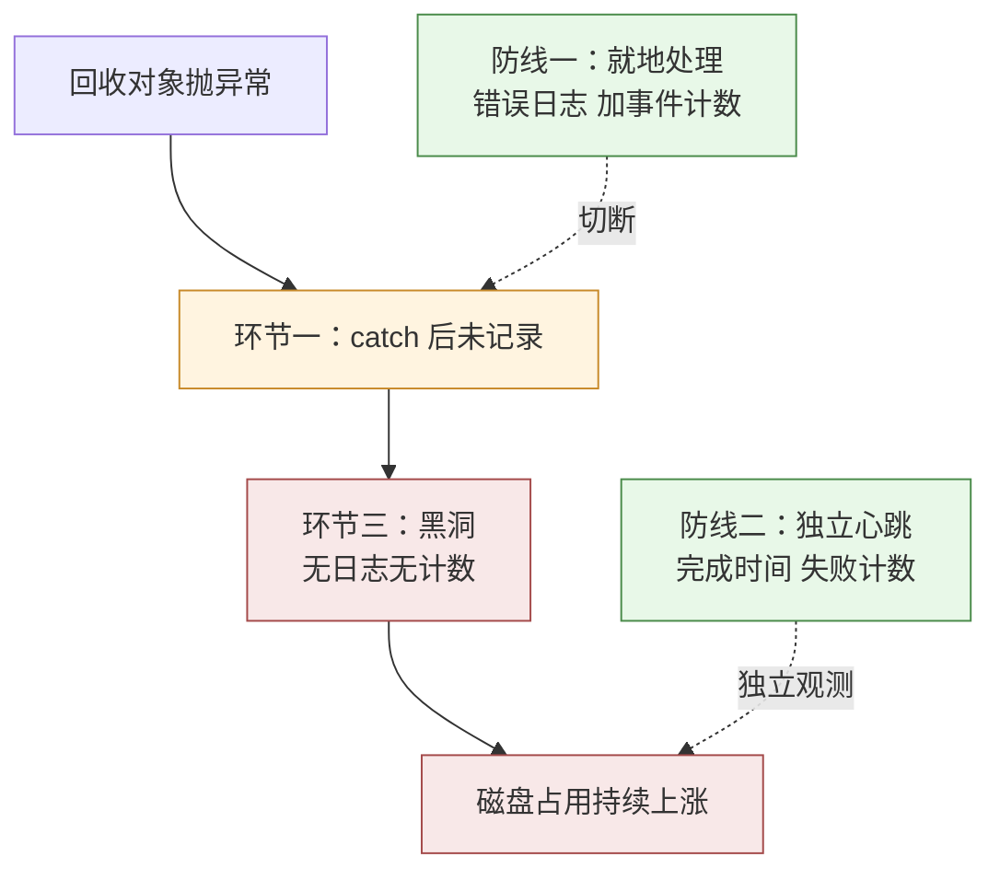
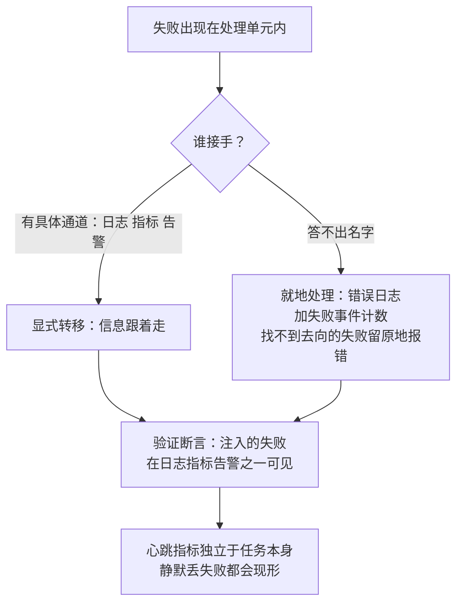

# 失败转移的最后一站：找不到去向的失败要留在原地报错

> **要点**：**从错误处理单元出来后，失败要么有人接（记日志、转指标、进告警），要么留在原地报错（就地崩溃）**；**"转移到下一层"必须能说出接手者的名字——链上每个环节都假定下一层会处理，失败就消失了**。

## 要解决的问题

打个比方：失败的传递像医院分诊——**病人被推给下一位医生时，必须喊出接诊医生的名字；要是每个分诊台都假设"下一位会处理"，病人最后就消失在走廊里**。**这个比方到「必须有人接手」为止**，具体哪种失败该就地崩溃、哪种该转指标，看下文的分级。

错误处理有一条朴素纪律：**捕获了就要处理**。**什么算"处理"，代码评审时各有各的理解**：记一条日志算吗？包装成另一种异常再抛算吗？吞掉只更新一个计数器算吗？Apache BookKeeper 的一个真实病例（上游修复 commit 35b8f137，可查）给"处理"下了一个可操作的判定。

背景：**bookie（BookKeeper 的存储节点）的后台垃圾回收线程负责清理已无引用的 entry log 文件**——**entry log 是条目在磁盘上的追加日志文件，删除账本后其中的条目即成为待回收的垃圾**。回收循环的运行骨架里有一个异常捕获，**它做了一件看似尽职的事：捕获到异常后不做任何记录，跳出本轮循环体——判定"失败已经转移，我的职责到此为止"**。

**这里的"转移"名不副实：异常没有被重新抛出，只是被就地丢弃**；捕获在循环内，线程本身不终止，但**这一轮回收静默失败且无任何痕迹**，**后续轮次只要不再遇到异常就照常跑，回收能力时有时无，故障形态是"回收不再可靠"而非"线程消失"**。**垃圾回收就这样在无人知晓的情况下丢失了失败信息，磁盘占用一路涨到写满，写入被拒，全程没有留下可检索的日志**。**异常既然被捕获后丢弃，就不会逃逸到线程默认的未捕获异常处理器——那条兜底通道没有机会触发**。

这个病例给出的判定标准比"要处理"三个字好用得多：**失败转移出当前处理单元时，转移目标必须是一个有接手约定的位置**——日志系统、指标收集、告警通道、显式的错误回调。**目标位置不存在接手者，失败转移就是失败丢弃，此时留在原地报错**——记日志、登记失败事件（接入指标系统，暴露为失败计数器）——**让未捕获异常处理器接管反而是暴露失败的最后一站**，**排期机制本身无法暴露失败，但"排期停了"这件事可以被心跳（节点定期互发的存活信号，超时收不到就判定故障）发现**。

## 它是怎么做到的：失败转移链与唯一的断点


*图源：Wikimedia Commons《AgensSQL HA Clustering》，作者 Gorgonzola-oh，CC BY-SA 4.0，https://commons.wikimedia.org/wiki/File:AgensSQL_HA_Clustering.png。**切换图看着很稳，是因为图上每一条转移都有画出来的接收方；下面这条链断掉，恰恰是因为转移发出去了却没人接**。*

把 35b8f137 的失败旅程摆成一条链，断点的位置就清楚了。

**环节一（回收循环的 catch）**：**捕获异常，判定"不是我该报的"，就地跳出本轮**。转移时**没有记录任何信息**——它相信外层会接。
**环节二（调度与监测面）**：**线程还在跑、调度还在排期，"任务活着"的一切表面信号都正常；异常已被捕获吞掉，不会逃逸到未捕获异常处理器，监测面看到的失败计数为零**。转移过来的失败在这条链上**没有任何接收方**。
**环节三（黑洞）**：**失败既不在日志里、也不在任何计数器里，系统对外表现为"一切正常，只是垃圾回收有点慢"**。

环节一与环节二的错配造成断点：**环节一把"转交"当成了"上报"，而环节二根本没有监听"转交"这个通道**。**错误处理链的设计里，每一次转移都要能回答两个问题——失败的信息（类型、上下文、堆栈）有没有跟着走？接收方有没有承诺处理？两个答案有一个是否，转移就是丢弃**。本库稳定性域"Error 逃逸终止周期任务"一文讲的 Throwable 兜底是同一枚硬币的另一面：兜底是让失败**留在处理单元内**被记录，本文讲的是当失败确实要出门时，出门后必须有人接。



上半部是缺陷现状，下半部是防线，两者混在一张图里是为了看清切断点：**就地处一断，失败转移在环节一与环节二之间断掉——环节一把"转交"当成"上报"，环节二根本没有监听这个通道，心跳独立观测最终后果**。**转移时两个问题必须都有答案：失败的信息有没有跟着走，接收方有没有承诺处理**。

## 为什么"转移"这个直觉如此常见

**写"转交外层"的动机通常成立，理解动机才能对准修法**：

**职责分离的直觉**：**回收循环的职责是清理，报错的职责在别处——这个直觉本身对**。**问题在"别处"必须真实存在：调度器不接失败，日志系统才接**。职责分离的正确写法是**显式指定接手者**（记日志、登记失败事件、触发告警），让"别处"有名字。

**避免重复上报的洁癖**：**内层记了日志，外层再记一遍就重复了——这个顾虑也成立**。**但它约束的是"两层都记"，不约束"零层记"**。**取舍很明确：宁可重复，不可丢失——重复的代价是日志多几行，丢失的代价是磁盘写满**。**重复要配上限频与聚合——循环内高频失败时，逐条打印会淹没日志并挤压磁盘，这本身就是另一种形式的故障**。

**单元测试只测成功路径不测失败路径**：**成功路径人人测，"失败转移后失败去哪了"没有测试能兜住，除非把"失败必须由某个接手者承接"写成断言**——这正是防线要做的事。

## 修完之后靠什么防住复发



上游修复的动作是把回收循环外层的静默转移改成**就地处理**：捕获后记录错误日志、登记失败事件，不再向外转移。防线体系按层次排：

**转移前自问接手者**：**写"向外转移"代码时问一句"谁接？"——答案必须是具体通道（日志、指标、告警、回调），"外层""调用方""框架"不算答案**。**答不出接手者的转移，改成就地记录**。

**周期任务的兜底约定**：后台任务的异常边界遵守本库稳定性域的既定纪律——**最外层 Throwable 兜底、记录、按对象粒度隔离失败——单个对象处理失败时记录并跳过，本轮其余对象继续处理**，这与本文的"不转移"是一体的：**兜底保证失败出不了任务边界，转移纪律保证失败在边界内由接手者承接**。

**后台任务的存活性观测**：**每个后台任务配一个心跳指标（最近一轮完成时间、失败计数），观测面从"有没有日志"升级为"任务活着吗"**——**失败转移黑洞的终极防线，任何形态的静默丢失败都会在心跳上现形**，**前提是心跳的上报链路独立于被观测的任务本身——共用同一条链路时，任务所在的执行环境出问题，心跳会跟着一起失明**。

**代码评审的转移敏感度**：**catch 块里出现"转交、rethrow 换类型、只计数不日志"的动作时，按本篇判定过一遍**；**rethrow 包装有它的合法场景（上下文增强），但信息必须无损、接收方必须存在**。

**重试通道之外，失败的另一类「有名字的接收方」是断路器**。Azure 架构中心的官方状态机图把它的接手约定画成了 UML（Unified Modeling Language，统一建模语言）：Closed 状态下失败计数累计到阈值转 Open、直接拒绝并启动计时器，超时后转 Half-Open 放试探请求，成功达标回 Closed、失败则再次转 Open——**失败没有消失在某个 catch 块里，它被一个有状态、有阈值、有出口的机制显式接住了**：


*图源：[Microsoft Learn《Circuit Breaker pattern》](https://learn.microsoft.com/en-us/azure/architecture/patterns/circuit-breaker)，Microsoft 版权，CC BY 4.0，文档引用。*

## 这套说法在哪儿会失效

三条边界防止防线走形。

**就地报错优先级最高的场景是周期任务**：请求驱动路径上失败转交中间件统一处理是成熟架构（Web 框架的异常解析器、消息队列的重试机制），那些中间件**就是有接手约定的接手者**。**本文打击的是"转移目标无人监听"的伪转移，统一错误处理通道是真实接手者**。

「有接手约定的接手者」长什么样，Microsoft Learn 的重试模式图画出了这份约定的全部条款：失败后按间隔重试（第一次短、第二次长）、每次失败都留在请求记录里、重试次数到达预定义上限后不再无声继续——把错误转成异常交给应用显式处理。**转移之所以可靠，是因为重试通道自己声明了终点**：


*图源：[Microsoft Learn《重试模式》](https://learn.microsoft.com/zh-cn/azure/architecture/patterns/retry)，Microsoft 版权，CC BY 4.0，文档引用。*

**静默吞掉在极少数场景成立**：**刻意忽略的失败（best-effort 清理、可推导的缓存失效）要留痕——注释写明为什么忽略、最好配一个 debug 级计数**。**连注释都没有的空 catch 才是不可原谅的形态**。

**就地报错不是就地崩溃进程**：**留原地报错指让失败以系统既有机制暴露（未捕获异常处理器、调度器失败计数），周期任务里单个对象的失败按对象粒度隔离继续处理其余对象——崩溃进程是比静默丢弃更糟的选择**。

## 怎么自己动手验证

**验证要拿的账是：注入的异常次数与最终落到日志里的次数对不对得上**。

1. 构造失败注入：**在回收循环处理某个对象时注入可控异常（测试钩子或损坏数据）**；
2. 未修复基线（正常状态下的指标水平、用来对比异常）：**观察回收行为——异常后任务停止、无任何日志、磁盘占用持续增长，确认失败在转移中消失**；
3. 修复后重跑：**同一注入下，失败以错误日志 + 失败事件计数体现，后续轮次与其余对象不受影响**；
4. 断言锚点：**任何注入的失败，都能在日志、指标、告警三者之一找到承接位置**；后台任务心跳指标在注入期间保持可见。

```text
注入 = 回收对象抛出非预期异常
可见断言 = 日志或失败计数出现该异常
存活断言 = 任务心跳持续，其余对象继续被处理
```

**"注入的失败必可观测"是错误处理链的终局判据——把失败注入固化进持续集成的故障用例，任何新的静默转移当场红**。

## 接着读哪几篇：失败写入日志后的级别语义与告警信道保护

- [[工程知识/缺陷分析：从个案到体系/稳定性/异常处理器的覆盖面：Error 逃逸终止周期任务]] —— 同一批上游修复（35b8f137 与 7733db1c）的姊妹篇：兜底让失败留在边界内，本篇讲失败出门时的接手者纪律
- [[工程知识/缺陷分析：从个案到体系/正确性/日志级别的语义：把提示当告警，告警就成了背景噪音]] —— 失败写入日志后的级别语义与告警信道保护
- [[工程知识/软件构建：让变化可以理解、验证与交付/架构与代码/错误处理的分类学：错误类型与恢复策略的映射]] —— 错误类型与处理策略的映射总纲
- [[工程知识/缺陷分析：从个案到体系/正确性/静默失真的检测靠对账与不变量而不是报错]] —— 静默家族的检测方法论：对账与不变量
- [[工程知识/缺陷分析：从个案到体系/稳定性/订阅者断线之后路由指向谁：请求被静默丢弃的识别]] —— 同一纪律在投递路径上的实例：查无状态不等于有人接手
