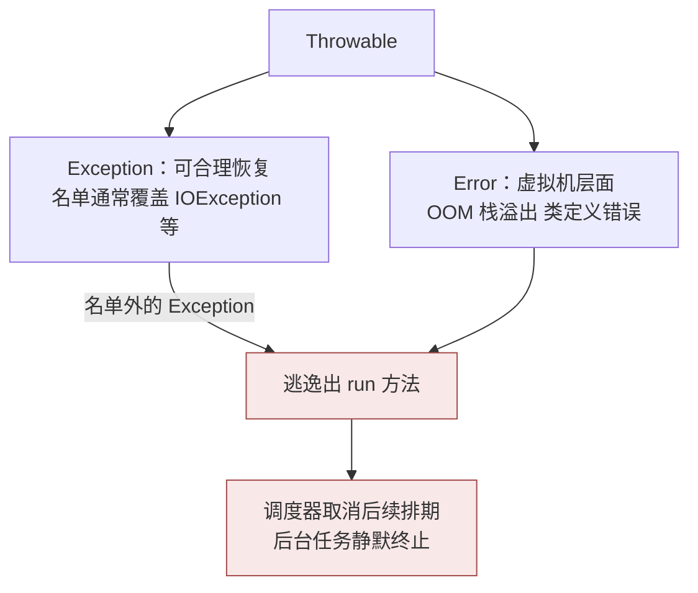
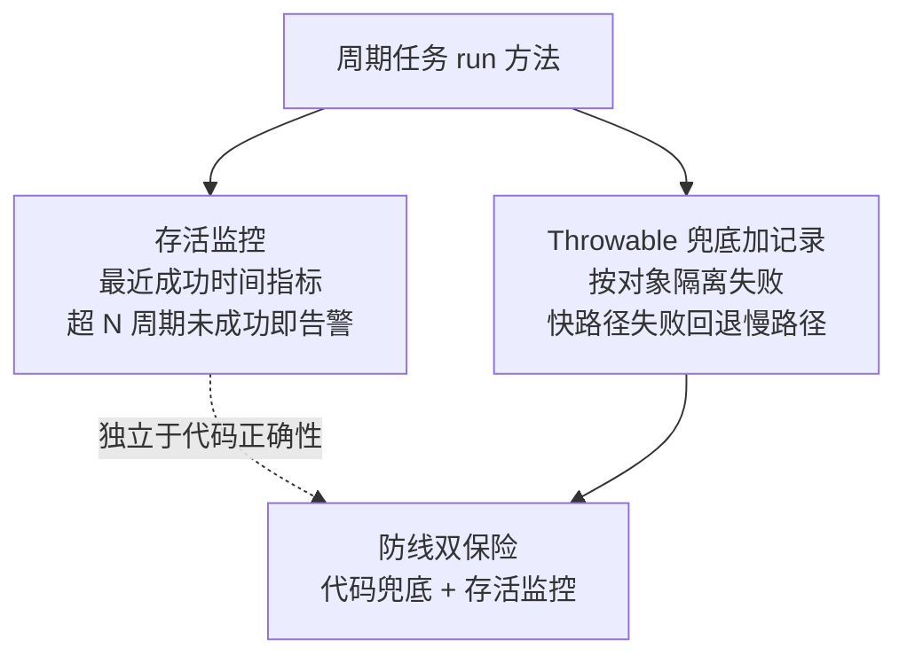

# 异常处理器的覆盖面：Error 逃逸终止周期任务

> **要点**：**周期任务的异常处理器按"预期异常"列名单，名单外的 Throwable 逃逸出 run 方法，调度器取消后续排期**——**后台任务静默终止，磁盘在无人回收中走向写满，几乎不留可检索的日志**。

## 要解决的问题

**后台周期任务（垃圾回收、对账、过期清理、统计上报）有一个隐含的存活性假设**：**任务跑挂了会有人知道**。**这个假设靠两样东西支撑——异常被捕获并记录、调度器继续排下一轮**。两样的失效后果不同，都要防：**缺了排期，任务跑完这一轮就没有下一轮（终止）；缺了记录，任务还在跑但没人知道它每轮都在失败（静默）**。**两者都通向"没人知道"，路径不同**。Apache BookKeeper 的两个真实病例（上游修复 commit 7733db1c 与 35b8f137，均可查）把两种缺法各演示了一遍：

第一个病例，**垃圾回收取日志元数据只捕获 IOException 与 RuntimeException，损坏日志触发 OutOfMemoryError，逃逸的 Error 中止本轮并让调度器取消后续排期**——**磁盘被无法回收的日志慢慢占满，bookie（BookKeeper 里负责存储的节点）最终拒绝写入，重启也会再次命中（损坏文件还在）**。第二个病例更糟：同样只捕获部分异常，名单与第一个病例不同，Error 逃逸终止周期任务，而且**不写任何日志**——回收线程永久停止，系统表面上一切正常，直到磁盘写满才有第一个症状。

**两个病例、两种细节，同一个结构缺陷**：**异常处理器的覆盖面与 Throwable 的真实谱系不匹配**。

## 为什么名单外的 Error 能带停整个任务：机制

先把形状说成一件事：**周期任务的异常处理器像值夜班保安手里的访客名单——只拦名单上的常客（IOException、RuntimeException 这些预期异常），名单外的来客（Error 支的内存耗尽、栈溢出）既不在名单上，保安又没接到"陌生人格外警惕"的指令，于是直接放行**。**放行的后果保安被辞退、整栋楼从此夜里没人值守（调度器取消后续排期），而不是"这一晚出点小事"**。**这个比喻到"辞退保安"为止——现实里辞退有离职记录可查，任务被调度器除名却可能一行日志都不留，这正是第二个病例比第一个更糟的原因**。


*图示：Airflow 的回填——一次回填把一段区间的多轮周期任务依次跑一遍，每轮各是一次独立执行。图源：Apache Airflow 官方文档《DAG Run》，Apache-2.0，https://airflow.apache.org/docs/apache-airflow/stable/core-concepts/dag-run.html。看这张图要注意的是"依次"两个字：**周期任务的每一轮本来就该互不影响，下面这个案例里，一轮没兜住的异常却把后面所有轮次都带停了**。*

**先界定两个词：受检异常（checked exception，编译器要求必须声明或捕获）与非受检异常（unchecked，编译器不检查， RuntimeException 与 Error 都属此类）**。**Java 的异常谱系是棵两层树：Exception 下面是"程序可以合理恢复的状况"，Error 下面是"虚拟机层面的严重问题"（内存耗尽、栈溢出、类定义错误）**。

**两支的真实分界不在「受检/非受检」，而在名单画到了哪一支**：Error 整支都不在名单里：OOM（Out Of Memory，内存耗尽后被系统强制终止进程）连同栈溢出、类定义错误，**它们和名单外的 Exception 最终走的是同一个出口**。

异常沿调用栈逐层上抛、每层检查处理器的完整过程，Oracle 官方教程的动图演示得最直接：**异常从当前方法抛出后按栈帧顺序回溯，任何一层没有匹配的处理器就继续上抛，直到栈底**——**逃逸出 run 方法的 Throwable 走的正是这条无人拦截的回溯路**：


*图源：Oracle《The Java™ Tutorials》Essential Classes 异常章节（exceptions-callstack.gif 与 exceptions-errorOccurs.gif），https://docs.oracle.com/javase/tutorial/essential/exceptions/，官方教程动图。*



缺口的形状是：**名单是一条画在 Exception 支上的线，运行期送来的东西却从 Error 支进来**——**两条支在「取消排期」这个节点上合流，合流点之前没有任何一道拦截**。

捕获名单按业务语义列在 Exception 这一支，长期运行送来的东西却大量来自 Error 那一支，两支之间的错位就是覆盖面的缺口。

写异常处理器时的本能是按业务语义列名单——"这里可能抛 IO 异常和参数异常"——这份名单覆盖的是**正常波动**，而周期任务在长期运行中遇到的恰恰是**非正常状况**：直接内存（绕过 JVM 堆、由操作系统直接管理的内存）耗尽、堆耗尽、第三方库抛出的未受检错误。

**错位在周期任务的调度语义里被放大成静默终止**。**ScheduledThreadPoolExecutor 的周期任务有一个鲜为人知的约定**：**run 方法逃逸出的任何 Throwable 都会导致该任务被取消，后续执行不再排期**。**`Runnable.run()` 不声明受检异常，受检异常必须被包装成未受检异常才能逃逸，所以逃逸出来的实际是 RuntimeException、Error，以及被包装过的受检异常——三者同样致命**。**这个设计对"任务彻底坏了"是合理防御，但它把"捕获覆盖面"从代码质量问题升级成了存活性问题**：

- **捕获名单 = 周期任务的生命线**。**名单外任何一种 Throwable，终止的都是任务本身，而不是一轮执行**；
- **名单是按"写代码那天能想到的异常"列的，运行环境会送来写代码那天想不到的异常**；
- **任务终止发生在后台线程，前台无感知，监控通常也不盯"周期任务还活着吗"——没人盯的东西终止得最安静**。

第二个病例比第一个多一层教训：**Error 逃逸不仅终止任务，连"终止记录"都没开——没有 catch 就没有日志，运维查问题时连"任务什么时候停的"都答不出来**。**静默失败的最坏形态是无日志的静默失败**。

## 修完之后靠什么防住复发

**修复靠两条互不相干的防线：一条在 run 方法里兜底并按对象隔离，另一条根本不看代码——它只看「最近一次成功执行是什么时候」**。


两条线在 W 汇合，且是「或」不是「与」：**兜底拦住的逃逸不会惊动监控，监控抓到的新逃逸路径恰恰说明兜底没拦住——这正是两道都要有的理由**。

上游两个修复的动作高度一致，合成一条可复用的防线。

**Throwable 兜底加记录**：**周期任务的 run 方法最外层捕获 Throwable（不止 Exception），记录错误日志并登记失败事件（计数器或告警埋点），然后跳过本轮出问题的处理对象、继续其余工作**。**7733db1c 的修复按对象粒度隔离——单个损坏日志的 OOM 不再殃及其余日志的回收**；**35b8f137 的修复更进一步，元数据解析失败时回退到全量扫描——快路径失败有慢路径兜底**。

**存活监控**：**周期任务暴露"最近成功执行时间"指标，监控对"超过 N 个周期没成功"告警**。**这条防线独立于代码正确性——就算将来有人写出新的逃逸路径，任务终止也会在第一个周期被发现，而不是磁盘写满时**。

周期任务的防线可以一直往下排，这里给出四条：

- **周期任务模板统一收口**：**调度包装器统一做 Throwable 兜底、日志、失败计数，业务代码只写业务；散落的、未做 Throwable 兜底的 Runnable 各自为政，防线靠每个人的记忆**；
- **按对象隔离失败**：**批处理（把多个请求合并成一批同时计算、提高硬件利用率）语义的任务里，单个对象的失败不应终止整批，跳过并计数，失败率超阈值才升级为整批中止**；
- **失败要有第二形态**：**快路径（增量、缓存、元数据）失败时回退慢路径（全量扫描），降级（主动牺牲部分功能或精度，保住核心链路）继续提供服务而不是直接终止**；
- **捕获 Error 不是坏味道**：**教科书写"不要捕获 Error"，那条纪律针对的是应用主流程；周期任务恰好是例外——它不捕获就会终止，终止了还没人知道**。**纪律要按场景取用，背口诀不如看结构**。

## 这套说法在哪儿会失效

三条边界防止防线走形。

**捕获 Throwable 不等于吞掉**：**兜底 catch 的职责是记录与隔离，之后要么跳过本轮、要么重新抛出让调度器取消**——**"记录后假装无事"的周期任务比已经终止的任务更危险，它制造一切正常的假象**。**兜底与吞掉的界线在"处理对象还能不能继续"：能则跳过继续，不能则带着完整日志退出**。

**OOM 的处理要省着用内存**：**堆已耗尽时，catch 块里再分配大对象（拼长日志、构建报表）会二次 OOM**。**兜底路径的代码要按"内存拮据"写：短消息、复用对象、避免装箱**。

**Error 有不可恢复的种类**：**VirtualMachineError 中的某些类型（如内部错误）重试无意义，兜底策略里要有"连续 N 次同类错误即停止任务并升级告警"的熔断（依赖持续报错时暂时不再调用它，直接走失败路径，防止拖垮自己）**，**防止兜底把"应该喊人的故障"变成"每轮重试的背景噪音"**。

## 怎么自己动手验证

**验证要拿的账是：Error 注入之后，排期的新增条数与日志中的 Error 条数是否都停在零**。

1. 构造逃逸：**在测试环境的周期任务里注入一个会抛 Error 的处理对象（模拟损坏文件触发内存耗尽）**；
2. 未修复基线（正常状态下的指标水平、用来对比异常）：**观察调度器停排期、无日志输出，捕获一次即可作为缺陷证据**；
3. 修复后重跑：**同一注入下，其余对象的处理照常完成，错误日志与失败计数出现，任务存活**；
4. 存活监控验证：**把"最近成功时间"指标的告警规则在预发环境触发一次，确认链路通**。

```text
注入 = 批处理中单对象抛 Error
存活断言 = 任务持续排期 && 其余对象处理完成 && 失败被记录
监控断言 = 停止成功执行 N 周期 → 告警触发
```

**"单对象失败不终止整批"这条断言值得进每个周期任务的标准测试集——它是这类缺陷最便宜的拦截点**。修复的代价与收益算清楚：**兜底 catch 多几行代码、失败计数多一个指标，换来的是任务从"一错即终止且无日志"变成"记录、隔离、继续"**，**磁盘写满这类连锁事故在第一个周期就被拦下——这笔交换里，代价是几行代码，收益是后台任务的存活性本身**。

## 接着读哪几篇：周期任务的另一类失效方式：活着但在做无用功

- [[工程知识/缺陷分析：从个案到体系/稳定性/案例一：垃圾回收线程的终止——BookKeeper 磁盘写满]] —— 同一上游缺陷的案例侧写，本文抽出的方法面
- [[工程知识/缺陷分析：从个案到体系/资源与容量/周期任务只进不出的集合：清理动作自己也要被清理]] —— 周期任务的另一类失效方式：活着但在做无用功
- [[工程知识/后端系统：在并发、失败与变化中维持服务/任务与并发/任务生命周期必须覆盖进程、日志、超时与清理]] —— 任务存活性作为生命周期的一等公民
- [[工程知识/软件构建：让变化可以理解、验证与交付/架构与代码/错误处理的分类学：错误类型与恢复策略的映射]] —— 异常谱系与恢复策略的完整框架
- [[工程知识/缺陷分析：从个案到体系/稳定性/失败转移的最后一站：找不到去向的失败要留在原地报错]] —— 同批上游修复（35b8f137）的姊妹方法面：兜底让失败留在边界内，转移要交给有接手约定的位置
