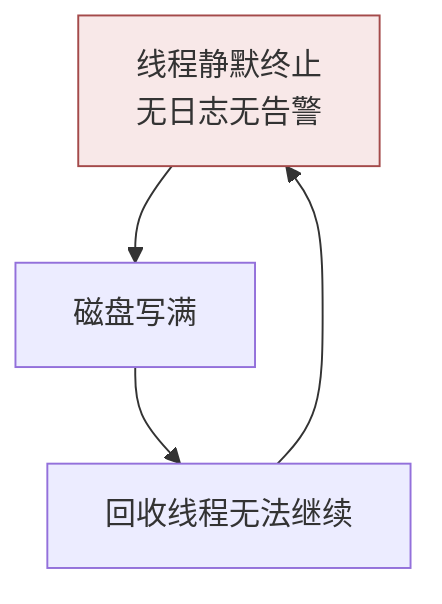
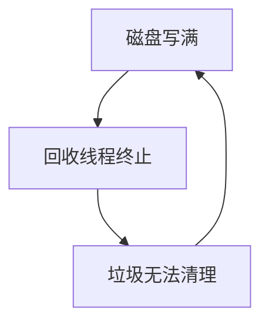
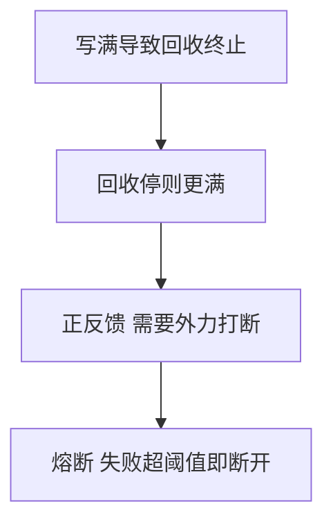

# 案例一：垃圾回收线程的终止——BookKeeper 磁盘写满

> **要点**：后台垃圾回收线程遇到未捕获异常会**静默终止**：不留日志、不触发告警，已删除数据的空间随之不再回收，直到磁盘写满停服。修复让线程"不中断、喊得出"，异常本身无法消灭。

**稳定类缺陷里有一种最阴险的形态**：**后台线程的终止**。**前台请求还在正常处理，监控一切发绿——直到某一天磁盘写满、写入失败，你回头看才发现，真正干活的后台线程早已终止了很久**。**这一篇解剖 BookKeeper（一个分布式日志存储系统，常作为流式消息平台 Pulsar 的存储层）的底层存储的两个真实病例，同一条垃圾回收线程，两种不同的终止方式**。

## 要解决的问题

**项目**：Apache BookKeeper——为日志条目提供低延迟、可持久化写入的分布式日志存储服务，**其后台那条负责回收空间的线程异常退出后，节点磁盘再也无法腾出空间**。

**BookKeeper 是一种分布式日志存储，Bookie（BookKeeper 里负责存数据片段的服务实例）节点负责存储条目**。**写入不断产生新的 entry log，删除操作留下的垃圾要靠后台的垃圾回收线程周期性回收——这条线程的健康，就是节点磁盘健康的全部**。Bookie 这个角色在 Pulsar（分布式消息队列）架构文档里有官方的实体图：


*图示：Broker 与 Bookie 在 Pulsar 集群中的角色。图源：Apache Pulsar 官方文档《Concepts and Architecture》，Apache-2.0，https://pulsar.apache.org/docs/concepts-architecture-overview/。*

把镜头拉远一层，官方架构总图给出数据流与元数据流的分工：Producer 与 Consumer 只跟无状态的 Broker 说话，消息数据全程走 Broker 到 Bookies 这条橙线，元数据与协调走灰线进 Metadata store——**两条流各走各的，Bookie 的磁盘只承接数据流**：


*图源：Apache Pulsar 官方文档《架构概览》（中文版内联 SVG），Apache-2.0，https://pulsar.apache.org/zh-CN/docs/concepts-architecture-overview/。存储与计算分离的形状在这张图上：消息数据一条橙线从 Broker 进 Bookies，集群协调一条灰线进元数据存储——**垃圾回收线程跑在数据流那一侧的每个 Bookie 里，它终止后橙线照常写入、灰线照常协调，没有任何一条流会经过「空间不再回收」这件事**。*

图中每个 Bookie 就是一个独立管理自己磁盘的存储节点——本病例里「静默终止的垃圾回收线程」跑在每个 Bookie 进程内部：**条目写入落到 Bookie 的磁盘上，被删除条目的空间回收同样发生在 Bookie 的磁盘上，这条后台线程停了，图中所有的 Bookie 方框都会在几周后被各自写满**。

- **病例 A（[上游 commit 35b8f137](https://github.com/apache/bookkeeper/commit/35b8f137b49e730efc3c1c0d5e294d2ff827bd42)，P0）**：垃圾回收与压缩周期遇到 `OutOfMemoryError` 这类未捕获的 `Error`（Java 中 `Error` 与 `Exception` 分属两支，`catch (Exception)` 兜不住 `Error`）时，线程整体停止且**不留任何日志**。**已删除数据占用的空间从此不再回收，节点最终磁盘写满、写入失败**。
- **病例 B（[上游 commit 7733db1c](https://github.com/apache/bookkeeper/commit/7733db1c9a673371301d585e3d0e35c44c4110f9)，P0）**：**垃圾回收扫描到损坏的 entry log 文件时，抛出未捕获的内存溢出错误，回收线程终止——同样导致磁盘无法回收、最终停服**。

## 它是怎么做到的：它是怎么发生的

**磁盘写满让回收线程终止，回收停了磁盘就更满——这是个正反馈**。**熔断（错误率过高时暂时断开调用快速失败）器的作用正是打断这类循环：失败累积到阈值后断开，后续请求直接失败不再调用下游，给下游留出恢复时间**。


**两个病例的触发条件不同，失效机制相同**。垃圾回收线程是一个**长生命周期的后台循环**：扫描 entry log、对照账本账目、删除无引用的数据、做压缩。**它跑在后台，不服务任何用户请求——这恰恰是危险所在**。

这条线程每个周期做的事，官方博文的流程图给了一条完整的删除链路：**Broker 侧先删 Meta Store（元数据存储，此处为 ZooKeeper）里的账本元数据，压缩检查器逐个账本核对元数据是否仍存在，确认不存在才从本地磁盘删数据——病例里终止的就是这条链路的执行者**：


*图源：StreamNative 官方博客《[A Deep Dive into the Topic Data Lifecycle in Apache Pulsar](https://streamnative.io/blog/deep-dive-into-topic-data-lifecycle-apache-pulsar)》。Delete Ledger 3=删除账本 3 的元数据，Check metadata exists?=核对元数据是否仍存在，from the local disk=从本地磁盘删数据。**链路任何一环停转（本病例是执行线程终止），磁盘上的 entry log 就再也等不到那一轮「确认不存在后删除」**。*

病例 A 的触发是一次内存分配失败。**Java 里 `OutOfMemoryError`（内存耗尽错误）和内存分配失败都属于 Error 而非 Exception（Error 表示通常无法恢复的严重错误，`catch (Exception)` 接不到它），绝大多数 `try/catch` 根本不接它们**。**循环体里没有兜底，一次分配失败就顺着调用栈把整个线程打穿——线程静默退出，连一条日志都没留下**。

病例 B 的触发是一个损坏的数据文件。**扫描读到损坏的 entry log 头，处理路径上抛出 OOME（内存耗尽错误，即上面的 `OutOfMemoryError`），同样没有兜底，线程终止**。

共同点：**周期性后台线程一旦没有最外层的异常兜底，任何一次未捕获的错误都会直接终止它**。**而它终止之后，没有任何东西替它报警**。

两个病例的共同案发地，从上游提交改动的文件就能看出来：

```
bookkeeper-server/src/main/java/org/apache/bookkeeper/bookie/GarbageCollectorThread.java
bookkeeper-server/src/main/java/org/apache/bookkeeper/bookie/DefaultEntryLogger.java
```

排查者面对的难题是：**故障暴露点（磁盘写满）和故障发生点（线程终止）之间隔了几天甚至几周，没有任何日志桥梁——这正是后台线程与前台请求在可观测性（通过系统对外输出判断内部状态的能力）上的本质差别**。





**从线程终止到磁盘写满中间隔了几天到几周，这段间隔就是排查难点**：故障暴露点与故障发生点之间没有日志桥梁：**排查只能从磁盘写满倒着往回找，而图里那条回溯虚线所依赖的日志，恰恰是这条路径上没有的东西**。

## 为什么这一类危险

**后台线程的终止是"慢性终止"**。**垃圾回收不发生→已删除数据占着空间→空间慢慢变少→某天写满**。**从线程终止到故障暴露，中间隔了几天甚至几周**。

「一切发绿直到写满」在运维端看到的样子，就是这张表——Use% 一天天爬向 100%，但表上的任何一格都不指向病因；等它变红时，线程终止那一刻的现场早已消失：


*图：`df -h` 的输出示例。表中 97% 的根分区就是「离写满只差一次大批量写入」的形态——这张表能告诉你磁盘快满了，回答不了「谁该回收而没回收」；**告警位置的选择（见下文教训）正是要把观测点从这张表挪到线程心跳（节点定期互发的存活信号，超时收不到就判定故障）**。*

三个麻烦都从同一个事实里长出来——**间隔**：



**左半段是"慢性"的含义：故障没有崩溃的表现，能力在慢慢消失，且消失的过程本身没有任何可观测事件**。右半段的三个麻烦是间隔在时间维度上的三个后果——**现场已毁是间隔太长的直接结果，归因遥远是因为中间没有线索把两端连起来，波及面大则来自写满这个终局会触发集群级的重试与恢复**。**修复掐断的是"一次错误升级为线程终止"这条传导路径，也就是把链路终止在最左边，不让它进入间隔**。三个麻烦分别落在三处：

- **现场已毁**。**等磁盘写满时排查，你看到的是"磁盘满了"，线程终止那一刻的调用栈早就找不回来**。
- **归因遥远**。**磁盘写满和"几周前一次内存分配失败"之间没有任何直接线索相连，靠监控告警几乎不可能走回到病因**。
- **波及面大**。**Bookie 写满会连锁触发集群的写入重试与恢复流程，一个节点的问题放大成一场集群事故**。

## 上游是怎么修的

两个病例的修复思路一致：**给循环体加上最外层的兜底，把"错误终止线程"改成"错误跳过本轮、记录日志、下轮继续"**。**病例 B 的修复更细——捕获 OOME 后跳过损坏的那个日志文件，回收继续，空间释放能力保留**。

**修复没有试图消灭内存分配失败或损坏文件——那做不到**。**它消灭的是"一次错误升级为线程终止"这条传导路径**。验证的锚点在文末验证章：**注入异常后线程应继续存活并留下日志，修复前实测线程退出且无任何记录，与预期对不上**。

## 这套说法在哪儿会失效，代价换来了什么教训

- **兜底不是吞异常**。**修复里日志必须记下失败本身，否则线程虽然活着，你依然不知道它每轮都在失败——那只是把线程终止换成了慢性病**。
- **给后台线程做"心跳"**。**让线程每轮报告"我活着、上轮做了什么、失败了什么"，监控对着心跳告警，而不是对着磁盘剩余量告警——后者是最差的告警位置**。**后台线程终止了由谁发现，答案必须是线程自己的心跳，而不是它失职的后果**。
- **家族聚集是线索**。**同一条线程两周内被报了两个不同触发的终止病例——再扫出第三个终止触发时不用惊讶，直接检查循环体还有没有其他未兜底的路径**。
- **磁盘写满这类症状是结果不是原因**，顺着结果往前找"谁该干活而没干活"。
- **线程活着不等于队列在收敛**。**回收线程每轮正常运行，不代表它处理的每一项最终都会走完——待删集合里的账本可能因条件永不成立而被无限期跳过，堆积成幽灵**。**中间态必须有人负责收敛**，见 [[工程知识/缺陷分析：从个案到体系/资源与容量/案例十七：删除列表里的幽灵——永不收敛的待删账本|案例十七·待删幽灵]]。
- **线程活着不等于行为正确**。**本例修的是线程被异常终止，但回收线程的另一类故障来自它读到的输入本身不可信——回收依据 entry log 文件头自述的索引，索引写错时线程会正确地删掉仍在使用的真实数据**。**健壮性与输入校验是两件事**，见 [[工程知识/缺陷分析：从个案到体系/正确性/案例十六：数据被自己人删掉——entry log 头里的假账|案例十六·假账索引]]。


## 怎么自己动手验证

1. 上游对照：**到 BookKeeper 的提交 35b8f137 与 7733db1c 里核对两处修复，确认改动位于 `GarbageCollectorThread.java` 与 `DefaultEntryLogger.java`，方向是给回收周期补上异常兜底与日志**。
2. 线程终止复现（病例 A）：**在回收周期执行中制造内存分配失败**。

**预期修复后异常被兜住、线程继续运行并留下记录；修复前实测线程整体退出且不留任何日志、已删除数据的空间不再回收，与预期对不上，即为缺陷证据**。
3. 线程终止复现（病例 B）：**让回收扫描读到一个损坏的 entry log 文件**。

**预期修复后损坏文件被跳过且不影响后续回收；修复前实测回收线程终止、磁盘占用持续上升直至写入失败，与预期对不上**。
4. 观测核对：**给线程接上心跳指标（最近成功回收时间、失败计数），确认磁盘占用的增长曲线能在写满之前被发现**；**心跳缺失时本病例在 T+0（故障发生那一刻）到 T+数周之间无任何信号，这正是第 2、3 步实测复现的现象**。

5. 断言锚点：**回收线程的存活状态可观测（对应第 4 步的心跳指标）、磁盘已删除空间的回收速率有基线（以修复后正常周期速率为基线，对照第 2 步注入前后的速率差）、写满场景下写入失败的反馈路径确认可达**（第 3 步末段实测写入失败即为反馈路径存在性的证据）。

## 用了能拿到什么，要付什么代价

**按周期任务是否仍在运行来审查后台线程，换来的是兜底缺失、心跳缺失这两类问题在写代码时就能被指出，磁盘写满这类症状会先被追到"谁该干活而没干活"**。**代价是个案的完整分析要追到上游提交与修复取舍，告警位置还要从磁盘剩余量挪到线程心跳，改动范围超出单个案例本身**。

## 接着读哪几篇：期望与现实的偏差

- [[工程知识/缺陷分析：从个案到体系/缺陷分析方法——三分离、判定树与五步法]]
- [[工程知识/缺陷分析：从个案到体系/复现与回归/从复现到回归——让证据走完一圈]]
- [[工程知识/缺陷分析：从个案到体系/缺陷分析：从个案到体系——导读与开源地图]]
- [[工程知识/缺陷分析：从个案到体系/稳定性/异常处理器的覆盖面：Error 逃逸终止周期任务]] —— 讲"Throwable 兜底 + 存活监控 + 按对象隔离"的通用防线，本病例修复动作背后的方法面
- [[工程知识/缺陷分析：从个案到体系/稳定性/类初始化的隐式输入：静态块里的环境读取]] 讲同批上游环境类故障的启动面
- [[工程知识/缺陷分析：从个案到体系/配置/配置模板的段归属：选项写错段落，严格模式一票否决]] 讲配置资产导致的启动面故障
- [[工程知识/性能工程：从用户等待到资源瓶颈/存储与网络/磁盘空间管理三原则：配额水位与临时目录纪律]] —— 本病例是"写满后连锁反应"的实例解剖，防线篇讲配额、水位（队列或资源的当前占用程度）与临时目录的前置治理
- 后台线程为什么会被一次内存分配失败终止——[[工程知识/性能工程：从用户等待到资源瓶颈/操作系统与运行时/垃圾回收与内存分配决定延迟尾部]]。
- 后台任务的生命周期与清理责任归谁——[[工程知识/后端系统：在并发、失败与变化中维持服务/任务与并发/任务生命周期必须覆盖进程、日志、超时与清理]]。