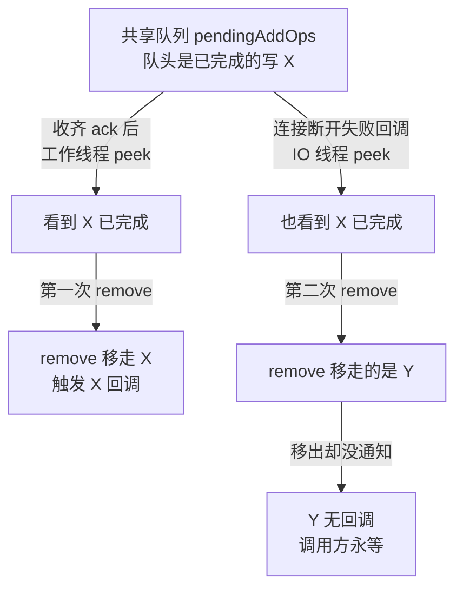
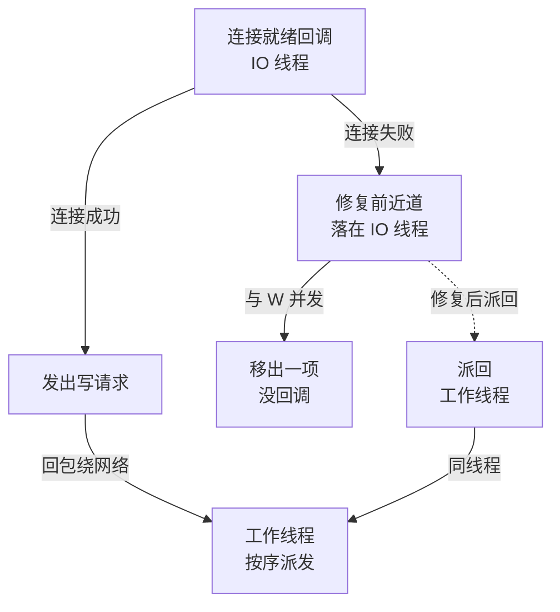
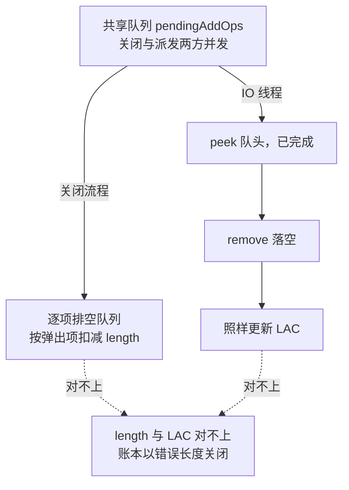

# 案例三十六：写被自己的回调堵住——挂起的 add 回调

> **要点**：**一次写收齐确认后，要有人从在途队列的队头开始逐个派发完成回调**。**派发这件事本该只由一个工作线程做；一条连接断开的失败路径让 IO 线程也来派发，两个线程同时从队头取走一项，第二个被取走的写永远等不到回调，上层等它完成的关闭流程从此停住**。

**一个用来做记账的结构，本身也会变成故障源**。**这类结构与它要防止的问题往往同名：防重复的结构自己产生了重复，防丢失的结构自己产生了丢失**。下面这个来自 Apache BookKeeper 的病例里，**出问题的正是登记"未完成的写"的那个队列，要解决的问题是它怎么会自己让一次写永远无法完成**。

## 案例出在哪个环节：场景

**项目**：Apache BookKeeper——为日志条目提供低延迟、可持久化写入的分布式日志存储服务。它的异步写入用一份在途写登记表串起确认回调，派发回调这件事由哪个线程做，决定了**这份登记表还可不可信**。

本病例的上游一手证据是 PR（Pull Request，拉取请求：请求把我的分支改动合入主干） #4557：标题直接写着「Write stuck due to pending add callback by multiple threads」，Motivation 里列了正常路径与断连路径各自怎么拿到 IO 线程、Issue-1 一节给出 Ensembles 3 / WriteQuorum（法定人数：多数派确认才算成功的机制） 3 / AckQuorum 2 的复现设置：


*图源：[apache/BookKeeper（Apache 的分布式日志存储，Pulsar 的底层存储） PR #4557](https://github.com/apache/bookkeeper/pull/4557)（页面截图，2026-09-27）。**报告方把两条到达路径的线程归属逐步列在 Motivation 里，这篇病例「问题」一节的交错分析与它一一对应**。*


*图源：Apache BookKeeper 官方文档 DistributedLog API，Apache-2.0，https://bookkeeper.apache.org/docs/4.13.0/api/distributedlog-api/。*

**这张图给出 BookKeeper 在整条写入链路里的位置：应用与数据经无状态的 Write Proxy 进入，最终落到 BookKeeper 与元数据存储组成的有状态层**。Pulsar（流式消息平台，以 BookKeeper 为存储层）构建在 BookKeeper 之上，客户端与 bookie 之间的回调派发线程模型（下文的 IO 线程与工作线程）就发生在图里 BookKeeper 那一格的边界上——**服务层怎么重组都不改这一格的约束：回调必须在属主线程上被消费**。


*图源：Apache Pulsar 官方文档 Concepts and Architecture，Apache-2.0，https://pulsar.apache.org/docs/concepts-overview/。*

先交代几个词。**账本（ledger）是一段只追加的日志；bookie 是存放账本副本的存储节点；一条账本当前在用的那组 bookie 叫 ensemble（账本生命周期内可以换），每条条目实际要写的那几个 bookie 叫它的 WriteSet**。**客户端写入一条条目（entry）是异步的：`asyncAddEntry` 发出后不阻塞，等到 ack quorum（比如 3 个副本里的 2 个）确认后触发回调**。在这段窗口内，这次写处在**已发出、未确认**的状态。

**`LedgerHandle` 用一个名为 `pendingAddOps` 的队列登记这些在途的写**。它是 `ConcurrentLinkedQueue`：**单个 `peek` 或 `remove` 各自线程安全，先 `peek` 再 `remove` 这两步合起来没有原子性保证**。**这个队列有两个用途：写入限流（在途数量达到上限时拒绝新写）与关闭时的完整性保证（关闭账本前必须等所有在途写确认）**。**回调按条目顺序派发：`sendAddSuccessCallbacks` 从队头开始，看到一项已收齐确认就把它移出队列并触发它的回调，遇到第一项未收齐的就停下**。

**派发只从队头走、见到未收齐就停，这两条合起来让队列同时承担了限流与完整性两种用途，而这两种用途都依赖同一条性质，于是它承担了一个关键的不变量**：**队列里每一项，要么还在等确认，要么已经被派发过回调**。**这条不变量还依赖一个隐含前提：移出队头与触发回调由同一个线程一次做完，所以 `sendAddSuccessCallbacks` 里的 `peek` 与 `remove` 之间没有加锁**。**BookKeeper 用 `OrderedExecutor` 按账本 id 把回调派到固定的工作线程上，这个前提平时成立**。

## 两个线程同时取队头会发生什么：问题

上游报告的现象（[PR #4557](https://github.com/apache/bookkeeper/pull/4557)，master 合并提交 [e47926bc](https://github.com/apache/bookkeeper/commit/e47926bc71c8f4b9fc548646b2abb46700923b37)，分支回移 [804b2b61](https://github.com/apache/bookkeeper/commit/804b2b611c6a11b42ca0307dd9803c16b9cc3915)）是写入停顿——`Write stuck due to pending add callback by multiple threads`，P0 是本系列给缺陷定的严重等级，最高级。**报告方遇到的形态是一个 Pulsar 主题停在 `ClosingLedger` 状态：关闭账本要等所有在途写完成，有一次写的回调永远没有到**。

**停顿的直接原因藏在标题里的"multiple threads"：派发完成回调的动作有两条到达路径**。**正常路径是 bookie 的写响应回到客户端，由按账本排序的工作线程执行 `PendingAddOp.writeComplete`，收齐 ack quorum 后调用 `sendAddSuccessCallbacks`**。

**另一条是到某个 bookie 的连接断开：连接就绪回调在 Netty 的 IO 线程上收到失败，直接对这条写执行一次失败的 `writeComplete`**。**如果这条写此前已经靠别的副本收齐确认、标记为 `completed`，这次失败的 `writeComplete` 同样会去调用 `sendAddSuccessCallbacks`**。

**两个线程同时进入 `sendAddSuccessCallbacks`，各自 `peek` 到同一个队头、各自判断它已完成、各自 `remove` 一次**。**第一次 `remove` 移走队头，第二次 `remove` 移走的是队头后面那一项**。**那一项的回调没有人触发，等它的调用方从此永远等待**。

## 为什么停顿比报错更麻烦

**它不报错。** **没有异常堆栈，没有错误日志**。**被多弹走的那一项在 `LedgerHandle` 眼里已经处理完了，在调用方眼里还在等**。**从监控看，写入吞吐掉到零，但没有失败计数——这是"健康地停住了"**。

**它自我固化。** **上层的关闭流程等这一次写完成，写永远不完成，关闭永远不结束；关闭不结束，这个账本上就不会再有新的写与新的回调，也就没有任何东西能把它唤醒**。**状态机从"等待"进入了"死锁（多个执行流互相等待对方释放资源）"，这两者在日志上无法区分**。

**影响是整条写入路径。** **对于以 BookKeeper 为存储层的 Pulsar，一个账本关不上，对应的主题就停在 `ClosingLedger`，新消息写不进去**。同一份上游报告还记录了第二个后果：**IO 线程派发回调与工作线程关闭账本并发执行时，账本长度与最后确认位置对不上，账本以错误的长度关闭**。

**归因要跨线程。** **单看任何一个线程的堆栈都是正常的：工作线程在按序派发回调，IO 线程在处理连接失败**。**问题只存在于两者对同一个队头的交错操作里**。**这类缺陷很难靠单线程的代码阅读发现**。

## 根子在哪：记账结构与对象要同时生灭

把这份登记表的增删行为抽象出来，骨架是：

> **当一个队列的每一项都代表一次"有人在等"的事件，那么从队列移出一项与通知等它的人必须是同一个原子动作，并且只由一个执行者做；移出与通知被拆开，或者两个执行者同时移出，都会制造出"被移出却没被通知"的项，等它的人永远等不到。**

这里的要害在于**一一对应外加单一执行者**。**这类记账结构通常有个隐含假设：移出与通知配对，且都在同一条执行流上**。**这个假设在正常路径上成立**，在以下三种情况下会破：

- 移出路径多于通知路径（某个分支移出了，但没有任何分支去通知）。
- 通知依赖于某个可能不发生的事件（回调）。
- 第二个执行者从约定的执行流之外进来，与正常路径并发操作同一个队头。

**第三种是本例的形态，也是最难被发现的一种：每条路径单独看都做了"完成后出队并回调"这个正确动作，错的是两条路径同时做**。**`peek` 再 `remove` 这两步依赖"同一时刻只有一个人在动队列"，这个前提没有写在任何断言里，只体现在"回调都在工作线程上跑"的惯例上**。**惯例被一条失败路径绕过，队列就坏了**。

## 打个什么比方：两个人同时叫号撕票

办事大厅的叫号机吐出一排号码，规矩是：叫到一个号，就把它的票从队列最前面撕下来，喊号让人进去。**撕票和喊号本该由窗口里唯一的值班员一次做完**。

某天，一个从后门进来的临时工也开始叫号。两个人同时看了一眼队列最前面的票，都觉得"这张该叫了"，都伸手去撕。**值班员撕走了第一张并喊了号；临时工的手慢半拍，撕走的是第二张，却没有喊号——他以为自己撕的就是刚才喊过的那张**。

第二张票的主人一直坐着等。**叫号屏上再也不会出现他的号码，票已经不在队列里了**。**大厅打烊要等所有号办完，那个人永远办不完，大厅永远关不了门**。

问题不在任何一个撕票的人（他们各自都是"看到该叫的号就撕票喊号"），在于**撕票喊号这件事本该只有一个人做**，而系统把"票不在队列里"当成了"这个人已经办完了"。

## 回调怎么被放错线程：机制

挂起的回调牵涉到下面三个类：

```
bookkeeper-server/src/main/java/org/apache/bookkeeper/client/LedgerHandle.java
bookkeeper-server/src/main/java/org/apache/bookkeeper/client/PendingAddOp.java
bookkeeper-server/src/main/java/org/apache/bookkeeper/proto/BookieClientImpl.java
```

写入路径上，**`PendingAddOp` 代表一次在途的写，它在创建后被加入 `pendingAddOps`，每个副本的响应到达时调用它的 `writeComplete`**。`writeComplete` 自身是 `synchronized` 的，改确认计数不会出错；收齐 ack quorum 后它把自己标记为 `completed`，再调用 `LedgerHandle.sendAddSuccessCallbacks()` 从队头开始派发。上游修复前的两段代码如下：

```java
// PendingAddOp.writeComplete：已完成的写再收到任何响应（包括失败响应），仍会去派发队列里的回调
public synchronized void writeComplete(int rc, long ledgerId, long entryId, BookieId addr, Object ctx) {
    if (completed) {
        sendAddSuccessCallbacks();
        maybeRecycle();
        return;
    }
    // ...
}

// LedgerHandle.sendAddSuccessCallbacks：peek 与 remove 之间没有互斥
void sendAddSuccessCallbacks() {
    while ((pendingAddOp = pendingAddOps.peek()) != null && !changingEnsemble) {
        if (!pendingAddOp.completed) {
            return;
        }
        pendingAddOps.remove();
        explicitLacFlushPolicy.updatePiggyBackedLac(lastAddConfirmed);
        pendingAddsSequenceHead = pendingAddOp.entryId;
        pendingAddOp.submitCallback(BKException.Code.OK);
    }
}
```

**`BookieClientImpl` 发送一条写之前要先确认到该 bookie 的连接可用，这一步挂在连接就绪的回调 `ChannelReadyForAddEntryCallback` 上**，而这个回调运行在 Netty——这是 BookKeeper 客户端底层使用的网络框架，它为每条连接分配专门的 IO 线程处理网络事件的 IO 线程上。**连接成功时，写请求从这里发出去，响应走正常的网络回包路径，最后由工作线程执行 `writeComplete`**。

连接失败时，修复前的代码在这个回调里**直接**调用 `completeAdd`，把失败结果送进 `writeComplete`——于是 `writeComplete` 以及它调用的 `sendAddSuccessCallbacks` 跑在了 IO 线程上。

上游报告里的复现设置是 ensemble 3、write quorum 3（一条写实际发往几个 bookie）、ack quorum 2：**一条写发往三个 bookie，前两个返回成功后这条写已标记 `completed`，第三个 bookie 的连接恰好在此时断开**。此后两个线程在队列上的交错：



**丢的是 Y：两方看到的都是 X，第二次移出却落在 Y 身上**。**Y 从队列里消失了，它的回调没有发生**。

相关的另一条上游修复（[commit 33a1985c](https://github.com/apache/bookkeeper/commit/33a1985c95ea)）优化的是读路径上的 `reorderReadSequence`，它原本检查整个 ensemble，实际只需要检查这条条目的 WriteSet。两者的共同点是**对集合的遍历与判断范围要与语义一致**，范围过大会让本可以快速完成的判断等待更多条件，本例则是执行者范围过大。

两条到达 `writeComplete` 的路径，修复前后各走哪个线程：



**多出来的那个线程来自失败路径：正常路径的响应绕一圈网络回来，落在工作线程上；失败路径抄了近道，落在 IO 线程上**。**修复没有改队列本身，只是把近道的终点也接回工作线程**。

## 怎么发现：质疑"已出队"的判断

**给在途队列加驻留时长监控。** **每一项在队列里待了多久，最老的那项待了多久**。**健康的在途队列，每项的驻留时长都应有上界，通常不超过一次往返的超时**。**本例的受害者已经离开队列，这项指标抓不到它，抓得到的是上层：Pulsar 侧 managed ledger（位于 BookKeeper 之上、管理消息日志与消费游标的那一层）的在途写列表里那一项一直不走**。**上下两层的在途计数对不上**，就是回调丢失的直接证据。

**为登记与回调分别计数。** **入队次数减回调次数应当等于队列当前长度；差值大于长度，说明有项被移出却没有回调**。**这个校验成本极低，能在问题发生的瞬间给出信号**。

**在回调入口断言线程归属。** **回调约定只在某个线程上跑的，就在入口检查 `Thread.currentThread()` 是否属于那个执行器，不属于就记录堆栈**。**上游修复附带的测试 `testAddEntriesCallbackWithBKClientThread` 正是这么做的：包一层装饰器记录每次 `writeComplete` 的线程，断言全部落在 `BookKeeperClientWorker` 线程上**。**这条断言放进常驻测试，同类回归当场暴露**。

**让等待有上限。** **关闭流程等待在途写清空时，如果等了远超预期的时间，应当中止并报告"有 N 项等待超过 T 秒"**。**无限等待让死锁不可观测，有上限的等待把它变成一次明确的失败**。

**在并发测试中交叉触发连接失败。** **单纯并发写不会触发这类缺陷，必须让"写已收齐 ack quorum + 到剩余 bookie 的连接断开"同时发生**。**测试要覆盖的是交错，负载大小反而次要**。

**审查时列出所有出队点与所有回调点，并标注各自跑在哪个线程。** 逐个配对检查：每个出队点是否紧跟着回调？出队与回调之间有没有别的线程能插进来？这个清单是审查这类结构的有效工具。

## 上游把线程归属怎么改：修复

**修复在回调的执行位置上：连接失败路径里的 `completeAdd` 交给 `executor.executeOrdered(ledgerId, ...)` 派发，与正常路径的响应落在同一个按账本排序的工作线程上**。**队列本身与出队逻辑一行没动**。

**修复没有选择"给 `sendAddSuccessCallbacks` 加锁"这条路**。**加锁能让两次 `remove` 不再同时发生，但 IO 线程仍会在错误的时机派发回调，与关闭账本的并发问题也还在**。上游报告里的第二张交错表说的就是后者：关闭流程逐项排空队列、按弹出项扣减账本长度，IO 线程在同一队列上派发回调并更新最后确认位置，两边对不上，账本就以错误的长度关闭。LAC（Pulsar 客户端的内部锁结构） 是 lastAddConfirmed（最后确认位置，账本上连续确认到的最新条目号），派发回调时会顺手更新它。两边各自怎么走，下图摆开：



**这张交错里没有任何一步同时操作队列，加锁拦不住它**。关键在时序：IO 线程 peek 时队列尚有一项，remove 之前队列恰好被关闭流程排空，IO 线程的 remove 因此落空，落空之后照样更新 LAC，两个方向各走各的，只要派发仍可能发生在 IO 线程上，它与关闭流程就会这样交错。**把所有派发收回同一个线程，两个问题一起消失**。

预期同一账本上所有 `writeComplete` 都在 `BookKeeperClientWorker` 线程上执行；修复前实测连接失败时有一部分落在 Netty IO 线程上，与预期对不上。

## 这套修复在哪儿会失效：边界与教训

- **队列里每一项代表"有人在等"时，移出与通知必须是同一个原子动作。** 拆开做的记账结构比没有记账更危险，因为它会给出错误的确定感。
- **等待与死锁在日志上无法区分。** 要靠上下两层在途计数的差值判断，"有没有报错"给不出答案。
- **等待必须有上限。** 无限等待让可恢复的故障变成永久停顿。
- **回调的线程归属是不变量的一部分。** 无锁的记账结构依赖"只有一个线程在动它"，每条新增的失败路径都要问一遍它跑在哪。
- **并发测试要覆盖交错。** 连接失败与正常确认同时进行时才会暴露这类问题，单纯加负载测不出来。


## 想自己复现一遍怎么动手：验证

1. 上游对照：到 PR #4557 的正文里核对两张交错表（Issue-1 双弹出、Issue-2 关闭账本时长度错算），再到提交 e47926bc 里核对 `ChannelReadyForAddEntryCallback.operationComplete` 的失败分支：修复前直接调用 `completeAdd`，修复后经 `executeOrdered(ledgerId, ...)` 派发；同一提交新增的 `ClientSocketDisconnectTest` 记录每次 `writeComplete` 的执行线程并断言全部落在 `BookKeeperClientWorker`。
2. 卡住复现：**ensemble 3、write quorum 3、ack quorum 2，一条写在前两个 bookie 返回成功之后让第三个 bookie 的连接断开**，预期修复前有 `writeComplete` 落在 IO 线程、下一条写的回调不再到达、账本关闭停住；修复后所有回调在工作线程上、关闭正常结束。
3. 对账：**运行 24 小时后对比 `LedgerHandle.pendingAddOps` 的长度与上层 managed ledger 的在途写数，预期两者对得上**。
4. 断言锚点：回调线程归属单一、每次出队紧跟一次回调。

## 接着读哪几篇：同在缺陷分析里的相邻问题

- 并发控制与完成条件的定义——[[工程知识/后端系统：在并发、失败与变化中维持服务/任务与并发/并发控制先定义共享状态和完成条件]]。
- 任务生命周期与清理责任——[[工程知识/后端系统：在并发、失败与变化中维持服务/任务与并发/任务生命周期必须覆盖进程、日志、超时与清理]]。
- [[工程知识/缺陷分析：从个案到体系/并发/回调必须回到属主线程：完成通知的线程归属纪律]] 是本病例的方法面，讲完成通知为什么必须回到属主线程。
- [[工程知识/缺陷分析：从个案到体系/并发/写入路径的串行化边界：回调换了线程，不变量就换了主人]] 是本病例的方法面，讲不变量随线程更换。
- [[工程知识/缺陷分析：从个案到体系/稳定性/案例二十一：异常路径上没有完成——永不兑现的 future]] 讲异常路径上回调根本没有发生的形态，与本篇"回调被别人替自己消费掉"互为对照。
- [[工程知识/缺陷分析：从个案到体系/资源与容量/案例十七：删除列表里的幽灵——永不收敛的待删账本]] 讲另一份"为空才算完成"的登记表如何失真。
- [[工程知识/缺陷分析：从个案到体系/性能/判定范围的口径错位：按谁判，就在谁头上加成本]] 引用了本病例同一批上游修复的姊妹病例，讲判定范围与影响范围一致的方法面。
- 导读见 [[工程知识/缺陷分析：从个案到体系/缺陷分析：从个案到体系——导读与开源地图]]。
