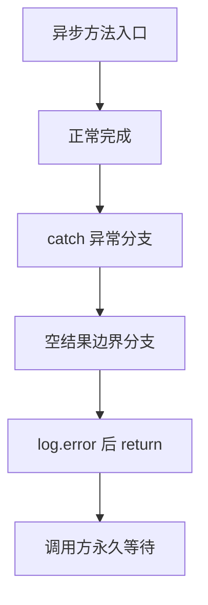
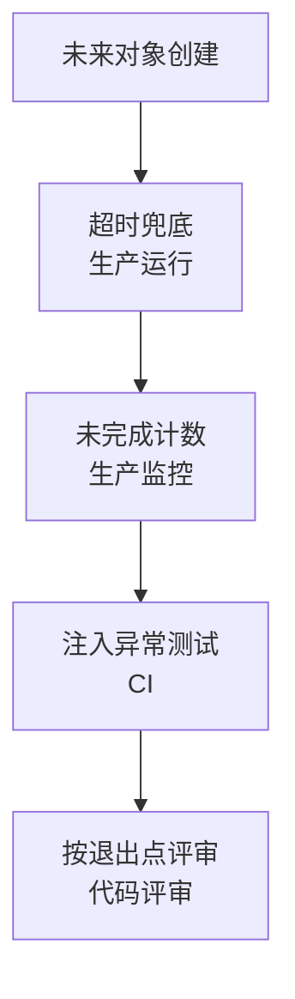
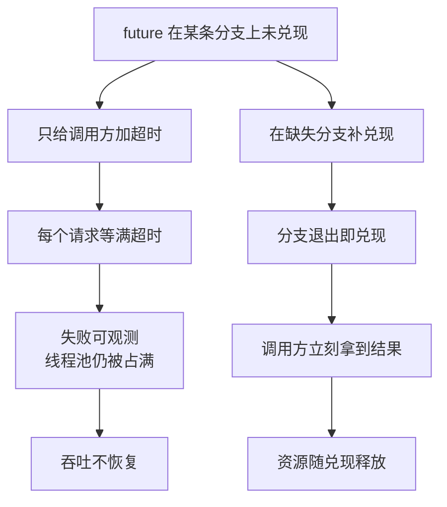

# 案例二十一：异常路径上没有完成——永不兑现的 future

异步方法在正常分支上都会兑现 future，异常分支却常常漏掉这一步，调用方于是永久等待。读完这篇你能让 future 在每条路径上都有交代。

> **要点**：异步方法在正常分支上都会兑现返回的 future，异常分支与"什么都不用做"的边界分支常常漏掉这一步；**调用方于是永久等待——没有超时，失败信号也没有传到它手里**。

异步编程有一条不成文的约定：返回一个 future（一个稍后才会被填上结果的占位对象），就要保证它在**每一条**路径上被兑现（**往里写入最终结果或异常，让等它的人醒来**）。**这条约定在正常路径上几乎不会违反——那是开发者最先写、最先测的部分**。**问题出在异常路径上：那里往往只写了日志与返回，忘了调用方还在等**。本篇要解决的问题是：为什么"完成 future"这个动作会被系统性地漏掉，漏掉之后系统是什么样子。Apache Pulsar（分布式消息队列）的这组病例是这条规律的集中展示。

## 案例出在哪个环节：场景

**项目**：Apache Pulsar——分布式的消息与流处理平台。它的 broker（服务节点）**异步接口同时依赖回调与 CompletableFuture（Java 标准库里的 future 实现）兑现结果**，异常路径上兑现不了，就是本篇追问的事。

Pulsar 的 broker 大量使用异步接口：读取条目、重放去重状态、更新主题属性、管理事务元数据。这些方法的共同形态是接受一个回调或返回一个 `CompletableFuture`，在操作完成时兑现。

这类接口的正确性要求有两半：**做对了要通知，做错了也要通知**。**第一半通常由业务逻辑直接保证，第二半依赖错误处理代码**——而**后者往往是后来补上的，或者是从别处复制来的**。

broker 的异步接口散布在整条服务链路上：客户端连 broker，broker 把条目读写交给 BookKeeper 的 bookie 集群，元数据协调交给 metadata store。Apache Pulsar 官方文档的集群架构图画出了这条链——三个病例分属的读取条目、重放去重状态、更新主题属性，**全是这条链上 broker 与下游（bookie、元数据）之间的异步往返**，**任何一环的异常分支漏掉兑现，等待方就挂在这条链上**：


*图源：[Apache Pulsar 官方文档《Architecture Overview》](https://Pulsar.apache.org/docs/next/concepts-architecture-overview/)。*

## 三个病例缺的是同一块什么：问题

**病例 A（[上游 commit c8872591](https://github.com/apache/pulsar/commit/c8872591e2e8)，P1 是本系列给缺陷定的严重等级，P0 最高）**：从 BookKeeper（Pulsar 的存储层）异步读取条目时，**如果读到的是空条目，`asyncReadEntries` 可能永不完成**。**空条目算不上错误，只是一条没有被显式处理的分支**——**处理循环在遇到它时，既没有继续推进，也没有兑现 future**。

**病例 B（[上游 commit 0444514a](https://github.com/apache/pulsar/commit/0444514a3f30)，P1）**：去重状态的重放（broker 加载主题时重新读一遍"哪些消息已经处理过"的标记，用来跳过重复投递）**在遇到某些异常时可能永不完成**。**异常被捕获并记录，但兑现 future 的那一步在异常分支上缺失**。

**病例 C（[上游 commit e15aedfc](https://github.com/apache/pulsar/commit/e15aedfcb3e3)，P1）**：**主题属性的更新与删除方法同样存在未完成的 future——部分返回路径上没有兑现**。

**三个病例分属不同模块、由不同人报告，缺口形态完全一致**：**存在一条代码路径，它退出时没有兑现调用方持有的 future**。
## 为什么等待会变成永久

**没有超时。** **调用方通常不为这类内部 future 设置超时——它信任被调用方会完成**。**future 不兑现时，等待方就一直等下去**。**网络调用有超时兜底，内部 future 没有**。

**没有报错信号传到调用方。** 被调用方这一侧可能记了一条错误日志，但**既不抛异常也不给 future 写入失败**，于是它认为自己"处理完了"，调用方认为"还在进行中"。双方都正常，交易未完成。

**资源随之滞留。** **等待中的请求持有上下文对象、可能的网络连接与分配的内存**。**这些资源要等 future 兑现才释放。future 永不兑现，资源就永不释放**——这是 [[工程知识/缺陷分析：从个案到体系/稳定性/案例八：承诺没有兑现——Pulsar 里六个永不返回的请求|案例八]] 描述的悬空请求的一个具体成因。

**表现随积压放大。** **单个请求挂起不影响可用性**；**挂起累积到线程池（预先建好一组线程反复取用、避免频繁创建销毁）容量后，新请求排队，整体吞吐下降**，最终表现为"broker 变慢"或"部分主题无响应"。**运维看到的症状与根因之间隔了好几层**。积压的物理形态就是排队的请求把线程池的座位占满：机房里一排排机架各立各的，请求却都堵在同一个入口上。


> 图：NOIRLab 总部机房的服务器机架走廊，来自 [Wikimedia Commons](https://commons.wikimedia.org/wiki/File:NOIRLab_HQ_Server_Racks_(6V6A0395-CC).jpg)，CC BY 4.0，摄影 NOIRLab/NSF/AURA/T. Slovinský。

积压的细部形态——被占满的座位长什么样——在机架背面的特写里更直观：每个 1U 服务器是一个座位，面板指示灯显示各自的状态，线缆从同一个入口汇入；挂起的请求就像亮着灯却不再推进的节点，从入口这一侧数不清哪个座位已经卡住：这个比方到「卡住的样子看得见」为止——机架座位是静态占位，挂起请求占着的是线程、连接和超时预算，什么时候释放、谁来判定，要看正文。


*图源：Wikimedia Commons《Rear of rack at NERSC data center - closeup.jpg》，CC0 公有领域。*

## 根子在哪：兑现是每条路径的承诺

把这条 future 承诺抽象出来，骨架是：

> **"返回一个 future"是一条全称承诺：它必须在所有可能的退出路径上被兑现，包括每一条异常分支与边界分支。缺失任何一条，等待方就无法区分"尚未完成"与"永远不会完成"。**

这个病例的关键认知在于**"所有路径"这四个字如何被系统性遗漏**。

代码的书写顺序决定了注意力的分布。开发者先写正常路径，它的完成是自然的；再逐步添加错误处理，而每添加一条 `catch`，注意力都在"如何处理这个错误"上——记录、清理、重试——**"调用方还在等"这件事此刻不在视野里**。**错误处理的意图与 future 兑现的意图在代码里是两个独立的动作，前者不会自动带来后者**。

**注意力是有限的，先写的正常路径拿到了全部关注，后补的分支拿到的关注递减**，越晚补的分支越可能在"要不要兑现"这一步被跳过。于是缺口呈现出可预测的分布：**越晚添加的错误分支，越可能缺少兑现**。这也解释了为什么**这类缺陷常常成簇出现——同一个模块里，错误处理是分批补的，每批都可能漏**。

还有一个加剧因素：**空分支**。病例 A 的空条目是一个"什么都不需要做"的分支，连异常都算不上。这类分支最容易被写成"什么都不做"——包括不兑现 future。**异常分支至少有 `catch` 块提醒你写点什么，空分支连这个提醒都没有**。

一个异步方法的退出点按"有没有兑现"分类，缺口集中在哪一类，摆出来是这样：



三个病例各落在哪一类：A 的空条目在空结果边界分支，B 的重放异常在 `catch` 分支，C 的属性更新是部分返回路径没走到兑现——三类里只有正常完成天然带兑现动作。

## 打个什么比方：挂号后没人叫号，也没人说结束了

医院叫号系统，病人取号后等待。系统规则是：医生看完叫下一个，或护士通知"今天看不了了"。

某天，一个病人取了号，但负责他的医生临时被叫走，**没有人接手这个号**。系统里没有"这个号作废"的操作，也没有"改由其他医生接手"的操作——这个号就一直挂在屏幕上，状态是"等待中"。

病人不知道要等多久（没有超时），不知道出了问题（没有错误提示），也不知道该找谁（没有负责人）。他只能一直等。而候诊区座位有限，挂着的号越来越多，真正能看病的病人反而没座位了。

催医生快点回来解决不了这件事。修复要**在系统里补一条规则：任何号，要么被叫到，要么被显式结束**。没有第三种状态。

## 缺的那行为什么看不见：机制

缺口分布在 managed ledger（Pulsar 里位于 BookKeeper 之上、管理条目日志与消费游标的存储层）与 broker 的异步实现层：

```
managed-ledger/src/main/java/org/apache/pulsar/broker/service/.../ManagedCursorImpl.java
pulsar-broker/src/main/java/org/apache/pulsar/broker/service/.../ (dedup / topic properties)
```

这类缺口在各处的写法收敛成一个典型形态：

```java
public void asyncReadEntries(..., ReadEntriesCallback cb, Object ctx) {
    // ... 正常路径
    if (entries.isEmpty()) {
        // 边界分支：既没有继续读，也没有调用 cb.readEntriesComplete(...)
        return;
    }
    // ...
}
```

上游修复前的反面写法（吞异常、不回调）长这样：

```java
try {
    doSomething();
} catch (Exception e) {
    log.error("failed", e);
    return;              // future 从未被 complete / completeExceptionally
}
```

两段代码在语法与风格上都完全正常，静态检查也不会报警——没有一个规则说"catch 块里必须兑现 future"。这就是为什么这类缺陷能穿过代码评审：**缺的是一行，而且这行的缺失在局部代码里看不出来，必须对照调用方的等待才能发现**。

病例 A 有一点特殊：空条目走的是**边界路径**，没有任何异常抛出。它的修复要求开发者意识到"读到空"也是一种需要终止等待的状态。这比异常分支更隐蔽——没有一个显式的 `catch` 提示你"这里需要收尾"。

上游修复的共同形态是：**在缺失的分支上补上兑现动作（正常则完成，异常则 `completeExceptionally`）。代码量极小，通常是几行**。

## 怎么发现：让未完成自己说话

承诺的兑现是全称命题：所有路径上都要完成，少一条就是永不兑现。熔断（错误率过高时暂时断开调用快速失败）器的状态机给了一个可观察的模板——闭合时正常调用，失败超阈值转断开，试探成功后回到闭合。每一步都有明确状态，不会悬着。


**给所有内部 future 加超时。** 这是兜底网。超时不能修复缺陷，但能把"永久等待"变成"可观测的失败"，并且给出堆栈定位到具体位置。生产环境下，这条的价值最大。

五条手段分布在"缺陷已经跑起来"到"提交之前"这条时间线的不同位置，各自能接住的东西不一样：



靠前两条不修复任何东西，作用是把静默失败变成看得见的失败——生产环境里这一层的价值最大，因为缺陷已经在跑了。靠后两条才是在提交之前拦住它，其中按退出点评审是唯一能覆盖边界分支（例如读到空直接返回）的办法，注入异常的测试对这种不抛异常的路径无能为力。

**统计未完成的 future。** 维护一个"已创建未兑现"的计数与最长存活时长。**健康系统里这个数应该稳定在低位且存活时间短**；出现长时间存活的项，就是缺口。

**在测试里注入异常。** 单元测试通常只测正常路径。为异步接口写"每个异常分支都会兑现 future"的断言，是发现这类缺陷成本最低的方式。可以用字节码注入或 mock（模拟对象：测试里替代真实依赖的假实现）强制抛出异常。

**代码评审时按"退出点"审查。** **列出方法的所有 `return`、`throw`、循环退出，逐个确认 future 的兑现**。这个方法笨，但有效——它把注意力从"这段代码做什么"转到"这段代码怎么结束"，按功能读代码看不到这一层。

**寻找成簇信号。** **同一模块报出一个未完成的 future 时，主动检查同模块其他异步方法——缺口往往不止一处**（本例三个病例分属不同模块，但每个模块内部都可能有多个）。

## 上游把缺口怎么补齐：修复

**三个病例的修复都是补上缺失的兑现动作：边界分支上正常完成，异常分支上以异常完成**。**没有重构，没有引入新机制**。

修复实物（上游 commit c887259，标题原文为 Fix asyncReadEntries might never complete if empty entries are read from BookKeeper，异步读条目在从 BookKeeper 读到空条目时可能永不完成）：提交被拣选进 branch-3.0 与两个候选版本，**改动六个文件加 167 行减 38 行**，**配套新增 MockedBookKeeper 单测（针对最小可测单元的自动化测试）把「空条目」这个触发条件钉进回归网**。标题里的 might never complete 正是本篇的病名——future 的承诺在边界分支上没有兑现：


*图源：[Apache Pulsar commit c887259](https://github.com/apache/pulsar/commit/c8872591e2e8) 页面截图（playwright 实拍，2026-09-28）。asyncReadEntries=异步读条目接口，empty entries=空条目（触发未兑现的边界输入），might never complete=可能永不完成，cherry picked from=从主干拣选进维护分支。*

修复的**方向**要分清：**让被调用方履行约定是修复，让调用方加超时是防御**。**超时值得加，但只加超时、不补兑现，系统仍然在做无用功——每个请求都要等满超时才失败，吞吐不会恢复**。

两种做法各自走到哪里：



超时只能算兜底的原因就在这里：**只加超时是把永久等待缩短成一个超时周期，等待仍然存在，只是有了尽头**；**补上兑现则让等待在分支退出的那一刻结束。两条都要做，先补兑现，再加超时**。

异步读取返回空条目时，预期是继续推进或明确结束；修复前实测该调用永不完成，与预期对不上。

## 这套防法在哪儿会失效：边界与教训

- **返回 future 就意味着在每条路径上兑现它。** 包括异常分支与"什么都不需要做"的边界分支。
- **空分支比异常分支更危险。** 异常至少有 `catch` 提醒你收尾，空分支连提醒都没有。
- **超时是兜底不是修复。** 它把永久等待变成可观测失败，但不恢复正确行为。
- **未完成的 future 会滞留资源**，累积后表现为整体变慢，症状与根因隔了好几层。
- **成簇出现。** 发现一处，主动检查同模块其他异步方法。
- **评审时按退出点审查。** 按功能读代码看不到"这段代码怎么结束"，按退出点数才看得到缺口。


## 想自己复现一遍怎么动手：验证

1. 上游对照：到 Pulsar 的提交 c8872591、0444514a 与 e15aedfc 里核对三处修复，**确认空条目读取、去重状态重放与主题属性更新三条路径的退出点都补上了兑现 future 的调用**。
2. 分支复现（病例 A）：**让 BookKeeper 异步读取返回空条目，修复前该调用永不完成、消费者收不到消息也不报错，修复后读请求继续推进或明确结束**。

3. 异常路径复现（病例 B）：**在去重状态重放过程中注入异常，修复前异常被记录但 future 不兑现、调用方永久等待，修复后调用方拿到失败结果**。
4. 返回路径梳理：**对每个返回 future 的异步方法，逐条列出正常与异常分支，确认每条分支都有兑现动作**。
5. 断言锚点：三处断点各自的修复前后行为留档，**等待中的请求所占资源随 future 兑现而释放这一结论有观测依据**。

## 接着读哪几篇：生命周期的时序竞态

- 异步路径上的资源与生命周期责任——[[工程知识/后端系统：在并发、失败与变化中维持服务/任务与并发/任务生命周期必须覆盖进程、日志、超时与清理]]。
- 调用语义与超时边界——[[工程知识/后端系统：在并发、失败与变化中维持服务/分布式可靠性/超时、重试与幂等共同定义调用语义]]。
- [[工程知识/缺陷分析：从个案到体系/稳定性/案例八：承诺没有兑现——Pulsar 里六个永不返回的请求]] 讲同一类缺口在请求层面的六种形态，本篇是其中一种成因的机制剖面。
- [[工程知识/缺陷分析：从个案到体系/并发/案例二十：关闭之后还有人在用——生命周期的时序竞态]] 讲生命周期的另一端，对象已经结束而调用还在继续。
- 导读见 [[工程知识/缺陷分析：从个案到体系/缺陷分析：从个案到体系——导读与开源地图]]。
