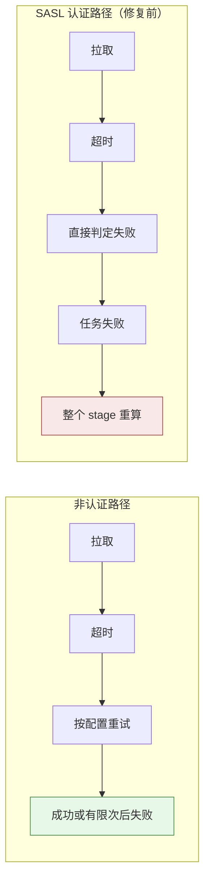
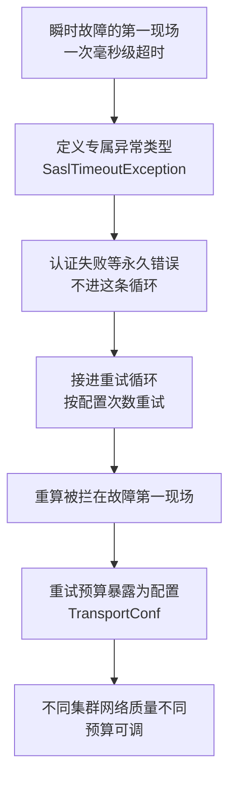

# 案例二十三：一次抖动变成一次重算——SASL拉取没有重试

**一次毫秒级抖动，因为没有重试直接升级成整批重算**。**读完这篇你能判断哪些拉取必须带重试，以及重试该怎么写**。

**SASL（Simple Authentication and Security Layer）拉取失败时若无重试机制，一次毫秒级抖动会直接升级为整批重算**。

> **要点**：**SASL 认证的 shuffle 块拉取路径上没有超时重试**，**网络一次毫秒级的抖动让块拉取直接失败、整个 stage 重算**——**瞬时故障与永久失败之间缺的那一层，叫重试语义**。

## 要解决的问题：案例背景

**项目**：**Apache Spark（分布式计算引擎，靠内存计算加速大规模数据处理）**——**shuffle 是它的数据交换枢纽**：上一个 stage 的输出按分区散给下一个 stage 的任务，**块拉取就是下游任务向上游取回自己那份分区数据**。

**启用 SASL 认证的集群里，这条拉取路径走认证加密通道**。缺陷在于：这条路径上**没有超时重试**（[上游 commit 1a26c7be](https://github.com/apache/spark/commit/1a26c7be56bf33c8c82aae2f7b972480bdf36916)，P2，已真实复现）。**网络抖动一下——一次毫秒级的超时——块拉取直接判定失败，下游任务失败，整个 stage 重算**。 **这类缺陷给运维出的难题是：失败看起来是随机的——同一个作业有时通过有时失败，抖动越大越频发，很难让人相信根因只是一次毫秒级的超时**。

## 初看这段代码会冒出哪两个疑问

1. **网络抖动谁没有？** **分布式系统里网络抖动是背景噪音，为什么别的路径扛得住、这条扛不住**？
2. **失败就重算，Spark 不是有容错吗？** **容错机制不是兜底了吗，问题在哪**？

**两个疑问的答案合起来，暴露的是一个设计层的缺失，而不是某个代码写错了**。


来源：[CSDN @bjmayor《图解分布式事务模式》](https://bjmayor.blog.csdn.net/article/details/154004146)（CC 4.0 BY-SA）


## 它是怎么做到的：两套容错之间掉进了缝隙

Spark 的容错模型是**重算**：**任何任务失败，调度器在别的节点上重新跑一遍，数据最终不丢。这是它的立身之本**。

但重算是**用计算换可靠性**的昂贵手段：**stage 重算意味着上游全部数据重新处理一遍，几十分钟的计算可能因为一次毫秒级的网络抖动全部重来**。所以在重算这道最后防线**之前**，**每一层都应该先把瞬时故障消化掉**——TCP（传输控制协议，负责把数据完整、有序地送达）自己有重传，应用层的块拉取也该对"超时"**这种典型的瞬时故障做有限次重试**。

**非认证的 shuffle 拉取路径有这层重试**。SASL 认证路径——**为了安全加了认证握手之后**——**超时被直接判定为失败**，**没有进入重试循环**。

**两条路径的对比，一眼看出缺口在哪**：

```text
非认证路径：拉取 → 超时 → 重试(按配置) → 成功或有限次后失败
SASL 路径：  拉取 → 超时 → 直接失败 → 任务失败 → stage 重算
```


**上下两条链路的输入完全相同——都是一次毫秒级超时**。差别只在于中间那一格：上链把超时当作"可能需要再来一次"，下链把它当作"这次失败了"。**同一事实的两种归类，代价相差几十分钟的计算量**。

**为什么偏偏这条路径没有？和案例五的认证绕过同构**：**为安全加的代码路径，往往是从主路径分叉出来的副本，副本落后于主路径的功能演进。** **主路径多年来积累了重试、超时调优**，认证分叉只实现了"能走通"，**没人回头补齐**。

**「副本要抄全主路径的功能清单」的实物原型是宫门上的成套五金**：**一扇正式的宫门，门环、门钉、铺首、门闩按规制成套——后来添置的边门只装了锁，环与闩没跟上，来客拉了半天找不到能叩门的地方**。**装配清单照主门抄一遍，这题就不存在**：


*图源：Wikimedia Commons，作者 Francesco Bini，CC BY-SA 4.0，https://commons.wikimedia.org/wiki/File:Citt%C3%A0_proibita,_porta_delle_portenza_divina_(nord),_maniglia_01.jpg。*

**认证分叉就是那道第二门：锁（认证）装了，门环（重试）、门闩（超时调优）、猫眼（指标埋点）都没抄——上游修复的三件事正是按主门的清单补齐**。**加安全路径时把主路径的功能清单抄一遍，装配清单在手，副本的能力差在验收时就能看出来**。

分叉本身就埋下了这个结果的种子：副本诞生时只承载"打通认证"这一个目标，**功能清单天然短于主路径**。**而主路径后续每一次加固（加重试、调超时、埋指标）都发生在主路径上，不会自动同步到分叉**。**时间越久，两条路径的能力差越大，而差的那部分恰好都在异常处理这类平时看不出来的地方**。

## 这类问题还在哪儿出现过

**三类问题串成一条线**：**瞬时故障没有重试语义**时，**它的代价沿着容错模型逐级放大——块拉取失败 → 任务失败 → stage 重算 → 数十分钟计算作废**，而不是"失败一次"。[[工程知识/缺陷分析：从个案到体系/稳定性/案例十二：调度线程的永久等待——广播写锁不释放]] **是等待没有上限，这一条是重试没有次数**——**都是把"异常情况怎么办"留给了系统最昂贵的兜底层**。修复的位置也一致：**都在故障发生的第一现场补语义，而不是让上层容错机制买单**。

## 上游怎么修

修复（[上游 commit 1a26c7be](https://github.com/apache/spark/commit/1a26c7be56bf33c8c82aae2f7b972480bdf36916)）做了三件事：**定义 SASL 超时异常类型（`SaslTimeoutException`，把这种瞬时故障和其他失败区分开）**；**在传输层对它按配置次数重试**；**把重试参数暴露为 `TransportConf` 配置**。三件事合起来是一条原则：**瞬时故障要有自己的类型，有自己的重试预算，且预算可调**——**不同集群的网络质量不同，一个固定写下的数字适配不了所有人**。


**修复的三件事有先后：先给瞬时故障一个专属类型，它才能从永久失败里被分出来进重试循环**；**进了循环，重试预算才谈得上暴露成可调配置**。



**类型、循环、可调预算三件事缺一件，认证路径的失败语义就还是与非认证路径对不上**。

认证路径失败语义要与非认证路径对账——**预写毫秒级超时后应按配置重试并成功，实测直接失败并引发整个阶段重算，与预期对不上**。

## 这套说法在哪儿会失效，代价换来了什么教训

- **重试只对瞬时故障有效**。**认证失败的永久错误被重试，只会放大攻击面和日志噪音**——**所以修复的第一步是定义 SaslTimeoutException**，先把"值得重试的失败"和"不该重试的失败"分开。
- **加安全路径时，把主路径的功能清单抄一遍**。认证、加密、压缩——**每条为安全分出的副本，都要对照主路径检查**：**重试有吗？超时有吗？指标埋了吗？**
- **stage 重算的成本要进监控**：重算次数突增往往意味着"某一层在把瞬时故障当永久失败"，**比作业失败本身更早暴露问题**。


## 怎么自己动手验证

1. 上游对照：**到 Spark 的提交 1a26c7be 里核对修复方式，确认 SASL 认证的块拉取路径补上了与非认证路径一致的超时重试语义**。
2. 抖动注入复现：**在启用 SASL 认证的集群里让一次块拉取发生毫秒级超时，修复前该拉取直接判定失败、下游任务失败、整个 stage 重算**；**修复后按配置重试并成功，作业无需重算**。

3. 路径对照：**把非认证路径与 SASL 路径的失败处理逐项并排，确认重试次数、退避与超时参数的取值对齐**。
4. 放大链路核对：**记录一次瞬时超时从块拉取到 stage 重算之间的传播路径与计算量损失，确认重试被放在故障发生的第一现场**。
5. 断言锚点：**两条路径的失败处理清单完成对齐，抖动注入前后的作业结果与重算记录可对照**。

## 接着读哪几篇：同在缺陷分析里的相邻问题

- 超时与重试的语义约定——[[工程知识/后端系统：在并发、失败与变化中维持服务/分布式可靠性/超时、重试与幂等共同定义调用语义]]。
- 失败分类决定处置动作——[[工程知识/AI 系统工程：从模型能力到生产能力/质量与运营/失败要分类才能对症下药]]。
- 部分失败如何传导——[[工程知识/后端系统：在并发、失败与变化中维持服务/分布式可靠性/部分失败决定分布式系统的设计]]。
- [[工程知识/缺陷分析：从个案到体系/稳定性/案例十二：调度线程的永久等待——广播写锁不释放]] · [[工程知识/缺陷分析：从个案到体系/稳定性/案例八：承诺没有兑现——Pulsar 里六个永不返回的请求]] · [[工程知识/缺陷分析：从个案到体系/缺陷分析：从个案到体系——导读与开源地图]]
