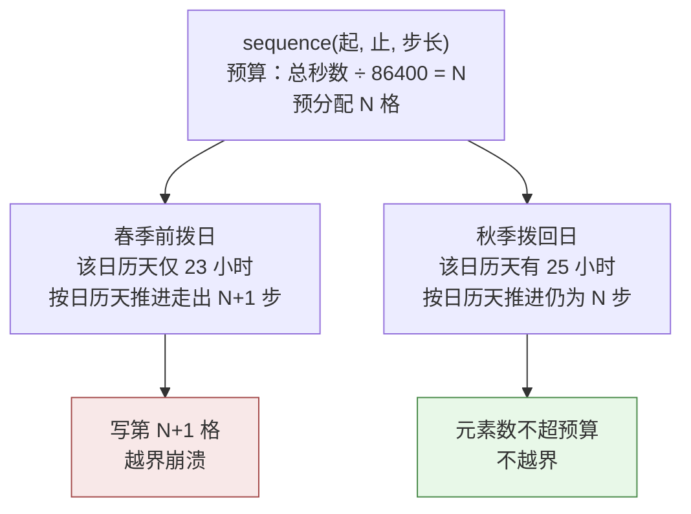
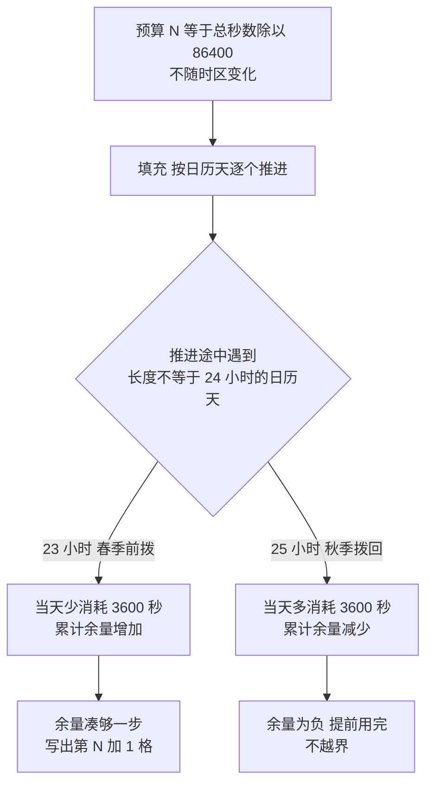

# 案例二十二：时间也是输入——夏令时让序列生成越界

时间不是一个背景常数，它是输入——时区切换会改变"一天有多少个小时"这个算术前提。**读完这篇你能避开夏令时造成的序列越界**。

> **要点**：**在启用夏令时的时区里，用 sequence() 生成跨越春季前拨日的日期序列会抛数组越界、查询失败**——时间不是一个背景常数，它是输入；时区的切换会改变"一天有多少个小时"这个算术前提。

## 要解决的问题是什么：一天有多少个小时为什么并不固定

**项目**：Apache Spark——**其 SQL 引擎提供 sequence() 函数，按起止时间和步长生成一串日期或时间戳**，**报表按天切分、日历表生成、时间维度构建都靠它**。

**缺陷的触发条件读起来像一道脑筋急转弯，且已真实复现**（[上游 commit 06857f3d](https://github.com/apache/spark/commit/06857f3d70af468ef4d1911ebae3abfa50830ad0)）：**把时区设为启用夏令时的区域（比如欧洲中部时间）**，用 sequence() 生成一段**跨越春季前拨日**的日期序列——查询失败，报数组越界。

**给时钟拨针这件事在历史上有实物**——1918 年美国首次实行夏令时，国会警卫官亲手把参议院的俄亥俄时钟拨快：

*图源：Wikimedia Commons，美国国会图书馆 Harris & Ewing 摄影室藏品，公有领域，https://commons.wikimedia.org/wiki/File:Senate_Sergeant_at_Arms_Charles_Higgins_turns_forward_the_Ohio_Clock_for_the_first_Daylight_Saving_Time,_while_Senators_William_Calder_(NY),_William_Saulsbury,_Jr._(DE),_and_Joseph_T._LOC_hec.13949_(cropped).jpg。*

**指针被拨动的那一小时在日历上从未存在过**——**接下来这一天的长度由行政命令改写，机器里的「每天 86400 秒」却无人通知**。**一百多年前的这道行政命令，至今仍是所有按天切分代码的隐藏输入**。

## 初看这段代码会冒出哪三个疑问

1. **夏令时和数组有什么关系？** **一个是时区规则，一个是内存数据结构，八竿子打不着**。
2. **跨越前拨日怎么了？** **那一天不就少一个小时吗，日历上天天都在发生**。
3. **为什么偏偏是春季前拨？** **秋季拨回那天多出一个小时，反而没事**？

**三个疑问指向同一个盲区**：**生成序列的那段代码，把"每天固定 24 小时"当成了算术前提。** 分开来看，这个前提是怎么被用坏的。
## 它是怎么做到的：按秒数切分，撞上一个不存在的时刻

sequence() 的实现思路很直接：算出起止时间的**总秒数**，除以步长得到**应该生成多少个元素**，按这个数量**预先分配数组**，然后从头到尾逐个填充。

**春季前拨日把算术打断了**。那天凌晨，时钟从 2:00 直接跳到 3:00——**这一天的实际时长是 23 小时**。矛盾出在两种"天"的口径不一致：**预算那一步把总秒数按固定的 86400 秒折算成天数**（N = 总秒数 ÷ 86400），填充那一步却是按**日历天**逐个推进（每步走一天，而切换日这一天只消耗 23 小时的秒数）。**同样的秒数，按日历天推进能走出的步数比按 86400 折算出来的多一个**。**计数说数组应该有 N 个元素，填充却要写第 N+1 个——数组越界，查询失败**。

把这次故障的算术写出来，看得更直接：

**两条分支共用同一个输入（预算都按 86400 折算），结局却不对称**：绿色那侧按日历天推进没有超出预算，**红色那侧因为切换日短了一小时，同样的秒数能多走一步，于是写出预算之外**。

*图源：Apache Spark SQL Built-in Functions 文档 sequence 条目，https://spark.apache.org/docs/latest/api/sql/index.html#sequence。*

**秋季为什么没事？拨回那天有 25 个小时，按日历天推进需要消耗的秒数更多**，**走完全程用掉的总秒数没有超过预算，因此生成 N 个日历天所需的步数不会超出 N**。**数组不会被写到预算之外，也就不越界。这就是为什么缺陷只在春季前拨出现**。

## 本质是什么：时间不是一个背景常数

**把预算与填充的账放在一起来看，差的是一笔累计余量**：**每遇到一个 23 小时的日历天余量就多出 3600 秒，凑够一天就多写一格，遇到 25 小时的日则正好相反**。

**余量为正是越界的充分条件、为负只是提前用完预算，两套算术走不到一起，根子就在一天等于多少秒被当成了常数**。

**这条缺陷的可迁移结论只有一句话**：**任何把时间当算术常数的代码，时区切换都是它的隐藏输入。**"一天 24 小时""一小时 60 分钟"在绝大多数代码里是对的，恰好在夏令时切换日是错的。同类的高危位置还有：按天聚合的窗口边界、定时任务的"每天 2 点"、证书（CA 签发的公钥凭证、证明持有者身份）与租期的到期计算。

**Python 的 `pytz` 文档里那句著名警告说的就是这件事：对本地时间做算术之前，先把时区归一化**。修复遵循同一个原则：**承认时间的非线性，别把它塞进线性数组的假设里**（具体做法见「上游怎么修」）。

## 这类问题还在哪儿出现过

和 [[工程知识/缺陷分析：从个案到体系/正确性/案例九：数字越过了边界——Redis 里三次截断导致的崩溃]] 的三个 Redis 病例对照：Redis 的崩溃是**数值超出类型边界**（2GB 元素、报文长度、定时器秒数），这一条是**时间超出算术边界**——**被截断的都出在「单位换算」这个隐含假设上**——**前者的边界写在类型里，后者的边界藏在「一天等于多少秒」这样的常识里**。类型边界和时间边界共享同一个教训：**边界检查的对象清单里，时间参数经常被漏掉。**

## 上游怎么修

**修复在 sequence() 的实现文件 collectionOperations.scala 里**：**预分配数组的容量计算把夏令时切换的偏移量计入，或填充时按实际推进动态扩容**，保证"预算的元素数"与"实际能生成的元素数"一致。**修复提交同时更新了集合表达式的测试套件，把前拨日场景固化为回归用例**——**时区测试从此是这个函数的必测项**。

## 这套说法在哪儿会失效，代价换来了什么教训

- **时间参数要进边界检查的清单**，和长度、大小、偏移量并列。凡是"按天数/小时数切"的代码，问一句：切换日怎么办？
- **测试要造"不存在的时刻"**。**前拨日 2:30 在有些时区根本不存在——测试环境里把时区拨到那些区域，很多时间类缺陷自己就会冒出来**。
- **超出预算才是致命的**：预分配的容量小于实际用量就越界，容量富余只是浪费。对"预算 vs 实际"永远留余量，或者放弃预分配改用动态结构。

## 怎么自己动手验证

1. 上游对照：**到 Spark 的提交 06857f3d 里核对修复方式，确认序列生成不再按固定每天小时数预分配数组**。
2. 机制复现：**把时区设为启用夏令时的区域，用 sequence() 生成一段跨越春季前拨日的日期序列，修复前实测抛出数组越界、查询失败，与预期对不上**；**修复后序列正常生成**。

3. 不对称核验：**对跨越秋季拨回日的区间重复同一操作，修复前后都通过，确认多写越界、少写无害这一不对称在复现记录中成立**。
4. 算术核对：**核对预分配数量与按步长实际推进的次数，确认两者在一天不等于固定小时数的日期上会偏离**。
5. 断言锚点：**春季与秋季两个方向分别验证，时区设置与起止区间写进复现脚本，越界位置可定位到具体元素下标**。

## 用了能拿到什么，要付什么代价

**把时间参数视作需要边界检查的输入，换来的是按天数或小时数切分的代码在时区切换日仍然成立**，**预分配与按步长推进的假设能被逐处核对**。**代价是个案的完整分析需要沿着上游提交与修复方式追一遍，测试环境还要构造不存在的时刻，这类场景平时不会出现在功能用例里**。

## 接着读哪几篇：同在缺陷分析里的相邻问题

- 时间顺序在分布式系统里为什么需要显式建模——[[工程知识/后端系统：在并发、失败与变化中维持服务/分布式可靠性/时间顺序与因果必须显式建模]]。
- 序列生成的边界算术——[[工程知识/软件构建：让变化可以理解、验证与交付/算法与数据结构/算法复杂度连接规模与资源成本]]。
- [[工程知识/缺陷分析：从个案到体系/正确性/案例九：数字越过了边界——Redis 里三次截断导致的崩溃]] · [[工程知识/缺陷分析：从个案到体系/缺陷分析方法——三分离、判定树与五步法]] · [[工程知识/缺陷分析：从个案到体系/缺陷分析：从个案到体系——导读与开源地图]]
