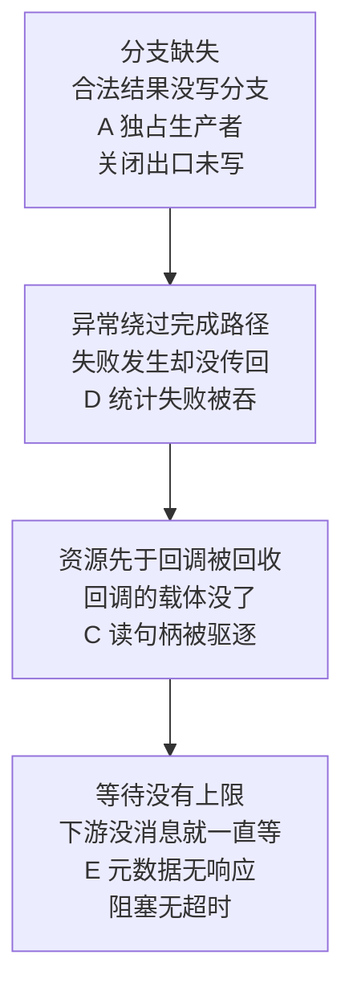
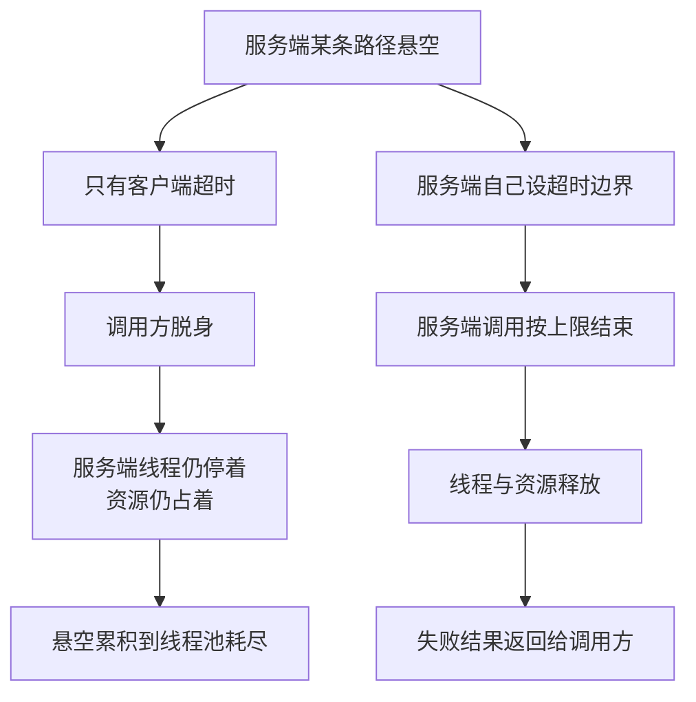

# 案例八：承诺没有兑现——Pulsar 里六个永不返回的请求

**异步调用发出去之后，既不成功也不失败，就是不返回——客户端卡到超时，比崩溃更难缠**。**读完这篇你能看出回调承诺是怎么在漏写的分支、被吞掉的异常里失守的**。

> **要点**：**一个异步调用一旦交给下游，就必须保证回调在每条路径上都被触发**。Pulsar（分布式消息队列）的**六个病例展示了这条保证是怎么在漏写的分支、被吞掉的异常、提前回收的资源和没有上限的等待里失守的**——**请求不报错、不返回，只是永远悬着**。

**崩溃至少是诚实的：进程终止了，监控能看见，告警会响**。这类缺陷相反——调用发出去之后**既不成功也不失败，就是不返回**。**客户端卡到超时，线程被占住，错误率还是零**。要解决的问题是：这种"不返回"在哪几处断掉，为什么它比报错更难处理。

六个病例全部来自 Apache Pulsar 的上游修复，**分布在 broker（服务节点）、managed-ledger（broker 里管理消息存储账本的那一层）、元数据访问三条互不相邻的链路上，断法高度同构**。

两个词先说好：future 指"稍后才会被填上结果的占位对象"，标题里的"承诺"说的就是它；**P1、P2 是本系列给缺陷定的严重等级，P0 最高**。

单集群视角的官方架构图把三条链路的位置摆出来：请求从生产者与消费者两侧到达无状态的 broker，落到 BookKeeper 集群与元数据存储——**本篇六类「永不返回」的请求，悬住的位置都在这几段边上**：

*图源：[Pulsar 官方文档 Architecture Overview](https://pulsar.apache.org/docs/concepts-architecture-overview/)（页面截图，2026-09-27）。六类断点分别对应图上 broker 内部各处理阶段、到 bookie 的写路径与到元数据存储的读路径——**链路分段是定位悬空请求的第一张地图**。*

病例 E 提到的元数据存储，在这张多集群视角的官方架构图里看得更清楚：**每个集群有自己的本地 ZooKeeper 保存集群内配置，跨集群的租户、命名空间与复制配置存在实例级的配置存储里**——**那条被阻塞调用挂住的链路，正是 broker 对这两类元数据存储的同步访问**：

*图源：[Apache Pulsar 官方文档 · Architecture Overview](https://pulsar.apache.org/docs/3.2.x/concepts-architecture-overview)，Apache License 2.0。*

## 要解决的问题是什么：回调的承诺在哪里断掉

**把这六例并排看，共同结构很清楚**：调用方持有一个 future 或回调，期待它在未来某个时刻被"完成"——**成功、失败、异常，任何一种都算完成**。悬空意味着**这条路径上没有任何代码去完成它**。

断点有四类，覆盖全部六例：

- **分支缺失**：代码处理了"有数据"和"出错"，漏掉了"数据为空""对象不存在"这些合法但没被写进分支的情况。病例 B 的空条目、病例 F 的不存在主题属于此类。
- **异常绕过完成路径**：**异常在到达 future 的 `complete` 之前就被抛出或吞掉，调用方拿不到任何信号**。**病例 D 最典型——底层失败已经发生，只是没被传上来**。
- **资源先于回调被回收**：**句柄、连接、上下文在回调触发之前被关掉，回调的载体没了**。病例 C 的读句柄（程序持有的资源引用标识）驱逐（按策略移除条目或实例）是这一类。
- **等待没有上限**：下游既不成功也不失败，调用方这一侧又没有给等待设期限，于是它替下游把"不返回"原样传了上去。病例 E 的阻塞调用是这一类，**它与前三类的区别是失败根本没有发生，只是永远没有消息**。

病例 A 稍微特殊：没有异常，也没有竞态（结果取决于执行时序、因而不可重现的并发缺陷），只是**状态迁移漏了一个出口**——**共享生产者关闭是一个明确的状态变化，却没有触发等待队列里的下一个状态**。可以归到分支缺失：出口分支没写。

六例各自落在哪一类断点上，一张图对上：

六例归到四类断点之后，同一类里的病例只是链路不同。**审查一段异步代码时按这四类各问一遍，比逐个功能点读更容易把漏网的路径数出来**。

这些「链路」在机房里有对应的实物：**请求从客户端到存储层要经过配线架与交换机（在局域网内按地址转发数据帧的设备）的每一级端口，任何一级松了，等待就发生在那一段线缆上**。下图是一个布满级联端口的机柜——悬空的请求就悬在这样一条真实的链路里。

> 图：机柜内的配线架与级联交换机，来自 [Wikimedia Commons](https://commons.wikimedia.org/wiki/File:19-inch_rackmount_Ethernet_switches_and_patch_panels.jpg)，CC BY-SA 4.0，摄影 Dsimic。

**这四类断点的共同点是，它们在正常路径上都不可见**。功能测试跑的是"有数据""正常返回""正常关闭""下游在线"，恰好绕开了全部四类。

## 哪六条路径会让回调悬空
**病例 A · 独占生产者的排队窗口**（[上游 commit 102fdb3a](https://github.com/apache/pulsar/commit/102fdb3a09d883b2d3b41a2e83ebabcb53d995f1)，P1）。**Pulsar 允许一个主题同时有多个共享生产者，也允许申请独占访问的生产者排队等所有共享生产者退出**。**主题上最后一个共享生产者关闭时，队列里等待独占访问的生产者应当被提升接替**。**目标版本没有做这个提升，于是创建独占生产者的客户端一直等到超时**。改动对应到 `AbstractTopic.java`——补上关闭时的提升逻辑。

**病例 B · 空条目的读取**（[上游 commit c8872591](https://github.com/apache/pulsar/commit/c8872591e2e87cb7f537d9978905e1fc3ba1b618)，P1）。**managed-ledger 的游标（记录订阅读到哪里的指针）向 BookKeeper（Pulsar 的存储层）发起异步读**，**底层返回空结果时，读请求没有走到完成分支，`OpReadEntry` 的回调永远不触发**。**消费者收不到消息，也不报错，只能重连或重启**。

**病例 C · 分层存储的读句柄被驱逐**（[上游 commit dcbe23f9](https://github.com/apache/pulsar/commit/dcbe23f94a83658649e4eb6111ce0f2e2f5e3cc0)，P2）。**Pulsar 会把老数据从 BookKeeper 搬到对象存储（分层存储，搬过去的叫已卸载）**，**读这些数据要通过一个读句柄，长时间没人用的句柄会被空闲驱逐逻辑关掉回收**。**空闲驱逐恰好命中仍在进行的读取，把读句柄关掉。这次读取就此永久悬空，消费回溯和 seek（把订阅位置拨到任意一条消息）一起卡住**。

**病例 D · 真实的错误被吞掉**（[上游 commit 2b85b875](https://github.com/apache/pulsar/commit/2b85b8752b5ae00fb197e19ccd0476335e5e860a)，P1）。**事务元数据查询依赖底层统计信息，统计获取失败时，失败没有沿着 future 传回调用方，请求挂到超时**。**合入后同一查询立即以真实异常结束——调用方不只是不用干等，还能拿到失败原因去重试**。

**病例 E · 元数据无响应时的阻塞调用**（[上游 commit cbeff98d](https://github.com/apache/pulsar/commit/cbeff98d513564418f4d800d04208d4206335c4e)，P2）。**元数据存储（ZooKeeper 这类保存集群成员与账本位置的服务）不响应时，存储节点注册、账本布局查询、副本管理这些阻塞调用没有超时边界，线程一直停在那里**。**改动给它加了超时上限**。

**病例 F · 404 缺失**（[上游 commit e15aedfc](https://github.com/apache/pulsar/commit/e15aedfcb3e393745a771fae7030a138e87d07fc)，P1）。对不存在的非分区主题（不切分区、直接以主题名管理的主题）更新或删除属性，**服务端没有返回主题不存在的 404，管理端只能等到客户端超时**。这例修法最直观，也最能说明问题：**缺的是一个应当快速返回的失败结果**，失败本身早就发生了。
## 为什么这一类危险

**好比泳池里的静默溺水者：不喊救命、水面平静，只是慢慢下沉**。**救生员盯着「有没有人呼救」这个指标，永远不会抬头**；这样的人一个个增多，直到占满救生能力。

**它伪装成慢。** **请求不返回，监控看到的往往是延迟升高、队列堆积、线程数上涨，错误率纹丝不动**——**对着错误率配置的告警一条都不会响**。难就难在：延迟和堆积天然每天都在波动，从中认出"这一波不一样"，需要基线（正常状态下的指标水平、用来对比异常）意识。

**它会累积。** **悬空的请求不会像崩溃那样释放资源重来——每个悬空调用都占着一条线程、一份连接资源**。**病例 E 里线程停在无上限的调用上，累积到线程池耗尽，整个 broker 失去响应能力**。

**超时掩盖了它，也治不好它。** **客户端超时能让调用方脱身，但服务端那条悬空的路径还在，资源也没释放**。超时把"无限等待"变成"有限等待"，没有修复不返回本身。**病例 E 的修复是在服务端给阻塞调用加超时边界，客户端超时是另一层兜底，替代不了它**。两种超时各自能收回什么，摆在一起看：

**只有客户端超时的那条链路，解放的只是等待的一方，问题的载体原封不动**；**服务端自己设超时边界，才是在问题发生的那一端给出终态，资源跟着释放**。**判据看资源由谁释放：等待方脱身不算修复，载体一方给出终态才算**。

## 上游怎么修

六个修复的方向一致：**枚举出每条会让回调不完成的路径，给它一个明确的终态**。**空条目走完成分支并触发回调；读句柄有在途读时不驱逐；异常沿 future 传回而不是吞掉；阻塞调用加上超时边界；不存在时返回 404；共享生产者关闭时提升等待者**。

病例 C 的修法值得对照修复前看。修复前，句柄"是否空闲"由最后访问时间戳判断，而时间戳在读**开始**时刷新——**一次跑得久的读，中途看起来就像很久没人碰过**。**修复给读句柄加了一个在途读计数 `pendingRead`：读开始加一、结束减一并刷新时间戳，空闲驱逐只考虑计数为零的句柄**。**"有没有人在用"从一个时间推断变成一个计数事实**，驱逐不再需要猜。

## 同一类问题还会在哪些现场出现

同一条"回调必须被完成"的保证，在 Pulsar 的另外三条链路上以不同面目出现。病例 A 与「栈溢出导致的订阅失败」都发生在订阅这条链路上——Pulsar 的订阅模式决定了消费者怎么挂到主题上，独占订阅只允许一个消费者挂上来，其余的请求全部被拒绝：

*图源：[Apache Pulsar 官方文档 · Subscription types](https://pulsar.apache.org/docs/concepts-messaging/)，Apache License 2.0。*

- **客户端故障切换的健康检查任务**（[上游 commit 8214bfde](https://github.com/apache/pulsar/commit/8214bfded94bdcff695c3b67eb2373345745c712)，P1）**被异常打断后不再运行，集群故障后无法自动切回健康集群**。周期任务被打断，本质上也是"承诺的下一次执行没有发生"。
- **去重主题的加载回放**（[上游 commit 0444514a](https://github.com/apache/pulsar/commit/0444514a3f30607f834fb0430a0dbd40ff5b9041)，P1）——开了消息去重的主题在加载时要重读一遍"哪些消息已处理过"的标记，遇到读取或解析异常时不结束这次重读，加载请求一直等到超时。
- **栈溢出导致的订阅失败**（[上游 commit e98e8443](https://github.com/apache/pulsar/commit/e98e8443c526a025914e624686775867f7b28088)，P1）是这条保证的对立面：**回调触发得太深——独占订阅在活跃消费者连接关闭过程中接受新消费者，沿同一线程无限递归**。**修复改成有次数上限的异步延迟重试**。

**预期空条目读取与请求不存在的主题都返回明确结果；修复前实测不返回也不报错，与预期对不上**。

## 用了能拿到什么，要付什么代价

升级后的审查方式：不靠「没报警就是健康」，按"回调有没有被完成"逐条过异步代码——**空结果、对象不存在、句柄被回收、下游无消息这些合法情形逐项写进判定清单并给出终态，服务端的超时边界不再由客户端代偿**。代价有两笔：每条异步路径要多列一份"合法但没有结果"的分支清单，评审时间比按功能读代码长；把"不返回"当独立故障类别监控，要新增 pending 时长分布与未完成 future 存活时间这类指标，现有的错误率告警对它无效。比喻到「逐项列正常值」为止。

## 这套说法在哪儿会失效，代价换来了什么教训

**「阴性」也是一种结果：记录「没检出异常」本身是检验动作的一部分（空、不存在、零长度都是合法结果，要显式写进报告）**；**只记录「检出即报警」（只盯错误率），永远漏掉全部阴性项**。

- **审查异步代码时，枚举的是"回调不完成的路径"。** **出错且被正确处理，不构成悬空；出错但没走到 `complete`，才构成**。"可能出错的路径"是另一份清单，代码形状完全不同。比喻到「阴性也是结果」为止。
- **空、不存在、零长度、已关闭，都是合法结果。** **它们没有异常可抛，`catch` 兜不住，却常常被漏写成分支**。
- **资源回收要等进行中的操作结束。** **关句柄、关连接、释放上下文之前，先确认没有未完成的操作依赖它**。
- **服务端的超时边界是可用性设施。** **依赖客户端超时来兜底，等于把服务端的问题外包给调用方，资源仍留在服务端**。
- **把"不返回"当成一个独立的故障类别去监控。** 只盯错误率会漏掉它；**pending 时间分布、future 未完成的存活时长、线程池占用趋势，才是这一类缺陷的报警位置**。

## 怎么自己动手验证

1. 上游对照：**到 Pulsar 的提交 102fdb3a、c8872591、dcbe23f9、2b85b875、cbeff98d 与 e15aedfc 里逐条核对六处修复，确认独占生产者的提升、空条目读取、读句柄驱逐、错误上抛、超时上限与 404 返回各自的改动位置**。
2. 分支缺失复现：**分别投递空条目与请求不存在的非分区主题，修复前对应的读请求与属性更新调用不返回也不报错，修复后空条目继续推进、不存在的主题返回 404**。

3. 异常绕过复现：**让底层统计信息获取失败，修复前失败不沿 future 传回、请求挂到超时，修复后同一查询立即以真实异常结束**。
4. 资源回收复现：**在读取已卸载数据的过程中让空闲驱逐命中仍在进行的读取，修复前该读取永久悬空、消费回溯与 seek 一起卡住**。

5. 超时边界复现：**让元数据存储不响应，修复前注册与布局查询的线程一直停住，修复后按超时上限结束**。
6. 断言锚点：**六条路径各自的修复前后行为留档，悬空请求的表现特征（不报错、不返回、占住调用方）被逐条确认**。

## 接着读哪几篇：永不兑现的 future

- 异步路径上的资源与生命周期责任——[[工程知识/后端系统：在并发、失败与变化中维持服务/任务与并发/任务生命周期必须覆盖进程、日志、超时与清理]]。
- 可观测性（通过系统对外输出判断内部状态的能力）为何对"静默"类失效——[[工程知识/性能工程：从用户等待到资源瓶颈/观测与诊断/性能问题定位]]。
- [[工程知识/缺陷分析：从个案到体系/稳定性/案例二十一：异常路径上没有完成——永不兑现的 future]] 是病例 B、F 与同族现场里去重回放的机制剖面，讲那一行兑现动作为什么会被漏掉。
- [[工程知识/缺陷分析：从个案到体系/稳定性/案例一：垃圾回收线程的终止——BookKeeper 磁盘写满]] 讲"周期任务被异常打断后不再运行"的另一个实例。
- [[工程知识/缺陷分析：从个案到体系/正确性/案例九：数字越过了边界——Redis 里三次截断导致的崩溃]] 是对照组，崩溃这种"诚实的失败"长什么样。
- 分析方法见 [[工程知识/缺陷分析：从个案到体系/缺陷分析方法——三分离、判定树与五步法]]。
