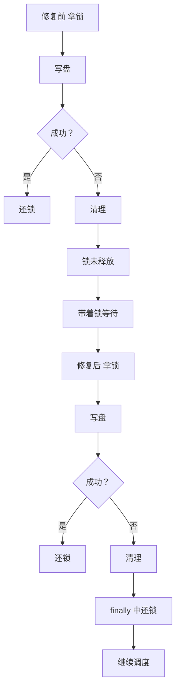
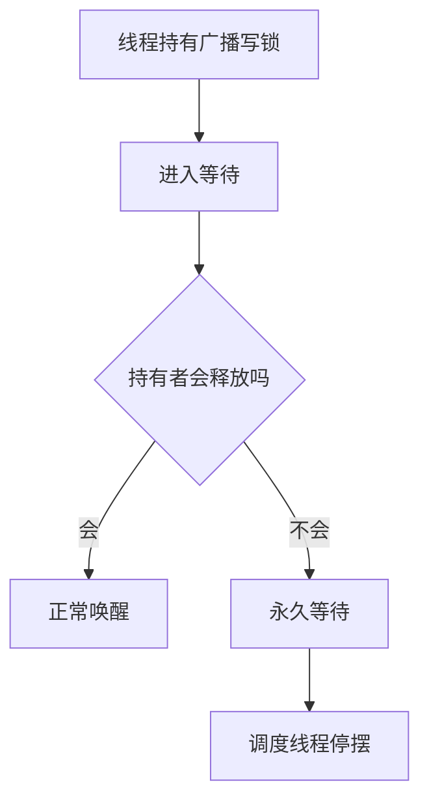

# 案例十二：调度线程的永久等待——广播写锁不释放

一个异常路径上缺失的 finally，把"一次写入失败"放大成"所有后续作业都无法调度"。**读完这篇你能挡住这类锁不释放的连锁反应**。

> **要点**：**广播数据写盘失败时，清理路径没有释放块写锁，持有等待语义的调度线程永远等了下去**——一个异常路径上缺失的 finally，把"一次写入失败"放大成"这个应用的所有后续作业都无法调度"。

**这类缺陷值得单独占一篇，是因为它的输入和后果之间隔得太远：一次本地磁盘写入失败，最终让整个应用再也调度不了任何作业**。**中间没有报错、没有崩溃、没有重启，只有一个线程安静地等着一把永远不会归还的锁**。理解它需要把"异常路径上的资源释放"和"锁的等待语义"这两件事连起来看。

## 要解决的问题

**本篇要解决的问题是：一次本地磁盘写入失败，怎样经过一条缺失的资源释放，放大成全局调度停滞**。**答案涉及两处机制——异常路径上的资源释放，以及锁的等待语义**。

## 从一句缺陷描述怎么开始定位

缺陷描述只有一句：

> **广播数据写入本地磁盘失败时，块写锁不释放，后续作业无法调度**。

**初读的人心里会冒出三个疑问，每一个都打在要害上**：

1. **写失败就失败，为什么会"卡住"？** 失败不是应该抛个异常、报个错、继续往下走吗？
2. **锁不释放，影响的应该只是"这一次广播"吧？** 怎么会变成"后续所有作业"？
3. **为什么没有任何报错？** 失败好歹留条日志，这条连痕迹都没有。

**这三个疑问的答案，恰好就是这类缺陷的全部本质**。先立一个比喻，把机制分开来看。

来源：[博客园《解密 Raft算法》](https://www.cnblogs.com/traditional/p/12588733.html)（CC 4.0 BY-SA）

来源：[小林coding《进程、线程基础知识》](https://www.xiaolincoding.com/os/4_process/process_base.html)

## 银行柜台这个比喻怎么对应到系统

| 现实 | 比喻 |
|---|---|
| 调度事件循环线程 | 银行**柜员**——所有业务都要过她的手 |
| 块写锁 | 柜员手里的**公章**——盖章才能办下一笔 |
| 广播数据写盘 | 办理**一笔具体的业务** |
| 写盘失败 | 这笔业务的**材料有问题** |
| 清理路径不释放锁 | 业务办砸了，**章没还给柜台** |
| 后续作业无法调度 | 柜员空着手站在那儿，**整个银行不办业务** |

正常流程：拿章 → 盖章办业务 → **把章放回柜台** → 叫下一位。失败流程：拿章 → 办业务 → 材料有问题 → 转入善后处理 → **善后的人忘了把章放回去**。**柜员没有章，叫号系统还在叫号，队伍越排越长——银行表面上开着门，实际上什么业务都办不了**。

急停旋钮给"锁在故障态不归还"提供了实物：工业设备的急停旋钮按下后设备全停，而它的设计前提是**必须有人旋转复位**——复位这个动作缺席，机器就永远停在停机态，看起来安然无恙，再也不会动。**块写锁是同一条命运：写盘失败走进异常路径，释放锁的清理动作缺席，锁被扣在故障态里——调度线程像那台没人复位的机器，等着一把永远不会还回来的钥匙**：

*图源：Wikimedia Commons，Flygklubben，CC BY-SA 4.0，https://commons.wikimedia.org/wiki/File:Emergency_stop_button_on_a_HAAS_CNC.jpg。*

这里的结构性原因值得说透：**写锁的获取和释放写在两条代码路径上**。正常路径"拿锁 → 写 → 还锁"写得清清楚楚；失败路径"出错了 → 清理 → （这里忘了还锁）"。还锁的道理程序员都懂，**分歧出在清理代码的作者和加锁代码的作者关注的场景不同**——清理逻辑通常在事故之后补写，补写的人盯着"把失败现场收拾干净"，锁这件事不在他的视野里。这正是案例一里 Bookie（BookKeeper 里负责存数据片段的服务实例）垃圾回收线程终止的同一个结构性原因：**异常路径是人少的路径，人少的路径没有人审。**

## 三个疑问逐层怎么回答

**好比医院一把公用钥匙管着唯一通道：值班员借走钥匙去处理急事（写失败），处理完忘了还（清理路径漏释放），而等钥匙的人没有任何「最多等多久」的约定（等待无超时）**——**之后每个要用通道的人（后续所有作业）都排在门外，队伍无声变长**。

**疑问一：写失败为什么会卡住，而不是报错？**比喻到「借走不还加无限等」为止，两次失败的账见下文。

**因为失败发生了两次，卡住发生在第二次**。第一次失败是"写盘失败"——它确实抛了异常。第二次失败藏在**清理路径**里：**清理代码要处理半成品文件、要更新状态、要释放资源——锁的释放被遗漏在这一段里**。而**锁的等待方没有超时语义**：调度线程等锁的方式是"一直等到锁可用"，没有"最多等多久"。**于是第一次失败的后果把一个没有超时的等待挂进了系统，而不是报错**。

这里有一条可迁移的判断：**凡是"失败后进入清理"的代码，要按完整业务来审**——清理自己也可能失败，清理涉及的所有资源都要逐一释放。

**疑问二：锁不释放，为什么影响的是"后续所有作业"？**

**这由等待者的身份决定。锁的等待者如果是单个请求，爆炸半径就是这一个请求**；本例的等待者是**调度事件循环（反复取出队列里的回调执行的调度机制）线程**——它负责把所有排队的作业一个个推上执行。**它等锁，等于整条流水线停线**。这也是审这类缺陷时的关键一问：**谁在等这把锁？** 等待者越多、越核心，一个未释放的锁就越接近全局故障。

**疑问三：为什么没有任何报错？**

有两个"没有"。第一，写盘失败的那次异常被清理路径处理了，处理完没有继续向外抛——失败被"就地消化"。第二，等锁的线程没有超时，它不认为自己在故障中，它认为自己"还在正常等待"。两边都不觉得自己该报警。**静默的停摆比崩溃更难发现**：崩溃有尸体（堆栈、core），静默停摆只有一个"一切正常但就是不干活"的进程。

## 这类问题还在哪儿出现过

和 [[工程知识/缺陷分析：从个案到体系/稳定性/案例一：垃圾回收线程的终止——BookKeeper 磁盘写满]] 并排放着看：Bookie 终止在磁盘上，Spark（分布式计算引擎，靠内存计算加速大规模数据处理）终止在调度队列里，不变量是同一个——**异常路径上少一个 finally，一次错误就升级成永久停摆**。和 [[工程知识/缺陷分析：从个案到体系/稳定性/案例八：承诺没有兑现——Pulsar 里六个永不返回的请求]] 也互为印证：Pulsar（分布式消息队列）的六个病例是"回调没有被完成"，本例是"锁没有被释放"——本质都是**某个承诺（完成回调、释放锁）只在正常路径上被兑现，异常路径上成了空头支票**。

修复互为印证：Bookie 补"跳过并记录"，Pulsar 给每条悬空路径一个终态（流程结束后不再变化的状态），Spark 补 try/finally——三个项目、三种表述，剪断的是同一根传导链。

## 上游怎么修

修复（[上游 commit b95a7710](https://github.com/apache/spark/commit/b95a77107a6f9e91e1a1ad57e7efd6b90c5517f8)）**把锁的释放挪进 try/finally 的保障范围：无论写入成功还是失败，控制流必然经过释放**。改动本身极小——把释放语句的位置和执行保证调整一下。这一族的共性再次成立：**发现的成本远高于修的成本**。

等锁的线程在转储里呈现成什么形态，是这类事故唯一能拿到的现场：

图取自 [perfmatrix 的线程转储分析页](https://perfmatrix.com/thread-dump-analysis/)，927×349。图上把"谁在等谁持有的锁"画成传递关系，正对着本篇的判据：等一把无人归还的锁时，转储里只有一条单向的等待边，没有环——它不是死锁（一组进程互相持有对方需要的资源、谁都推进不了的状态），死锁检测抓不到它。

## 这一例怎么复现、怎么验证修好了

**这一例已实际复现。复现的构造方式是让广播写入的本地目录不可写——触发写入失败，然后观察调度线程的状态**。**修复前，线程停在对写锁的等待上，应用日志中没有与该失败相关的错误；修复后，写入失败正常抛出，锁被释放，后续作业继续调度**。

验证要盯的**指标**调度线程的状态：它是否仍阻塞在同一把锁上，而不是错误数。**这个缺陷不产生错误日志，靠日志检索发现不了它，只能靠线程转储或等待时长的观测**。

**调度线程状态要与写入失败对账——预写广播写入失败后应抛错并释放写锁，实测线程停在等待写锁上且日志无相关记录，与预期对不上**。

## 这套说法在哪儿会失效，代价换来了什么教训

**四条边界要事先写清楚：服务不服务、等多久给个说法（等待必须有边界）、不来了怎么处置（清理按完整业务审）、谁等不起（等待者身份定爆炸半径）——都写在明处，等待才不会静默积压成事故**。

- **"拿锁 → 干活 → 还锁"的代码，固定问一句：活干砸了，锁还吗？** **异常、超时、中途取消，每条路径都要走一遍这个问题**。比喻到「规则上墙」为止。
- **等待必须有边界**。没有超时的等待是把控制权交给对方——对方出任何问题，都变成你的永久停摆。给等待加上限，停摆才会变成"一次失败"。
- **清理代码按完整业务审查**。它处理的是异常现场，它自己也可能有异常；它触碰的每一份资源都要逐一确认释放责任。
- **等待者的身份决定爆炸半径**。修这类缺陷之前，先画清楚：锁的等待者是谁，等待会沿着调用链传导到哪里。

## 怎么自己动手验证

**永久等待的根因不在等待本身，而在释放路径断了**：

1. 上游对照：**到 Spark 的提交 b95a7710 里核对修复方式，确认清理路径补上了释放块写锁的动作**。
2. 机制复现：**让广播数据写盘失败，修复前块写锁未释放、调度事件循环线程持续等待，该应用的所有后续作业都无法调度；修复后锁被归还，后续作业正常调度**。

3. 路径核对：**逐条检查持有该锁的代码路径，确认异常分支与清理分支都走到释放动作；核对等待该锁的一方是否存在超时上限**。
4. 无痕特征确认：**修复前该故障不产生任何报错日志，只有线程停住这一现象，这一点在复现记录中明确写出**。
5. 断言锚点：**锁的获取与释放在同一代码范围内成对出现，异常路径有释放动作，等待方有上限或可观测的停滞信号**。

## 接着读哪几篇：同在缺陷分析里的相邻问题

- 后台任务的生命周期与清理责任——[[工程知识/后端系统：在并发、失败与变化中维持服务/任务与并发/任务生命周期必须覆盖进程、日志、超时与清理]]。
- 等待与超时的语义约定——[[工程知识/后端系统：在并发、失败与变化中维持服务/分布式可靠性/超时、重试与幂等共同定义调用语义]]。
- 锁的等待者视角——[[工程知识/后端系统：在并发、失败与变化中维持服务/任务与并发/并发控制先定义共享状态和完成条件]]。
- [[工程知识/缺陷分析：从个案到体系/稳定性/案例一：垃圾回收线程的终止——BookKeeper 磁盘写满]] · [[工程知识/缺陷分析：从个案到体系/稳定性/案例八：承诺没有兑现——Pulsar 里六个永不返回的请求]] · [[工程知识/缺陷分析：从个案到体系/缺陷分析：从个案到体系——导读与开源地图]]
