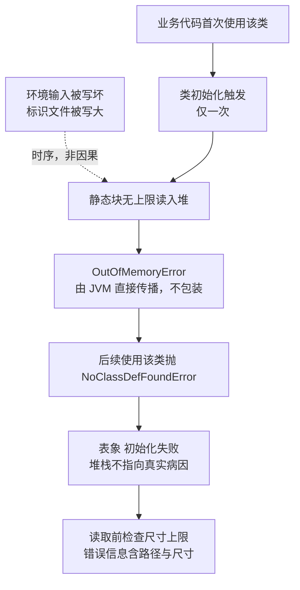
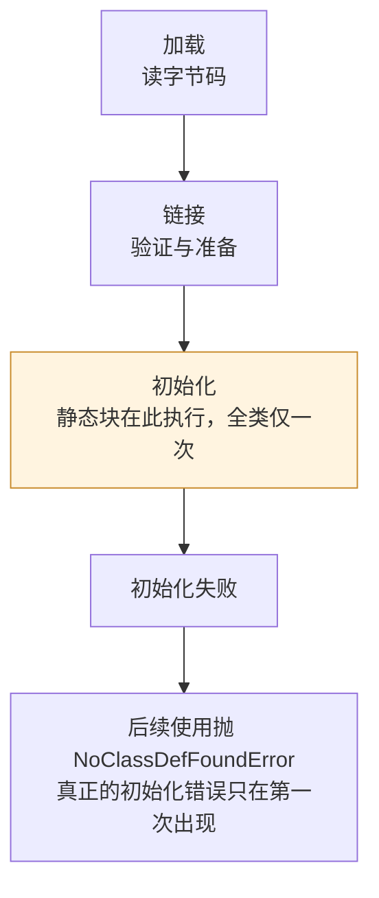
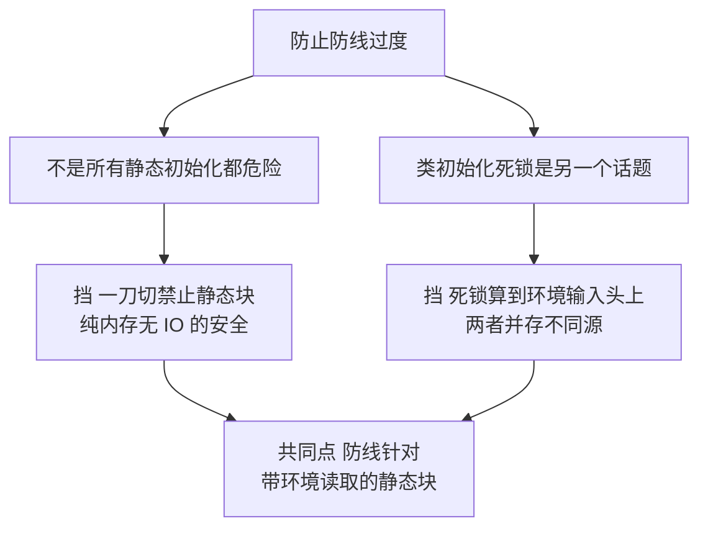
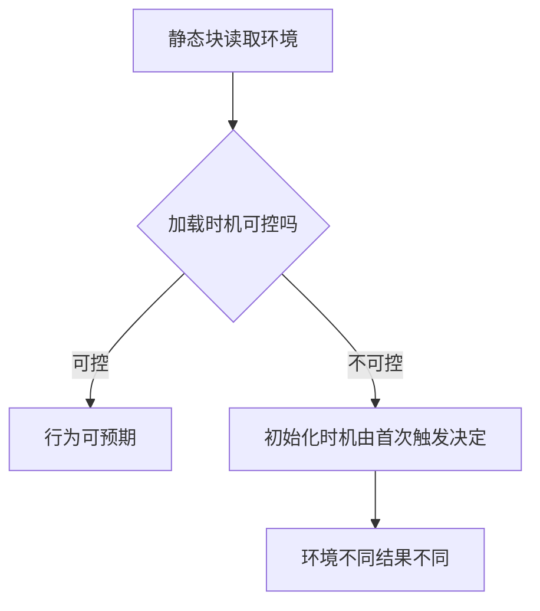

# 类初始化的隐式输入：静态块里的环境读取

**类的静态初始化会执行代码、读取环境，这段隐式代码没有入口检查也没有降级（主动牺牲部分功能或精度，保住核心链路）路径**。**读完这篇你能识别这类隐式输入，避免进程在启动路径上终止**。

> **要点**：类的静态初始化会执行代码、读取环境，这段隐式代码没有入口检查与降级路径——**它依赖的环境输入被写坏时，用到该类的进程会在初始化这一步失败——若该类位于启动关键路径，进程随之终止，且堆栈与真实病因隔了一层**。

## 要解决的问题

来源：[JavaGuide](https://javaguide.cn/high-availability/timeout-and-retry.html)（CC 4.0 BY-SA）

**进程启动失败，堆栈指向一个与业务毫无关系的第三方类（网络库、序列化库）的初始化，真实病因却在环境里——这是启动类故障最迷惑人的形态**。**Apache BookKeeper 的一个真实病例（上游修复 commit 48bcef70，可查）把链条走全了**：**某个被 Netty 静态初始化读取的系统标识文件（容器环境中由平台维护）被异常写大到超出 JVM（Java 虚拟机，Java 程序的运行环境）堆上限**；**bookie（BookKeeper 的存储服务端进程）与客户端启动时 Netty 进入类初始化，静态块读取该文件，一次读入内存直接堆耗尽**——**进程起不来，表象是网络库初始化失败，根因是一个与网络毫无关系的文件尺寸**。

这类故障的通用结构值得单独成篇：**静态初始化是一段隐式执行的代码**——没有 main 入口那样的显性地位，没有启动检查、没有降级路径，**却在类首次被主动使用时必然执行，且全生命周期仅此一次，且执行环境（堆大小、文件系统、环境变量）完全可能不满足它的假设**。静态块里的每行代码都是"进程能不能起来"的一部分，但没人按这个标准审查它。



环境与触发是两条独立的线：文件被写坏与"业务代码首次用到该类"之间没有因果关系，只是恰好在同一时段发生，所以用虚线标注时序。三处修复的作用也不同——前两处切断链条，第三处不切断任何环节，只把定位时间从几天压到一眼。


**那条从表象绕回根因的虚线是这类故障最难的地方：堆栈把人引向网络库，真实病因在一个与之无关的文件上**。三处修复点分别切断链条的不同环节。

**静态块跑在类生命周期的哪一步，决定了它失败之后是什么现象**：



JVM 规范定义的完整生命周期是下面这七个阶段，**静态块执行在初始化阶段——加载到初始化之间还有链接的三个子阶段，这是理解「同一份字节码，不同环境不同命运」的坐标系**：


*图源：JavaGuide《类加载过程详解》（oss.javaguide.cn），CC BY-NC-SA 4.0，https://javaguide.cn/java/jvm/class-loading-process.html。*

**链接里的验证阶段自己再分四步，每步挡一类坏输入**：**文件格式验证拦不符合 Class 文件规范的字节流（魔数 0xCAFEBABE、版本号范围、常量池类型），元数据验证做语义分析（有没有父类、final 类有没有被继承），字节码验证走数据流与控制流分析（参数类型、类型转换是否合法），符号引用验证确认引用的目标真实存在且权限合法**——「环境读取」类的故障里，有一部分就是验证环节在特定环境下才暴露的引用不存在：


*图源：同上（JavaGuide《类加载过程详解》），（oss.javaguide.cn）。*

**解析阶段把常量池里的符号引用换成直接引用，两者的差别决定了「同一个符号在不同虚拟机实例上翻译结果不同」**：**符号引用是一组无歧义定位目标的字面量，与内存布局无关，格式定义在《Java 虚拟机规范》的 Class 文件格式里；直接引用是可以指向目标的指针、相对偏移量或句柄，与虚拟机的内存布局直接相关——解析发生在此刻，静态块读到的环境差异就在此刻固化**：


*图源：同上（JavaGuide《类加载过程详解》）。*

## 它是怎么做到的：隐式执行的三个特征

**静态初始化（静态字段初始化器、static 块）与普通代码有三个结构差异，每个差异都是风险源**。

**触发不可见**：**静态初始化在类首次被主动使用时触发：实例化、读写静态字段、调用静态方法、子类初始化联动、作为 main 类启动、`Class.forName`**。**例外是编译期（代码编译成可执行文件时发生的阶段）常量——访问 `static final` 的基本类型或字符串常量不会触发初始化，因为值已在编译期内联**。哪行业务代码会"第一次碰到"这个类，编译期看不出来——依赖图里一条边的变化就能改变触发点。故障因此表现出"随机性"：同样的代码，走到不同分支，不同进程崩在初始化处。

**执行无降级**：**静态块抛出的普通异常被 JVM 包装为 `ExceptionInInitializerError`；若是 `OutOfMemoryError` 这类 Error（Java 中表示严重故障、通常不可恢复的错误类型），则由 JVM 原样向上传播，不做包装**。**两种情形下该类都被标记为初始化失败，后续使用它的代码会收到 `NoClassDefFoundError`**。**它没有 try-catch（捕获并处理异常的语句）的恢复语义——初始化失败的类按定义是坏的**。**普通代码读文件失败可以降级（用默认值、跳过功能），静态块读文件失败则会让该类永久不可用；当这个类在启动路径上时，结果是进程终止**。

**依赖不声明**：**静态块里读什么文件、用什么环境变量、连什么地址，这些依赖不出现在任何接口上**。运维改了一个"不相干"的文件（比如清理日志目录时动了标识文件），没有任何机制提醒"这会影响进程启动"。

三个特征叠加的后果：静态块里的环境读取成为**无人审查、无降级、依赖不透明的启动关键路径**。它正常运行时不可见，失效时以最意外的方式把进程放倒。

## 为什么静态块里会有环境读取

**为静态块辩护的设计动机是真实存在的，理解动机才能给出替代方案**。

**"只做一次"的缓存动机**：环境探测（CPU 核数、内存页大小、操作系统特性、本地库加载）结果全局不变，静态块是天然的"执行一次、全局共享"位置。Netty 在静态块里探测平台特性、加载本地库，动机正当。

**框架的透明性动机**：**框架希望使用者无感——不用调初始化函数，用到即完成就绪。隐式初始化换来的是接入成本低，代价是把初始化时序的控制权交了出去**。

"上电那一刻读什么就执行什么"是加载环节最老的形态。下图是 IBM 1402 读卡机（IBM 1401 系统的卡片输入部件）：1401 的开机流程 IPL（Initial Program Load，初始程序加载）从读卡机的送卡箱里把第一叠卡片读进去执行——**机器加电后跑什么，取决于送卡箱里压的是哪叠卡，这个输入在按下启动键之前就定了，机房操作员没有任何参数可传**。**静态块里的环境读取把这套时序原样搬进了 JVM：类加载即执行，读到的环境与当年送卡箱里的卡片一样，是写在启动序列里的隐式前提**。


> 图：IBM 1402 读卡机（Computer History Museum），来自 [Wikimedia Commons](https://commons.wikimedia.org/wiki/File:IBM_1402_at_CHM.jpg)，CC BY 2.0，摄影 Phil Hollenback。

动机正当不等于实现安全。替代结构同样能满足这两个动机，且把风险暴露出来：**惰性初始化单例**（首次使用时检查环境、失败给出明确错误）、**显式启动钩子**（进程启动序列里主动调用初始化，失败在启动日志最前面）。**替代方案多一行业务代码，换来的是可审查、可降级、可诊断**。

## 修完之后靠什么防住复发

**上游修复的动作是对齐职责：出问题的读取移出静态初始化，放到显式的启动路径，文件异常时给出可诊断的错误而不是堆耗尽**。防线体系按层次排：

**静态块里只放纯内存计算**：常量表、映射结构、无 IO 的派生值——这些放进静态块是安全的。静态块里出现文件读取、网络探测、本地库加载，一律视为需要评审的信号。

**环境读取要限量与校验**：**确需在启动早期读环境文件（身份标识、配置），读取前检查尺寸（超出合理上限即报明确错误）、读取时限量（不无上限读入堆）**。"文件被写大"在容器环境并非罕见——挂载错卷、日志误写、平台故障都可能，读取方的防御不能假设文件永远正常。

**启动路径的失败要可诊断**：启动序列中的每次环境读取，失败时错误信息包含"读了什么、多大、在哪读"——让运维一眼看到"标识文件 4GB"而不是一堆类初始化堆栈。诊断信息前移是这类故障修复体验的分水岭。

**依赖清单显式化**：**进程启动依赖的外部文件、环境变量列成文档或启动自检项，变更这些输入时（平台升级、挂载调整）有据可查。隐式依赖最危险的地方是没人知道它存在**。

## 这套说法在哪儿会失效

三条边界防止防线过度。

**不是所有静态初始化都危险**：纯内存、无 IO、确定性输出的静态初始化（常量表、不可变映射）是安全且高效的，防线针对的是"带环境读取与副作用（操作对外部状态产生的额外影响）的静态块"。一刀切禁止静态块是把婴儿和洗澡水一起倒掉。

**类初始化死锁（多个执行流互相等待对方释放资源）是另一个话题**：**多个类的静态块相互引用可能触发初始化死锁，那是有独立机制的并发缺陷（JLS（Java Language Specification，Java 语言规范） 12.4 有明确的锁语义），与本文讲的环境输入问题并存但不同源**。

** GraalVM 原生镜像有更严的约束**：**native-image 的静态初始化在构建期运行，环境输入问题以另一种形态出现（构建期与运行期环境不一致）**。**本篇防线的原则（显式、可诊断、限量）同样适用，细节按平台文档处理**。

这三条边界各自挡住一种把防线用过头的方向：



**三条的共同点就在最下面那一行：防线针对的是带环境读取与副作用的静态块，纯内存、无 IO、确定性输出的常量表与不可变映射是安全且高效的，一刀切禁止等于把婴儿和洗澡水一起倒掉**。**第二条把类初始化死锁单独划出去——它有独立的锁语义机制，与本文讲的环境输入问题并存但不同源，混在一起会让两类缺陷都查不清楚**。

## 怎么自己动手验证



**隐式输入的问题在于它把外部状态藏进了加载过程**：


**验证要拿的账是：启动失败的堆栈指向的类与在静态块里读取堆上限环境值的那个第三方类对不对得上**。

1. 构造环境故障：**在测试环境把目标标识文件写大到超过堆上限（或用小的 -Xmx 模拟）**；
2. 未修复基线（正常状态下的指标水平、用来对比异常）：**启动进程，观察失败堆栈——表象是第三方类初始化错误，确认根因定位耗时**；
3. 修复后重跑：同一环境故障下，启动失败信息明确指向"文件 X 尺寸 Y 超上限"，或读取方限量后跳过继续；
4. 回归固化：把"环境文件异常时启动错误可诊断"写进启动测试，任何退回隐式读取的重构当场暴露。

```text
注入 = 环境文件异常膨胀（或堆上限收紧）
诊断断言 = 失败信息包含文件路径与尺寸，而非纯类初始化堆栈
存活断言 = 读取方限量，异常文件不拖垮不相关的功能
```

诊断断言是本类缺陷的核心回归项：故障可以发生，但"表象与根因隔一层"的定位地狱不能再发生。验证时预期与实际的对照：**修复后启动失败的错误信息预期包含文件路径与尺寸，对不上（仍是一堆类初始化堆栈）即环境读取还在隐式路径上**；**限量读取生效时进程预期降级继续，对不上（仍整体崩溃）即读取点还有无上限的读入**。

## 接着读哪几篇：静态初始化的可见性与安全发布

- [[工程知识/缺陷分析：从个案到体系/稳定性/案例一：垃圾回收线程的终止——BookKeeper 磁盘写满]] —— 同批上游环境类故障的案例侧写
- [[工程知识/软件构建：让变化可以理解、验证与交付/语言与运行时/内存模型决定并发读写何时可见]] —— 静态初始化的可见性与安全发布
- [[工程知识/后端系统：在并发、失败与变化中维持服务/任务与并发/任务生命周期必须覆盖进程、日志、超时与清理]] —— 启动路径作为生命周期的一等公民
- [[工程知识/缺陷分析：从个案到体系/配置/配置类缺陷的静态防线：schema校验与默认值审计]] —— 环境输入的校验防线在配置域的展开
- [[工程知识/缺陷分析：从个案到体系/兼容与升级/发行物自检：合规文件与实际产物要一起核对]] —— 同一上游修复（48bcef70）的发行工程面：CVE（Common Vulnerabilities and Exposures，公开披露的安全漏洞编号） 升级与合规条目同步
