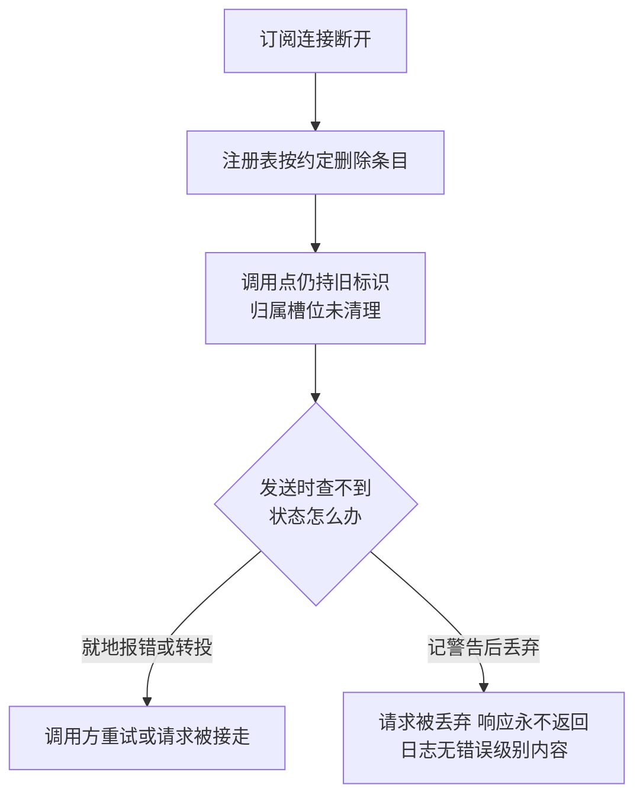

# 订阅者断线之后路由指向谁：请求被静默丢弃的识别

**整个系统里没有任何一处报错，调用方还在等待，用户看到的界面上什么也没有发生**。读完这篇你能识别这种请求被静默丢弃的故障。

一个进程按连接标识把请求发出去，收到的是「查无此状态」，于是它记一条警告，然后什么也不做。这类故障的症状稳定：**一部分请求永久等待，另一部分同类请求却正常，日志里翻不出错误级别的内容**。

## 要解决的问题

「把请求转发给确定的收件人」这套结构里，收件人由一份注册表维护。**注册表会随连接的关闭而删除条目，发送方手里却可能还留着旧的标识**。于是同一份数据有两个副本：**注册表里已经删掉，调用点的变量里还指着它**。

这种不一致本身很常见，问题在于不一致出现之后系统怎么办。三种处置方式，后果完全不同：

| 处置方式 | 调用方看到的 | 故障表现 |
| --- | --- | --- |
| 就地报错，说明收件人已断开 | 明确的失败 | 调用方可以重试、降级或终止 |
| 转投到其他可用连接的广播 | 请求被别的连接接走 | 需要接收方有能力应答 |
| 记一条警告后丢弃 | 无限等待 | 排查时没有入口 |

第三种是这里要讨论的形态。**把「明确的失败」变成了「无限的等待」，调用方无从知道自己已经被放弃**。

## 它是怎么做到的：一次断线如何变成永久等待


*图源：Wikimedia Commons《Circuit breaker pattern state diagram》，作者 MovGP0，Copyrighted free use，https://commons.wikimedia.org/wiki/File:Circuit_breaker_pattern_state_diagram.svg。这张图是"故障之后怎么处置请求"的正面参照：它清清楚楚有一个 Open 态，请求在该态下被快速拒绝。本文的订阅链路缺的正是这样一张状态机——断线之后既没人表态，而不是拒绝也不是重投。*

故障分三步，每一步单独看都合理：



### 第一步，连接断开

 订阅连接因为网络抖动（性能指标不稳定的起伏）、进程重启、空闲回收而关闭。**注册表按约定删除了这个条目，这一步是对的**。

连接断了之后发送方能不能感知，取决于对端处在哪种状态。TCP（传输控制协议，负责把数据完整、有序地送达）保活机制按对端主机四种状态分别处理，这张表把「断线」拆成了可判定的四种形态：


来源：即时通讯网（52im.net）《TCP的keepalive和http的keepalive》，https://cloud.tencent.com/developer/article/2042599（腾讯云开发者社区转载）。四种状态里只有第一种连接还活着，后三种都以断开收场——区别只在发送方多久、以何种信号知道这件事，这正是断线识别要在时间窗内抢的东西。

### 第二步，引用没跟上

 调用点保留了发送目标的标识，这个标识在注册表里已经不存在了。若归属槽位在断开时没有清理或回退，它就一直指着这条已删除的连接，见 [[工程知识/后端系统：在并发、失败与变化中维持服务/服务设计/一路会话只能有一个回复归属：多客户端接入时的所有者绑定]]。

### 第三步，发送静默丢弃

 发送函数在注册表里查不到状态，按实现记录一条警告后返回空结果。**调用方拿到的是一个空值，本该抛出的失败信号在这里被丢掉了，于是它继续等待一个永远不会到来的回复**。

**第三步是整个链条上唯一可以立刻改动的环节**。前两步需要重新设计归属策略，改动面更大；第三步只是决定「查不到状态时做什么」。这与 [[工程知识/缺陷分析：从个案到体系/稳定性/失败转移的最后一站：找不到去向的失败要留在原地报错]] 是同一条纪律：失败转移出去时，接手者必须有名字。**查无状态时那条警告日志不构成接手者，因为它不带调用方需要的失败信号**。

还有一层容易被忽略的因素：请求与事件的流量方向不同。**事件是服务端推给客户端的单向消息，用广播分发；请求是客户端发起、需要回复的往返消息，必须送到唯一收件人手里**。断线之后，广播类消息自然停止，无需处置；往返类请求则停在一个等待状态。**这解释了为什么故障常常表现为「有的功能正常、有的功能挂起」——两类消息走的是不同的分发路径**。

另有一条相关的缺陷家族：把请求与响应对上号时，键里少写了区分维度。键不完整会让请求投到错误的对象上，见 [[工程知识/缺陷分析：从个案到体系/并发/案例四十：谁在回答谁——Pulsar 连接复用与去重的键不完整]]。与本文的差别在于，那里是键算错了对象，这里是对象已经不存在。


来源：[腾讯云开发者社区《消息队列：听我解释，我真的不是只有Kafka！》](https://cloud.tencent.com.cn/developer/article/1866156)（CC 4.0 BY-SA）


## 这套说法在哪儿会失效

**广播可以缓解但不能替代报错。** 把请求转投给所有存活连接，需要接收方具备应答能力；如果接收方是只订阅事件的旁观者，**转投只是把等待换了个位置**。广播还要求请求本身能被多个接收方安全处理。

**超时是必要兜底，不是充分条件。** 加了超时之后，最坏情况有界，但调用方若把超时当成普通重试，**会重复发起已经成功过的操作**。超时预算的设计见 [[工程知识/后端系统：在并发、失败与变化中维持服务/分布式可靠性/超时的层次设计：连接、读写与整链路的预算分配]]。

**注册表与调用点的双份数据是根源，不是症状。** 彻底的做法是发送时实时查询注册表，或在断开事件上同步清理所有引用。**前者让注册表成为唯一真源，后者要求断开事件可靠触发**。

**静默丢弃可能是有意设计。** 在事件推送路径上丢弃一条过期的事件是合理的，因为事件本身就允许丢失。**判据是「这个请求的调用方是否在等待回复」，等待回复的请求不允许静默丢弃**。

## 怎么自己动手验证

复现与确认分两步。

第一步，确认请求真的发出去了。在发送函数处记录目标标识与发送结果：

```bash
grep -n 'sendToClient' "$CLIENT_LOG" | tail -20
```

第二步，确认注册表里已经没有这个标识：

```bash
grep -o 'connectionId=[^ ]*' "$CLIENT_LOG" | sort | uniq -c
```

**预期**是两处的标识集合一致。**对不上**说明发送目标与注册表内容出现了分叉，**故障已经发生**；此时再看调用的结果是否为批量出现「无结果」：

```bash
grep -c 'No state found' "$CLIENT_LOG"
```

**预期**是零。**这个计数大于零，且伴随一批没有返回结果的工具调用，就是本故障的确认证据**。

## 会带来什么影响，要付什么代价

- 查无状态时就地报错：把无限等待变成明确失败，代价是**调用方必须处理失败分支**。
- 发送时实时查询注册表：消灭双份数据，代价是**每次发送多一次查询**，且要处理「查询到发送之间又断开」的窗口。
- 断开事件上清理引用：及时性好，代价是**必须保证断开事件在所有退出路径上触发**，包括进程被强杀的场景。
- 给等待加超时：兜底有界，代价是**需要区分「超时」与「对端处理慢」两种情况**，避免把两种情况混为一谈。

## 从什么地方做

「指令还指着已拆除的线路」的实物原型是铁路信号房的扳道杆：老式信号房里每根杆连着一副道岔，线路拆除后杆还留在台面上——扳杆的司机按旧指令行车，道岔那头已经是断头轨；信号员要在拆除线路时同步撤杆（登记表清理），并在扳到空位时就地亮红灯（查无状态即报错），不能亮一下绿灯又灭掉（记条警告了事）：


*图源：Wikimedia Commons，作者 Steve Hodgson，CC BY-SA 2.0，https://commons.wikimedia.org/wiki/File:Signal_box_levers,_Town_railway,_Beamish_Museum,_9_July_2010.jpg。*

对照这四步做：撤杆对应断开事件上清理归属槽位，亮红灯对应查无状态时就地报错，红灯常亮对应失败信号直达调用方，信号房台账对应注册表唯一真源——**四步做完，"按旧指令驶向断头轨"的静默丢弃从机制上消失**。

1. **先找静默点**：在发送路径上搜索「记日志后返回空值」的写法，**列成清单**。
2. **改成就地报错**：查无状态时抛出明确错误，**说明收件人已断开**。
3. **再补超时**：给等待回复的调用加超时预算，**超时后就地失败**。
4. **最后收窄双份数据**：发送时查询注册表，或在断开事件上清理所有引用，**让注册表成为唯一真源**。

## 接着读哪几篇：同在缺陷分析里的相邻问题

- [[工程知识/缺陷分析：从个案到体系/稳定性/失败转移的最后一站：找不到去向的失败要留在原地报错]] · [[工程知识/缺陷分析：从个案到体系/并发/案例四十：谁在回答谁——Pulsar 连接复用与去重的键不完整]] · [[工程知识/AI 系统工程：从模型能力到生产能力/质量与运营/投递指针的选举与失效：连接注册表的四个健壮性缺陷]]
