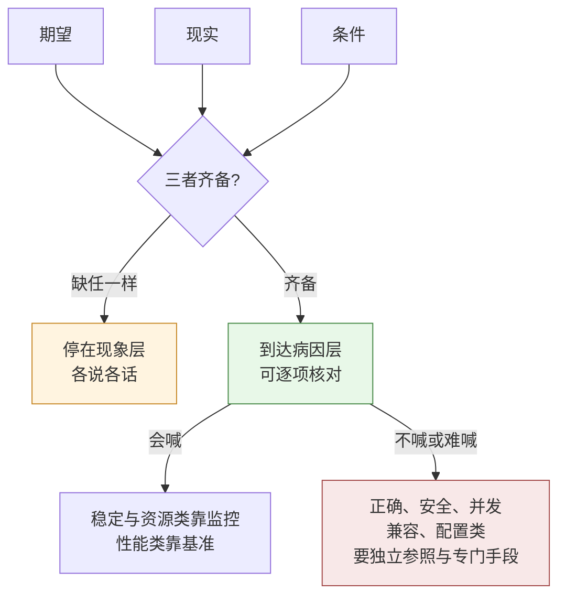
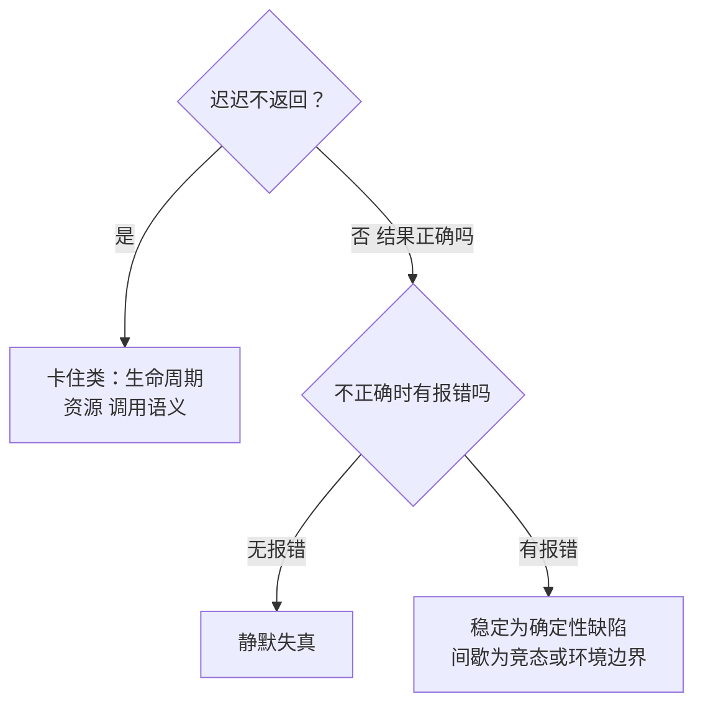
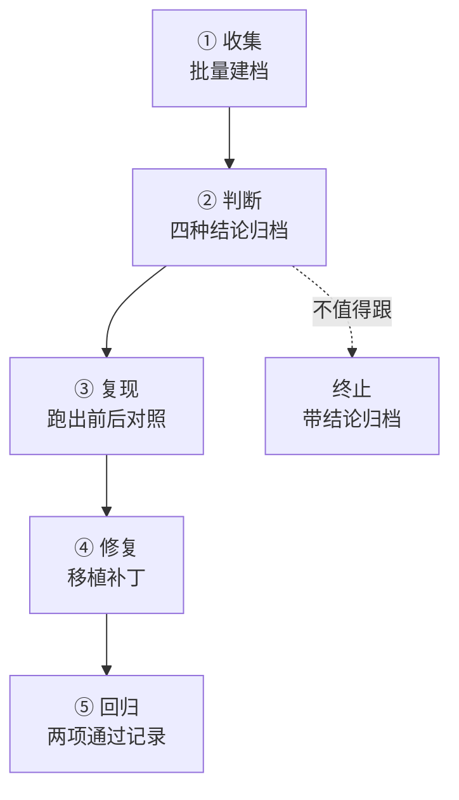

# 缺陷分析方法——三分离、判定树与五步法

新缺陷来了，手上只有一句"任务卡住了""数字不对"。**这篇回答三个问题：缺陷是什么、手上这句现象怎么归类、归类之后怎么跟到底**。**骨架是三样东西：三分离（把期望、现实、条件分开看）、判定树（拿可观察症状做二分）、五步法（收集、判断、复现、修复、回归）**。三者首尾相接：三分离给出"错在哪里"的可核对定义，判定树把现象导到机制类别，五步法把类别送进证据流程。

## 要解决的问题

**同一套排查手法，用在崩溃类缺陷上很顺手，遇上静默错算就常常扑空：前者留下现场可以看，后者什么都不说，等到被发现时数据已经错了很久**。另一个真实的浪费是：**判断、复现、修复、回归每步都做过，但每步产出都丢，下次同类缺陷又从零开始**。本篇要解决的问题是：**给缺陷一个可核对的定义、给现象一个归类入口、给流程一条可审计的通道，三件事合成一条流水线，让每条线索都有结论、有证据、有归档**。

## 第一部分 三分离：缺陷是什么

先看两条病例。第一条：BookKeeper 的 Bookie 节点，垃圾回收线程遇到内存分配错误时**整体终止且不留日志**（上游 commit 35b8f137，P0 即缺陷的最高严重等级，稳定类）。

**注意服务并未中止——节点照常运行、照常应答，只是已删除数据占用的磁盘空间从此不再回收，占用一路涨到写满，之后写入才开始失败**。第二条：Spark SQL（分布式计算引擎 Spark 的 SQL 查询模块）里，Union 两侧同名的列靠来源别名区分两张表；别名一旦也撞了名，引擎**不报任何错，静默返回错误结果**（上游 commit d04c7884，P0，正确性类）。上游 commit 指缺陷修复所在的那个开源项目提交。

**更危险的是第二条**。第一条至少最终会把问题喊出来——磁盘写满、写入失败，监控响了，人被叫起来了。喊得晚，但毕竟喊了。**第二条什么都不说，答案就是错的，你的报表、你的决策、你下游的每一行数据都在悄悄跟着错**。**崩溃的缺陷吵闹但诚实，静默的缺陷安静但致命**。

**缺陷是期望与现实之间的一次偏差。要定位它，先得把「期望」从口头约定变成可核对的东西**。

**一个缺陷由三样东西组成，三样必须分开看**（下文简称三分离）：

- **期望**：**这段代码被约定要做的事。垃圾回收周期应该持续运行；Union 应该逐行拼接两侧数据**。
- **现实**：**它在特定条件下实际做的事。GC（垃圾回收：运行时自动找出不再使用的内存并回收）线程遇到内存分配错误直接终止；别名冲突时返回了拼接错误的行**。
- **条件**：**让期望与现实分道扬镳的那个触发点。一次内存分配失败；一个特定的列命名组合**。

三者缺一不可。没有条件，缺陷只是潜在的风险；没有期望，你连"错"都无从定义。**分析缺陷的全部工作，就是把这三样从一团模糊的故障现象里分离出来**。判据是可以对账的：**先写定期望、现实与条件，再看证据是否与预期一致——对不上说明三样里至少有一样是猜的**。

**期望有三种可靠的来源——接口与配置的成文约定（API 文档、参数语义）、领域的规范定义（SQL 的 Union 语义、文件格式规范）、以及已经被测试固化的既有行为**。**直觉和「以前一直是这样」不算来源：没有成文的期望，偏差就无从判定，争论只会变成各说各话**。**这也是为什么约定意识是缺陷分析的起点**——[[工程知识/后端系统：在并发、失败与变化中维持服务/服务设计/API接口约定定义输入输出和演进边界]]讲的正是这件事在服务层的形态。

把三分离说成医生看诊是同一个道理。**病人说「发烧」——那是症状，不是病因；退烧药是对症治疗，不是对因治疗**。**工程师最容易犯的错就是把症状当病因：磁盘满了去清磁盘，查不出来为什么满，清完还满**。**发烧要查感染灶，磁盘写满要查为什么已删除数据不被回收——找到「垃圾回收线程已经终止」这一层，才算碰到病因**。上面那条 Bookie（BookKeeper 里负责存数据片段的服务实例）缺陷，用三分离分开就是：**症状是磁盘写满，病因是回收线程终止且不留日志，治疗方案是补上异常兜底**。

把两处病例涉及的基础概念挂上钩：后台线程为什么会被一次内存分配失败中断，见 [[工程知识/性能工程：从用户等待到资源瓶颈/操作系统与运行时/垃圾回收与内存分配决定延迟尾部]]；「静默算错」为什么只有独立参照才抓得住，见 [[工程知识/软件构建：让变化可以理解、验证与交付/架构与代码/静态分析发现结构问题但不能证明行为正确]]——**结构检查证明不了行为正确，行为正确需要的是参照答案**。

三分离的代价要摆在明处：**写定期望要查文档与规范，确认现实要复现，找触发条件要缩小输入范围——在一眼就能看出原因的缺陷上，这套流程是净支出**。**它的价值集中在那些「看起来有多种解释」的缺陷上，而那正是排查会卡住的地方**。

## 第二部分 判定树：现象怎么归类

案例库按机制分目录（正确性、稳定性、并发、资源与容量、配置等），但新缺陷来的时候，手上只有一句现象描述："任务卡住了""数字不对""服务时好时坏"。**从现象描述到机制类别之间缺一个入口——判定树解决的就是这件事**：**拿可观察的症状特征做二分（每次把搜索范围砍半、按对数速度收敛的查找法），把新缺陷导到正确的机制类别**。

判定树的每一层只用**当时就能观察到的信息**做分支，不用事后才能确认的信息。这样树可以在排查最早期使用，而不是等结论出来了才对号入座。

每一片叶子指向库内的代表案例：

| 机制类别 | 代表案例 |
| --- | --- |
| 静默失真 | [[工程知识/缺陷分析：从个案到体系/正确性/案例二：静默错算——Spark SQL Union 的别名陷阱]] |
| 生命周期与完成条件 | [[工程知识/缺陷分析：从个案到体系/稳定性/案例二十一：异常路径上没有完成——永不兑现的 future]] |
| 资源泄漏与容量 | [[工程知识/缺陷分析：从个案到体系/资源与容量/案例六：容量与泄漏——连接泄漏和 SST 堆积]] |
| 调用语义（超时、重试与幂等共同定义的调用行为约定） | [[工程知识/缺陷分析：从个案到体系/稳定性/案例八：承诺没有兑现——Pulsar 里六个永不返回的请求]] |
| 确定性缺陷 | [[工程知识/缺陷分析：从个案到体系/配置/案例四：配置不生效——recover 速率与重复日志]] |
| 竞态（多个执行流争抢资源、结果取决于时序）与时序边界 | [[工程知识/缺陷分析：从个案到体系/并发/案例二十：关闭之后还有人在用——生命周期的时序竞态]] |
| 时间与时区边界 | [[工程知识/缺陷分析：从个案到体系/稳定性/案例二十二：时间也是输入——夏令时让序列生成越界]] |
| 后台任务静默终止 | [[工程知识/缺陷分析：从个案到体系/稳定性/异常处理器的覆盖面：Error 逃逸终止周期任务]] |
| 环境与外部依赖 | [[工程知识/缺陷分析：从个案到体系/性能/锁内的长动作：临界区里藏着的延迟放大器]] |

**判据要同时满足三条才算合格：二分的，一次只切两半不留下中间地带；无歧义的，两个人对同一句现象描述会得到同一个分支；当时可观察的，站在排查最早期就能回答**。**按组件分（数据库问题、网络问题）要求排查者预先猜对组件，猜错就整棵子树白走；按症状特征分（有没有信号、谁在等什么、是否间歇）不预设组件，分支判据直接来自观察**。这与第一部分的三分离一致：症状特征就是偏差的可观察面。

**「后台任务静默终止」这个叶子值得单独说一句：它既无失败信号也不返回结果，卡在普通「报错/不报错」两分支之外**。**判定树必须能容纳「什么都没发生」这类症状，那正是静默缺陷最典型的样子**。

树的骨架与同构的成熟方法对得上：**性能领域的 USE 方法（Utilization/Saturation/Errors，对每类资源查使用率、饱和度、错误数）对每类资源依次问错误、利用率、饱和度三问，同样强调判据在排查最早期可回答**；**安全工程的故障树分析FTA（Fault Tree Analysis，故障树分析）把顶事件沿逻辑门逐层分解，分支判据写成布尔式，两个人对同一事件分解会得到同一棵树**——**判定树从症状向机制类别走，故障树从顶事件向原因走，方向相反，骨架相同**。

这棵判定树有三个边界：

1. **叠加缺陷**。**一个现象可能是多个机制叠加（资源泄漏导致超时，超时重试加剧泄漏），树只能给出主要分支，排查时对每个分支都快速验证一遍而不是只走一条**。
2. **树不能替代复现**。归类只是缩小假设空间，确认还是要走最小复现，见 [[工程知识/软件构建：让变化可以理解、验证与交付/测试与交付/调试从假设到最小复现]]。
3. **静默类要主动验证**。"无信号"分支是最危险的入口——静默失真往往已经存在很久才被发现，判定后应直接进入对账与不变量检查，方法见 [[工程知识/缺陷分析：从个案到体系/正确性/静默失真的检测靠对账与不变量而不是报错]]。

**树本身也要过账：新案例进来后，命中叶子、树上没有叶子、走错分支是三种结局，各自触发的动作不同**。**树上没有叶子说明体系缺一类机制表达，先补树再归档案例；走错分支时优先怀疑判据有歧义，改判据而不是加分支，改完重跑全库反测；案例本身跨多机制的记一笔不改树**。**树的可用性用库内案例反测：把案例的现象描述（不看结论）逐篇过树，九成以上走到正确机制类才算合格**。

## 第三部分 五步法：归类之后怎么跟到底

**三分离给了定义，判定树给了入口，跟到底靠五步法**。**判断影响、真实复现、合入回归，三段方法各自成立；把它们串进一条从收集起步、每步产出都归档的完整流水线，才能持续运转，否则每次都是一次性动作**。

**第一步：收集。** 盯住上游的提交流，按范围批量拉取。做：按分支和时间窗批量扫，给每条提交建档。不做：凭记忆记"哪些上游最近有问题"——记忆是最先过期的存储。BookKeeper 的 GarbageCollectorThread.java 在 branch-4.16 分支上的提交历史页按时间倒序排列，每条带提交号与 PR（Pull Request，拉取请求：请求把我的分支改动合入主干）编号，**收集步就是把这一页逐条过一遍**。

**第二步：判断。** 对每条提交回答"要不要跟"。做：四种结论（需要合入 / 不涉及生产代码 / 目标已有修复 / 未使用相关功能）逐条归档，结论带证据和置信度。不做：所有提交一视同仁地细看——大多数提交当场了结，只有少数值得往下走。Spark SQL 静默错算病例的 commit d04c7884，**提交说明里直接给出修复前后同一查询的错误结果与正确结果对照——判断静默缺陷靠的就是这种独立参照答案**。

**第三步：复现。** 给值得跟的缺陷造证据。做：确定输入、可判定输出、修复前后的对照。不做：用"应该会好"代替"跑过确认"。

**第四步：修复。** **把补丁移植到目标分支。做：读 diff、对照目标分支的代码形态、在冲突处手工适配。不做：跳过对照直接原样套——编译通过不代表语义成立**。

**第五步：回归。** **闭环收口。做：复现脚本复跑通过 + 共享路径测试全绿，两个都写进记录。不做：合入即宣告完成**。

终止路径同样是这套流程的一部分：一条提交走到判断步被归档为"不涉及生产代码"，算带着结论结案，与丢弃是两回事——这条结论在下次审计时可以被复核，也能回答"为什么当时没跟"。

用五步法重走开头的两条病例：

**Bookie 垃圾回收卡死**（稳定类）：**收集扫到上游补丁；判断为目标分支受影响、需合入；复现跑通——GC 线程终止、磁盘不再回收**；**移植时与目标分支的基线（正常状态下的指标水平、用来对比异常）有冲突，按目标分支的形态手工适配；回归确认回收恢复、日志补齐。五个环节，一个不少**。

**Spark SQL 静默错算**（正确类）：收集扫到补丁；判断为正确性缺陷、需合入；**复现构造同名列别名用例——错误结果稳定重现；合入无冲突；回归确认原用例通过**。静默缺陷的每一步都依赖"有一个独立参照答案"，这正是它比崩溃类更依赖流程的原因。

一次真实的扫描量经过判断步之后分成四条去向，需合入的少数按机制散开，配置类最多、正确类最贵：

- **配置类最多**。**代码没有写错，错在程序的行为与读配置的人的理解不一致——这类缺陷靠文档和启动自检压降，重构帮不上**。
- **正确类最少但最贵**。**它靠对照测试抓，而对照测试要先有一个独立参照——建设参照的成本，就是正确类缺陷的预防成本**。**数量少说明它不常发生，代价高说明它一旦发生就要回溯整段时间的决策**。

让五步真正咬合的是**交接物**：每一步的产出就是下一步的输入——判断步交出"影响结论 + 证据等级"，复现步交出"可运行的脚本 + 前后对照"，合入步交出"diff + 冲突标记"，回归步交出"两绿记录"。交接物缺失的地方就是流程断裂的地方。度量同样有据可依：**每一步的积压量、通过率、平均耗时，是这条流水线的健康指标——哪一步积压最深，哪一步就是瓶颈**。

## 这套说法在哪儿会失效

- **不要把复现当根因**。复现脚本造出了故障，只说明"这个条件能触发"，不说明这就是唯一的触发路径。
- **不要认为修了就是修好了**。补丁合入只完成一半，没有回归验证的修复随时可能被下一次变更冲掉。
- **不要只盯崩溃**。**开头两条病例里，静默算错的那条对业务的实际伤害更长——它从出现到被发现之间隔着的每一天，都是脏数据**。
- **不要把五步做成五张表格**。每一步的价值在证据，不在表单；只有表单没有证据的流程会退化为仪式。
- **五步的入口是"一条有据可查的线索"**。案例里的线索来自上游提交；日常开发中，测试失败、评审意见、线上告警、故障复盘同样是合格线索。换掉收集步的来源，后面四步不需要改动。

## 怎么自己动手验证

1. 三分离核验：**对一条真实故障，分别写出期望、现实与触发条件三样，缺任何一样都说明分析还没到病因层**。
2. 归类核对：**按判定树的五问把这条现象走到叶子，核对所选机制类别与该类暴露方式匹配；归类依据写成记录**。
3. 交接物核验：**对五步各自的产出逐项检查——判断步交出影响结论与证据等级、复现步交出可运行脚本与前后对照、合入步交出 diff 与冲突标记、回归步交出两项通过记录；任一交接物缺失即该处流程断裂**。
4. 上游对照：**到 BookKeeper 的提交 35b8f137 与 Spark 的提交 d04c7884 里核对现象与根因，确认与三分离的结果一致**。
5. 断言锚点：**三样齐备、归类有据、每步产出都归档且可审计，回归的两项通过记录齐备**。

## 接着读哪几篇

- [[工程知识/缺陷分析：从个案到体系/缺陷分析：从个案到体系——导读与开源地图]] —— 案例索引与地图如何生长
- [[工程知识/缺陷分析：从个案到体系/影响判断/影响判断——这条修复值不值得跟]] —— 判断步的展开
- [[工程知识/缺陷分析：从个案到体系/影响判断/影响面估算先于修复——从改一行到伤多少服务]] —— 影响面的量化
- [[工程知识/缺陷分析：从个案到体系/复现与回归/从复现到回归——让证据走完一圈]] —— 复现步与回归步的展开
- [[工程知识/缺陷分析：从个案到体系/正确性/案例二：静默错算——Spark SQL Union 的别名陷阱]] —— 开头第二条病例的完整病历
