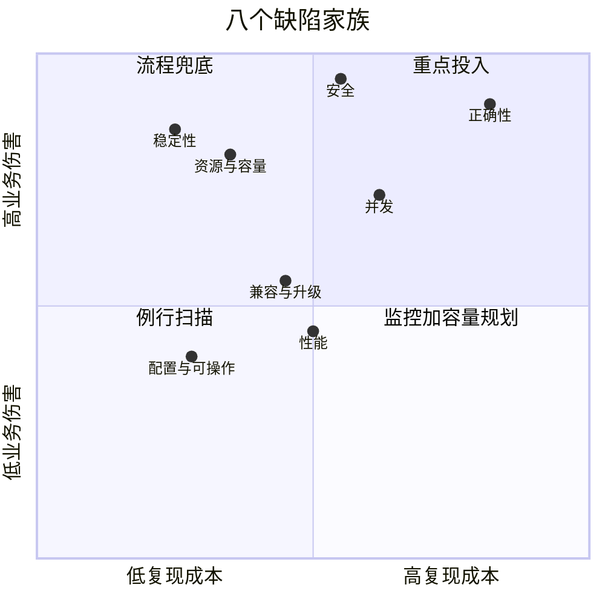

# 缺陷分析：从个案到体系——导读与开源地图

本篇是缺陷分析系列的地图。要解决的问题：案例越积越多之后，读者从哪读起、案例按什么组织、案例池按什么标准扩项目、新案例怎么入库去重——**这四件事如果只靠约定俗成，地图很快就会和正文脱节**。方法本身在三分离、判定树与五步法那篇，此处不重复。

## 怎么读

**先读方法篇**：[[工程知识/缺陷分析：从个案到体系/缺陷分析方法——三分离、判定树与五步法]]——缺陷是什么、现象怎么归类、归类之后怎么跟到底，**三件事合成一条流水线**。方法篇里已经并入原本质篇（三分离与八家族）、判定树篇（五问二分）、五步法篇（交接物与度量）的全部内容。

**方法展开成三篇**，各自深入一个环节：

- [[工程知识/缺陷分析：从个案到体系/影响判断/影响判断——这条修复值不值得跟]] —— 判断步的展开：三问分流，四种结论
- [[工程知识/缺陷分析：从个案到体系/影响判断/影响面估算先于修复——从改一行到伤多少服务]] —— 影响面的量化
- [[工程知识/缺陷分析：从个案到体系/复现与回归/从复现到回归——让证据走完一圈]] —— 复现步与回归步的展开：合入前的差异比对

**然后读案例**。**按缺陷的家族排列，每篇讲一两个真实缺陷的完整病例——它怎么发生、为什么危险、上游怎么修、可迁移的教训是什么**。可以按需跳读，也可以通读。案例数量持续增长，**全量清单以各家族目录页为准**：

- [稳定性](/?domain=缺陷分析%3A%E4%BB%8E%E4%B8%AA%E6%A1%88%E5%88%B0%E4%BD%93%E7%B3%BB&topic=%E7%A8%B3%E5%AE%9A%E6%80%A7)
- [正确性](/?domain=缺陷分析%3A%E4%BB%8E%E4%B8%AA%E6%A1%88%E5%88%B0%E4%BD%93%E7%B3%BB&topic=%E6%AD%A3%E7%A1%AE%E6%80%A7)
- [并发](/?domain=缺陷分析%3A%E4%BB%8E%E4%B8%AA%E6%A1%88%E5%88%B0%E4%BD%93%E7%B3%BB&topic=%E5%B9%B6%E5%8F%91)
- [配置](/?domain=缺陷分析%3A%E4%BB%8E%E4%B8%AA%E6%A1%88%E5%88%B0%E4%BD%93%E7%B3%BB&topic=%E9%85%8D%E7%BD%AE)
- [安全](/?domain=缺陷分析%3A%E4%BB%8E%E4%B8%AA%E6%A1%88%E5%88%B0%E4%BD%93%E7%B3%BB&topic=%E5%AE%89%E5%85%A8)
- [资源与容量](/?domain=缺陷分析%3A%E4%BB%8E%E4%B8%AA%E6%A1%88%E5%88%B0%E4%BD%93%E7%B3%BB&topic=%E8%B5%84%E6%BA%90%E4%B8%8E%E5%AE%B9%E9%87%8F)
- [兼容与升级](/?domain=缺陷分析%3A%E4%BB%8E%E4%B8%AA%E6%A1%88%E5%88%B0%E4%BD%93%E7%B3%BB&topic=%E5%85%BC%E5%AE%B9%E4%B8%8E%E5%8D%87%E7%BA%A7)
- [性能](/?domain=缺陷分析%3A%E4%BB%8E%E4%B8%AA%E6%A1%88%E5%88%B0%E4%BD%93%E7%B3%BB&topic=%E6%80%A7%E8%83%BD)

八个家族按"复现成本"和"业务伤害"两个维度摆进象限，**右上角（又难复现又致命）是投入重心，左下角交给例行扫描就够。这张图决定每一类该配什么武器**：



## 案例池按什么标准扩项目

案例池的覆盖度取决于选了哪些项目。**选择标准有三条：生产中常见、上游社区活跃（提交流不断）、与已覆盖项目形成语言或场景互补**。下表按这三条列出候选：

| 项目 | 语言 | 补什么维度 | 状态 |
|---|---|---|---|
| BookKeeper | Java | 存储、一致性、后台周期任务 | 已接入 |
| Spark | Java/Scala | 批计算、SQL 正确性、资源管理 | 已接入 |
| Redis（内存键值数据库，常当缓存与排行榜用） | C | 内存数据结构、单线程模型、协议解析 | 已接入 |
| PostgreSQL（开源关系型数据库，以事务与扩展能力见长） 系发行分支 | C | 查询优化、事务与 MVCC（多版本并发控制：同一行保留多个版本，每个事务按自己的快照挑版本读）、崩溃路径 | 已接入 |
| MySQL | C++ | InnoDB、主从复制（一台主节点负责写入、其他从节点同步数据的部署形态）、优化器 | 候选 |
| Pulsar | Java | 消息投递、订阅语义、异步回调 | 已接入 |
| Kafka | Java/Scala | 日志追加、消费组协议 | 候选 |
| etcd（分布式键值存储，Kubernetes 用它存集群状态） | Go | Raft（一种以易于理解著称的共识算法：靠领导者与日志复制达成多数派一致） 实现、Compact 与 watch | 候选 |
| Kubernetes（容器编排平台：管容器调度、扩缩与自愈） | Go | 调度器、控制器 reconcile 模型 | 候选 |
| Nginx | C | 事件循环、内存池 | 候选 |
| Envoy | Go/C++ | 网络过滤链、热重启 | 候选 |
| ClickHouse | C++ | 列式执行、TTL（Time To Live，存活时间：到期后自动失效或删除） 与类型系统 | 已接入 |
| RocksDB | C++ | LSM（Log-Structured Merge，先把写入攒在内存里、再按批顺序落盘的存储结构） 压缩、SST（Sorted String Table，按 key 排好序后落盘的只读文件） 生命周期 | 候选 |

各仓库统一克隆到本地同一目录即可：

```sh
mkdir -p ~/code && cd ~/code
for repo in redis/spiredb redis/redis postgres/postgres mysql/mysql-server \
            apache/pulsar apache/kafka etcd-io/etcd kubernetes/kubernetes \
            nginx/nginx envoyproxy/envoy ClickHouse/ClickHouse facebook/rocksdb; do
  git clone --bare "https://github.com/${repo}.git" "$(basename ${repo}).git"
done
```

--bare 只拉历史不打工作区，扫描用不到工作区，**体积小一半以上**。扫描的对象是 GitHub 的 commits 页：每行一个提交、按时间倒排，hash 与标题并排，**hash 是唯一键，标题是初筛关键词的来源，点进任意一行就是可复核的 diff**。

## 案例怎么入库、怎么去重

- **唯一键是上游 commit hash**。入库前先查这个 hash 是否已被收录——**收录过就只更新对应文章的案例段，不开新篇**。
- **同机制同教训的并入已有文章**。判断标准在"出错的机制和得出的教训是否同一类"：BookKeeper 和 Spark 各出一个心跳（通信双方定期互发小报文、确认连接还活着）竞态（结果取决于执行时序、因而不可重现的并发缺陷），**并入同一篇并发案例，而不开两篇**。
- **新机制才开新篇**。能并入的并入，开新篇的标准是**出现了一个现有文章没有回答的问题**。
- **案例段永远指向 commit**。**读者要能从文章里任何一个案例跳到上游原始提交去核对**。

## 这套方法的适用范围和用法

- **方法建立在一个前提上：缺陷的期望有据可查。** 案例的期望来源都是上游已合入的修复提交——有 commit、有 diff、有修复前后的对照。在自有项目里，期望同样可以来自测试失败、评审意见、线上告警或故障复盘，**收集步换一个线索来源，后面四步原样适用**。
- **案例按机制代表性收录**。写进案例库的只占扫描量的一小部分，标准写在每个案例段的第一句：**这个机制能不能迁移到别的系统**。能迁移的才收，与严重程度无关。案例总量与各家族清单看本篇的家族索引即知，不在此重复计数。
- **象限图用来定投入重心**。复现成本与业务伤害是经验刻度，**用途是决定哪一类缺陷该配哪一种武器，不是给单个缺陷打分的标尺**。
- **地图与正文同步更新**。每接入一个新项目，**先补地图的项目表和象限图，再写案例**。

## 怎么自己动手验证

1. 索引核对：打开八个家族目录页，**确认每个家族的案例清单与侧栏目录树一致，新增案例出现在对应家族里**。
2. 上游可查：对目录页列出的案例抽查其上游 commit 链接，**确认链接可访问且现象描述与正文一致**；预期抽查若干条全部可访问、描述无出入。
3. 复现可用：抽查案例给出的复现步骤在实际环境中跑通，**确认修复前后的对照能够重现**。
4. 阅读顺序：从方法篇进入，**确认每个展开篇的前置概念都在方法篇里给出**。
5. 断言锚点：**家族目录页与目录树一致、上游链接可查、复现步骤可跑通，三项齐备才算地图可用**。

## 接着读哪几篇

- [[工程知识/缺陷分析：从个案到体系/缺陷分析方法——三分离、判定树与五步法]] —— 方法总纲
- [[工程知识/缺陷分析：从个案到体系/稳定性/案例一：垃圾回收线程的终止——BookKeeper 磁盘写满]] —— 第一条完整病例
