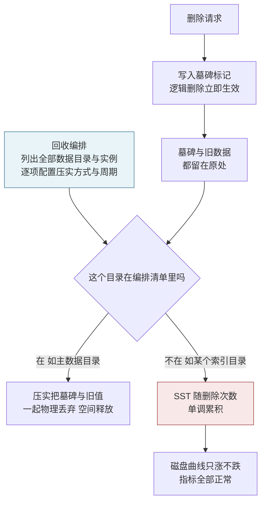
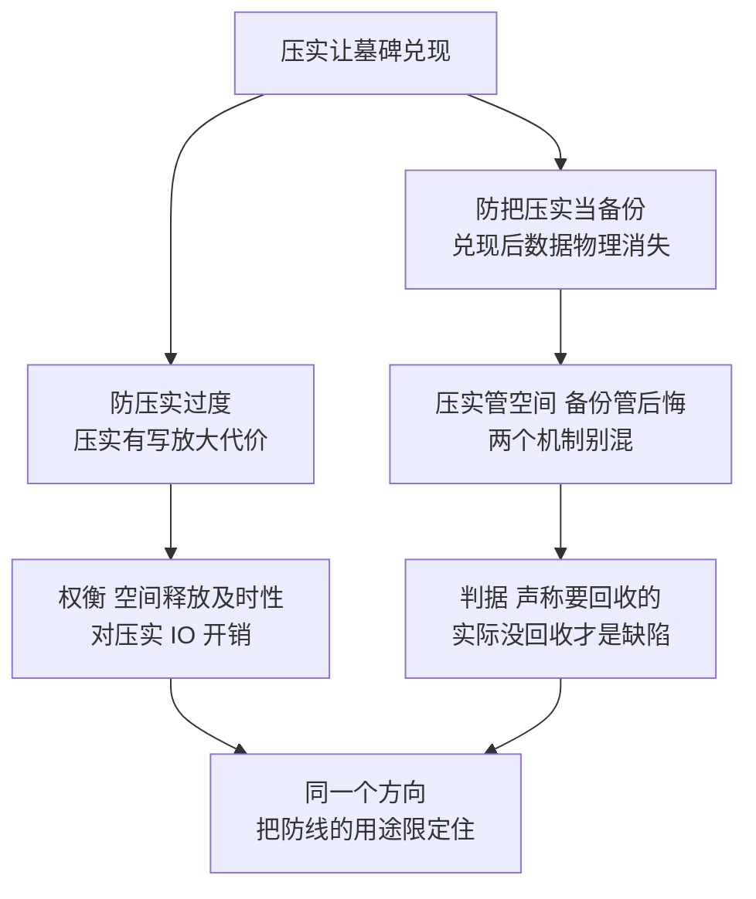
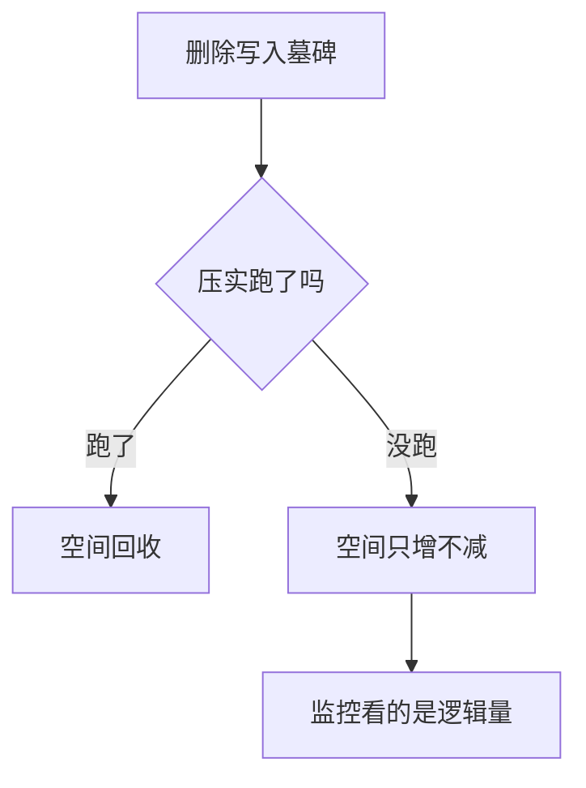

# 只增不减的索引：墓碑靠压实才能变成空间

LSM（log-structured merge-tree，日志结构合并树：写入先顺序落盘成多层文件，靠后台压实合并的存储结构）类的存储，删除只是写入墓碑标记，空间要等压实才真正释放。**读完这篇你能判断漏掉哪个目录的压实会让删除越多、占用越大**。

> **要点**：LSM 类存储的删除只是写入墓碑标记，**磁盘空间要等压实（compaction）把墓碑与旧数据一起丢弃才真正释放——回收流程漏掉某个索引目录的压实，删除越多磁盘占用越大，且一切指标看起来正常**。

## 要解决的问题

"删了数据，磁盘为什么没变少？"是 LSM 类存储（以 RocksDB 为代表，采用追加写与后台合并结构的存储）最经典的疑问。答案写在这类存储的结构里：删除操作写入一条墓碑记录（tombstone，标记"此键已删"），被删的数据本体与墓碑都留在原处，**等后台压实把同一键的旧值与墓碑一起物理丢弃，空间才回到文件系统**。**删除是两段式的：逻辑删除立即生效，空间释放等待压实。**

**两段式结构带来一个隐蔽的缺陷形态：回收编排漏掉某个子目录的压实**。**Apache BookKeeper 的一个真实病例（上游修复 commit fbd33b56，可查）演示了完整链条**：bookie（BookKeeper 的存储节点进程）删除账本（ledger，一段有序的条目序列）后，**位置索引——locations 目录的 RocksDB 实例记录每个账本存在哪个 entry log 文件的哪个偏移里产生可回收的墓碑**；后台垃圾回收只按周期回收 entry log 主数据文件，**从不压实位置索引**——墓碑永远躺在那里，SST（Sorted String Table，按key排序的不可变文件）文件随删除次数单调累积，磁盘占用持续增长，恢复依赖运维手动调用接口触发压实。

这个缺陷的危险在于它的伪装性：每层组件都正常干活，唯独"该有人调用压实"这一步没人做。像写字楼里每个员工都按时打卡、每项工作都有人认领，但"联系保洁清空储物间"这件事不在任何人的职责表上——储物间越堆越满，考勤记录却一片良好。伪装机制单独在后面一节展开。

「删除不立刻释放」在存储硬件上也是日常现实：**机械盘里被删的文件只改了文件系统记录，数据块本体原地不动等覆盖**；**SSD（固态硬盘）更明显——TRIM（通知 SSD 哪些块已失效）指令只是把块标记为无效，空间要等 GC（垃圾回收，把有效页搬到新块后整块擦除）做完才真正可用。删除与释放之间隔着一个后台回收**：


*图源：Wikimedia Commons，Siarhei Besarab，CC BY-SA 4.0，https://commons.wikimedia.org/wiki/File:SSD_mSATA_to_M2.jpg。*

——tombstone 取的是墓碑本义：立碑标记"此人已去"，碑身还要在原地立着；LSM 的删除写墓碑、空间等压实，与此同构。

**墓碑与它要盖掉的旧值分散在不同层，只有压实把它们读到一起时，删除才真正兑现**：

图取自 [RocksDB 官方仓库 wiki「Leveled Compaction」](https://github.com/facebook/rocksdb/wiki/Leveled-Compaction)，2428×1279，Apache 2.0。**图里每一层的文件各按键值范围排布，一条键的旧版本可能在更深的层里——墓碑在下压到那一层之前，旧值一直占着空间**。

## 墓碑靠谁兑现：压实为什么是删除的第二段

**把删除的完整生命周期排出来，缺口的位置看得清楚**。可以用图书馆整理书架来理解这套机制：LSM 存储像一座只往前添书、不当场撤书的书架，删除一本书时先在目录卡上盖一个"此书已下架"的章（墓碑标记），书本体还留在架上；等管理员定期按目录卡统一撤书（压实），书才真正腾出位置。这个比喻到"定期整理"为止——书架整理不会重写别的书，压实却要把多层文件重写合并，这是比喻之外的成本，后面边界一节会讲。

**写入侧**：**正常写入产生 SST 文件，层层压实合并。这条路通常没问题是压实策略的默认配置与大量生产检验**。

**删除侧**：**删除写墓碑，墓碑本身是普通数据，走同样的写入与压实路径。压实把同一键的墓碑与旧值合并时才会真正丢弃**，且要等墓碑沉降到没有更旧数据压在它下面的层——在此之前墓碑必须保留，否则被它遮住的旧值会"复活"。这是空间释放的兑现点，也是它滞后的原因。

**回收编排**：**存储引擎往往有多个 RocksDB 实例或多个目录（主数据、索引、元数据），每个实例都需要压实**。引擎自带的压实只管"自己这个实例的 SST 合并"，**实例之外没有谁统筹"每个存储区域都配置了压实且周期合理"**。**BookKeeper 的病例里，locations 实例的压实压根没有编排进去——压实本身没有失败，从来没人调用它**。

缺口就在编排层。每一层单看都合理：RocksDB 说"压实我负责，你得调用或配置触发"；垃圾回收说"我负责 entry log，那是我的职责清单"；配置说"压实参数有默认值，应该是开着的"——职责清单的空白处，墓碑永远不兑现。

删除的两段式与编排缺口的完整链条，见下图：



图：缺陷藏在哪里——**删除的两段式里，第一段（写墓碑、逻辑生效）永远正常，第二段（压实兑现空间）取决于该目录是否被回收编排覆盖**——主数据在编排清单里有对应入口，沿着链路能走到终点；位置索引没有对应入口，走到这一步就断了。判定分支是"这个目录在编排清单里吗"，而不是"压实失败了吗"——BookKeeper 的病例里压实从没被调用过，失败都谈不上。分支不写死具体目录名——换成别的索引目录、元数据目录，走的是同一条路径。断掉之后的表现正是它的伪装性：垃圾回收指标健康、读不到已删数据、磁盘涨速温和，三个"正常"叠在一起，只有墓碑兑现率与删除对账能拆穿。


来源：[稀土掘金《看完这篇文章，别再说不懂索引了》](https://juejin.cn/post/7102419772200976414)（CC 4.0 BY-SA）


来源：[博客园《一文搞懂 LSM-Tree》](https://www.cnblogs.com/zxporz/p/16021373.html)（CC 4.0 BY-SA）


## 为什么监控看不见它

**这类缺陷躲过监控的原因值得单独讲，因为它是资源类缺陷的通用伪装术**。

**磁盘曲线与业务曲线同形**：删除量与业务量通常正相关，"磁盘随业务增长"看起来天经地义。区分二者需要把磁盘占用对"累计删除量"回归，而不是对"时间"或"写入量"——没有几个系统的监控做到这一步。

**回收指标显示正常**：垃圾回收的指标（回收了多少 entry log、压实执行了多少次）全部健康——它们度量的是"被编排的动作"，而缺陷恰恰是"有动作没被编排"。监控只能看见存在的东西，看不见缺席的调用。

**单机复现需要时间**：**压测环境跑几小时，删除量不够多，增长看不出来。这个缺陷的复现时间常数以周计（要积累足够删除量才看得出增长），普通测试窗口抓不住**。

三条加起来，缺陷要在生产环境持续运行数月才暴露到磁盘告警，且暴露时的第一症状是磁盘告警，回溯定位要走"哪部分占用可回收"的下钻—— compaction 统计、每目录占用、删除量对照，一路查到"这个目录从来没有压实过"。

**三条伪装术有一个共同的根源：监控度量的是动作而不是状态。「回收了多少 entry log」是动作，「有多少墓碑未兑现」是状态**。**缺席的调用不产生动作，因而在动作类指标上完全不可见——这一条不限于压实，周期任务没被编排、清理任务只认一条入口、监听器从未创建，全都是同一种不可见**。**把指标从动作改成状态，是这类缺陷唯一的事前报警手段**。

## 修完之后靠什么防住复发

**上游修复补上了缺席的编排：新增配置项控制位置索引的压实周期（带随机延迟打散），按周期调用压实清理 SST。动作很小，背后的防线体系值得展开**。

**回收编排要覆盖每个存储区域**：列出存储引擎的全部数据目录与实例，逐项确认"压实方式、触发周期、可回收性"三项。清单化是对付"缺席调用"的唯一可靠手段——靠记忆，漏掉的正是记忆里没有的。

**墓碑兑现率作为指标**：统计"墓碑产生量"与"墓碑兑现量（压实实际丢弃的墓碑数）"，兑现率是后者与前者的比值，两条曲线长期背离就是压实缺席的直接证据。这条指标把"缺席"变成了可观测的东西，是三条防线里唯一能事前报警的。

**删除与释放的对账**：定期对账"逻辑删除量"与"磁盘释放量"，比值长期显著小于 1 说明存在只删不放的区域。对账思想与静默失真检测同源——不依赖报错信号，靠两个独立口径的数字互相印证。

**压实参数按区域设定**：**写多读少的元数据索引、按删除频率波动的位置索引，压实周期应短于主数据——墓碑兑现越快，空间释放越及时。默认参数为通用负载设计，按负载特征调参属于正确性配置**。

## 这套说法在哪儿会失效

三条边界把「压实回收」约束在安全收益为正的范围内。

**压实有写放大（实际写入量是逻辑写入量的多倍）代价**：压实是重写数据的操作，过于频繁的压实消耗 IO 与 CPU，反噬写入延迟。周期设定要在"空间释放及时性"与"压实 IO 开销"之间权衡，监控压实本身的耗时与排队——压实积压也是磁盘曲线异常的来源之一。

**压实不等于备份**：墓碑兑现后数据物理消失，"删错了靠压实找回"不存在。压实管空间，备份管后悔，两个机制别混为一谈。

**删除语义可能另有设计**：有的系统故意延迟释放（回收站、软删除窗口），那是产品语义，缺陷的判定标准是"编排声称要回收的区域实际没回收"。先读语义再判定，别把设计当缺陷，也别把缺陷当设计。

三条边界分别防止防线用歪的三种方式，见下图：



第二条最容易被混淆：压实与备份都是"数据的另一份存在"，但压实兑现后原始数据物理消失，删错了没有后悔余地。第三条反过来——有的系统故意延迟释放，这是产品语义而不是缺陷，判定标准是"编排声称要回收的区域实际没回收"，先读语义再判定。

## 怎么自己动手验证



**墓碑只是标记，空间要等压实才真正释放**，释放过程见下图：


**用一组写入-删除循环就能亲眼看到空间只增不减**：

1. 压测构造：**在测试环境对 RocksDB 实例（或使用 LSM 的存储）执行大量写入-删除循环，删除键空间大于写入存活集**；
2. 观察基线（正常状态下的指标水平、用来对比异常）：**记录 SST 总占用随删除量的增长曲线——无压实时持续增长，这是缺陷形态的证据**；
3. 打开压实重跑：**同一压测下，SST 占用回落到存活集量级并稳定**；
4. 断言锚点：**磁盘占用 ≈ 存活数据量 + 压实滞后窗口内的墓碑量，与累计删除总量无关**。
**拿存活数据量加压实滞后窗口内的墓碑量算出预期磁盘占用，与实际磁盘占用对账，对不上且差额随累计删除总量增长，即可判定位置索引条目在压实后未被回收**。

```text
压测 = 写入-删除循环（删除量 >> 存活量）
空间断言 = 磁盘占用收敛到存活集量级，与累计删除量无关
指标断言 = 墓碑兑现率长期趋近 1
```

**「磁盘占用独立于累计删除量」这条不变量适用于一切带墓碑机制的存储，值得成为容量巡检的标准判据**。

## 接着读哪几篇：回收编排缺席的另一形态：重复执行而非从不执行

- [[工程知识/缺陷分析：从个案到体系/资源与容量/案例六：容量与泄漏——连接泄漏和 SST 堆积]] —— 同一存储引擎的 SST 堆积案例侧写
- [[工程知识/缺陷分析：从个案到体系/资源与容量/周期任务只进不出的集合：清理动作自己也要被清理]] —— 回收编排缺席的另一形态：重复执行而非从不执行
- [[工程知识/数据系统：在并发与故障中保存事实/事务与存储/存储引擎的两大路线：B树与LSM的写读取舍]] —— 墓碑与压实的机制基础
- [[工程知识/缺陷分析：从个案到体系/正确性/静默失真的检测靠对账与不变量而不是报错]] —— 删除与释放对账的方法论出处
- [[工程知识/缺陷分析：从个案到体系/资源与容量/回收要遍历每个候选：清理任务不能只认一条入口]] —— 同一缺陷的编排面方法：垃圾产生路径 × 回收入口的责任矩阵
