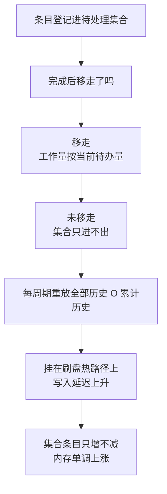
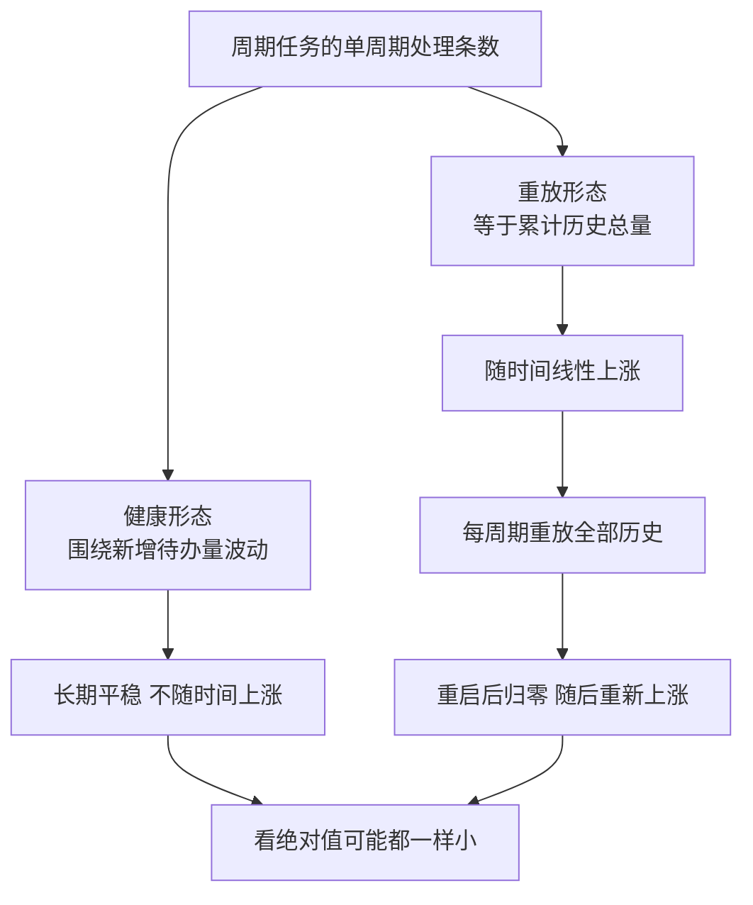

# 周期任务只进不出的集合：清理动作自己也要被清理

周期任务把已完成的工作重新清理一遍，工作量随历史单调增长。读完这篇你能让清理动作自己也被清理，不再被自己积累的工作拖慢。

> **要点**：周期任务的工作集合登记了要清理的对象，清理完成后不把条目移走，**下一次周期把全部历史重新清理一遍——工作量随历史单调增长，系统被自己积累的"已完成工作"拖慢**。

## 只进不出的集合为什么会把内存吃干

后台周期任务有一个通用形态：**维护一个待处理集合，每个周期把集合里的项处理一遍（清理、同步、重试、上报）**。这个形态隐含一条**完成纪律：处理成功的项要从集合里移走**。缺了这一步，**集合只进不出，每个周期都把全部历史重新处理一遍，任务越来越慢，占用的内存越来越多**，而**系统没有任何报错——它在勤勤恳恳地重复劳动**。

Apache BookKeeper 的一个真实病例（上游修复 commit 0d312020，可查）是标准样本：**存储节点删除账本后，把账本记进一个待删除集合，每个写缓存刷盘（把内存中暂存的数据写入磁盘持久化）周期都执行一次"清理这些账本的索引并同步元数据"**。**清理逻辑没有把已删账本从集合移除**，于是**发生过一次删除之后，每一次刷盘都在重新清理全部历史删除**。

**运行时间越长、累计删除越多，每次刷盘越慢，写延迟持续上升，集合占用的内存同步增长，重启才能清零**。像记账员把销掉的账目不划掉：**每天结账都把已经作废的旧账重算一遍——月初只多算几分钟，月底账本翻不开了**，而且**从没人报错，他一直在"勤恳工作"**。

## 它是怎么做到的：完成信号缺失时，周期语义放大一切

好比一班通勤班车每天按固定路线跑：**已下车还站在名单上的乘客（已删账本没出集合）每天都被逐一点名（每周期全量重放），名单越长点名越久，司机却从没觉得不对——他只是在「勤恳工作」**。登记与销账的闭环在分布式事务里有标准形态：**补偿事务模式把一个长操作拆成 Step 1、Step 2、Step 3 的正向链，任一步失败就按逆序执行 Compensate 1、2、3 抵消已完成步骤——每一步的完成都绑定一个销账动作，登记项与销账项一一配对**。

微软 Azure 架构模式文档画的正是这个闭环，**本篇病例缺的恰是右半边的逆序链：只有登记没有销账，正向链越拉越长**：比喻到「下车不出名单」为止。


*图源：Microsoft Azure 架构模式，Compensating Transaction pattern，CC BY 4.0，https://learn.microsoft.com/zh-cn/azure/architecture/patterns/compensating-transaction。*

**单次执行的无害疏漏，在周期语义下沿四条链放大**：




单次执行视角下，**"处理完不移除"是个无害的小疏漏——工作照样完成了**。**周期语义把它放大成性能缺陷**，中间的传导链值得完整看一遍。

### 集合的语义为什么会漂移

设计意图是"待处理队列"，实际行为变成"全部历史台账"。**集合不再回答"现在有什么要做的"，改答"曾经有过什么"——两个语义的工作量差一个运行时长的数量级**。

回旋镖的纪律是"掷出几支、收回几支"，账要当场结清；只掷不接的收藏家最后面对的是满地飞不回来的木头。周期任务的登记集合同款：登记多少就要在完成时销账多少，销账动作缺位，集合就从"在飞的"漂移成"飞过的全集"：


*图源：Wikimedia Commons，A.Savin，FAL 1.3，https://commons.wikimedia.org/wiki/File:Wooden_boomerang_asv2021-05.jpg。*

### 为什么每周期全量重放会放大问题

好比收银员下班对账，不去数今天收了多少笔，而是**把开店以来所有历史小票全部重算一遍（O(累计历史)）**——今天生意没变大，对账却一天比一天久，账没记错，时间全耗在重放历史上。**周期任务的执行成本从 O(当前待办) 退化为 O(累计历史)**。**退化没有阈值、没有报警，只有随时间的线性爬坡——最容易被误判成"数据量自然增长"**。比喻到「重算全部历史小票」为止，健康的出队形态看下图。

待处理集合的健康形态是标准的优先队列模式：**消费者按节奏从队列头取任务，处理完成即出队，队列长度围绕待办量波动**。微软 Azure 架构模式文档里的队列消费者模式画的正是这个形态——**完成出队、按量消费**：


*图源：同上（Microsoft Azure 架构模式），priority-queue pattern。*

### 与热路径耦合为什么放大伤害

这个集合的清理被挂在写缓存刷盘的路径上，**重复清理直接拖慢每次刷盘，写入延迟随之上升**。**纯后台任务的重放只是浪费资源，挂在热路径上的重放直接变成用户可感知的延迟**。同一个对比：**仓库盘点慢了没人察觉（后台），收银台每结一单都先把当天全部小票重对一遍（热路径），排队的顾客立刻就骂——浪费放在顾客的路径上，浪费就变成了等待**。

### 内存是怎么随集合涨起来的

集合里的条目持有关联对象（账本元数据、索引引用），**只进不出意味着内存占用单调上涨，最终成为资源缺陷而不只是性能缺陷**。会议室的登记白板同款：**每场会都往上写参会部门，散会从不擦**——白板持住的不只是部门名，还有钉在后面的会议纪要、场地申请单（关联对象），**一年下来整面墙贴满，新会议没地方写了**；白板（集合）占掉的是墙（内存），**不是写了多少字的问题**。

## 为什么完成纪律总被漏掉

完成纪律被漏掉，往往因为**「做完了」这件事没有被一个专门的环节确认——每个执行者都默认别人会收尾**。**要有统一的收口方，把完成信号从这里发出去**。


**登记与处理写在同一个函数里，移除却属于另一个时刻——"确认成功"的时刻**。**代码结构在鼓励遗漏：处理循环的结尾没有天然的钩子提醒你"这里该移除了"**，而失败路径（处理失败要保留、下次重试）的存在让移除逻辑必须带条件。**带条件的收尾步骤是最容易被整体省略的——先省掉让功能先跑起来，回归时没有任何测试覆盖"处理过的项不再出现"，缺陷就定居了**。装修队做水电的收尾同款：**改完管线当天就能住（功能跑通），墙面修复（清理）"下周来做"——没人盯着，下周永远不来，验收单上也没这一项（没有测试覆盖）**，最后住户自己忘了墙上还有道槽。

还有一个认知偏差在帮忙：**重复清理看起来无害**。幂等（同一个操作执行一次和执行多次的结果相同，重复执行不会产生额外副作用）的清理动作重复执行，**结果正确、数据无损，只是浪费**。**浪费不触发任何错误处理路径，于是没有任何信号**。**把"结果正确但成本失控"识别为缺陷，需要的视角是资源账本——这正是性能类缺陷与正确性缺陷的分界**。

## 清理动作该怎么修、靠什么兜底

上游修复的动作极小：**处理成功的条目从集合移除；集合为空时整个流程提前返回**。**极小的修复背后是三条可推广的防线**。

**完成即移除**：**处理成功的条目在同一事务语义下移出集合**。**移除与处理要么都发生要么都不发生，不允许"处理了但没记"的中间态**。

**空集合快路径**：**集合为空时提前返回，不做任何扫描**。这条看似多余（空集合循环本来就不执行），实际上**它声明了"无事可做是这个任务的常态"，让最常见情形的成本为零**。

**工作量守恒监控**：给周期任务加一个自监控指标——**单周期处理条数**。**健康值围绕"新增待办量"波动；持续等于累计历史总量、随时间线性上涨，就是重放缺陷的直接信号**。**这条监控在缺陷出现前就能报警，是三条防线里唯一"事前"的**。

两条曲线长得不一样，看形状就能判断：



最后一行是这条监控容易被忽略的原因：**缺陷早期，单周期处理条数的绝对值并不大，看上去与正常波动无异**。**要盯的是斜率而不是数值——持续上涨的曲线才是信号**，而**"重启后归零再涨"这个锯齿形态一旦出现，就可以确定是重放**。

把这条原则推广成可执行的清单：

- **设计周期任务先写三句话**：**集合里是什么、处理成功后去哪、失败后去哪——三句话写不出来，完成纪律就没想清楚**；
- **幂等不豁免完成纪律**：**重复执行结果正确只是缺陷的遮羞布，成本账单独算**；
- **挂在热路径上的后台工作要单独评审**：**它的成本直接进用户延迟，预算与告警按热路径标准给**。

## 这套说法在哪儿会失效

**失败保留是纪律的另一半**：**移除只针对成功项，失败项必须留在集合里等待重试**。**省略失败判断的"一律移除"会把偶发失败变成永久丢失——集合清空了，工作没做完**。完成纪律的完整形态是**"成功移除、失败保留、（必要时）失败计数与退避"**。

**集合要有界的另一面是拒新的**：如果**集合无界增长来自生产速率超过消费速率**（待清理的产生速度超过清理能力），**移除纪律解决不了，那是容量问题**，要背压（下游处理不过来时把压力传回上游减速）或限流（控制单位时间放进来的请求数量，超过配额就拒绝）。**完成纪律管"做过的别再做"，容量管理管"做不过来的别都接"，两条防线管两件事**。

## 怎么自己动手验证

可复现的验证路径，性质同收银交接班的对账：**故意在钱箱里留一张已作废的小票，看下班清点时它会不会被算进当日流水——算进去了，说明清点流程在重放历史**；再**故意让一张真钞"验不过"，看它会不会被留在待复核盒里等下次处理（失败保留）**。这个比喻到「对账分流」为止，断言口径见下方清单。

1. **压测构造**：**周期性执行"登记-处理"循环，登记 N 项，处理完成后下一个周期开始计时**；
2. **断言处理成本**：**第 2 个周期起，单周期处理条数应回到新增待办量级，与历史累计量无关**；
3. **断言内存**：**集合长度在处理完成后回落，不随周期数单调增长**；
4. **失败注入**：**让部分处理失败，断言失败项保留到下一周期、成功项按期移除**。

```text
健康判据 = 单周期处理条数 ≈ 新增待办量（与累计历史无关）
内存判据 = 集合长度处理完成后回落
失败判据 = 失败项保留重试，成功项移除
```

**工作量守恒判据写进后台任务的通用巡检项，这一类"只进不出"的缺陷在上线前就能拦下**。**防线的代价与收益算得清：完成即移除多写一行代码，换来任务成本与历史总量解耦；空集合快路径多一个判断，换来常态下零开销**。**预期与实际的对账是验证的核心——第 N 个周期的处理条数预期等于新增待办量，对不上就说明集合里混进了不该留的项**。

## 接着读哪几篇：内存单调增长的排查方法

- [[工程知识/缺陷分析：从个案到体系/资源与容量/资源泄漏的三段式排查法：预筛确认与归因]] —— 内存单调增长的排查方法
- [[工程知识/缺陷分析：从个案到体系/资源与容量/案例十七：删除列表里的幽灵——永不收敛的待删账本]] —— 同一上游缺陷的案例侧写
- [[工程知识/后端系统：在并发、失败与变化中维持服务/任务与并发/任务生命周期必须覆盖进程、日志、超时与清理]] —— 周期任务的生命周期框架
- [[工程知识/性能工程：从用户等待到资源瓶颈/观测与诊断/系统指标与观测]] —— 工作量守恒指标的观测基础
