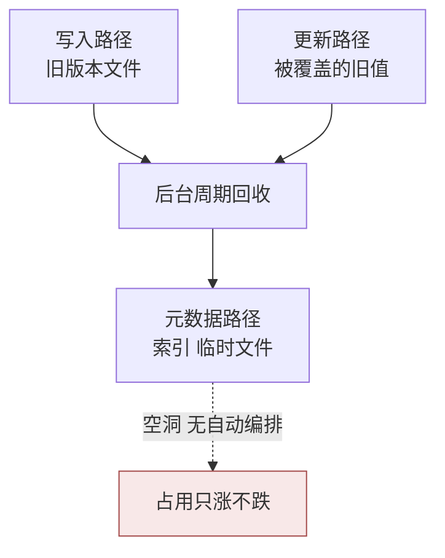
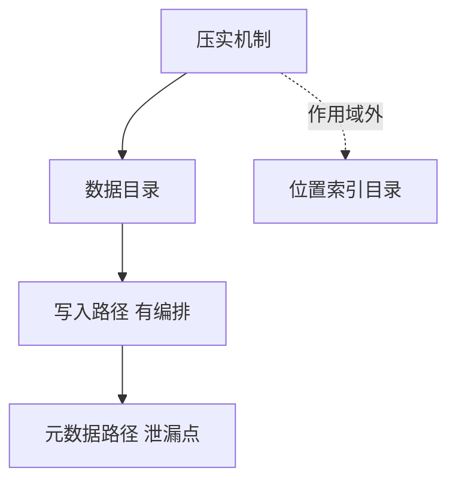
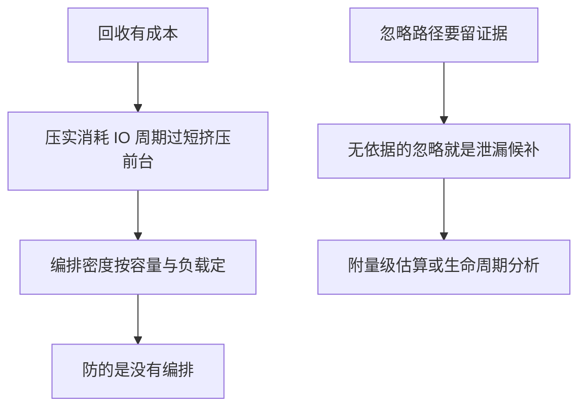

# 回收要遍历每个候选：清理任务不能只认一条入口

> **要点**：系统里产生"可回收空间"的路径通常不止一条，回收任务若只编排其中一条入口，未被入口覆盖的路径就持续累积垃圾——**本病例里位置索引目录的残留只由手动接口回收，后台周期任务从不碰它，于是占用只涨不跌**。

## 要解决的问题

存储系统里的"空间回收"通常被理解成一件事，实际是两个变量相乘：**垃圾在哪产生**（写入、更新、删除各自的残留）× **回收从哪进入**（后台任务、手动接口、重启钩子）。**像小区垃圾清运：垃圾从厨房、书房、院子多个地方产生，清运车却只跑一条路线，路线外的垃圾就一直堆着**。

**两者对不齐——垃圾有四条产生路径（写入、更新、删除、元数据），回收只编排了覆盖其中部分的入口——磁盘占用就变成一条只涨不跌的曲线**。Apache BookKeeper 的真实病例（上游修复 commit fbd33b56，可查）：bookie（BookKeeper 里负责存储的节点）的位置索引（记录每条数据在文件里的位置）随账本删除产生可回收的墓碑（已删除对象留下的占位标记），而**写入持续产生新的索引文件**；**后台回收任务只按周期压实数据日志文件，从不处理位置索引目录——删账本释放不了索引占用的空间，自动回收路径上没有任何编排覆盖它，唯一手段是运维手动调压实接口**。**长期运行的 bookie，磁盘被已删账本的索引残留吃掉——只要没人手动调接口，占用就不会回落**。

库内资源与容量域"只增不减的索引：墓碑靠压实才能变成空间"已从墓碑机制的角度解剖过这条缺陷，本篇把编排面的方法抽出来：**回收责任矩阵**——把"垃圾产生路径"与"回收入口"摆成一张表，矩阵里的空洞就是磁盘泄漏的候补。

## 怎么把垃圾路径列全：清单化为什么有效

**垃圾有多条产生路径，回收却只认一条入口，漏掉的就是漏洞**。竞争消费者的另一形态说明了问题：**消费者各自独立，一条消息只被处理一次，处理失败则回到队列——每条路径都要被覆盖到**。


*图源：Microsoft Learn 中文文档《竞争消费者模式》，CC BY 4.0，https://learn.microsoft.com/zh-cn/azure/architecture/patterns/competing-consumers。*

回收这件事在港口是日常作业的实景：集装箱码头的起重机队列每一条对应一种货流，装卸、转运、归位各走各的吊臂——没有哪台起重机"只认一条入口"就能吃下全码头货流。回收任务对垃圾产生路径同理：写入、更新、删除、元数据每条路径都要有编排接住：


*图源：Wikimedia Commons，H. Zell，CC BY-SA 3.0，https://commons.wikimedia.org/wiki/File:Container-Terminal_Bremerhaven_02.jpg。*


把"空间去哪了"的问题变成一张清单，是这类缺陷的通用解法：

**写入路径的残留**：**追加写产生新文件（entry log 即 BookKeeper 的只追加日志分段，SST 即 LSM（Log-Structured Merge，先把写入攒在内存里、再按批顺序落盘的存储结构）存储引擎的排序字符串表文件），旧文件在重写后被替换——替换产生的旧版本是否被回收？**

**更新路径的残留**：**键被覆盖时，旧值所在的空间要等压实（compaction，把多个文件合并、丢弃被覆盖版本的后台动作）才释放——压实的编排覆盖所有存这些键的子目录吗？（fbd33b56 的空洞：entry log 有压实编排，locations 目录没有）**。

**删除路径的残留**：**删除产生墓碑（已删标记），墓碑本身也是数据——墓碑被压实掉之后，空间才真正归还**。

**元数据路径的残留**：索引、清单、临时文件——"数据删了，索引还在"是本病例的直接形态；临时文件在崩溃后残留是相邻形态（见本库稳定性域的启动清理讨论）。



**图里那个空洞就是泄漏本身：写入、更新、删除三条路径都有后台入口接着，唯独元数据路径（本病例中的位置索引目录）没有自动编排**。**手动接口理论上能覆盖它，但那要靠运维记得去调——图中画成虚线，正说明它不是自动发生的**。

清单的产出是一张责任矩阵：每行一条产生路径，每列一个回收入口（后台周期、手动接口、启动清理），格子里填"这条路径的垃圾由这个入口负责回收吗"。**空格就是泄漏**——本病例的矩阵里，"位置索引残留"一行在"后台周期"一列是空的，垃圾只能等手动列的格子（运维记得调接口）被填上。

## 为什么单入口回收这么常见

回收编排长成"只认一条入口"有结构原因，理解原因才能在设计期防住：

**入口按回收机制命名，不按垃圾路径命名**：实现者的注意力在"压实这个机制怎么编排"（周期调 compaction），压实天然作用在某个目录上——机制视角覆盖了它作用域内的路径，作用域外的路径**很难进入实现者的视野**。

**回收正确性难测试**：**空间泄漏在测试环境通常不显现（数据量小、周期短），垃圾累积往往以月为单位——常规测试跑不出来，缺陷随生产数据量自然曝光**。

**"删了就没了"的直觉**：**删除操作在 API 层面成功，直觉上空间就该释放——墓碑、索引、压实延迟这些中间态只在机制细节里可见，直觉绕过了它们**。

**把两种回收编排画在一起，缺口的位置就清楚了：左边是机制视角，只覆盖自己作用域内的那一条；右边是路径视角，先把所有产生垃圾的路径列全，再逐条确认有没有回收**：



左边那张图里，位置索引目录连一条虚线都没有——它压根没被列进候选，而不是被判断为"不需要回收"。右边的做法把候选枚举出来，每条路径都要有明确答案，没有答案的就是缺口。

这与判断对象是否可回收时的思路一致：**可达性分析从根集合出发遍历整张引用图，而不是只看某几条已知路径**（参考中文资料：[《深入理解 Java 虚拟机》GC 垃圾回收机制](https://www.cnblogs.com/bokers/p/14903016.html)）。下图是可达性分析的一幅示意：绿色的 GC（Garbage Collection，垃圾回收：自动找出并释放不再使用的内存） ROOTS（Pulsar 客户端里的根句柄集合：所有账本句柄的源头） 是根集合，蓝色的对象从根出发可达因而存活，灰色的对象走不到根、因此被判为垃圾——只有从根出发把整张引用图遍历一遍，`locations` 目录这类"没有入口的残留"才会作为不可达对象被扫出来：


*图源：腾讯云开发者社区《JVM 垃圾回收机制》，CC BY-SA 4.0，https://cloud.tencent.com/developer/article/2045897。*

## 修完之后靠什么防住复发

**上游修复的动作是给矩阵空格补上回收：新增周期压实参数，后台任务按间隔（加随机延迟错峰）调用位置索引压实**。防线体系按此展开：

**回收责任矩阵进设计文档**：新存储特性实施时，"垃圾产生路径 × 回收入口"矩阵是设计文档的一部分——每条产生路径在后台入口有格子，或显式声明"此路径垃圾量可忽略，理由 X"。评审时矩阵有空格不通过。

**回收的对称性测试**：功能测试写"产生垃圾 → 触发回收 → 空间归还"的对称断言——写入测试顺带断言旧文件被删，删除测试顺带断言墓碑被压实。**对称性测试有可能把泄漏的发现时机从月级（生产）提前到分钟级CI（Continuous Integration，持续集成：代码合并后自动构建与测试）——前提是测试里真的造出了足够量的垃圾**。

**磁盘占用的成分监控**：磁盘水位之外，按目录成分（数据、索引、临时、日志）分别计量与告警——本病例的形态是总量缓涨、成分里索引一路走高，成分监控让"哪个目录在泄漏"直接可见。

**手动接口保留但降级为例外**：手动压实接口继续存在（应急工具），但它的存在要在监控里可见——手动触发的次数与频率是"自动回收有洞"的直接信号，常态化的手动操作就是缺陷报告。

## 这套说法在哪儿会失效

三条边界把「遍历清理」约束在可审计的范围内。

**回收有成本，不是越勤越好**：压实消耗 IO 与 CPU，周期过短挤压前台负载——回收间隔是权衡参数（本病例修复用随机延迟错峰），矩阵防的是"没有编排"，编排密度按容量与负载定。

**可忽略路径的判断要留证据**：声明"此路径垃圾可忽略"要附依据（量级估算、生命周期分析），无依据的忽略就是泄漏候补——矩阵允许空格，但空格必须写着理由。

**空间归还滞后是常态**：**压实延迟决定了删除到归还之间存在窗口，监控的告警阈值要给窗口留余量——把正常滞后当泄漏报警，告警会先于缺陷失去公信力**。

三条边界各自指向一种把防线用过头的做法：



**第二条是矩阵这个工具唯一的漏洞：矩阵允许空格，但空格必须写着理由**——声明"此路径垃圾可忽略"要附依据，无依据的忽略就是泄漏候补。第三条说的是监控的判断标准：压实延迟决定了删除到归还之间存在窗口，**阈值不给窗口留余量，告警就会先于缺陷失去公信力，而失去公信力的告警比没有告警更糟**。第一条把防线和使用强度分开：矩阵防的是"没有编排"，编排密度是另一件事，按容量与负载定，本病例修复用的随机延迟错峰就是调密度的手段。

## 怎么自己动手验证

可复现的验证路径：

1. 产生垃圾：**批量创建账本、写入数据、删除账本，循环多轮**；
2. 未修复基线（正常状态下的指标水平、用来对比异常）：**观察 locations 目录占用随轮次单调增长、后台回收不触碰该目录——捕获泄漏**；
3. 修复后重跑：**同一负载下，位置索引占用随周期压实回落并稳定在水位（队列或资源的当前占用程度）内**；
4. 断言锚点：**每条产生路径的占用在后台回收运行后有界**；成分监控里无目录呈单调无界增长。

```text
负载 = 创建/写入/删除 × N 轮
有界断言 = 各目录占用回落至水位，索引不单调增长
观测断言 = 成分监控按目录计量
```

"垃圾必有归口"写成矩阵、矩阵格进测试，空间回收从"运维记得手动调"变成结构保证。验证时预期与实际的对照规则提前写明：**泄漏注入后各目录占用预期单调增长，对不上（占用有界）说明回收入口实际已覆盖该路径，矩阵要按真实行为修订**；**修复后占用预期回落至水位，对不上（持续增长）说明压实编排没生效或间隔过长，成分监控会指出具体目录**。

## 接着读哪几篇：同一缺陷的墓碑机制视角

- [[工程知识/缺陷分析：从个案到体系/资源与容量/只增不减的索引：墓碑靠压实才能变成空间]] —— 同一缺陷的墓碑机制视角
- [[工程知识/缺陷分析：从个案到体系/资源与容量/案例六：容量与泄漏——连接泄漏和 SST 堆积]] —— 泄漏家族的案例侧写：句柄（程序持有的资源引用标识）与文件两代
- [[工程知识/数据系统：在并发与故障中保存事实/事务与存储/存储引擎的两大路线：B树与LSM的写读取舍]] —— 压实机制的存储引擎背景
- [[工程知识/性能工程：从用户等待到资源瓶颈/存储与网络/存储IO性能取决于访问模式、队列与持久化语义]] —— 回收密度权衡的 IO 成本依据
