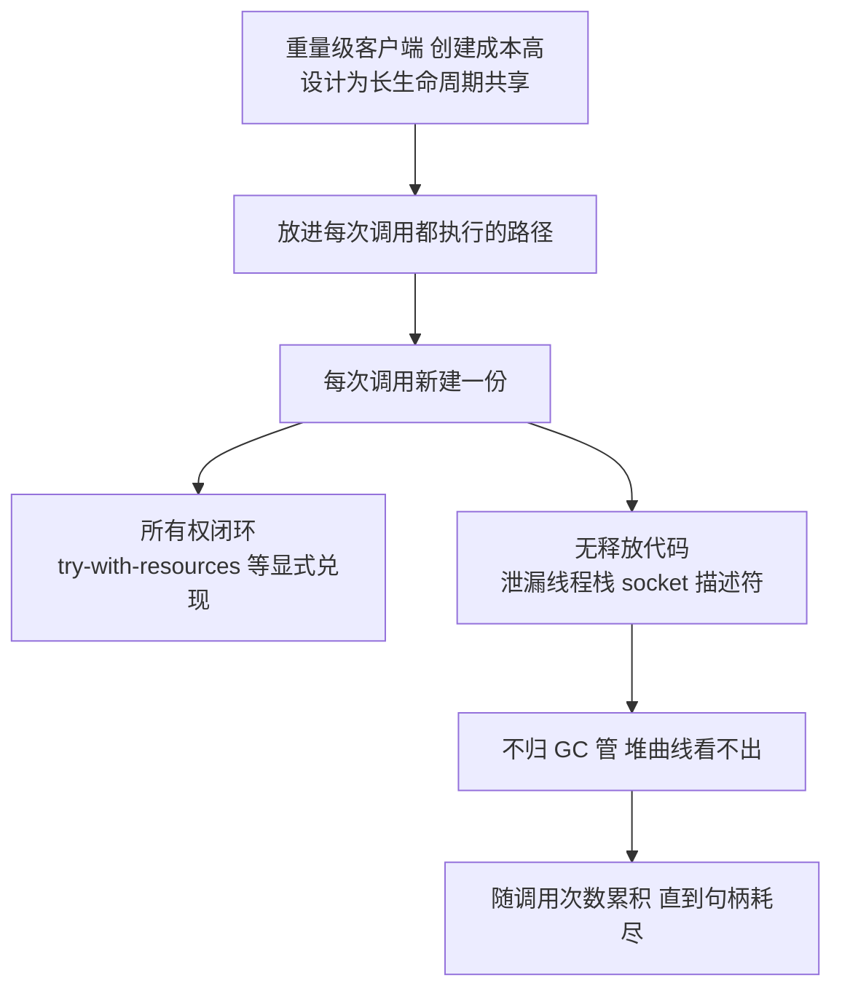
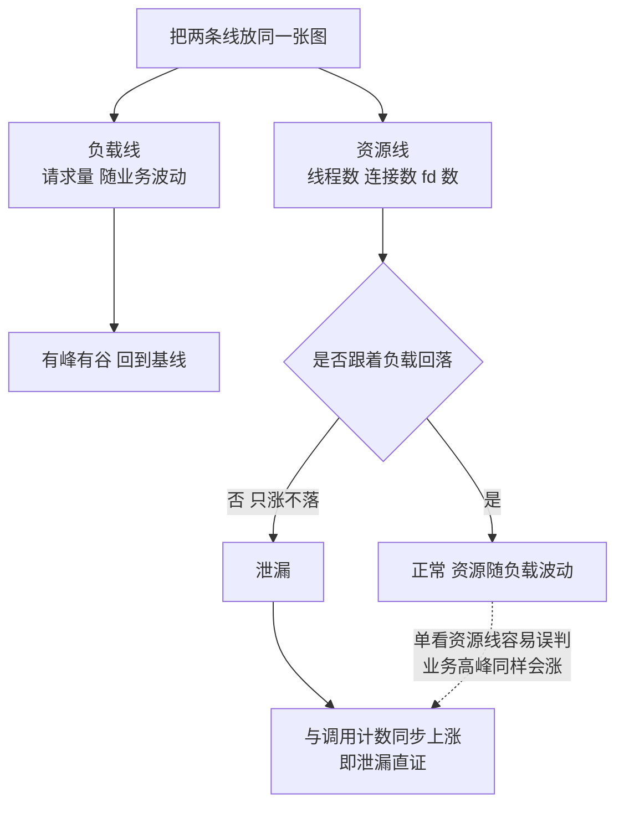

# 复用错误：同一对象重入使用路径，释放语义被重放

按"一次请求一个对象"设计的资源被反复新建，**新建与释放没有闭环**。读完这篇你能堵住**每调用一次泄漏一份**这类问题。

> **要点**：按"一次请求一个对象"设计的资源，被放进每次调用都执行的路径里反复新建；对象本身用完即弃没有错，错在新建与释放没有闭环——每调用一次，泄漏一份。

## 要解决的问题

客户端对象（数据库连接的轻量封装、RPC client、管理器句柄；RPC 即 Remote Procedure Call，远程过程调用：像调本地函数一样调远端服务）有一个**典型用法约定：创建成本高，按连接池（预先建好连接反复取用、省去反复握手建连的开销）或长生命周期持有**。**这个约定在代码里没有强制力——构造函数谁都能调**。当一段按"工具函数"思路写的代码在每次调用里新建一个客户端、用完不关，**约定就被打破了：每次调用泄漏一份线程、连接、文件句柄（程序持有的资源引用标识）**。

Apache BookKeeper 的一个真实缺陷（上游修复 commit 47c3fc37，可查）就是这个形态：开启 HTTP 管理接口后，**"删除账本"接口的每次调用内部新建一个 BookKeeper 客户端对象，用完从不关闭；每调用一次，客户端持有的线程池（预先建好一组线程反复取用、避免频繁创建销毁）与网络连接就泄漏一份**。**运维批量清理账本时反复调用接口，线程与连接随调用次数累积，最终耗尽句柄，服务不可用，只能重启**。同样的问题还出现在 DistributedLog 命名空间的流删除与枚举路径上——**三处独立的代码，同一个疏漏**。

单次调用视角下一切都对：**对象创建成功、操作完成、接口返回成功**。**缺陷只累积在时间轴上**，典型的高危点正是**管理接口、清理脚本、定时任务这类低频但会被反复触发的路径**。

## 它是怎么做到的：所有权没有随调用栈闭环

释放语义被重放，本质是**同一个对象被两个地方当成自己的**。要防住，得有一个**明确的「已归还」状态：归还之后再次使用应当直接失败**，而不是**悄悄继续——这与断路器在打开状态下直接拒绝调用是同一个思路**。


泄漏累积在时间轴上，单次调用看不到：



**释放之后对象还在被指向，是所有权断裂的内存侧形态**。维基教科书经典的悬垂指针示意里，Dangling Pointer 与第一个 Pointer 指向同一个位置，而**那个位置上的对象已被删除**——第二个持有者浑然不觉地使用一块已经释放的内存，**「同一对象重入使用路径」的病根与这是同一枚硬币的两面：所有权没有随释放一起闭环，使用方不知道对象已经走完生命周期**：


*图源：Wikimedia Commons，公共领域，https://commons.wikimedia.org/wiki/File:Dangling_Pointer.svg。*


资源泄漏的本质可以用一句话刻画：**创建与释放的所有权没有闭环**。"每次调用新建一个客户端"的设计隐含所有权约定——**调用栈负责释放，栈帧退出时资源归还**。**这个约定需要代码显式兑现（try-with-resources、defer、RAII（Resource Acquisition Is Initialization，资源获取即初始化：对象生命周期绑定资源释放）），它不会自动发生**。

按一次性设计的实物是一次性筷子：拆开就用、用完就扔，生命周期一次一换——没人会把一次性筷子洗了留到下一餐，它整套设计都建立在"单次使用"的前提上：


*图源：同上（Wikimedia Commons），作者 Solomon203。*

重型客户端对象恰好相反：**它按"重复使用"设计（连接池、长生命周期持有），却被人当成一次性筷子在每次调用里现拆现用、用完不回收**。**一次性筷子扔进垃圾桶无所谓；没有回收机制的重型对象每次"用完即弃"，扔掉的都是整套餐具，筷子只是其中一件——线程、连接、文件句柄随调用次数一份份沉淀**。

三个因素让闭环容易断在管理路径上。

### 工具函数背了什么历史包袱

好比庙会上的临时摊位，收摊时把垃圾随手一丢没关系（进程跑完就退出，泄漏无所谓）；这个摊位后来搬进了常设商场，**随手丢垃圾的习惯没改（所有权代码没跟着变），通道一年年被占满**。**管理接口常从一次性脚本演化而来，脚本语境里"进程跑完就退出，泄漏无所谓"成立；函数被搬进长生命周期服务后，语境变了，所有权代码没有跟着变**。比喻到「搬进商场没改习惯」为止。

### 为什么这个对象看起来很轻

一个客户端包装对象在 Java 堆上确实不大，**泄漏的观感被堆内存曲线掩盖**；**真正累积的是它持有的原生资源——线程栈、socket、文件描述符（进程打开文件的编号句柄）**，这些**不归 GC（垃圾回收：运行时自动找出不再使用的内存并回收）管，也不进堆直方图（把数值按区间分桶统计、看分布形态）的前几名**。

### 触发频率低为什么反而更危险

管理接口不是热路径，几百次调用才见分晓。**压测覆盖不到，监控看到的是"缓慢上涨的线程数"，直到触顶**。

三因素共同的解法方向只有一个：**把所有权写进结构，不靠作者记得**。

## 修完之后靠什么防住复发

**上游修复把三处泄漏点全部改成 try-with-resources——语句块结束即完成关闭，所有权随语法结构闭环**。**这个动作背后的防线值得逐条记下**。

**语言结构优先**：能用 **try-with-resources（Java）、`using`（C#）、RAII（C++）、`defer`（Go 的恢复路径）**的结构化方案，就不用手写 finally。**结构化方案把"忘记关闭"从可能变成语法错误级别的困难**。

**新建客户端是告警级味道**：在长生命周期服务里，**业务路径上出现"每次调用 new 一个重型客户端"直接按坏味道评审**。判据：**对象是否持有线程、连接、文件句柄中的任何一种——持有任何一种即属重型，需要明确的所有权归属（池、单例、或调用栈内闭环）**。

池化正是所有权归属的标准形态。微软 Azure 隔舱模式文档里的这张图画的即是健康形态——每个工作负载通过专属连接池访问服务，连接在池内长生命周期复用、按负载伸缩，与"每次调用新建即弃"形成直接对照：


*图源：Microsoft Azure 架构模式，Bulkhead pattern，CC BY 4.0，https://learn.microsoft.com/en-us/azure/architecture/patterns/bulkhead。*

**接口内部不藏所有权转移**：管理接口的实现如果需要临时客户端，**所有权要写在方法签名能看出来的地方（返回的资源要关、传入的资源不关）**。**藏在实现里的所有权转移是最难审查的泄漏源**。

**泄漏哨兵（持续探测故障并触发切换的守护进程）指标**：**线程数、连接数、fd 数按"应随负载波动、不随调用次数单调"检查**。**管理接口的调用计数与资源占用放同一张图，两条线同步上涨就是泄漏直证**。

判据是两条曲线的相对关系，单看任何一条都判断不了：



**右侧那句是关键：业务高峰时资源线本来就会上涨，只看它分不清是正常波动还是泄漏**。**判据在"回不回落"——负载降回去之后资源线不跟着降，才是泄漏**。**堆内存曲线在这件事上帮不上忙，因为泄漏的是线程栈、socket、文件描述符这些不归垃圾回收管的东西**。

## 这套说法在哪儿会失效

**try-with-resources 的嵌套释放顺序**：**多个资源的关闭顺序与声明相反**，依赖顺序的释放（先关会话再关连接）要**检查声明顺序**——**结构化方案解决"忘记"，不自动解决"顺序"**。

**关闭异常不能掩盖业务异常**：try-with-resources 里业务代码抛 A、关闭抛 B 时，**B 作为 suppressed 附加在 A 上，主异常保留**。自写 finally 时手动捕获关闭异常再抛业务的，**别把 B 顶掉 A——诊断时业务异常才是主线**。

**池化对象不适用本条**：**从池里借的对象归还即可，"用完关闭"反而破坏池**。防线判据按所有权归属走：**池拥有的对象借还配对，调用栈拥有的对象创建释放配对**。**两套纪律别混用——对池化对象调 close 是常见的反向错误**。

## 怎么自己动手验证

可复现的验证路径：

1. **调用循环**：对管理接口（或任意被怀疑的路径）连续调用 N 次（N 取 500 到 5000），**每次调用前后采样（只采集一部分数据以控制记录开销）线程数、连接数、fd 数**；
2. **断言恒定**：**采样值在调用结束后回到基线（正常状态下的指标水平、用来对比异常），不随 N 单调增长**；
3. **修复前基线**：**未修复版本跑同一循环，记录增长率作为缺陷证据**；
4. **哨兵测试**：把**"调用 N 次资源恒定"写成回归测试，任何新引入的泄漏路径当场红**。

```text
循环 N 次调用 → 线程/连接/fd 采样回到基线
哨兵 = 采样值不随调用次数单调上涨
```

fd 与线程采样用系统级命令（`ls /proc/<pid>/fd | wc -l`、线程 dump）就能完成，**不需要任何插桩**。**预期与实际的对账就是验证本身：N 次调用后采样值回到基线，说明所有权闭环成立**；对不上则**按"创建点 - 释放点"的差集找缺口**。**防线的代价与收益同样直白：try-with-resources 是零运行时成本的结构约束，换来的是"忘记关闭"从线上事故降级为编译期习惯**，**泄漏哨兵多采几个数，换来资源曲线异常在触顶之前数天可见**。

## 接着读哪几篇：泄漏的通用排查路径

- [[工程知识/缺陷分析：从个案到体系/资源与容量/资源泄漏的三段式排查法：预筛确认与归因]] —— 泄漏的通用排查路径
- [[工程知识/缺陷分析：从个案到体系/资源与容量/案例六：容量与泄漏——连接泄漏和 SST 堆积]] —— 同一上游缺陷的案例侧写
- [[工程知识/后端系统：在并发、失败与变化中维持服务/任务与并发/任务生命周期必须覆盖进程、日志、超时与清理]] —— 资源生命周期的框架性讨论
- [[工程知识/缺陷分析：从个案到体系/并发/案例二十：关闭之后还有人在用——生命周期的时序竞态]] —— 关闭时机的另一类错误
- [[工程知识/缺陷分析：从个案到体系/复现与回归/内存错误的检测要靠影子内存：红区、悬垂隔离与代价账.md]] —— 本篇讲的悬垂访问正是 ASan 隔离区用 fd 标记扣住的那类错误，检测侧的射程与代价账在那篇对齐