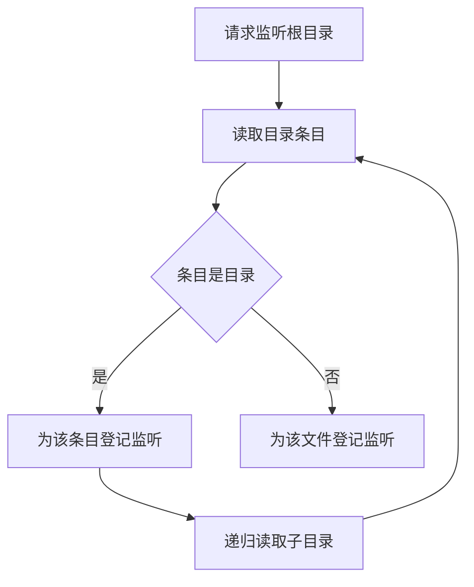
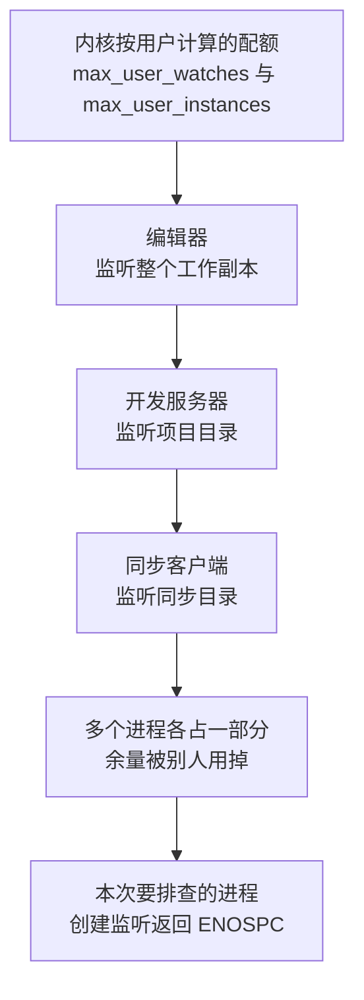

# 文件监视器数量失控：递归监听与上限裁剪

给一个目录树加上「文件变化就重新执行」的能力，最直接的做法是递归监听整棵树。这个做法用在含成千上万个条目的工作副本上会立刻暴露代价：**进程的句柄（程序持有的资源引用标识）数量与常驻内存一起上涨，涨到某一步开始出现创建失败，而失败位置在树的深处，报错信息看不出是哪一层**。

## 要解决的问题

递归监听的实际成本由树中的条目数量决定。内核提供的监听接口只登记单个路径，递归语义由用户态（普通程序运行的低权限受限状态）库模拟：遍历这棵树，为每个条目各建一个监听，并在新条目出现时补建。**监视器数量因此与条目数量同一个数量级；「监听了几个根目录」这个数字与它没有关系，一个根目录也能产生上万个监听**。

三个后果连着来，见下图：

- **句柄与原生内存随条目数量线性增长**，工作副本越大开销越高。
- 内核侧有按用户计算的上限，**越过之后创建失败并返回 `ENOSPC`，失败点取决于遍历顺序**。
- **条目数量是外部输入**：依赖目录、构建产物、缓存目录都会重新出现，**启动时正常不代表运行中一直正常**。

## 它是怎么做到的：递归怎么被模拟出来

递归语义由用户态模拟，代价落在一个专门的中间层上——这一点与「把公共能力卸到网关（站在客户端与后端服务之间的入口层，集中处理路由、鉴权与协议转换）」同构：能力本身不复杂，复杂的是它替每个调用方各做一遍，量随调用方数量线性增长。


*图源：Microsoft Learn 中文文档，CC BY 4.0，https://learn.microsoft.com/zh-cn/azure/architecture/patterns/gateway-offloading。*




内核接口每次只登记一个路径。用户态库要做递归，只能自己走一遍目录树逐个登记，文件与子目录都要各建一个；为了覆盖运行期间新建的条目，还要在收到「目录创建」事件时对新目录再登记一次。**这条补建链路正是数量失控的入口：依赖安装一次，条目数量可以翻几倍**。

裁剪参数的价值在此处体现。一个「最多监听多少个条目」的上限参数，只有作用在每个条目各判断一次的位置才能封顶数量；若它只在遍历根目录时判断一次，对条目数量的增长毫无约束。**差别不在数值，在判断发生的位置——只对根目录判断一次，等于给「监听了几个根目录」设限，而真正的数量来自条目**。


- **忽略规则带来数量级的下降**。把依赖目录、构建产物、版本控制目录排除，**常见的仓库能从数千个条目降到数十个**。忽略掉的目录内部变化不可见，**需要与定期全量扫描配合，否则会漏掉变更**。
- **创建失败只在创建时刻出现一次**。之后的运行不再报错，表现为「某些条目的变化一直没有被响应」，**与「本来就没有变化」无法区分，这是它难查的原因**。
- **监听器创建与释放不配对会累积**。配置变更后重建监听时若不先释放旧的，**数量会跨重启累加**。
- **内核上限对定期扫描没有约束力**。改成扫描条目时间戳就不占用监听名额，代价是**变化发现延迟与全量扫描开销**。

为什么数量问题总是到运行中期才暴露：**条目数量不是代码里的常量，它是工作副本的实际状态**。一次依赖安装、一次构建、一次缓存写入都会改变它，而这些动作发生在进程启动之后。**启动时的自检因此只能证明「此刻没超」，证明不了「运行中不会超」**——这正是启动自检要与运行时计数配合的原因，前者抓初始规模，后者抓增量。

补建链路还有一个容易忽略的性质：它是单向的。库会在收到「目录创建」事件时为新目录补登记，却不会因为目录被删除而立即回收对应的监听名额——回收依赖关闭或显式取消。反复安装与清理依赖的场景下，**这个不对称会让实际数量高于当前条目数量**。

### 边界
- 内核上限的约束面：**只限监听名额，不限定期扫描**——用扫描换监听时，容量问题转化成发现延迟与扫描开销。
- 忽略规则的盲区：数量降下来的代价是**被忽略目录内部变化不可见**，**必须有定期全量扫描兜底**。
- 两条机制各自的失效形态都只在出事时可见：**创建失败只在创建时刻报一次，不配对的累积要跨重启才显形——验证不能依赖运行期报错**。
### 验证


先确认内核对监听资源的预算还有余量。这里有两个独立的上限，任一耗尽都会让创建立即失败：


*图源：Linux man（Unix 手册页命令）-pages 项目 inotify(7)，https://man7.org/linux/man-pages/man7/inotify.7.html，手册原文整理排版截图。*

```bash
cat /proc/sys/fs/inotify/max_user_instances
cat /proc/sys/fs/inotify/max_user_watches
find /proc/*/fd -lname anon_inode:inotify 2>/dev/null | wc -l
```

第一条是每个用户可创建的 inotify 实例数上限，第二条是可登记的 watch 条目数上限，第三条给出当前已创建的实例数。实例数接近上限时创建立刻返回 `ENOSPC`；watch 条目总数接近上限时同样如此，只是条目总数要遍历 `/proc/<pid>/fdinfo/<fd>` 统计 `inotify wd:` 的行数才能得到。**预算是每个用户共享的，同一台机器上其他进程建得越多，留给本次复现的余量越少**。

上限是按用户算的，不是按进程算的。同一账户下所有进程的监听都从同一个池子里取：



按用户记账的口径决定了：同一账户下别的进程多占一批，留给本次排查的余量就被吃掉，而这部分消耗不由被排查的进程决定，**所以"上次还好好的"不能作为判断依据**——别的进程多占一批不由本次排查的进程决定，按用户统计才看得出余量被谁用了。三个内核参数的作用与默认值参考中文资料：[Vite 故障排除·官方中文文档](https://vite.org.cn/guide/troubleshooting)、[Linux inotify 机制详解](http://www.hqwc.cn/a/1157120.html)、[Linux 中的 inotify 是什么](https://svtter.cn/p/linux-%E4%B8%AD%E7%9A%84-inotify-%E6%98%AF%E4%BB%80%E4%B9%88)。

Vite 团队在一篇中文故障排除文档里把这个坑讲得最直白：编辑器、开发服务器各自递归监听整个工作副本，条目一多就越过内核上限，报错原文与两条调参命令如下。


*图源：Vite 官方中文文档故障排除页（vite.org.cn）页面截图，Vite 文档以 CC BY 4.0 许可发布。*

预算有余量之后，造一棵含数千个空目录的树，用递归监听跑起来，再对照资源计数：

```bash
mkdir -p "$HOME/treedemo" && for i in $(seq 1 3000); do mkdir -p "$HOME/treedemo/d$i"; done
node -e 'require("fs").watch(process.env.HOME+"/treedemo",{recursive:true},()=>{});setInterval(()=>{const c={};for(const x of process.getActiveResourcesInfo())c[x]=(c[x]||0)+1;console.log(c)},1000)'
```

**预期**是文件监听那一类资源的计数（不同运行时版本下可能显示为 `FSWatcher` 或 `FSEventWrap`）**随条目数量同向上涨**。加上忽略规则或改成非递归监听后重跑，**计数应当回到个位数**。**对不上**说明监听数量并不由条目数量决定，**需要检查实现是否做了合并处理**。

### 影响与代价


- **条目数量成为启动开销的隐含上限**，工作副本一大就触发。
- 忽略规则换来数量级下降，代价是**这些目录内的变化需要靠定期扫描补上**。
- **上限参数只有放在正确的判断位置才有意义，放错位置等于没有**。
- **启动自检应当核对「实际登记的监听数量」与「预期数量」，两者差距过大时立刻告警**。

上限耗尽后的失败形态值得单独记一笔：**`ENOSPC` 只在创建监听的那一刻返回一次，此后的运行完全正常——没有异常、没有日志、没有重试**。表现是「某些目录的变化没有被响应」，而这与「这些目录本来就没有变化」在外部观察上无法区分。**排查因此不能依赖报错，只能主动比对「已登记数量」与「应登记数量」的差值**。

### 从什么地方做

1. **先数**：打印当前登记的监听数量与条目数量，**确认两者处于同一个数量级**。
2. **再加忽略**：把依赖目录、构建产物、缓存目录加入忽略，**重新计数**。
3. **再改策略**：条目数量依然很大时改用「根目录监听加定期全量扫描」的**混合策略**。
4. **补上自检**：启动时核对监听数量，**超出阈值就记录并告警**。

## 接着读哪几篇：同在缺陷分析里的相邻问题

- [[工程知识/性能工程：从用户等待到资源瓶颈/观测与诊断/进程内存异常：堆转储与句柄清单的现场诊断]] · [[工程知识/缺陷分析：从个案到体系/资源与容量/资源泄漏的三段式排查法：预筛确认与归因]] · [[工程知识/软件构建：让变化可以理解、验证与交付/开发工具/Linux调查先收集事实再改变状态]]
