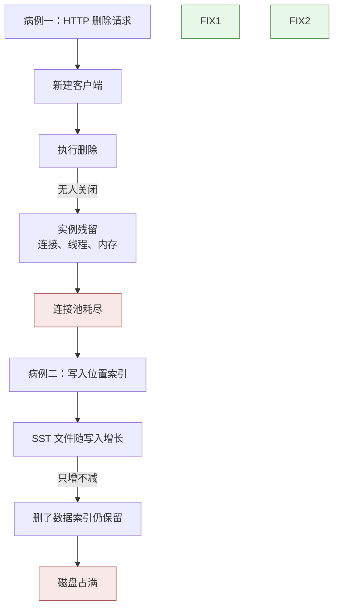
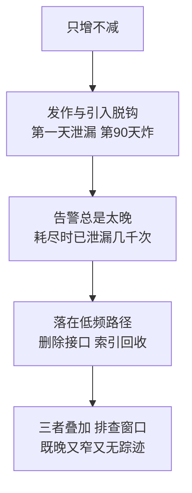
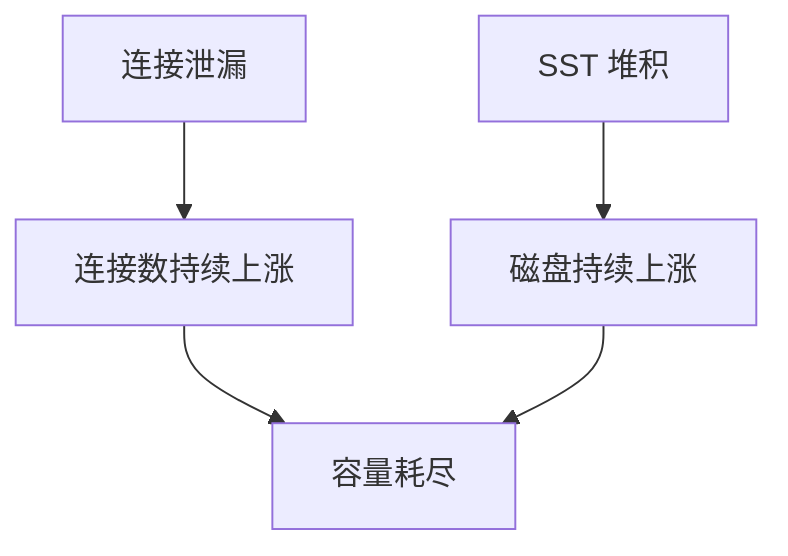

# 案例六：容量与泄漏——连接泄漏和 SST 堆积

## 要解决的问题：这一类缺陷为什么难以在常规测试与评审中暴露

本篇回答：这一类缺陷为什么难以在常规测试与评审中暴露，判定的入口是什么。

> **要点**：每次删除请求泄漏一个客户端、SST 文件从不自动清理——单日毫无异常，累积数月后致命。修法是把资源归还交给语言结构、把回收交给周期触发，而不是指望有人记得。

**容量类缺陷是慢刀子**：单次请求看不出任何问题，累积几个月之后一刀致命。像漏水的水表后阀——**每天多滴几毫升，账单要几个月后才显形**，查的时候阀门早锈在半开的位置。这一篇的两个病例都来自 **BookKeeper（分布式日志存储服务）**，都在**长期运行**后才暴露——**一个是连接泄漏，一个是文件堆积**。它们共享同一条底层规律：**资源被创造出来的速度正常，被释放的速度出了问题，或者根本没有释放这一说**。

## 病例一：管理接口泄漏客户端（P0）

**背景**：BookKeeper 的 server **提供一套 HTTP 管理端点**，其中"删除账本"接口**每收到一次请求，就新建一个 BookKeeper 客户端去执行删除**。

**缺陷**：这个客户端**用完没有关闭**。**每次删除请求泄漏一个客户端实例**——**每个实例背后是连接、线程、内存**。单次请求毫无异样；长周期反复调用后，**服务端连接被耗尽，服务停摆**。

**机制**：资源的使用者（一次 HTTP 请求）和资源本身（客户端，带连接池和后台线程）**生命周期不匹配**。**请求结束，使用者消失了，资源还活着**——**没有人拥有它的关闭职责**。

**修复**（[上游 commit 47c3fc37](https://github.com/apache/bookkeeper/commit/47c3fc37a075b0bb991f8ecabb91415a04dcb1ec)）：改成 try-with-resources，让客户端**随请求结束自动释放**。修复没有加限流（限制单位时间内的请求量、超出部分拒绝或排队）、没有加缓存，就是把"资源归还"**这件事还给语言的结构去做**——**Java 的 try-with-resources 就是为这种场景设计的**。

来源：[腾讯云开发者社区《消息队列：听我解释，我真的不是只有Kafka！》](https://cloud.tencent.com.cn/developer/article/1866156)（CC 4.0 BY-SA）

来源：[博客园《TCP 三次握手和四次挥手图解（有限状态机）》](https://www.cnblogs.com/huansky/p/13951567.html)（CC 4.0 BY-SA）

## 病例二：SST 文件堆积（P0）

**背景**：**Bookie（BookKeeper 集群里负责存数据片段的服务实例）**启用 entry location（记录这份数据在哪些 Bookie 上存着的位置信息）存储后，**位置索引以 SST 文件形式写在 locations 目录**。**这些索引随数据的删除本应被回收**。

**缺陷**：locations 目录的 SST 文件**没有自动清理的逻辑**——删除数据后索引文件留着，**长期运行后占满磁盘，节点不可用**。

**机制**：和病例一不同，这里**清理逻辑缺失**，而不是通常意义上的「泄漏」。数据生命周期管理只写了"怎么写"，没写"怎么回收"——**回收需要周期性触发机制，而那个机制没有被实现**。

**修复**（[上游 commit fbd33b56](https://github.com/apache/bookkeeper/commit/fbd33b56210bc17965c2d4bf0d835c44c5d4836f)）：加入周期触发逻辑，**运维无需手动介入，SST 文件自动回收**。

**堆积的量级感可以看集装箱码头**：起重机背后的箱区一层层码上去，**卸船的速度永远快过疏运的速度**，堆场容量是按"流入 - 流出 = 余量"管理的。**SST（Sorted String Table，按 key 排好序后落盘的只读文件）** 目录缺了"流出"那一半方程，**箱区只进不出，堆场再大也有见底的一天**：

*图源：Wikimedia Commons，H. Zell，CC BY-SA 3.0，https://commons.wikimedia.org/wiki/File:Container-Terminal_Bremerhaven_02.jpg。*

**两个病例的失效方式相同，成因不同**：病例一是"用完没关"**（释放缺失）**，病例二是"没写回收"**（清理逻辑缺失）**。两处修复的共同点是不靠人的自觉——**一处交给语言结构，一处交给周期触发**。

索引以 SST 文件的形式写在 locations 目录，**文件随删除次数越攒越多**。**LSM（Log-Structured Merge，先把写入攒在内存里、再按批顺序落盘的存储结构）**类存储里这些文件的通用形态如下（RocksDB 官方文档图，借来看形态，不等于本病例的存储实现）：

图取自 [RocksDB 官方仓库 wiki「Leveled Compaction」](https://github.com/facebook/rocksdb/wiki/Leveled-Compaction)，1800×1174，Apache 2.0。本病例的堆积出在删除之后索引文件无人回收、周期清理逻辑缺失：**文件只增不减，磁盘占用单调上涨**。

## 为什么这一类比其他缺陷更难抓

**两个病例的失效现象一模一样**（都表现为只增不减），值得单独强调：

- **发作时间与引入时间完全脱钩**。**泄漏从第一天就在发生，第 90 天才炸**。等炸的时候，引入它的那次代码变更早被几百次提交埋住——**归因难度是所有家族里最高的**。
- **监控告警的位置总是太晚**。连接耗尽告警时，**泄漏已经发生了几千次**；**磁盘 90% 告警时，能追的踪迹只剩"增长曲线从哪天开始抬头的"**。
- **它惩罚的是"低频路径"**。**两个病例都发生在管理/维护路径上**——删除接口、位置索引回收。高频路径被反复测试，**低频路径恰恰是资源管理最容易漏的地方**。

三条麻烦都从"只增不减"这一个现象里长出来，且互为因果：

三条互相加重：**发作晚让现场消失，告警晚让可追的线索只剩曲线**，落在低频路径又意味着这条路径上本来就没有多少观测。三者叠加的结果是**排查窗口既晚又窄又无踪迹**——这也是为什么这一类在泄漏家族里归因难度最高。

## 上游是怎么修的

两个修复都指向同一个设计原则：**资源的释放不靠人的自觉，靠结构**。**try-with-resources 让"谁申请谁释放"由语言保证**；**周期触发逻辑让"该回收的会被回收"由系统保证**。手工清理脚本可以救急，但把回收建立在"有人记得跑脚本"上，**就是把缺陷延迟到下一次忘记**。

**泄漏要与实例计数对账**——反复调用删除账本的管理接口：**修复前客户端实例数单调增长直至连接耗尽**，**修复后每次请求结束即释放，实例数应回落基线**（正常状态下的指标水平、用来对比异常）；**与预期对不上，说明释放路径没有生效**。

## 这套说法在哪儿会失效，代价换来了什么教训

- **审查资源管理代码时，先画生命周期**：**谁创建、谁使用、谁负责关闭、异常路径上关不关**。**四个问题里答不出任何一个，就是缺陷**。
- **低频路径要有专属测试**。管理接口、恢复流程、后台清理——**这些路径的测试频率应该和它们的爆炸半径匹配**，而不是和触发频率匹配。
- **增长曲线是最早的告警**。连接数、文件数、句柄（程序持有的资源引用标识）数这些"只涨不跌"的指标，**斜率突变就是泄漏的签名**（用私钥对数据生成可验证的防篡改标记）——监控它们的变化趋势，**比监控绝对阈值早几周发现问题**。

病例一的累积过程画出来就是一条只升不降的线：

| 时间 | 事件 | 后果 |
| --- | --- | --- |
| 第 1 天 | 删除接口请求 #1 | 客户端实例 #1 泄漏 |
| 第 N 天 | 累计泄漏 #N | 连接池逐渐吃紧 |
| 第 M 天 | 连接耗尽 | 服务停摆 |

**单看任何一天的监控都是正常的**——这正是它靠绝对阈值抓不住的原因，也是"增长曲线是最早的告警"这条结论的依据。

- **修复之后要做长时间验证**。**泄漏类缺陷的复现周期以天计**，回归验证跑一遍不够，**要挂上趋势观察确认曲线真的平了**。

## 怎么自己动手验证

1. 上游对照：到 BookKeeper 的提交 47c3fc37 与 fbd33b56 里核对两处修复，**确认一处改为 try-with-resources 让客户端随请求自动释放、一处加入周期触发的 SST 文件回收逻辑**。
2. 连接泄漏复现：反复调用删除账本的 HTTP 管理接口，跟踪客户端实例数量与服务端连接数，**修复前每次请求泄漏一个实例**、数量单调增长直至连接耗尽，**修复后请求结束时实例被释放**。

3. 文件堆积复现：写入数据后删除，观察 locations 目录中 SST 文件的数量与磁盘占用，**修复前索引文件不被回收、占用随删除次数累积**，**修复后由周期任务自动回收**。
4. 低频路径核验：确认这两条路径在日常流量中调用频率低，**普通测试覆盖不到**，**需要长时间运行或针对性循环调用才能暴露**。

5. 断言锚点：资源数量与磁盘占用均有可跟踪的指标曲线，**增长趋势能在耗尽之前被观察到**，**释放动作由结构而非人工脚本保证**。

## 用了能拿到什么，要付什么代价

两个病例的表现不同，但都指向同一个结局——**只涨不降的占用**：

按资源的创建者、使用者、关闭者与异常路径逐项核对，换来的是**低频路径上的泄漏与清理缺失在评审阶段就能列出**，**连接数、文件数这类只涨不跌的指标成为最早的告警位置**。代价是个案的复现周期以天计，回归验证需要挂上趋势观察，**管理接口与后台清理这些路径的测试频率要按爆炸半径来安排**，触发频率管不了这件事。

## 接着读哪几篇：期望与现实的偏差

- [[工程知识/缺陷分析：从个案到体系/缺陷分析方法——三分离、判定树与五步法]]
- [[工程知识/缺陷分析：从个案到体系/稳定性/案例一：垃圾回收线程的终止——BookKeeper 磁盘写满]]
- [[工程知识/缺陷分析：从个案到体系/缺陷分析：从个案到体系——导读与开源地图]]
- [[工程知识/缺陷分析：从个案到体系/资源与容量/复用错误：同一对象重入使用路径，释放语义被重放]] —— 讲"所有权随调用栈闭环 + 泄漏哨兵（持续探测故障并触发切换的守护进程）指标"的通用纪律，是本病例修复动作背后的方法面
- [[工程知识/缺陷分析：从个案到体系/资源与容量/只增不减的索引：墓碑靠压实才能变成空间]] —— 讲"墓碑（删除标记，压实合并时才真正清除数据）兑现依赖压实编排"的机制与磁盘占用不变量，本病例 SST 堆积的近亲形态
- [[工程知识/性能工程：从用户等待到资源瓶颈/存储与网络/连接池的验证要看池内水位：活跃数、等待数与超时率三个水位计.md]] —— 连接泄漏在运行时的水位（队列或资源的当前占用程度）形态：活跃数只涨不降、借还配对缺口
- [[工程知识/缺陷分析：从个案到体系/硬件故障/空间回收要有对账表：引用登记让删除不漏不冤.md]] —— SST 类文件回收的对账体系：泄漏量与丢失量双指标
- SST 文件在 LSM 存储里扮演什么角色、为什么它会堆积——[[工程知识/数据系统：在并发与故障中保存事实/事务与存储/LSM树用写放大换取顺序写和可扩展性]]。
