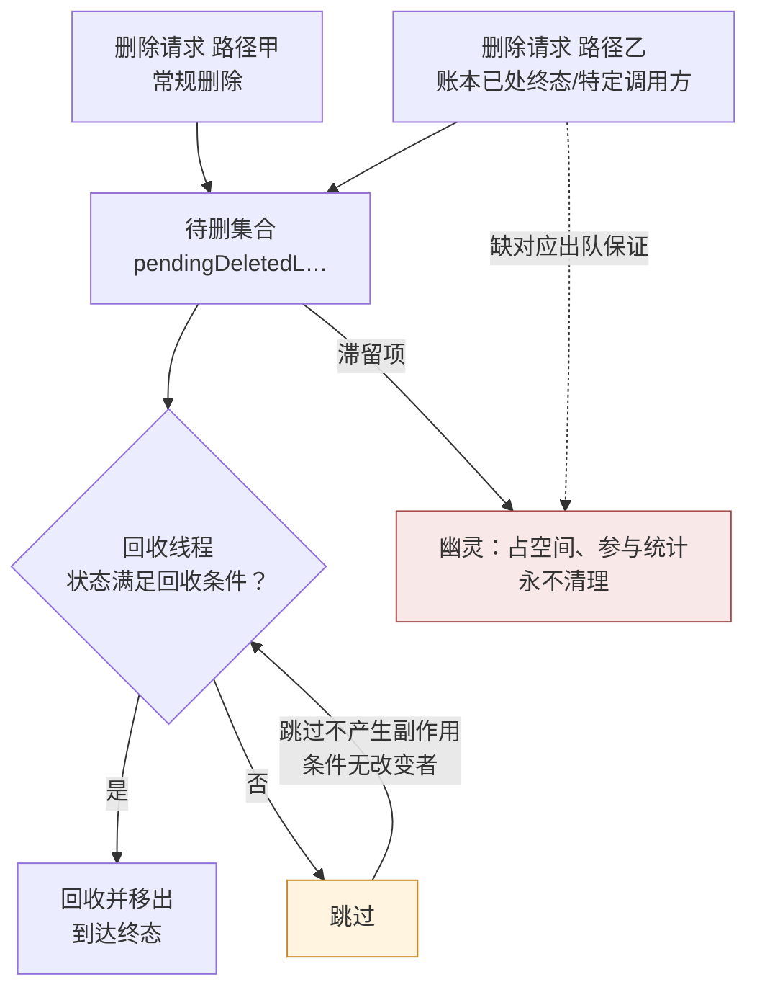
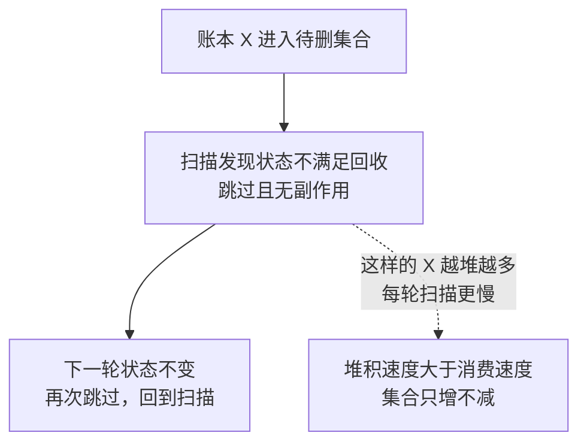

# 案例十七：删除列表里的幽灵——永不收敛的待删账本

**删除流程分步执行时，中间态需要有人负责推进到终态**（流程结束后不再变化的状态）。读完这篇你能挡住记录永远停在中间态这类不收敛。

> **要点**：当推进只在某一条路径上发生，走另一条路径进来的记录会永远停在中间态——**它们占用空间、参与统计，却再也不会被清理**。

删除一个东西，很少是一步完成的。分布式存储里尤其如此：**要先标记、再确认没有读者、再回收空间、最后清掉元数据**。这条链上每走一步，系统就处在一个**中间态**。中间态本身不是问题，**没有人为中间态的收敛负责**才是。Apache BookKeeper 的这个病例（已实际复现）展示了一条中间态如何变成永久状态。

## 账本进了待删集合为什么再没出来：要解决的问题

**项目**：Apache BookKeeper——为日志条目提供低延迟、可持久化写入的分布式日志存储服务，其账本删除要先放进待删集合再由回收线程清账，这个缓冲能否收敛构成本篇的问题。

账本（ledger）的删除在 BookKeeper 里不是单个动作。删除请求到达后，账本先被放进一个**待删除集合**（`pendingDeletedLedgers`），**等待垃圾回收线程在下一轮扫描中真正执行空间回收**；回收完成，元数据里的账本记录才被移除。

这个设计的用意是合理的：**删除请求可能高频到达，而空间回收是重操作，攒一批批量处理更划算**。**待删集合就是这两者之间的缓冲**。


*图源：翟佳《高可用、强一致、低延迟——BookKeeper 的存储实现》（DataFun/StreamNative），CC 4.0 BY-SA，https://www.cnblogs.com/datafuntalk/p/16505697.html。*

图上四个 Ledger 里有三个标着 closed、一个标着 open。删除请求处理的是那三个 closed 账本：它们不再接受写入，只剩元数据与磁盘空间等待回收。中间态就发生在这条从 closed 到彻底消失的路上。

缓冲带来一个隐含要求：**集合里的每一项最终都必须被取出并处理**。如果出现某条路径把账本放进集合、却没有对应的路径把它取出来，**这些账本就变成了幽灵**。



**两条入队路径汇入同一个集合，出队却只有一条且附带条件**。要害在中间那个回环（橙色）：**跳过动作不产生任何副作用**，**没有任何流程会去改变那个不成立的条件**，于是**每一轮都重新落到同一个判定上**。红色节点标的是这些项的最终下场——它们始终躺在待删集合里（图上 Q 指向 G 的那条边），**只是永远等不到出队**。

## 观察到的现象：哪些账本成了幽灵

**上游报告的现象**（[上游 commit 0d31202037](https://github.com/apache/bookkeeper/commit/0d31202037b8)，P1 即上游判定的第二高严重级）**是待删账本集合持续增长**，且其中的账本迟迟不被清理。

后果有两层。表层是**空间不释放**：账本被用户删除了，用户认为空间已经归还，**实际数据还躺在磁盘上**。深层是**元数据膨胀**：待删集合本身要参与持久化与统计，**它越长，扫描一轮的代价越大**（自我加速的机制见后文）。

这类问题的隐蔽之处在于，**从单个账本的视角看，一切正常**：**删除命令成功返回，账本状态显示为已删除**。要看出问题，必须从**集合的整体规模**这个视角看——而**监控通常不采集这个量**。

## 为什么拖下去会越来越重：慢性与自我加速

**它不报错。** **没有任何一条异常日志**。删除接口返回成功，回收线程每轮照常运行、照常处理队列里的其他项。**系统从内部视角看完全健康**。

**它自我加速。** 待删集合变长，导致每轮扫描需要遍历更多元素、比对更多元数据，单轮耗时增加；耗时增加意味着单位时间内能处理的账本变少；处理变少又让堆积更快。**这是一个没有自限性的正反馈**，**直到磁盘或内存先撑不住**。

**它污染判断。** **运维看到磁盘空间没有如期释放，第一反应是回收线程挂了**（例如 [[工程知识/缺陷分析：从个案到体系/稳定性/案例一：垃圾回收线程的终止——BookKeeper 磁盘写满]] 描述的那种终止）。**按这个方向排查会完全走错**——**线程活得好好的，每轮都在跑**，**只是它处理的对象里有一批永远轮不到**。

**它延迟暴露且归因困难。** **待删集合涨到引发故障，可能需要数周**。而要定位到"某条入队路径缺少对应的出队处理"这个根因，**得把多条代码路径逐一比对**，看哪些路径进了集合、哪些路径会触发消费。

## 幽灵的根子在哪：中间态要有人负责收敛

去掉所有专有名词，骨架是四步标记、确认、回收、清理。

> **分步流程产生的每一个中间态，都必须存在一条保证把它推进到终态的路径；如果入队路径多于出队路径，多出来的那部分会永久停留在中间态。**

这句话里"保证"两个字是核心。**每一条入队路径都要有对应的出队保证**，而不是"通常会有路径处理它"。**缺一条，就缺一类**。

可以把它看作一个守恒关系：**进入中间态的速率与离开中间态的速率在稳态**（系统运行指标进入平稳区间后的状态）下必须相等。**当离开的速率结构性低于进入的速率**（而不是暂时性低于），**系统里就会积累永久性的中间态**。

这类缺陷与资源泄漏是近亲，但有个重要区别：**泄漏通常是「拿了没还」，而这里是「标记了没做完」**。泄漏的对象往往可以直接找到持有着；中间态的幽灵**每一轮都会被扫描到、却永远不会被处理**——它并不隐蔽，恰恰相反，**它在队列里明晃晃地躺着**，只是没有任何一条路径会把它取走。

## 打个什么比方：挂号单掉进了缝隙

医院分诊台发挂号单，病人拿着单子去候诊区等叫号。医生每看完一个，从候诊区叫下一个。

正常情况，每张单子都会走到被叫号这一步。但假设有一类病人的单子上盖了个章，护士叫号时看到这个章就**翻过去叫下一个**——而盖章的原因是"等某个检查结果"，**可那个检查根本没人去做，章永远不会消失**。

这些病人会一直等下去。他们确实在候诊区（占用座位），护士确实每轮都在叫号（每轮都在工作），而且每轮都会看到他们、每轮都翻过去。**但因为那个章不会自己消失，永远不会轮到**。

随着等待的人变多，候诊区越来越挤，医生从诊室走到候诊区的时间变长，**叫号速度也跟着下降**。

要发现问题，你不能问任何一个病人"你被服务了吗"（他们会说"我在等，正常的"），也不能问医生（"我一直在叫号"）。你只能去看**有没有人等得远超正常时长**。

## 进集合容易出集合难在哪：入队与出队不对称


待删账本的两侧代码是回收线程与元数据管理。

```
bookkeeper-server/src/main/java/org/apache/bookkeeper/bookie/GarbageCollectorThread.java
bookkeeper-server/src/main/java/org/apache/bookkeeper/meta/LedgerManager.java
```

**待删账本集合由回收线程维护**，**账本元数据的读写经过** `LedgerManager`。

这类"元数据已标记删除、物理空间待回收"的分层结构在存储系统里很常见：SQLite（嵌入式单文件数据库）把整个存储分成接口层、SQL 命令处理、虚拟机、B-Tree、Pager、操作系统接口六层，删除一段数据只改动逻辑层（B-Tree 里的记录），物理页面由 Pager 层决定何时真正回收。层的划分带来一个直接后果：**逻辑层说"删好了"，物理层可能还留着**——中间态就活在这一段里。


*图源：SQLite 官方文档 Architecture of SQLite，https://www.sqlite.org/arch.html（公有领域）。*

问题的结构是这样的：**账本进入待删集合的路径不止一条**，但**触发消费的条件只覆盖其中一部分**。某些情况下（例如账本在元数据中的状态已经处于特定终态、或删除请求来自某些特定调用方），账本被加入集合，却**因为状态判断不成立而在后续扫描中被反复跳过**。

这个循环没有自限性——集合变长之后每一轮扫描更慢，处理得更少，堆积反而更快：



回收线程扫描时的那个「状态判断」，在 StreamNative 官方博文的机制图里有实物形态：Meta Store 里已经没有 Ledger 2 的元数据（只剩 1、3、8、9），三台 Bookie 上却各躺着一份 Ledger 2 的副本与 entry log；压缩检查器逐台核对「Ledger 2 是否仍存在」，答案全是否——这正是「元数据已删、磁盘数据待回收」中间态的结构，账本 X 就悬在这两层的缝隙里等那轮永远不会来的确认删除：


*图源：StreamNative 官方博客《A Deep Dive into the Topic Data Lifecycle in Apache Pulsar》。Meta Store=元数据存储（此处为 ZooKeeper），entry log file=条目日志文件，Ledgers: {1,2,3...}=该 Bookie 磁盘上仍存有账本清单，Check ledger2 exist?=核对账本 2 元数据是否仍存在。核对全为否之后才轮到磁盘删除——中间态就活在这段核对与删除之间的缝隙里。*


1. 账本 X 被加入 `pendingDeletedLedgers`。
2. 回收线程扫描到 X，检查其状态，判定"当前不满足回收条件"，跳过。
3. 下一轮再扫描到 X，状态没有任何变化（因为没有任何流程会去改变它），再次跳过。
4. 永远如此。

关键在第 2 步与第 3 步之间：**没有任何东西会改变 X 的状态**。**跳过动作本身不产生副作用，状态机就此停住**。**没有一条路径会推它前进，这已是永久中间态**，等待无从谈起。**日志上表现为「每轮都在正常跳过」**，与「暂时不满足条件」毫无区别。

上游修复的核心是让**清理动作不再依赖那个永远不成立的条件**，或者**为不满足条件的项提供一条明确的终结路径**（记录并移出待删集合），而不是无限期重试。

修复实物（上游 commit 0d31202037）正是一行出队操作：`removeDeletedLedgers()` 在元数据里删掉账本记录、计数加一之后，原先就此返回——待删集合里的这项从此没人记得；修复补上 `pendingDeletedLedgers.remove(ledgerId)`，**让「元数据已删」与「移出待删集合」同步发生**，**中间态就此有了终点**：


*图源：[Apache BookKeeper commit 0d31202037b8](https://github.com/apache/bookkeeper/commit/0d31202037b8)（PR #4525）的 commit 页 diff 截图。*

## 怎么发现：盯中间态存量还是流程存活

这类缺陷无法靠"流程是否运行"来判断，因为流程在运行。有效的观测点：

**监控中间态集合的存量与驻留时长分布。** 不看总量（总量上涨只是结果），看**最老的那一项待了多久**。一个健康的分步流程里，**任何一项的驻留时长都应有上界**。**出现远超出上界的老项，就是结构性卡住的证据**。

**对入队与出队分别计数。** **两个计数器长期不相等，差值即堆积速率**。这比看集合大小更早给出信号，因为**它在堆积还小的时候就能发现速率差**。

**为跳过动作打点。** 回收线程每次跳过一个待删项，记录跳过原因与该项的驻留时长。**同一个项被跳过 N 次以上，应当触发告警**——**重试是有意义的，无限重试不是**。

**定期做入队/出队对账。** 主动构造一批删除，验证它们是否在预期时间内走完全流程。**这是唯一能主动发现（而不是等故障暴露）的手段**。

## 修要在上游怎么修：给每个入口配出口

修复方向是补齐缺失的收敛保证：让清理逻辑在处理待删项时不因为不满足某个条件就无限期挂起，而是**要么处理、要么显式判定为无法处理并移出集合**（同时记录），**保证集合中的每一项都有终点**。

这里的设计取舍是：**"跳过并重试"在分布式系统里通常是正确的默认策略**（应对暂时性故障），但**它只在"条件会自行变化"时成立**。**当条件不会自行变化时，跳过重试就退化成永久挂起**。区分这两者的方法很简单——问一句：**这个条件由谁来改变？** **答不出具体的改变者，就不能用跳过重试**。

## 这套防法在哪儿会失效：边界与教训

- **中间态要有明确的收敛负责人。** 设计分步流程时，**为每一个中间态写明"谁负责把它推进到下一步，超时怎么办"**。
- **跳过重试的前提是条件会变。** **没有改变者的条件不适用重试策略，必须走终结路径**。
- **监控存量与驻留时长，不只监控流程存活。** **流程活着但对象卡住，是最容易漏掉的一种故障形态**。
- **入队路径与出队路径要成对审查。** **加一条新的入队路径时，同步确认出队侧是否已覆盖**。
- **"每轮都在正常跳过"与"卡死"在日志上无法区分**，**要靠计数与时长来分辨**。

## 接着读哪几篇：BookKeeper 磁盘写满

- [[工程知识/缺陷分析：从个案到体系/稳定性/案例一：垃圾回收线程的终止——BookKeeper 磁盘写满]]
- [[工程知识/缺陷分析：从个案到体系/正确性/案例十六：数据被自己人删掉——entry log 头里的假账]]
- [[工程知识/缺陷分析：从个案到体系/缺陷分析：从个案到体系——导读与开源地图]]
- [[工程知识/缺陷分析：从个案到体系/资源与容量/周期任务只进不出的集合：清理动作自己也要被清理]] —— 讲"完成即移除 + 空集合快路径 + 工作量守恒"的通用纪律，是本病例修复动作背后的方法面
- 后台任务的生命周期与清理责任——[[工程知识/后端系统：在并发、失败与变化中维持服务/任务与并发/任务生命周期必须覆盖进程、日志、超时与清理]]。
- 重试在什么条件下才有意义——[[工程知识/后端系统：在并发、失败与变化中维持服务/分布式可靠性/超时、重试与幂等共同定义调用语义]]。
