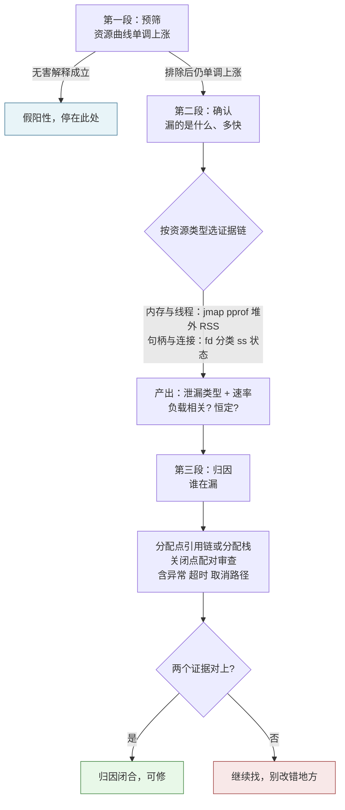
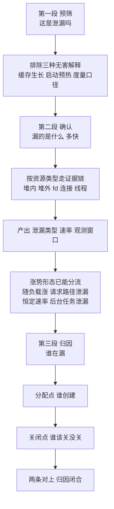

## 要解决的问题

内存缓慢上涨、句柄（程序持有的资源引用标识）数爬坡、连接数不降——**曲线像泄漏，但"像"到"是"之间隔着三道证明**：**真泄漏还是正常缓存生长**（要不要动）；**泄漏的是什么**（堆内、堆外、fd、连接、线程）；漏在哪里（**哪条代码路径没释放**）。**跳过证明直接重启，是这类问题的标准处置，也是标准复发方式**。三段式排查法的本质：**把"资源上涨"从运维症状翻译成代码级缺陷证据，每一段都有明确的产出物与判定标准，段与段之间是过滤器——预筛排除假阳性，确认锁定泄漏物与速率，归因拿到可修的代码位置**。

三段之间画成串联的过滤器，是因为每段的产出直接约束下一段：预筛排除假阳性省下 dump 开销，确认锁定的资源类型决定归因走哪条证据链。图里两个出口（假阳性、证据闭合）都是有结论地停止。

## 它是怎么做到的

泄漏在观测面板上的形态，比"某个数在涨"这句话具体得多——线程数按状态汇总的面板长这样：

图取自 [perfmatrix 的线程转储分析页](https://perfmatrix.com/thread-dump-analysis/)，945×598。面板把线程按状态与线程池（预先建好一组线程反复取用、避免频繁创建销毁）分组计数，**泄漏阶段的判据同一状态的数量随时间单调上涨且旧线程不回收**——这一条**只有看得到状态分布才判得出**，而不是"总数高"。

**第一段：预筛——这是泄漏吗**。**资源上涨有三种无害解释要先排除**。**缓存生长：设计如此**（LRU（Least Recently Used，最久未使用的先淘汰的缓存策略），未达上限前只涨不跌），查配置上限与命中率（请求直接从缓存拿到结果的比例）的联动（**涨的同时命中率不掉、达上限后走平，是缓存**；**无上限配置且持续线性涨，是嫌疑**）。**启动期预热**：冷启动（缓存或服务刚启动、还没有数据与连接的状态）阶段加载（JIT（Just-In-Time，即时编译：运行时把热点代码编译成机器码）、连接池建连、页面缓存），预热（上线前提前加载数据或建立连接，避免初期变慢）后走平即正常。**度量干扰**：容器视角的 RSS（Resident Set Size，进程当前占用的物理内存量）含共享页——page cache（页缓存：内核把读过的文件内容留在内存里加速下次访问）被计入记账，多进程共享内存被重复计量，**看 smaps 的 PSS**（Proportional Set Size：按共享库分摊后折算给本进程的内存口径）才是真实占用。**预筛的判定标准：稳态（系统运行指标进入平稳区间后的状态）负载下、排除设计性增长、度量口径正确（PSS 而非 RSS）之后仍单调上涨，才进第二段**。

**第二段：确认——漏的是什么、多快**。按资源类型走对应证据链。堆内（Java/Go/JS 运行时）：堆 dump 的对象直方图（jmap -histo、Go 的 pprof heap），**找"数量增长且 Retained Size**（这个对象被回收时能一并释放的内存总量）**占大头"的类型**（容器类、线程局部、监听器）。堆外（native）：**进程 RSS 减堆指标的差值走向**、malloc 级观测（jemalloc 的 prof、glibc 的 mtrace），Direct ByteBuffer 类要查运行时的 direct memory 统计。fd：**ls /proc/<pid>/fd 的分类统计**（socket 还是文件还是 eventfd（事件通知的文件描述符）、lsof（列出进程打开的文件与套接字的命令）的句柄类型分布）。连接：netstat（老的网络统计命令）/ss（查看套接字统计的命令）的状态分布——**ESTABLISHED 堆积说明连接建立后长期不释放**，**CLOSE-WAIT（被动关闭方等待本地关闭的状态）堆积说明对端已关而本端没调 close**，**直接指向代码里缺了关闭动作**。线程：线程转储（Java 的 jstack（打印 Java 线程堆栈的工具）、Go 的 goroutine 画像）按线程池分组计数，**同名线程堆积指向创建路径未收敛**，线程栈与 ThreadLocal 的内存随之滞留。**确认段的产出物：泄漏对象类型、泄漏速率（每小时涨多少）、以及一个可复现的观测窗口**（**涨势与负载正相关还是恒定速率**，两种形态指向不同根因：**负载相关=请求路径泄漏，恒定=后台任务泄漏**）。

连接证据链在机器上的样子——把 `ss -tan` 的状态列聚合计数，各状态是否堆积在这里一眼可判：

*图源：本机 `ss -tan` 真实输出聚合渲染（2026-09-27）。确认段对连接类泄漏的判据就是这一列：**TIME-WAIT 是主动关闭后的正常余波，会自行消退**；**要盯的是 CLOSE-WAIT 与 ESTABLISHED 的单调上涨且不回落**——**本机这份是健康形态，CLOSE-WAIT 为零**。*

**第三段：归因——谁在漏**。两条路。分配点归因（治本）：**泄漏对象"谁创建"的证据**——堆 dump 的引用链（**从 GC roots 到泄漏对象的最短路径，直指持有者**——GC roots 即垃圾回收的起点集合）、malloc profile 的分配栈、fd 的打开位置（/proc/<pid>/fdinfo 或 strace（跟踪进程系统调用的命令行工具）抓 open）。关闭点缺失归因（对照）：泄漏资源"该谁关"——**代码审查获取/释放的配对**：**异常路径、超时路径、取消路径是否都释放**；Java 的 try-with-resources（代码块结束时自动关闭资源）、Go 的 defer（关闭动作推迟到函数返回时执行）这类**语言级释放机制的覆盖面是否完整**。**两条路对照是归因的完备性检查：找到分配点（谁创建）与释放点（谁该关没关），两个证据对上，归因才算闭合**。

分配点归因在 MAT（Memory Analyzer Tool，Eclipse 的堆分析器）里的工作视图就是支配树——按「谁独占哪些对象」组织堆，通往大 Retained Size 的路径在树上直接可读：

*图源：[使用 Eclipse 内存分析器工具进行堆转储分析（javakk.com）](https://www.javakk.com/1285.html)，MAT 实测界面截图（2026-09-27 取）。**左列浅堆（Shallow Heap）与深堆（Retained Heap）的量级差就是归因线索**：main 线程自身只有 120B，却通过 DogShelter→HashSet→HashMap 的引用链独占 305MB——「**谁该为这块内存负责**」在树上自上而下读一遍即可完成闭合。*

两条路对照归因的另一种视角，是从堆转储的 Overview 入手——保留内存饼图先给出「最大的嫌疑对象」排序：

*图源：同上（[使用 Eclipse 内存分析器工具进行堆转储分析）。*

三段是三道收窄的门，每段都有明确的排除对象与产出物：

第二段拿到的不只是"漏了什么"：**涨势与负载是否相关已经能把根因分成两类**——**随负载涨的是请求路径在漏，恒定速率的是后台任务在漏**。**这个判断在第二段就能做，不必等到归因**。

## 它从哪儿来，要付什么代价

泄漏排查的归因阶段常遇到一个干扰：**并发消费者越多，资源曲线的噪声越大**。多个消费者并发处理同一队列时，**泄漏的线性增长被叠加的并发波动盖住**：

并发消费者越多，泄漏的线性增长越容易被叠加的并发波动盖住，噪声不压下去，后面就分不清是泄漏变快了还是并发变高了，所以**预筛阶段要先固定并发度，把这条噪声压下去**，再做归因。在并发度不可控的场景里，另一种做法是让外部角色来兜底——**监督者持续观察代理，失败就重启**，泄漏被重启掩盖但不再累积：

兜底不等于修复。**重启把泄漏的账藏起来了**，代价是**重启期间的处理窗口丢失**，以及**真正的原因永远查不到**。

资源泄漏排查的方法论沉淀在工具史里：上世纪八九十年代，Unix 的 lsof/strace 覆盖 fd 与系统调用层；2000 年代，Java 的堆转储分析从 jmap/jhat 演进到 MAT，后者借支配树——dominator tree 是按「谁独占哪些对象」组织的引用树，通往大 Retained Size 的路径都在这里把泄漏怀疑报告做成自动输出；Go 的 pprof 把分配画像做进运行时标准件；2012 年前后，Brendan Gregg 的 USE 方法（USE 即 Utilization-Saturation-Errors：利用率、饱和度、错误三个维度）给出资源检查的通用框架。

**三段之间的过滤器设计**：**每一段的产出是下一段的输入约束**——预筛排除假阳性省下 dump 的开销，确认锁定资源类型决定归因用哪条证据链，归因的两个证据闭合防止改错地方。跳段的代价具体可感：**不预筛直接 dump**，100G 堆的 dump 抓一小时、分析一小时，结论是**"缓存在长"**（白干）；不确认类型直接看代码，**堆外的泄漏改堆内逻辑（改错）**。代价：**dump 类手段本身是侵入性的**——STW（Stop-The-World：垃圾回收时暂停全部应用线程）、磁盘写、敏感数据写入磁盘；**生产上要先问能不能对影子实例或复现环境做**；归因到"该关没关"的代码路径后，**修复常牵扯生命周期设计**（不是补一行 close 能了：**连接池的归还语义、回调的注销时机、缓存的逐出钩子**），**修复成本在排查的十倍以上是常态**——这也是为什么归因段的两个证据闭合值得花时间：**改错地方的返工比排查本身更贵**。

## 这套说法在哪儿会失效

- **泄漏与洪泛的区分**：**曲线陡涨（分钟级翻倍）先怀疑突发负载或攻击**（洪泛、爬虫、重试风暴），走限流（控制单位时间放进来的请求数量，超过配额就拒绝）与过载保护路径，不是排查法射程。**排查法对付的是"慢性、单调、负载无关或弱相关"的上涨**。
- **native 泄漏的观测要运维配合**：**malloc profiling 需要预加载替代分配器**（jemalloc）或重启进程打开追踪选项（glibc 的 mtrace），**生产进程不能随便重启时，影子实例复现是替代路径**。**堆外泄漏是三段里证据最难拿的一段，预留时间**。
- **"修复后验证"要有基线（正常状态下的指标水平、用来对比异常）**：**修复上线后同负载下重测泄漏速率**（之前每小时涨 X，**修复后走平才算修好**）。**只看"没告警了"不算证据**——**告警阈值以上的涨势可能仍在，只是还没到**。
- **多语言混合进程（JNI（Java Native Interface，Java 调用本地代码的接口）、cgo、FFI（Foreign Function Interface，跨语言调用函数的接口））是归因地狱**：堆内工具看到 native 分配的黑盒，native 工具看到 VM（Virtual Machine，虚拟机）管理的内存乱飞。**这类进程的泄漏排查预算按三倍估**，**优先在边界层**（JNI 全局引用统计、cgo 的 pprof 标签）找接口泄漏。

## 怎么自己动手验证

- **三段全流程实验**：写一个故意泄漏的程序（**每请求创建一个不关闭的连接/不释放的 buffer**），部署后跑三段：预筛（排除缓存：无上限配置、恒速上涨）→ 确认（/proc fd 分类：socket 持续涨）→ 归因（fdinfo/strace 定位到泄漏函数）。**预期：三段各拿到对应证据**，**最终代码位置与实际埋的泄漏点一致**。**方法可用性的端到端验证**。
- **假阳性预筛实验**：同样的观测窗口跑一个正常 LRU 缓存服务。**预期：预筛段的上限配置与走平形态把它挡在第二段外，不触发 dump**。**过滤器有效性的证据**。
- **CLOSE-WAIT对照实验**：两个版本的服务端（正确 close vs 忘记 close），客户端主动断开。**预期：忘记版的 ss 输出 CLOSE-WAIT 单调堆积，正确版无残留**。**连接泄漏的形态特征可复现**。

## 接着读哪几篇：连接泄漏与池化设计互为因果：泄漏让池耗尽

- [[工程知识/缺陷分析：从个案到体系/复现与回归/从复现到回归——让证据走完一圈.md]] —— 三段式的每段产出都是证据链一环，复现到回归的方法论母篇
- [[工程知识/后端系统：在并发、失败与变化中维持服务/服务设计/连接池的容量数学：池大小与排队等待的权衡.md]] —— 连接泄漏与池化设计互为因果：泄漏让池耗尽，池的指标是泄漏的第一观测面
- [[工程知识/性能工程：从用户等待到资源瓶颈/观测与诊断/性能问题定位.md]] —— 资源上涨是 USE 方法的 Utilization 维度，定位方法共用证据素养
- [[工程知识/缺陷分析：从个案到体系/资源与容量/复用错误：同一对象重入使用路径，释放语义被重放.md]] —— 泄漏的预防侧：所有权随调用栈闭环与哨兵（持续探测故障并触发切换的守护进程）指标
- [[工程知识/性能工程：从用户等待到资源瓶颈/观测与诊断/进程内存异常：堆转储与句柄清单的现场诊断.md]] —— 预筛的下一层：把增长分摊到堆对象、原生句柄与映射文件
- [[工程知识/缺陷分析：从个案到体系/资源与容量/文件监视器数量失控：递归监听与上限裁剪.md]] —— 句柄型增长的典型来源：递归监听随目录数量放大
