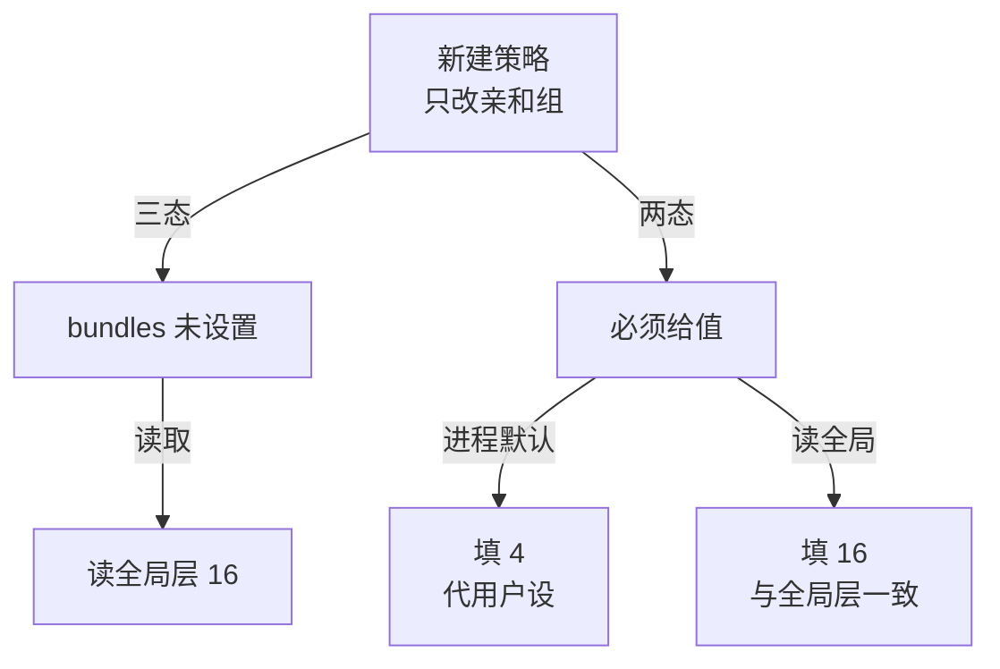
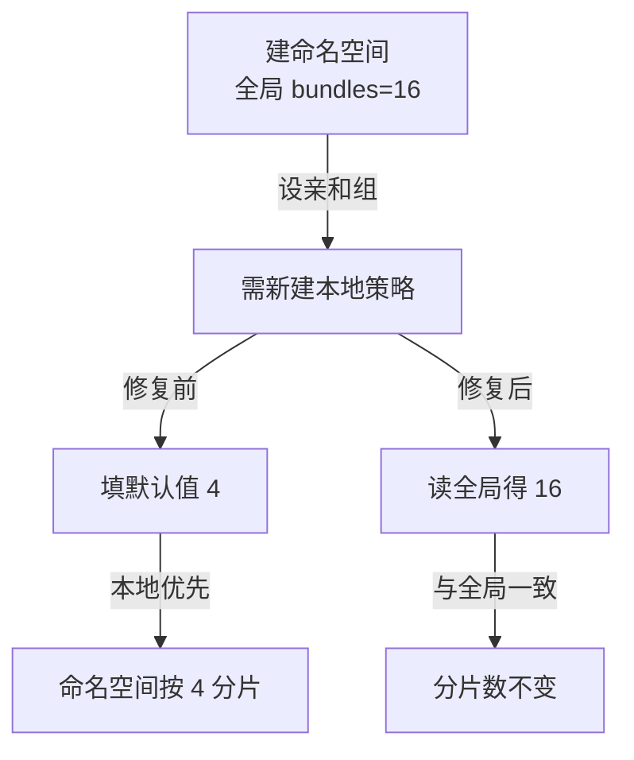
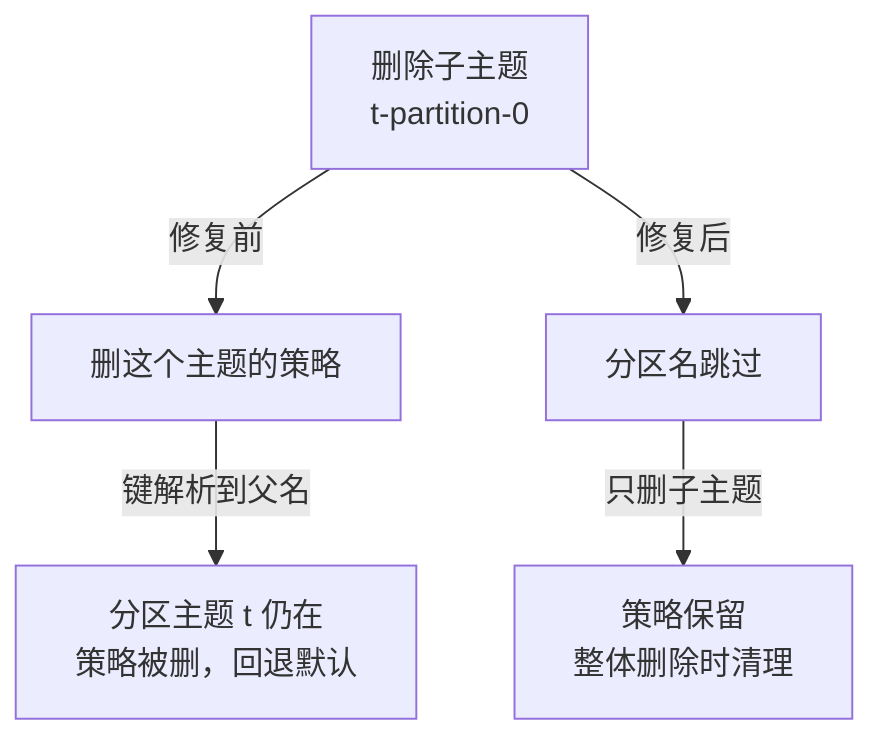

# 案例三十五：后写的覆盖了先写的——策略层级的覆盖顺序

多层级配置里，一次只想改局部某一项的写入，会盖住用户在上层写下的那个。读完这篇你能说清层级覆盖顺序，不再让设置悄悄失效。

> **要点**：多层级配置里，一次只想改局部某一项的写入，顺手把同一层里另一项填成了默认值。局部层一旦有了这个值，它就盖住用户在上层写下的那个，用户当初的设置随之失效。

**配置分层的意义是"局部覆盖全局"**。实现它需要一个明确的覆盖规则，以及同样重要的一条：**一次写入只应该写它要改的那一项，写进它该写的那一层**。本篇要解决的问题是：违反后一条会发生什么，以及**为什么它表现为"配置改了没用"这种最难排查的形态**。下面这组来自 Apache Pulsar（分布式消息队列）的病例给出了答案。

## 这个案例发生在什么场景

**项目**：Apache Pulsar——分布式的消息与流处理平台。它的命名空间策略分全局与本地两层存放，本地层的一次写入盖住了全局层的哪一项，就是本篇追问的事。

先交代几个词。**broker 是 Pulsar 的服务节点**；主题（topic）是消息读写的逻辑通道，生产者往里发消息、消费者从里取消息；**命名空间（namespace）是一组主题的管理单位**；bundle 是命名空间被切成的分片（把数据按规则切开存到不同节点），**broker 按 bundle 认领负载**，一个命名空间切成多少个 bundle 在创建时指定。

命名空间的策略（policies）分两层存放：全局策略（`Policies`）放在跨集群共享的配置存储里，本地策略（`LocalPolicies`）放在每个集群自己的元数据存储里。bundle 数量两层都有一份，broker 读取时**本地策略里的优先**，**本地没有才用全局的**。本地策略里还有 bookie 亲和组（把某个命名空间的数据固定写到指定的一组存储节点）这类只对本集群有意义的项。

**分层本身没有问题**。问题出在**写入时把哪些值写进了哪一层**。

## 要解决的到底是什么：设置本地策略的一项，覆盖了另一项


来源：[米诺之家《池化技术》](https://www.iminho.me/wiki/docs/note-architect/note-architect-1f7cll3q657or)（署名）

上游报告的现象是：**设置本地策略时，覆盖了创建命名空间时传入的 bundle 数量**，P1 是本系列给缺陷定的严重等级、P0 最高，来源见 [上游 commit 462c7176](https://github.com/apache/pulsar/commit/462c7176a68c0c14a4df75a1858891fdf30e4e5c) 与 PR（Pull Request，拉取请求：请求把我的分支改动合入主干） #24762。

具体机制是：**用户创建命名空间时指定了 16 个 bundle，这个 16 写进全局策略**。此时本地策略还不存在。随后用户给这个命名空间设置 bookie 亲和组——这是本地策略里的一项，代码要先构造一个本地策略对象再写入。**本地策略对象的 bundles 字段是必填的**，构造时代码用 **broker 的默认 bundle 数**（配置项 `defaultNumberOfNamespaceBundles`，缺省 4）填了这一格，**用户传的 16 没有被读出来**。

后果随即产生：本地策略里出现 `bundles = 4`，本地优先，这个命名空间从此按 4 个 bundle 分片。**用户只想设一个亲和组，bundle 数量被改了；全局策略里的 16 还在，但再也不生效**。

相关的另一条（[commit 0650d927](https://github.com/apache/pulsar/commit/0650d927f7a9e248693ffa4de08f1bb6ae99268f)，PR #24350，P1）是删除方向的同族问题。这里的分区主题指一个逻辑主题拆成 N 个分区，每个分区是一个名字带 `-partition-N` 后缀的子主题；它的主题策略存在分区主题名下，供所有分区共用。

**删除任何一个子主题时，代码顺手删了"这个主题的策略"**，而子主题的策略解析到的正是分区主题的那一份。于是**子主题一删，仍然存在的分区主题策略没了**：**共享的那份策略被连带删掉**。这是**删除操作的作用范围超出了它应该作用的对象**。

两条合起来是同一族：**一次写操作影响了它不该影响的项**——**一条是填了不该由它填的字段，一条是删了不属于它的记录**。


来源：[CSDN @bjmayor《图解分布式事务模式》](https://bjmayor.blog.csdn.net/article/details/154004146)（CC 4.0 BY-SA）


## 为什么是问题：它表现为"配置无效"

**所有组件都工作正常。** **写入成功了（值确实存下了），读取成功了（读到了值），覆盖逻辑正确（本地优先）**。**没有任何一方报错**。**唯一的问题是用户想要的效果没出现**。

**排查时每一步都对。** 用户反馈的原始问题大致是"建的是 16 个 bundle，怎么只剩 4 个"。**运维去看全局策略：16。去看生效值：4。去看覆盖逻辑：本地优先，正确**。每一步单独检查都是对的，**错误藏在一个没人会想到要问的问题里**：**本地策略里的 bundles 是谁写的？**

**它污染的是持久状态。** **错误的值一旦写进本地策略，就一直在那里**。用户后来手动把本地策略的 bundles 改回 16，这次也能生效，但**下一个命名空间设置亲和组时同样的事再发生一遍**。

**影响是长期的、跨版本的。** **设置亲和组可能发生在建命名空间几个月之后**，分片数变化的时间点与"我设了一次亲和组"这件事隔得很远，**没人会把两者联系起来**。这与 [[工程知识/缺陷分析：从个案到体系/配置/案例三十八：没有写下来的版本——默认值里的迁移债|案例三十八]] 的结构相似：**缺陷的引入与爆发相隔很远，而现场缺少解释所需的信息**。

**删除侧的问题同样隐蔽。** 删掉一个子主题，分区主题的策略跟着没了——分区主题仍在运行，只是策略回退到命名空间级默认值。没有报错，**表现为"配置莫名其妙丢了"**。

## 本质是什么：覆盖需要有"未设置"这个可区分的状态

配置文件里的问题肉眼就能看到一半：下面这张 YAML（缩进层级的配置文件格式）配置截图里，每一项都写着值——**看不出哪一项是运维显式设置的、哪一项是模板自动补的默认值**。**文件本身不携带这个区分**，读文件的人与加载它的程序同样分辨不出。


> 图：Home Assistant 的 configuration.yaml 示例，来自 [Wikimedia Commons](https://commons.wikimedia.org/wiki/File:Example_configuration.yaml_for_Home_Assistant.png)，CC BY-SA 3.0，作者 JohnWilliamDoe。

把这份策略写进本层的行为抽象出来，骨架是：

> **分层配置要求每一层能表达"我没有设置这一项"；当本层的写入方为一个它并不打算改的项填了值，本层就从"未设置"变成了"显式设置为该值"——此后上层的那个值再也无法传导下来。**

这条骨架的核心概念是**三态**：一个配置项在某一层有三个可能状态。

- **未设置**（本层不管这项，向上层要）。
- **显式设置为值 X**（本层覆盖，用 X）。
- （可选）**显式设置为空**（本层明确禁用）。

`LocalPolicies` 的 bundles 字段只有两态：**它是一个必填字段，构造对象时必须给值**。于是"我只想改亲和组，bundles 不归我管"**这个意图在两态数据结构里没有位置**，写入方只能填一个值——**填了默认值，就等于替用户做了一次他没有做过的设置**。三态与两态的差别在写入那一刻显形：



**两态结构把选择权硬塞给写入方**，写入方选对来源才能与三态等价；修复走的是"选全局层现值"这条路，数据结构没有改。

第二个要点是**必填字段的来源**。**字段既然必须有值，就要问这个值该从哪来**。**正确来源是同一个命名空间在上层已经写下的值**（全局策略里的 16）；**错误来源是与这个命名空间无关的进程级默认值**。**修复改的正是来源**：**构造本地策略时先读全局策略的 bundles，读不到才退回默认值**。

第三个要点是**删除的作用域**。子主题的策略解析到分区主题名下，是为了让所有分区共用一份策略；同一条解析规则用在删除上，就变成删任何一个分区都删掉共用的那一份。**读取时的共享关系，到删除时必须重新审视**。

## 打个什么比方：填表时把空格填成了模板默认值

公司有两级制度：集团制度（上层）与部门细则（本层）。部门细则里没写的，按集团制度执行。

某个部门第一次立细则，只想规定一条"加班餐补标准"。细则表格是集团统一模板，每一格都要填，不能留空。**办事员把餐补那一格认真填了，其余格子照模板上印的默认值抄了一遍**——其中一格是"年假天数"，模板默认 5 天，而集团制度里给这个部门定的是 15 天。

**细则发出去，部门年假从 15 天变成了 5 天**。**没有人改过年假，集团制度里的 15 天也还在，只是部门细则优先**。半年后有人发现休假天数不对，去查集团制度：15 天，没错；查部门细则：5 天，白纸黑字；问当初立细则的人，他只记得自己改的是餐补。

正确的做法有两种：**表格允许留空**，**留空表示"按集团执行"**；或者表格必须填满时，**每一格都从集团制度里抄这个部门的现值**，而不是抄模板上的默认值。

## 它是怎么做到的：必填字段被默认值填了

改动位于 admin 接口的命名空间与主题两处实现：

```
pulsar-broker/src/main/java/org/apache/pulsar/broker/admin/impl/NamespacesBase.java
pulsar-broker/src/main/java/org/apache/pulsar/broker/admin/impl/PersistentTopicsBase.java
pulsar-broker/src/main/java/org/apache/pulsar/broker/service/AbstractTopic.java
pulsar-broker/src/main/java/org/apache/pulsar/broker/service/BrokerService.java
```

写入侧在 `NamespacesBase` 里设置 bookie 亲和组与命名空间反亲和组（声明哪些命名空间不要落在同一个 broker 上）的两个方法。它们的写法是"**读出本地策略，没有就新建一个，改掉自己那一项，写回去**"。修复前新建的那一步：

```java
// 修复前：本地策略不存在时，用 broker 默认 bundle 数构造
.orElseGet(() -> new LocalPolicies(getBundles(config().getDefaultNumberOfNamespaceBundles()), ...))

// 修复后：先读全局策略里这个命名空间的 bundles，读不到才退回默认
private CompletableFuture<BundlesData> getDefaultBundleDataAsync() {
    return namespaceResources().getPoliciesAsync(namespaceName).thenApply(
        optionalPolicies -> optionalPolicies.isPresent() ? optionalPolicies.get().bundles
                : getBundles(config().getDefaultNumberOfNamespaceBundles()));
}
```

这一行在本地策略已经存在时不会执行，所以**它只在"第一次给这个命名空间写本地策略"时发作**——**正是用户第一次设亲和组的那一刻**。同一次"设亲和组"在两种来源下各走到哪里：



**那个 4 没有任何人有意设置**，**它是必填字段被模板默认值填上的结果**；**把来源换成同一个命名空间在上层写下的值之后**，**写入本地层只动了用户要改的那一项**。

删除侧在 `AbstractTopic.deleteTopicPolicies` 与 `BrokerService` 的主题删除链上。修复前，每个子主题删除时都调用一次"删除这个主题的策略"；主题策略的存放键是分区主题名，**子主题名会被解析到它的父名，于是这一步删掉的是分区主题的策略**。**修复加了一条判断**：主题名带分区后缀（`TopicName.isPartitioned()`）时跳过策略删除；分区主题整体被删除时，在 `PersistentTopicsBase` 的删除链末尾统一删一次策略。两种作用域各删掉什么：



多删的那份来自读取时的解析规则：子主题的策略键指向父名，删除也就落在父名上；修复把"分区名"识别出来，**让策略的删除只跟随分区主题整体的生命周期**。

## 怎么发现：检查"未设置"是否可区分

**在序列化格式里保留三态。** 用 `Optional`、显式标志位、或者"字段是否存在"来区分"未设置"与"设置为某值"。**格式里只有两态时，每个必填字段都是一处潜在的覆盖点**。

**审查所有"读-建-改-写"策略的路径。** 这是高危模式：读本层，没有就新建，改一项，写回。**逐个确认新建对象时每个必填字段的值从哪来**——来自同一实体的上层现值，还是来自进程级默认值。**这是发现本类缺陷最直接的手段**。

**测试分层覆盖的真正语义。** 测试不能只验证"设置后读取到的值正确"，必须验证：**在本层写入一项之后，本层其他项是否仍然跟随上层**。上游修复附带的测试 `NamespacesV2Test.testSetBookieAffinityGroupWithExistBundlePolicies` 正是这么做的：建 10 个 bundle 的命名空间，设一次亲和组，再断言 bundle 数还是 10（本文正文用 16 举例，数字不同，做法一样）。

**为策略项记录来源。** **每一项的当前值来自哪一层**（本地 / 全局 / 进程默认）。**这个信息在排查时价值极大**——它能直接回答"为什么我建的 16 个变成了 4 个"。

**删除操作要显式声明作用域。** 删除一个对象时，**明确列出会连带删除什么**。共享记录（几个子对象共用一份）的删除要跟随共享它的那个整体，**测试要覆盖"父对象仍在，子对象被删"这种不对称情形**。

## 上游怎么修

两处修复分别针对写入与删除：写入时新建本地策略，bundles 从全局策略读同一个命名空间的现值；删除时子主题不再触碰主题策略，策略随分区主题整体删除时清理一次。

修复没有改变"本地优先"这条覆盖规则——它是对的，保持不变。**该修的是"本地层里那个值是谁填的"，"哪一层优先"这条规则本身没有错**。这个区分很重要：看到"我建的 16 个变成 4 个"时，直觉反应可能是去动优先级，**那会把系统改错**。

预期第一次设置亲和组之后 bundle 数量保持创建时的 16；修复前的行为是变成 broker 默认的 4，与预期对不上，必填字段的来源用错了。

## 这套说法在哪儿会失效，代价换来了什么教训

- **"未设置"必须是可区分的状态。** **必填字段没有这个状态，写入方就被迫替用户做设置**。
- **必填字段的值要从同一实体的权威来源取。** **进程级默认值只配做最后的退路**。
- **"读-建-改-写"是高危模式。** **新建对象那一步会把所有必填字段一次填满，逐个问来源**。
- **测试要覆盖"改本层一项后其他项是否跟随上层"。** **只测"设置后能读到"测不出这类缺陷**。
- **"改了不生效"先查值从哪一层来、由谁写入，不要急着调优先级。**
- **读取时的共享关系，删除时要重新审视。** **几个子对象共用一份记录，删除只能跟随整体**。


## 怎么自己动手验证

1. 上游对照：到 Pulsar 的提交 462c7176 里核对 `NamespacesBase` 两处 `orElseGet(() -> new LocalPolicies(...))` 的 bundles 来源从 `getDefaultNumberOfNamespaceBundles` 改为 `getDefaultBundleDataAsync()`；到 0650d927 里核对 `AbstractTopic.deleteTopicPolicies` 与 `BrokerService` 对 `isPartitioned()` 的跳过，以及 `PersistentTopicsBase` 整体删除链里新增的 `deleteTopicPoliciesAsync`。
2. 机制复现（写入侧）：创建 16 个 bundle 的命名空间，设置一次 bookie 亲和组，再查 bundle 数；**修复前变成 broker 默认值，修复后仍是 16**。
3. 机制复现（删除侧）：给分区主题设一条主题策略，删除其中一个子主题，检查分区主题的策略；**修复前被连带删除并回退默认值，修复后保留**。
4. 边界核验：**本地策略已存在时重复设置亲和组，确认 bundles 不变**；读本地策略的序列化（把内存对象转成可存储或传输的字节格式的过程）结果，确认 bundles 字段永远有值，**数据结构上表达不出"未设置"**。
5. 断言锚点：**新建本地策略时每个字段的来源留档**，**删除操作的对象范围有明确边界定义**。

## 接着读哪几篇：同在缺陷分析里的相邻问题

- 配置与特性开关分离部署与发布——[[工程知识/软件构建：让变化可以理解、验证与交付/测试与交付/配置与特性开关分离部署与发布]]。
- API 接口约定定义输入输出与演进边界——[[工程知识/后端系统：在并发、失败与变化中维持服务/服务设计/API接口约定定义输入输出和演进边界]]。
- [[工程知识/缺陷分析：从个案到体系/配置/案例三十八：没有写下来的版本——默认值里的迁移债]] 讲另一种"默认值替用户做了决定"的配置缺陷，那里的默认值来自外部库。
- [[工程知识/缺陷分析：从个案到体系/正确性/案例三十四：省下的句柄与多出的删除——一次优化引入的回归]] 讲删除作用范围失控的另一种形态。
- 导读见 [[工程知识/缺陷分析：从个案到体系/缺陷分析：从个案到体系——导读与开源地图]]。
